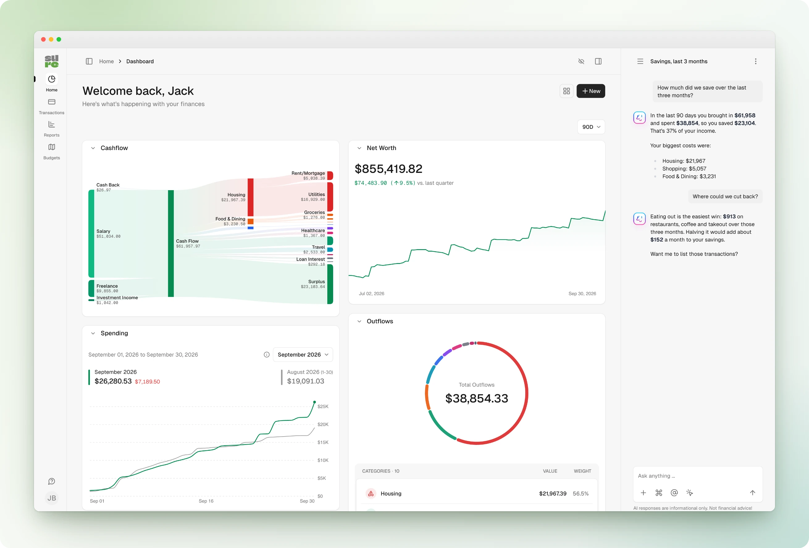

Multi-part series branch https://github.com/we-promise/sure/tree/refactor/ai-plumbing

---

### Plan

- https://github.com/we-promise/sure/pull/4440 plan documents.

---

### Review order for Milestone 1

Milestone 1 lands as one change: 2c to 2f on this branch plus the #5504 stack, about 500 files. Review it by risk, not by PR.

1. **The plan's decisions.** Every call made by @josh-sanders is a proposal, open to evidence. Scrutinise them first; the code follows from them.
   - [ai-plumbing-redesign.md](https://github.com/josh-sanders/sure/blob/proposal/v0.8-ai-workflow-reviews/docs/proposals/v0.8/ai-plumbing-redesign.md): search for "@josh-sanders". Start with §5.4 (failover and down marks), §18 (breaking changes), §19 (delivery) and §20 (not in scope).
   - The [decisions register](https://github.com/josh-sanders/sure/blob/proposal/v0.8-ai-workflow-reviews/docs/proposals/v0.8/rubyllm-spike-report.md#decisions-register) in the RubyLLM spike report: the evidence for and against each product decision.
   - The per-PR plans in the [same folder](https://github.com/josh-sanders/sure/tree/proposal/v0.8-ai-workflow-reviews/docs/proposals/v0.8) (`pr-2a` to `pr-2f`, `ai-generation-windowing.md`), each with its own decisions.
2. **The upgrade path.** What an existing install meets on deploy:
   - migrations, including dropping `family_documents.account_statement_id`;
   - jobs queued on `main` whose classes are deleted;
   - the old AI ENV and settings read by `Ai::LegacyEnvConfig` (redesign §4.5), including which vector store is chosen;
   - an AI run without family consent fails rather than skipping.
3. **The core.** `Ai::Generation` (§8.1), the transports (§7), the router and down marks (§5), `Ai::Result` and `Ai::Error` (§9), usage and instrumentation (§10).
4. **Each feature through its real entry point.** Bill setup, rule categorization and merchant detection, merchant enhancement, PDF import, document search, Jev, the health probes.
5. **The tests.** `test/architecture` (the invariants, redesign §17) and the recorded evals.

Fixes found in review land as commits on one PR at the top of the stack.

---

### Milestone 1 - December 2026

- https://github.com/we-promise/sure/pull/4773 2a. Transports and instrumentation.
- https://github.com/we-promise/sure/pull/4774 2b. Routing and consent.
- https://github.com/we-promise/sure/pull/4775 2c. Generations.
- https://github.com/we-promise/sure/pull/5209 CI: refuse provider HTTP outside live tests. 
- https://github.com/we-promise/sure/pull/4765 2d. Jev and shadow runs. 
- https://github.com/we-promise/sure/pull/3422 bridge the statement vault to search and let tools read a file. 
- https://github.com/we-promise/sure/pull/4771 2e. PDF import and document search. merged on branch
- https://github.com/we-promise/sure/pull/4892 2f. ruby_llm 2.2.3, Jev via OpenRouter, review fixes.
- https://github.com/we-promise/sure/stack/5504 stack
  - https://github.com/we-promise/sure/pull/5501 3a. Capsule, shared state and probes off the web thread.
  - https://github.com/we-promise/sure/pull/5502 Tidying 3a and dead code from 2a-2f; review fixes.
  - https://github.com/we-promise/sure/pull/5503 Trimming tests to a few comprehensive AI tests per layer.
  - https://github.com/we-promise/sure/pull/5521 Windowing: fixing 2c's O(N²) runs, a #5077 performance bug
  - https://github.com/we-promise/sure/pull/5550 2c follow-up: recorded evals that run, set-aside prompt overrides on the family
  - https://github.com/we-promise/sure/pull/5608 Fix #5077 follow-ups: credentials, rule-run accounting, JSON mode, eval errors
  - https://github.com/we-promise/sure/pull/5663 Send nullable enums to Anthropic as anyOf (on #5608).

Issue https://github.com/we-promise/sure/issues/5077 tracks follow-up work deferred from these PRs.

---

### Waiting on Milestone 1

---

- https://github.com/we-promise/sure/pull/4425 Propose a transaction split from an attached receipt.
- https://github.com/we-promise/sure/pull/4844 Run Anthropic AI features on a Claude subscription

---

[Plan](https://github.com/josh-sanders/sure/blob/proposal/v0.8-ai-workflow-reviews/docs/proposals/v0.8/stack-sequencer-off-the-web-thread.md): one stack, then one PR per feature, each under 2,000 lines.

- https://github.com/we-promise/sure/stack/5748 stack, on #5608
  - https://github.com/we-promise/sure/pull/5744 Count a mixed rule's ordinary changes as modified.
  - https://github.com/we-promise/sure/pull/5745 Outbox: record each AI job and deliver it again when lost.
  - https://github.com/we-promise/sure/pull/5756 4a. Lanes: a queue per AI lane, and chat a thread of its own.
  - https://github.com/we-promise/sure/pull/5758 4b. Gate: one per local model host, with lanes and interrupts.
  - 4c. Typing hold and visible waiting.
- One PR each, on 4c, landing in any order:
  - Bill suggestions and Stop.
  - Stopping a PDF import.
  - Documents in a job.
  - MCP tools in a job.
- Capsule-only check (enforcement), once the four have landed.

---

- 6 Chat.

---

- 7 Configuration in the database.

---

- 8 Health and settings pages.

---

- 9 Allowed endpoints, own keys and the member switch.

---


[](https://deepwiki.com/we-promise/sure)
[](https://oss.skylight.io/app/applications/s6PEZSKwcklL)
[](https://app.dosu.dev/a72bdcfd-15f5-4edc-bd85-ea0daa6c3adc/ask)
[](https://github.com/we-promise/sure/actions/workflows/pipelock.yml)

<picture>
  <source media="(prefers-color-scheme: dark)" srcset="https://raw.githubusercontent.com/we-promise/sure/main/docs/screenshots/dashboard-dark.webp">
  
</picture>

<p align="center">
  <!-- Keep these links. Translations will automatically update with the README. -->
  <a href="https://readme-i18n.com/de/we-promise/sure">Deutsch</a> | 
  <a href="https://readme-i18n.com/es/we-promise/sure">Español</a> | 
  <a href="https://readme-i18n.com/fr/we-promise/sure">Français</a> | 
  <a href="https://readme-i18n.com/ja/we-promise/sure">日本語</a> | 
  <a href="https://readme-i18n.com/ko/we-promise/sure">한국어</a> | 
  <a href="https://readme-i18n.com/pt/we-promise/sure">Português</a> | 
  <a href="https://readme-i18n.com/ru/we-promise/sure">Русский</a> | 
  <a href="https://readme-i18n.com/zh/we-promise/sure">中文</a>
</p>

# Sure: The personal finance app for everyone

<b>Get
involved: [Discord](https://discord.gg/36ZGBsxYEK) • [Website](https://sure.am) • [Issues](https://github.com/we-promise/sure/issues)</b>

> [!IMPORTANT]
> This repository is a community fork of the now-abandoned Maybe Finance project. <br />
> Learn more in their [final release](https://github.com/maybe-finance/maybe/releases/tag/v0.6.0) doc.

## Backstory

The [Maybe Finance](https://github.com/maybe-finance/maybe) (archived/abandoned repo) team spent most of 2021–2022 building a full-featured personal finance and wealth management app. It even included an “Ask an Advisor” feature that connected users with a real CFP/CFA — all included with your subscription.

The business end of things didn't work out, and so they stopped developing the app in mid-2023.

After spending nearly $1 million on development (employees, contractors, data providers, infra, etc.), the team open-sourced the app. Their goal was to let users self-host it for free — and eventually launch a hosted version for a small fee.

They actually did launch that hosted version … briefly.

That also didn’t work out — at least not as a sustainable B2C business — so now here we are: hosting a community-maintained fork to keep the codebase alive and see where this can go next.

Join us!

## Hosting Sure

Sure is a fully working personal finance app that can be [self hosted with Docker](docs/hosting/docker.md).
Sure can be accessed from a browser, the macOS desktop app, the mobile app, API
clients, and LLM agents. See [Sure Clients](docs/clients.md) for an overview.

## Forking and Attribution

This repo is a community fork of the archived Maybe Finance repo.
You’re free to fork it under the AGPLv3 license — but we’d love it if you stuck around and contributed here instead.

To stay compliant and avoid trademark issues:

- Be sure to include the original [AGPLv3 license](https://github.com/maybe-finance/maybe/blob/main/LICENSE) and clearly state in your README that your fork is based on Maybe Finance but is **not affiliated with or endorsed by** Maybe Finance Inc.
- "Maybe" is a trademark of Maybe Finance Inc. and therefore, use of it is NOT allowed in forked repositories (or the logo)

## Performance Issues

With data-heavy apps, inevitably, there are performance issues. We've set up a public dashboard showing the problematic requests seen on the demo site, along with the stacktraces to help debug them.

[https://www.skylight.io/app/applications/s6PEZSKwcklL/recent/6h/endpoints](https://oss.skylight.io/app/applications/s6PEZSKwcklL/recent/6h/endpoints)

Any contributions that help improve performance are very much welcome.

## Local Development Setup

**If you are trying to _self-host_ the app, [read this guide to get started](docs/hosting/docker.md).**

The instructions below are for developers to get started with contributing to the app.

### Requirements

- See `.ruby-version` file for required Ruby version
- PostgreSQL >9.3 (latest stable version recommended)
- Redis > 5.4 (latest stable version recommended)

### Getting Started
```sh
cd sure
cp .env.local.example .env.local
bin/setup
bin/dev

# Optionally, load demo data
rake demo_data:default
```

Visit http://localhost:3000 to view the app.

If you loaded the optional demo data, log in with these credentials:

- Email: `user@example.com`
- Password: `Password1!`

For further instructions, see guides below.

### Setup Guides

- [Mac dev setup](https://github.com/we-promise/sure/wiki/Mac-Dev-Setup-Guide)
- [Linux dev setup](https://github.com/we-promise/sure/wiki/Linux-Dev-Setup-Guide)
- [Windows dev setup](https://github.com/we-promise/sure/wiki/Windows-Dev-Setup-Guide)
- Dev containers - visit [this guide](https://code.visualstudio.com/docs/devcontainers/containers)

### One-click Install

Render expects each button target branch to have a `render.yaml` at the repository root. The branch-ready Blueprint files live in `branches/<branch-name>/render.yaml` in a separate repo and can be copied to each corresponding branch root.

| Option | What it deploys | `latest` | `stable` |
| --- | --- | --- | --- |
| **Sure - No AI** | Sure web, Sidekiq worker, Render Postgres, and Render Key Value. AI tokens are intentionally blank. | [](https://render.com/deploy?repo=https://github.com/we-promise/sure-render-templates/tree/sure-no-ai-latest) | [](https://render.com/deploy?repo=https://github.com/we-promise/sure-render-templates/tree/sure-no-ai) |
| **Sure - Simple AI** | Sure with OpenAI-backed AI settings, pgvector-ready Postgres, Sidekiq, and Render Key Value. Render prompts for the OpenAI token. | [](https://render.com/deploy?repo=https://github.com/we-promise/sure-render-templates/tree/sure-simple-ai-latest) | [](https://render.com/deploy?repo=https://github.com/we-promise/sure-render-templates/tree/sure-simple-ai) |
| **Sure - External AI** | Sure with external assistant settings plus AlphaClaw, which manages the OpenClaw gateway on Render. | [](https://render.com/deploy?repo=https://github.com/we-promise/sure-render-templates/tree/sure-external-ai-latest) | [](https://render.com/deploy?repo=https://github.com/we-promise/sure-render-templates/tree/sure-external-ai) |

[](https://www.pikapods.com/pods?run=sure)

[](https://console.hostim.dev/dashboard?preview=1&modal=1&template=sure)

## License and Trademarks

Maybe and Sure are both distributed under
an [AGPLv3 license](https://github.com/we-promise/sure/blob/main/LICENSE).
- "Maybe" is a trademark of Maybe Finance, Inc.
- "Sure" is not, and refers to this community fork.
