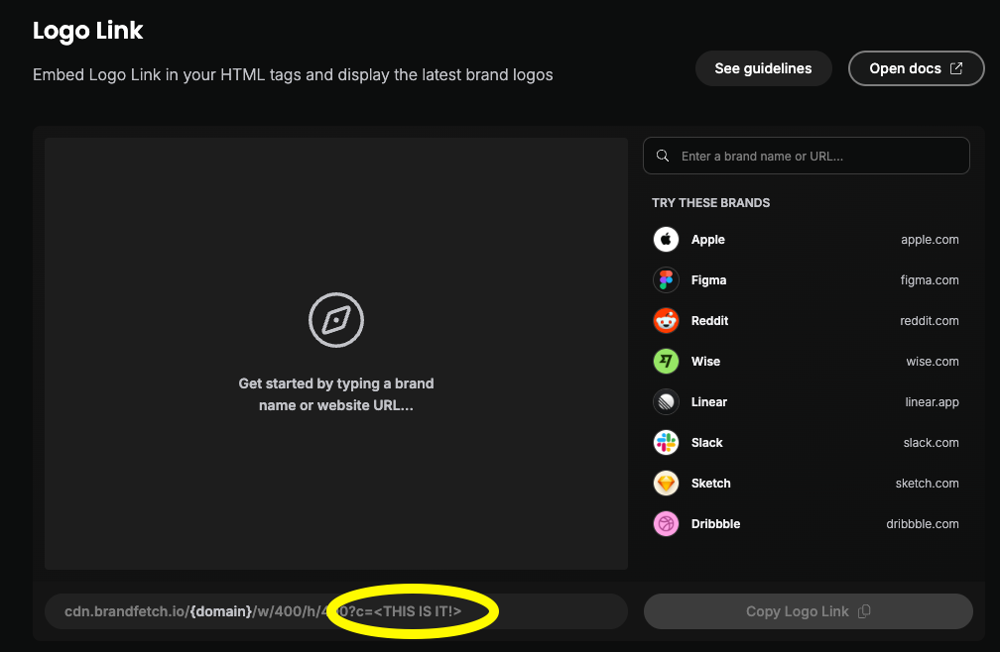

# Account, Merchant and Security Logos

Sure supports custom account icons and integrates with the [Brandfetch Logo Link](https://brandfetch.com/developers/logo-api) service to provide logos for accounts, merchants and securities.
Logos are currently matched in the following ways:

- For accounts, icons are discovered using the institution domain, supplied by a bank sync provider or entered manually. In the account form under **Additional details → Icon**, you can pick an icon from the App Store, Google Play, RuStore or favicon services, upload your own image, or choose Brandfetch when configured. Plaid is not required; uploads and discovery from other services work without a Brandfetch Client ID. Uploaded or manually picked icons are preserved during automatic updates.
- For merchants, logos are matched via the merchant's website FQDN. The website comes from the bank sync provider (e.g. Plaid, Akahu) or from an AI provider that matches it to the merchant name. A logo the provider already supplies is kept
- For securities, logos are matched using the ticker symbol

> [!NOTE]
> Currently ticker symbol matching cannot specify the exchange and since US exchanges are prioritized, securities from other exchanges might not have the right logo.

## Enabling Brandfetch Integration

A Brandfetch Client ID is required and to obtain a client ID, sign up for an account [here](https://brandfetch.com/developers/logo-api).

Once you enter the Client ID into the Sure settings under the `Self-Hosting` section, logos from Brandfetch integration will be enabled.
Alternatively, you can provide the client id using the `BRAND_FETCH_CLIENT_ID` environment variable to the web and worker services.

Merchants that already have a website but no logo, for example because they were matched before the Client ID was configured, get their logo on the next sync.

