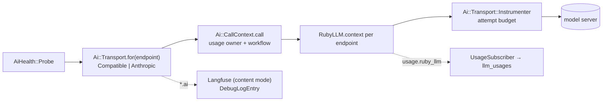
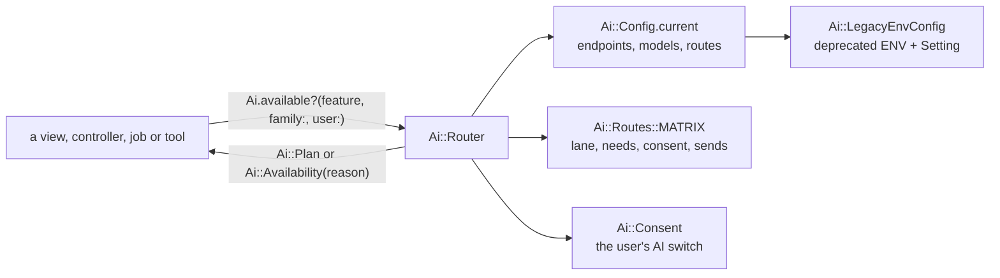
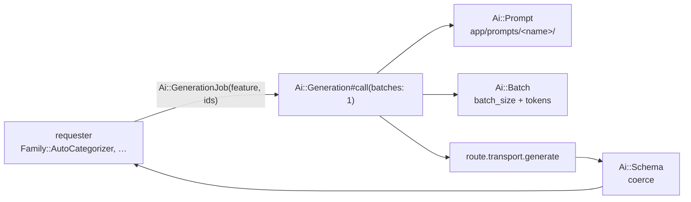
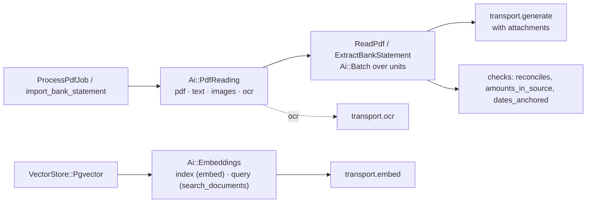

# AI pipeline

Sure's AI calls go through thin transports over RubyLLM. The design is in
`docs/proposals/v0.8/ai-plumbing-redesign.md`.

## Transports and instrumentation



**Where things live**

| Concern | File |
|---|---|
| Endpoint and model values a transport takes | `app/models/ai/config/endpoint.rb`, `model.rb` |
| Every HTTP client, the proxy resolver, the base URL rule | `app/models/ai/transport/http.rb` |
| The transports | `app/models/ai/transport/{base,compatible,anthropic,ruby_llm_adapter}.rb` |
| Errors | `app/models/ai/error.rb` |
| Token counts and cost | `app/models/ai/tokens.rb` |
| Usage owner, workflow and attempt budget around a call | `app/models/ai/call_context.rb`, `transport/instrumenter.rb` |
| Usage rows, the debug log, tracing modes, secret scrubbing | `app/models/ai/instrumentation/*` |

**Rules**

- **A transport never reads ENV, `Setting` or ActiveRecord.** It takes an `Ai::Config::Endpoint`
  and an `Ai::Config::Model`, built by its caller.
- **Build clients only in `Ai::Transport::Http`.** It applies the endpoint's timeout and
  headers, TLS options and the proxy. RubyLLM builds its own connections and takes no TLS
  options, so its contexts use `Http.ruby_llm_adapter`, a Net::HTTP adapter that adds them. The
  contract test fails on `OpenAI::Client.new`, `Anthropic::Client.new` or `Faraday.new`
  anywhere else under `app/models/ai/`.
- **Use RubyLLM's public API only**: `RubyLLM.context`, `Context#chat`/`#embed`,
  `Chat#generate`, the `with_*` setters, `RubyLLM::Tool`, `RubyLLM.workflow`,
  `RubyLLM.with_usage_owner`, `RubyLLM::OpenTelemetry.enable`. Nothing marked `:nodoc:`.
  `test/architecture/ai_transport_contract_test.rb` lists the surface Sure uses.
- **RubyLLM never retries.** Every context has `max_retries = 0`; `Ai::Transport::Base#attempt`
  retries rate limits, 5xx and timeouts up to the endpoint's `max_retries`. RubyLLM retries
  inside one request with no hook before a retry, so only Sure can stop on a spent balance and
  check the time budget between tries.
- **Raise only `Ai::Error`.** Map client errors in the transport (`mapping_errors`). Mapped
  messages are scrubbed of the endpoint's secrets (`Endpoint#secrets`: the key and long static
  header values) before anything logs them.
- **Wrap every call in `Ai::CallContext.call`.** RubyLLM's `usage.ruby_llm` event then carries
  the family (the usage owner) and the call (the workflow), and `UsageSubscriber` writes one
  `llm_usages` row per request. A failed request's row takes its own error from the
  `request.ruby_llm` event (`Ai::Transport::Instrumenter`). A job opens
  `Ai::CallContext.job(correlation_id)` first, with the id from its arguments; the id reaches
  the usage rows, the Langfuse session and the OTel `session.id`.
- **Never create `ruby_llm_usages`.** RubyLLM's ledger would then record every call a second time.

**Tests**

- `test/support/ai_test_helper.rb`: `ai_endpoint`, `ai_model`, `with_ai_call_context` and
  `capture_ai_events`.
- A new transport, or a new transport call, passes `ai_transport_contract_test.rb`: every HTTP
  status maps onto `Ai::Error`, retries follow the endpoint, usage counts cached tokens, and the
  proxy is resolved by `Http`.

## Routing and consent



**Where things live**

| Concern | File |
|---|---|
| The routing table: each feature's lane, needs, consent level and data sent | `app/models/ai/routes.rb`, descriptions in `config/locales/models/ai/en.yml` |
| What may run for a feature, family and user, or why not | `app/models/ai/router.rb`, `ai.rb` (`Ai.available?`, `Ai.availability`, `Ai.plan`) |
| Consent | `app/models/ai/consent.rb` |
| The configuration snapshot and its routes | `app/models/ai/config.rb`, `route.rb` |
| Today's AI ENV and `Setting` fields, read as configuration | `app/models/ai/legacy_env_config.rb` |
| The controller guard | `app/controllers/concerns/ai_feature_guard.rb` (`requires_ai`) |
| The family's AI settings | `app/models/family/ai_settings.rb` |

**Rules**

- **Ask the router, never a provider.** Show an AI affordance with
  `ai_feature_available?(:feature)` in a view, guard an action with `requires_ai :feature`, and
  check `Ai.available?(:feature, family:, user:)` in a model or job. Don't test
  `Provider::Registry`, `Setting` or `VectorStore` for availability.
- **No AI ENV.** The cop `Sure/NoAiEnv` flags `ENV` reads of AI-looking names outside
  `Ai::LegacyEnvConfig`. Add a column, a preset field or a config file key instead. The
  files on its allowlist in `.rubocop.yml` still read ENV until their part replaces them; the list
  only shrinks.
- **A new feature is a row in `Ai::Routes::MATRIX`**, with `sends:` keys described in
  `config/locales/models/ai/en.yml`, and its key is permanent once released. Regenerate the table
  below with `bin/rails ai:routes_doc`; `ai_routing_matrix_test` fails when it's stale.
- **Consent:** chat and bills need the user's own AI switch (`users.ai_enabled`); nothing else
  needs consent yet.
- **An AI tool declares its feature** (`ai_feature :extract_pdf` on an `Assistant::Function`), so
  chat and MCP list it only while the feature is available.
- **`Ai::Config` is built in each process from its own ENV**, so give the web and the worker
  containers the same AI variables.

<!-- ai:routes_doc -->
| Feature | Lane | Needs | Consent row | Sends |
|---|---|---|---|---|
| `chat` | interactive | tools, streaming | Chat (user) | Your chat messages; The financial data the assistant looks up to answer; The text of statements stored in your vault |
| `bill_setup` | interactive | structured_output | Bills (user) | Transaction dates; Transaction amounts; Transaction names; Your category names; The bill's current settings |
| `extract_pdf` | prompt | generation: structured_output; ocr: ocr | PDF import (user) | The document you upload |
| `embed` | prompt | embedding | Documents (user) | Your uploaded documents, as whole files to a vector store or as text chunks to an embedding model |
| `search_documents` | interactive | embedding | Documents (user) | Your search text |
| `categorize` | background | generation: structured_output; judgement: judge | Categories (family) | Transaction names; Transaction amounts; Categories your bank suggests; Your category names |
| `shadow_categorize` | background | generation: structured_output; judgement: judge | Categories (shadow runs) (family) | Transaction names; Transaction amounts; Categories your bank suggests; Your category names |
| `detect_merchants` | background | structured_output | Merchants (family) | Transaction names; Merchant names |
| `enhance_merchants` | background | structured_output | Merchants (family) | Merchant names |
<!-- /ai:routes_doc -->

**Tests**

- `use_ai_routes(categorize: %w[gpu/qwen3-8b openai/gpt-4.1-mini])` routes the rest of the test
  through the test setup (`AiTestHelper.test_config`), the named features' routes replaced;
  `use_no_ai` configures nothing.
- `test/architecture/ai_agreement_test.rb` asks every entry point in each setup today's code
  supports (`test/support/ai_legacy_setups.rb`) and fails when one disagrees with the router.
  Chat's entry points are on its allowlist, as chat doesn't go through the router yet.
- `ai_config_test.rb` checks that the deprecated ENV path routes each feature to the provider and
  model today's code uses; `ai_feature_guard_test.rb` that every action starting an AI feature
  declares `requires_ai`.

## Generations

Every structured-output feature (categorization, merchant detection and enhancement, bill setup)
is one small `Ai::Generation` file, a prompt folder and a domain requester. Jobs, failover and
parsing are the plumbing's.



**Where things live**

| Concern | File |
|---|---|
| A feature's declaration: key, prompt, schema, batching | `app/models/ai/generations/*.rb`, on `app/models/ai/generation.rb` |
| Its prompts, one folder per variant | `app/prompts/<name>/instructions.txt.erb` and `input.txt.erb` |
| The domain side: what to send, how to apply the answer | the requester, e.g. `app/models/family/auto_categorizer.rb` (`Ai::Requester`) |
| The one job | `app/jobs/ai/generation_job.rb` |
| JSON modes and tolerant parsing | `app/models/ai/transport/json_mode.rb`, `base.rb` |
| Coercion | `app/models/ai/schema.rb` |
| Batches and splitting | `app/models/ai/batch.rb`, `generation.rb` |
| Down marks | `app/models/ai/down_marks.rb` |

**Adding a generation feature**

1. Add its row to `Ai::Routes::MATRIX` (see above).
2. Write `app/models/ai/generations/<name>.rb`: `feature`, `prompt`, `schema` (a constant or a
   method, valid in OpenAI's strict mode), and for a list `batch`, `merge … by:`, `required` and
   `blank_item`. `prompt_locals` gives the templates their data.
3. Write the prompt folder. ERB runs as RubyLLM renders it, with no trim mode, so check the
   rendered text; shared parts go in `app/prompts/shared/_<name>.txt.erb`.
4. Make a domain class its requester (`include Ai::Requester`, `ai_feature :key`,
   `from_ai_job`, `ai_generation`, `apply_ai`, `ai_finished`, `ai_failed`) and list it in
   `Ai::Requesters`. Enqueue `Ai::GenerationJob.perform_later(:key, { ids:, family_id: })`.
5. Add `test/models/ai/generations/<name>_test.rb`; `ai_routing_matrix_test` and
   `ai_schemas_test` check the rest.

**Rules**

- **One schema, every transport.** The schema goes through RubyLLM's `with_schema`: a strict
  `response_format` on chat completions and the Responses API, native structured output on
  Anthropic.
- **JSON modes** apply to chat-completions servers: `auto` walks strict, json_object, none, moving
  on when the answer doesn't parse or, for a list, when more than half the items are blank. A
  400 about the JSON mode or the reasoning effort, or any 400 to a request that sent an effort,
  retries once in `none` without the effort; any other 400 ends the call.
- **Overflow splits, invalid output escalates, then bisects.** `ContextTooLong` or an answer cut
  at the output limit halves the batch on the same route; `InvalidOutput` moves to the next route,
  and when every route fails it the batch is halved on the first route (`BISECT_DEPTH`, twice) to
  find the transactions that break it. Items still unanswered are skipped and logged
  (`ai_generation` debug entries, ids only), and the run goes on. A
  timeout, 5xx, 429, refused connection, bad key or missing model marks the smallest broken thing
  down for 60 seconds and moves on.
- **Rule runs get one job per AI action.** The rule action counts the transactions onto
  `RuleRun#transactions_awaiting_ai` and queues one `Ai::GenerationJob` with every id; the
  requester reports each batch (`RuleRun#ai_handled!`) and completes the run once.
  `GET /api/v1/rule_runs/:id/progress` lets a client watch the count reach 0.
- **No prompt heredocs.** `Sure/NoPromptHeredoc` flags heredocs over ten lines in
  `app/models/ai/**` and controllers.
- **Prompts change only with evals.** `test/architecture/ai_prompts_test.rb` renders each prompt
  folder against its golden text in `test/fixtures/files/ai_prompts/`; a change to the text is its
  own PR, run with the `ai-live` label.

**Tests**

- `stub_ai(:categorize, returns: { categorizations: [...] })` answers the feature's generations
  without HTTP, still running coercion, failover, instrumentation and the requester; it returns
  the requests sent. `raises: Ai::Error::Timeout` fails them; a block answers per request.
- `use_ai_model_settings(batch_size: 2)` changes the test setup's OpenAI model for the rest of the test.
- `test/models/ai/live/` replays cassettes with `with_ai_cassette(preset, name)` under
  `test/vcr_cassettes/ai/<preset>/`; record them
  with `RECORD_CASSETTES=1` and the keys in ENV, or run them live with `AI_LIVE=1`.
- CI: `ai-evals.yml` runs the eval datasets against recorded answers on any AI change; the
  `ai-live` label runs the live tests and evals with repository secrets.

## Judgements and shadow runs

**Judgements.** A decision model (Jev) answers a feature through an `Ai::Judgement`, which the
feature's generation declares with `judged_by`. The generation's loop builds it on a `judge`
route with the same items, so failover from Jev to an LLM switches class, and both return one
value shape. `Ai::Transport::Jev#judge` goes through RubyLLM's `typesafe` provider, fanning a batch
out on the endpoint's `parallel_requests`. See [Adding a judgement](adding-a-judgement.md).

**Shadow runs.** A generation that declares

```ruby
shadow subject: "Transaction",
       compare: ->(value) { value[:categorizations].to_h { [ _1[:transaction_id].to_s, [ category_id_for(_1[:category_name]), _1[:confidence] ] ] } }
```

is sampled after each successful call at the family's rate. On a hit, `Ai::Shadow`
enqueues `Ai::ShadowJob` with the items the call was sent and the primary's compared answer. The
job runs the same class on the `shadow_<feature>` route; its calls are recorded under
`shadow_<feature>` and tagged `shadow`, and its answer goes only to the `compare.ai_shadow`
event, which `Ai::Instrumentation::ComparisonSubscriber` writes to `Ai::Comparison`, one row per
item. Nothing is applied.

| Concern | File |
|---|---|
| The judgement base and categorize's | `app/models/ai/judgement.rb`, `app/models/ai/judgements/` |
| The Jev transport | `app/models/ai/transport/jev.rb` |
| Sampling and the job | `app/models/ai/shadow.rb`, `app/jobs/ai/shadow_job.rb` |
| Comparisons | `app/models/ai/comparison.rb`, `app/models/ai/instrumentation/comparison_subscriber.rb` |
| The deprecated Jev settings | `app/models/ai/legacy_env_config/jev.rb` |

**Rules**

- `compare` maps a value to `{ item id => [value, confidence] }` with ids, not names, so renamed
  categories still compare. An item both sides answered agrees when the values match (a shared
  abstention included); an item only one side answered never agrees.
- Only `ComparisonSubscriber` writes `Ai::Comparison`, and a shadow answer is never written to
  the item (`test/architecture/ai_shadow_test.rb`).
- A shadow job never retries: a failed diagnostic is skipped.

**Tests**

- `stub_ai` answers judge requests by item id (see the judgement guide); a block can tell
  `Ai::Transport::Base::JudgeRequest` from `Request`, and `request.feature` is
  `:shadow_categorize` on a shadow run.
- `perform_enqueued_jobs` around `Ai::GenerationJob.perform_now(:categorize, …)` runs the shadow
  job too (`test/jobs/ai/shadow_job_test.rb`).


## Documents (PR 2e)

PDF import and document search on the plumbing: files on `generate`, `transport.embed` and
`transport.ocr`, one input step for PDFs, and the vector stores on `Ai::Embeddings`.



| Concern | File |
|---|---|
| A file on a request | `app/models/ai/attachment.rb`, `Request#attachments` in `transport/base.rb` |
| Embeddings and OCR on the wire | `transport/base.rb` (`embed`, `ocr`), `transport/compatible.rb` |
| The input step: ways of reading, Auto's order, fallback on failed checks | `app/models/ai/pdf_reading.rb`, `pdf_reading/unit.rb`, `pdf_reading/pages.rb` |
| What a PDF is, and a statement's rows and checks | `app/models/ai/generations/read_pdf.rb`, `extract_bank_statement.rb` |
| Page rendering | `app/models/pdf/page_images.rb` |
| Embedding for the vector store | `app/models/ai/embeddings.rb`, `vector_store/pgvector.rb` |
| OpenAI's vector store and its indexing status | `vector_store/openai.rb`, `app/jobs/vector_store/index_status_job.rb` |
| OCR prompts, one folder per model family | `app/prompts/ocr_<name>/` (`Ai::Config::Model::OCR_PROMPTS`) |

**Rules**

- **Decide what to send from capabilities, before sending.** A transport refuses an image to a
  model without `vision` and a PDF to one without `documents`, and a generation skips such a route
  (`Ai::Generation#needs`). RubyLLM sends a PDF as a file part to every compatible server, and most
  refuse it; llama.cpp answers an image it can't read with a 500.
- **Files go inline.** `auto_upload_large_files` stays off, so a statement never stays in a
  provider's Files API; the preset's inline limit (`Ai::Config::Endpoint::PDF_LIMITS`) sends a
  bigger PDF another way.
- **Files never enter a `.ai` event.** Events record each file's name and size.
- **A new way of reading** is a key in `Ai::PdfReading::WAYS`, a reason in `reason_for`, units in
  `units_for`, a "Read as" label in `config/locales/views/imports/en.yml`, and a row in
  `test/models/ai/pdf_reading_test.rb`.
- **Never drop an extraction.** One that fails its checks is kept and flagged for review.
- **Embeddings come from the route's first embedding model, with no failover**: another model's
  vectors don't compare with the stored ones.
- **`MIN_SCORE` (0.3) is a default, not a constant to tune in code.** It's calibrated on OpenAI's
  vector store; pgvector's scores depend on the embedding model, and 0.3 rarely filters there. PR 7
  makes the threshold a setting per embedding model for both stores, and resolves a model whose
  dimensions don't match the chunks table. Until then a mismatch is `InvalidOutput`, and Sure
  sends no `dimensions` (calls by @josh-sanders during development of PR #4440).
- **Render pages only through `Pdf::PageImages`**, which keeps poppler in a hardened child
  process; don't call `pdftoppm` or libvips's PDF loader yourself.

**Tests**

- `stub_ai` answers `embed` (one stable vector per text unless the block returns vectors) and
  `ocr` (a transcription per request) as well as `generate` and `judge`; a block can tell
  `EmbedRequest`, `OcrRequest` and `Request` apart, and `request.attachments` holds the files.
- `test/fixtures/files/statements/` holds the spike's two public sample statements: `bac_ocr.pdf`
  (an OCR'd text layer with errors, 13 transactions) and `impact_scanned.pdf` (a two-page scan).
- Live tests in `test/models/ai/live/`: `embed_live_test` (venus llama.cpp) and `ocr_live_test`
  (Cohere `parse-v5.0` and a local OCR model recorded; Mistral skipped without a key), skipped
  without a cassette or key.
