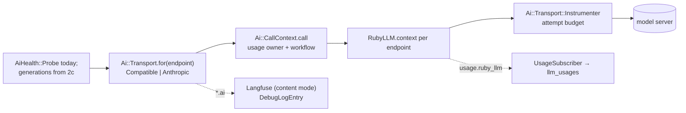
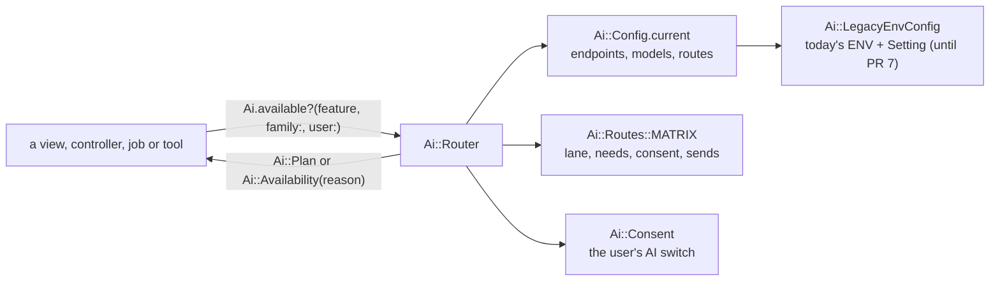

# AI pipeline

Sure's AI layer is moving onto one path: routing, consent, generations, a sequencer and chat on
thin transports over RubyLLM. The design and the order of the pull requests are in
`docs/proposals/v0.8/ai-plumbing-redesign.md` (PR #4440). This guide covers what has landed. It
grows with each part.

## Transports and instrumentation (PR 2a)

**Where things live**

| Concern | File |
|---|---|
| Endpoint and model values a transport takes | `app/models/ai/config/endpoint.rb`, `model.rb` |
| Every HTTP client, the proxy resolver, the base URL rule | `app/models/ai/transport/http.rb` |
| The transports | `app/models/ai/transport/{base,compatible,anthropic,ruby_llm_adapter}.rb` |
| Errors | `app/models/ai/error.rb` |
| Token counts and cost | `app/models/ai/tokens.rb` |
| Usage owner, workflow and attempt budget around a call | `app/models/ai/call_context.rb`, `transport/instrumenter.rb` |
| Usage rows, the debug log, tracing modes, secret scrubbing | `app/models/ai/instrumentation/*` |

**Rules**

- **A transport never reads ENV, `Setting` or ActiveRecord.** It takes an `Ai::Config::Endpoint`
  and an `Ai::Config::Model`. Configuration reaches them through `Ai::Config` (2b) and the
  `ai_*` tables (PR 7).
- **Build clients only in `Ai::Transport::Http`.** It applies the endpoint's timeout and
  headers, TLS options and the proxy. RubyLLM builds its own connections and takes no TLS
  options, so its contexts use `Http.ruby_llm_adapter`, a Net::HTTP adapter that adds them. The
  contract test fails on `OpenAI::Client.new`, `Anthropic::Client.new` or `Faraday.new`
  anywhere else under `app/models/ai/`.
- **Use RubyLLM's public API only**: `RubyLLM.context`, `Context#chat`/`#embed`,
  `Chat#generate`, the `with_*` setters, `RubyLLM::Tool`, `RubyLLM.workflow`,
  `RubyLLM.with_usage_owner`, `RubyLLM::OpenTelemetry.enable`. Nothing marked `:nodoc:`.
  `test/architecture/ai_transport_contract_test.rb` lists the surface Sure uses.
- **RubyLLM never retries.** Every context has `max_retries = 0`; `Ai::Transport::Base#attempt`
  retries rate limits, 5xx and timeouts up to the endpoint's `max_retries`. RubyLLM retries
  inside one request with no hook before a retry, so only Sure can stop on a spent balance and
  check the time budget between tries.
- **Raise only `Ai::Error`.** Map client errors in the transport (`mapping_errors`). Mapped
  messages are scrubbed of the endpoint's secrets (`Endpoint#secrets`: the key and long static
  header values) before anything logs them.
- **Wrap every call in `Ai::CallContext.call`.** RubyLLM's `usage.ruby_llm` event then carries
  the family (the usage owner) and the call (the workflow), and `UsageSubscriber` writes one
  `llm_usages` row per request. A failed request's row takes its own error from the
  `request.ruby_llm` event (`Ai::Transport::Instrumenter`). A job opens `Ai::CallContext.job(correlation_id)` first, with
  the id from its arguments.
- **Never create `ruby_llm_usages`.** RubyLLM's ledger would then record every call a second time.

**Tests**

- `test/support/ai_test_helper.rb`: `ai_endpoint`, `ai_model`, `with_ai_call_context`,
  `capture_ai_events`, `stub_ai_transport`, and `with_ai_cassette(preset, name)` for cassettes
  under `test/vcr_cassettes/ai/<preset>/` (record with `RECORD_CASSETTES=1`).
- A new transport, or a new transport call, passes `ai_transport_contract_test.rb`: every HTTP
  status maps onto `Ai::Error`, retries follow the endpoint, usage counts cached tokens, and the
  proxy is resolved by `Http`.

## Routing and consent (PR 2b)

**Where things live**

| Concern | File |
|---|---|
| The routing table: each feature's lane, needs, consent level and data sent | `app/models/ai/routes.rb`, descriptions in `config/locales/models/ai/en.yml` |
| What may run for a feature, family and user, or why not | `app/models/ai/router.rb`, `ai.rb` (`Ai.available?`, `Ai.availability`, `Ai.plan`) |
| Consent | `app/models/ai/consent.rb` |
| The configuration snapshot and its routes | `app/models/ai/config.rb`, `route.rb` |
| Today's AI ENV and `Setting` fields, read as configuration | `app/models/ai/legacy_env_config.rb` |
| The controller guard | `app/controllers/concerns/ai_feature_guard.rb` (`requires_ai`) |
| The family's AI settings | `app/models/family/ai_settings.rb` |

**Rules**

- **Ask the router, never a provider.** Show an AI affordance with
  `ai_feature_available?(:feature)` in a view, guard an action with `requires_ai :feature`, and
  check `Ai.available?(:feature, family:, user:)` in a model or job. Don't test
  `Provider::Registry`, `Setting` or `VectorStore` for availability.
- **No AI ENV.** The cop `Sure/NoAiEnv` flags `ENV` reads of AI-looking names outside
  `Ai::LegacyEnvConfig`. Add a column, a preset field or a config file key instead (PR 7). The
  files on its allowlist in `.rubocop.yml` still read ENV until their part replaces them; the list
  only shrinks.
- **A new feature is a row in `Ai::Routes::MATRIX`**, with `sends:` keys described in
  `config/locales/models/ai/en.yml`, and its key is permanent once released. Regenerate the table
  below with `bin/rails ai:routes_doc`; `ai_routing_matrix_test` fails when it's stale.
- **Consent, until PR 7:** chat and bills need the user's own AI switch (`users.ai_enabled`);
  nothing else needs consent. PR 7 adds the family's consent per row.
- **An AI tool declares its feature** (`ai_feature :extract_pdf` on an `Assistant::Function`), so
  chat and MCP list it only while the feature is available.
- **`Ai::Config` is built in each process from its own ENV** until PR 7, so give the web and the
  worker containers the same AI variables.

<!-- ai:routes_doc -->
| Feature | Lane | Needs | Consent row | Sends |
|---|---|---|---|---|
| `chat` | interactive | tools, streaming | Chat (user) | Your chat messages; The financial data the assistant looks up to answer; The text of statements stored in your vault |
| `bill_setup` | interactive | structured_output | Bills (user) | Transaction dates; Transaction amounts; Transaction names; Your category names; The bill's current settings |
| `extract_pdf` | prompt | structured_output | PDF import (user) | The document you upload |
| `embed` | prompt | embedding | Documents (user) | Your uploaded documents, as whole files to a vector store or as text chunks to an embedding model |
| `search_documents` | interactive | embedding | Documents (user) | Your search text |
| `categorize` | background | generation: structured_output; judgement: judge | Categories (family) | Transaction names; Transaction amounts; Categories your bank suggests; Your category names |
| `shadow_categorize` | background | generation: structured_output; judgement: judge | Categories (shadow runs) (family) | Transaction names; Transaction amounts; Categories your bank suggests; Your category names |
| `detect_merchants` | background | structured_output | Merchants (family) | Transaction names; Merchant names |
| `enhance_merchants` | background | structured_output | Merchants (family) | Merchant names |
<!-- /ai:routes_doc -->

**Tests**

- `with_ai_routes(categorize: %w[gpu/qwen3-8b openai/gpt-4.1-mini]) { }` runs the block with the
  test setup (`AiTestHelper.test_config`), the named features' routes replaced; `without_ai { }`
  with nothing configured. `use_ai_routes` and `use_no_ai` do the same for the rest of a test.
- `test/architecture/ai_agreement_test.rb` asks every entry point in each setup today's code
  supports (`test/support/ai_legacy_setups.rb`) and fails when one disagrees with the router.
  Chat's entry points are on its allowlist until PR 6.
- `ai_config_test.rb` checks that the deprecated ENV path routes each feature to the provider and
  model today's code uses; `ai_feature_guard_test.rb` that every action starting an AI feature
  declares `requires_ai`.
