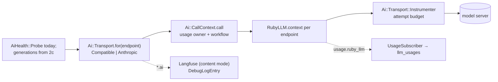

# AI pipeline

Sure's AI layer is moving onto one path: routing, consent, generations, a sequencer and chat on
thin transports over RubyLLM. The design and the order of the pull requests are in
`docs/proposals/v0.8/ai-plumbing-redesign.md` (PR #4440). This guide covers what has landed. It
grows with each part.

## Transports and instrumentation (PR 2a)

**Where things live**

| Concern | File |
|---|---|
| Endpoint and model values a transport takes | `app/models/ai/config/endpoint.rb`, `model.rb` |
| Every HTTP client, the proxy resolver, the base URL rule | `app/models/ai/transport/http.rb` |
| The transports | `app/models/ai/transport/{base,compatible,anthropic,ruby_llm_adapter}.rb` |
| Errors | `app/models/ai/error.rb` |
| Token counts and cost | `app/models/ai/tokens.rb` |
| Usage owner, workflow and attempt budget around a call | `app/models/ai/call_context.rb`, `transport/instrumenter.rb` |
| Usage rows, the debug log, tracing modes, secret scrubbing | `app/models/ai/instrumentation/*` |

**Rules**

- **A transport never reads ENV, `Setting` or ActiveRecord.** It takes an `Ai::Config::Endpoint`
  and an `Ai::Config::Model`. Configuration reaches them through `Ai::Config` (2b) and the
  `ai_*` tables (PR 7).
- **Build clients only in `Ai::Transport::Http`.** It applies the endpoint's timeout and
  headers, TLS options and the proxy. RubyLLM builds its own connections and takes no TLS
  options, so its contexts use `Http.ruby_llm_adapter`, a Net::HTTP adapter that adds them. The
  contract test fails on `OpenAI::Client.new`, `Anthropic::Client.new` or `Faraday.new`
  anywhere else under `app/models/ai/`.
- **Use RubyLLM's public API only**: `RubyLLM.context`, `Context#chat`/`#embed`,
  `Chat#generate`, the `with_*` setters, `RubyLLM::Tool`, `RubyLLM.workflow`,
  `RubyLLM.with_usage_owner`, `RubyLLM::OpenTelemetry.enable`. Nothing marked `:nodoc:`.
  `test/architecture/ai_transport_contract_test.rb` lists the surface Sure uses.
- **RubyLLM never retries.** Every context has `max_retries = 0`; `Ai::Transport::Base#attempt`
  retries rate limits, 5xx and timeouts up to the endpoint's `max_retries`. RubyLLM retries
  inside one request with no hook before a retry, so only Sure can stop on a spent balance and
  check the time budget between tries.
- **Raise only `Ai::Error`.** Map client errors in the transport (`mapping_errors`). Mapped
  messages are scrubbed of the endpoint's secrets (`Endpoint#secrets`: the key and long static
  header values) before anything logs them.
- **Wrap every call in `Ai::CallContext.call`.** RubyLLM's `usage.ruby_llm` event then carries
  the family (the usage owner) and the call (the workflow), and `UsageSubscriber` writes one
  `llm_usages` row per request. A failed request's row takes its own error from the
  `request.ruby_llm` event (`Ai::Transport::Instrumenter`). A job opens `Ai::CallContext.job(correlation_id)` first, with
  the id from its arguments.
- **Never create `ruby_llm_usages`.** RubyLLM's ledger would then record every call a second time.

**Tests**

- `test/support/ai_test_helper.rb`: `ai_endpoint`, `ai_model`, `with_ai_call_context`,
  `capture_ai_events`, `stub_ai_transport`, and `with_ai_cassette(preset, name)` for cassettes
  under `test/vcr_cassettes/ai/<preset>/` (record with `RECORD_CASSETTES=1`).
- A new transport, or a new transport call, passes `ai_transport_contract_test.rb`: every HTTP
  status maps onto `Ai::Error`, retries follow the endpoint, usage counts cached tokens, and the
  proxy is resolved by `Http`.
