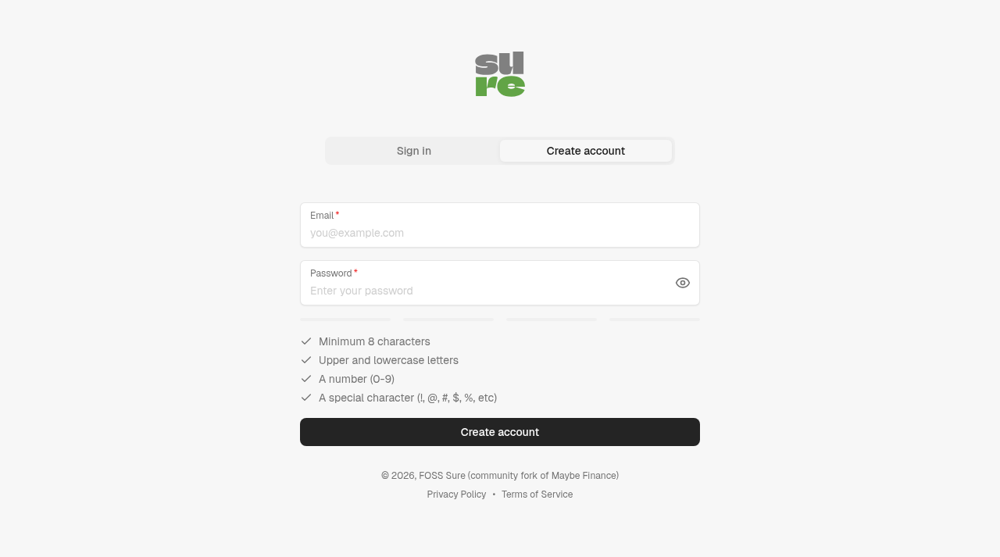
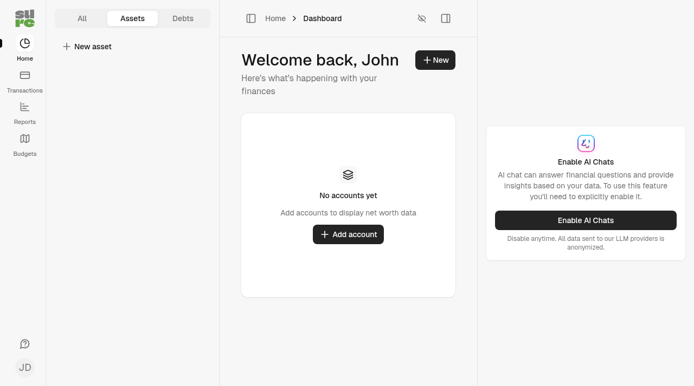
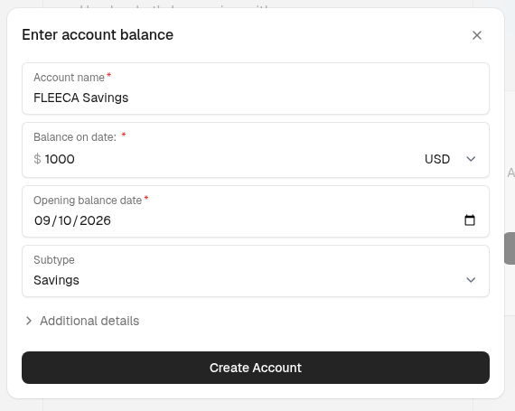
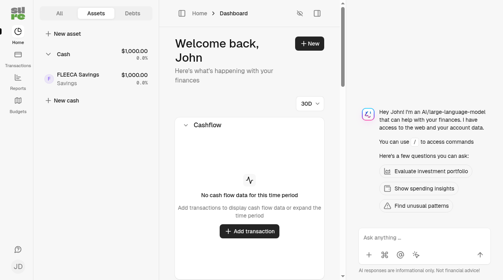
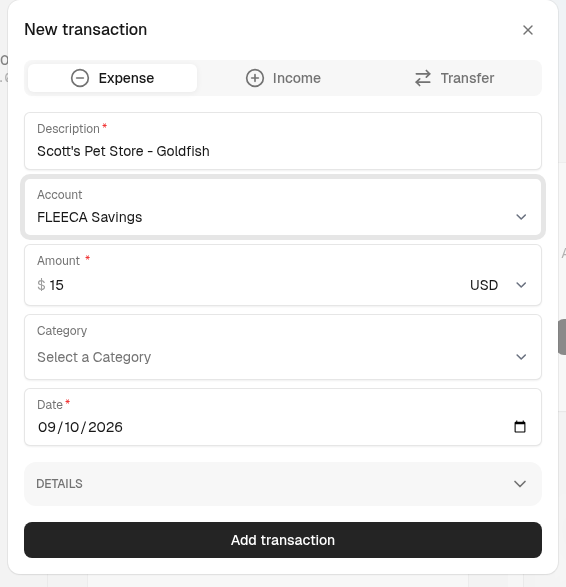
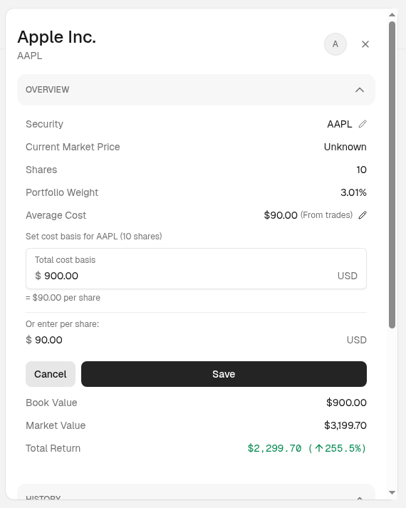
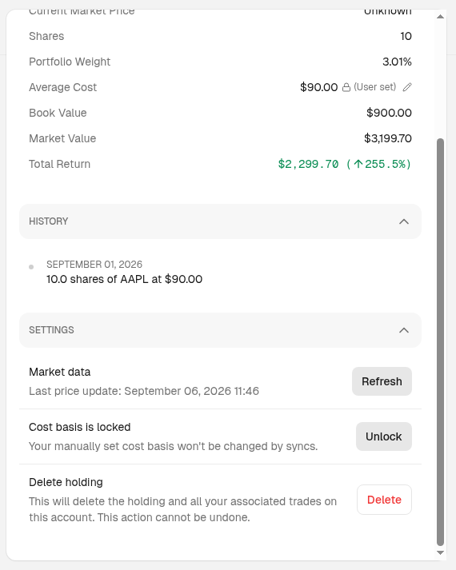
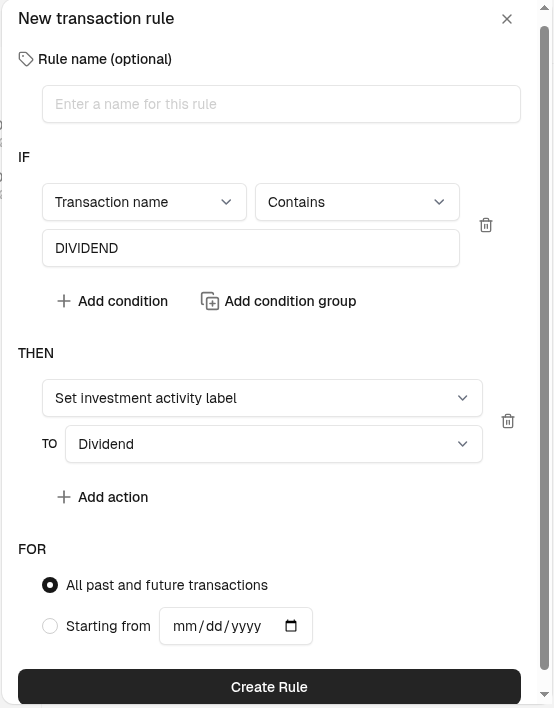

# Добро пожаловать в Sure!

Это руководство поможет вам:

1. Создать аккаунт Sure
2. Добавить первые счета
3. Записать операции

Также здесь объясняется разница между счетами **активов** и **обязательств** — это важно для понимания балансов в Sure.

> **Важно:** Sure быстро развивается. Если в руководстве есть неточность:
>
> - спросите в [Discord](https://discord.gg/36ZGBsxYEK);
> - создайте [issue](https://github.com/we-promise/sure/issues/new/choose);
> - или, если знаете ответ, откройте [PR](https://github.com/we-promise/sure/compare).

## 1. Создание аккаунта Sure

После установки Sure откройте в браузере [localhost:3000](http://localhost:3000). 
После чистой установки вы сразу попадёте на страницу **Создать аккаунт** — отдельной регистрации нет.

 
 

Несколько коротких шагов помогут указать **данные для входа**, **личные данные** и **настройки**. 
Когда откроется главная страница с надписью **Счетов пока нет**, настройка завершена.

 
 

> **Примечание:** дальше описано, как **добавлять счета и операции вручную**. 
> Можно подключить источник данных: Sure поддерживает, в частности:
>
> - [**Plaid**](https://github.com/we-promise/sure/blob/main/docs/hosting/plaid.md) (США и ЕС);
> - [**SimpleFIN**](https://beta-bridge.simplefin.org/);
> - [**Lunch Flow**](https://www.lunchflow.app/);
> - [**Enable Banking**](https://enablebanking.com/) (бета);
> - [**Monobank**](https://github.com/we-promise/sure/blob/main/docs/hosting/monobank.md) (украинские карты и банки);
> - [**Fio banka**](https://github.com/we-promise/sure/blob/main/docs/hosting/fio.md) (чешский банк);
> - [**Redbark**](https://github.com/we-promise/sure/blob/main/docs/hosting/redbark.md) (австралийские банки);
> - [**Up**](https://up.com.au/) (австралийский банк);
> - [**Akahu**](https://www.akahu.nz/) (банки Новой Зеландии);
> - [**CoinStats**](https://coinstats.app/) (бета, криптовалюты).
>
> Полный список и параметры подключения есть в разделе **Настройки → Синхронизация с банком**. Подключать провайдеров могут только **администраторы**.
>
> Даже при использовании синхронизации рекомендуем прочитать руководство: оно объясняет **типы счетов** и их работу в Sure.

## 2. Типы счетов в Sure

Sure делит типы счетов на **активы** (то, чем вы владеете) и **обязательства** (то, что вы должны):

| Активы | Обязательства |
| --- | --- |
| Деньги | Кредитная карта |
| Инвестиции | Кредит |
| Криптовалюта | Другое обязательство |
| Недвижимость | |
| Транспорт | |
| Другой актив | |

## 3. Как работают счета активов

Остаток на счетах денег, текущих и сберегательных счетах **увеличивается**, когда на них поступают деньги, и **уменьшается**, когда вы тратите деньги.

Пример:

- Начальный остаток: $500
- Добавьте расход $20 → остаток станет $480
- Добавьте доход $100 → остаток станет $580

## 4. Как работают счета обязательств

Счета обязательств показывают, сколько вы **должны**, поэтому расчёт может выглядеть *обратным* по сравнению со счётом активов.

**Главное правило:**

- **Положительный остаток** = вы должны деньги
- **Отрицательный остаток** = банк должен *вам* (например, при переплате или возврате)

**Операции работают так:**

- **Расходы** (например, покупки) → увеличивают долг
- **Платежи или возвраты** → уменьшают долг

Пример с кредитной картой:

1. Остаток: **долг $200**
2. Потратьте $20 → долг станет $220 (остаток *увеличится* и будет показан красным)
3. Погасите $50 → долг станет $170 (остаток *уменьшится* и будет показан зелёным)

Пример с переплатой:

1. Остаток: -$44 (банк должен вам $44)
2. Потратьте $1 → банк будет должен **$43** (остаток станет -$43 и приблизится к нулю)

> **Совет:** почему так? Это соответствует стандартному учёту и тому, как данные показывает банк. Воспринимайте остаток обязательства как **сумму долга**, а не доступные деньги.

## 5. Кратко: активы и обязательства

| Действие | Счёт актива (например, текущий) | Счёт обязательства (например, кредитная карта) |
| --- | --- | --- |
| Потратить $20 | Остаток ↓ $20 | Остаток ↑ $20 (долг больше) |
| Получить $50 | Остаток ↑ $50 | Остаток ↓ $50 (долг меньше) |
| Отрицательный остаток | Овердрафт | Банк должен *вам* деньги |

## 6. Добавление счёта

В этом примере добавим **сберегательный счёт**. 

> **Совет:** если добавляете **кредитную карту**, **кредит** или другое **обязательство**, выберите тип счёта **Кредитная карта** или **Обязательство**, а не **Деньги**. Тогда остаток будет рассчитываться правильно и совпадать с данными банка.

Большинство банковских счетов — текущие, сберегательные и счета денежного рынка — относятся к **денежным счетам**.

1. Нажмите **Добавить счёт** на главной странице или **Новый счёт** на странице счетов, затем выберите **Деньги**.
2. Чтобы добавить счёт вручную, выберите **Ввести остаток счёта**. Если настроена синхронизация, администраторы также увидят варианты **Подключить через …**.
3. Заполните поля:
   - **Название счёта**;
   - **Остаток на дату** — остаток на указанную ниже **дату начального остатка**. По умолчанию это дата двухлетней давности, поэтому укажите сегодня, если вводите текущий остаток;
   - **Дата начального остатка**;
   - **Подтип** — здесь выбирается текущий, сберегательный или другой тип счёта.
4. Нажмите **Создать счёт**.

 
 

После создания вы вернётесь на **Главную**. 
Там появятся:

- новый денежный счёт в списке **Счета** слева;
- обзор счетов по центру, под строкой чистого капитала.

Добавим операции, чтобы график начал меняться.

## 7. Добавление операций

Чтобы добавить операцию:

1. Откройте страницу **Операции** в левой панели под **Главной**.
2. Нажмите **Новая операция** в правом верхнем углу; на мобильном устройстве это круглая кнопка **+**.
3. Выберите тип операции:
   - **Расход** → трата денег;
   - **Доход** → поступление денег;
   - **Перевод** → перемещение денег между счетами.
4. Заполните данные и нажмите **Добавить операцию**.

Операция появится в **истории операций**, а **график чистого капитала** обновится.

### Загрузка выписок

Банковские выписки можно хранить рядом со счётом, а Sure будет сверять с ними остатки. Откройте счёт и загрузите PDF, CSV или XLSX в разделе **Выписки** либо сначала загрузите файл в **Настройки → Хранилище выписок**, а затем привяжите его к счёту.

Sure нужен **период** каждой выписки, чтобы показать охваченные месяцы и сравнить остатки. Он определяется в таком порядке:

1. **Внутри PDF** — если в выписке указан период: диапазоном дат, например `01 Apr 2026 - 30 Apr 2026` или `01.04.2026 – 30.04.2026`, либо датами начального и конечного остатка, например «Saldo iniziale al 01.07.2025» и «Saldo finale al 30.09.2025». Sure также считывает начальный и конечный остаток из сводки или рядом с подписями наподобие «Opening balance» и «Closing balance». Распознаются названия месяцев и подписи на английском, итальянском, немецком, французском, испанском, нидерландском и португальском. Поэтому имя файла без даты, например `Account statement.pdf` у Trade Republic, не мешает.
2. **По датам в имени файла** — для остальных случаев, например `2026-04`, `2026-04-30` или `Apr 2026`.
3. **Вручную** — откройте выписку и укажите период и остатки сами.

Если банк всегда называет файл одинаково, добавьте месяц в имя перед загрузкой: например, `Statement 2026-04.pdf`.

## 8. Управление инвестиционными счетами

Если вы отслеживаете инвестиции в Sure, дополнительные функции помогут точнее вести портфель.

### Учёт стоимости приобретения

Стоимость приобретения показывает первоначальную цену инвестиций и нужна для расчёта доходности и налоговой отчётности.

#### Источники стоимости приобретения

Sure получает стоимость приобретения из трёх источников:

| Источник | Описание |
| --- | --- |
| **Вручную** | Значения, которые вы ввели сами |
| **Рассчитано** | Данные, рассчитанные по сделкам покупки и истории операций |
| **Провайдер** | Данные из финансовой организации, например Plaid или SimpleFin |

#### Приоритет источников

Когда данные приходят из нескольких источников, Sure использует следующий приоритет:

**Вручную > Рассчитано > Провайдер**

То есть:

- введённые вручную значения всегда имеют приоритет;
- рассчитанные значения заменяют данные провайдера;
- данные провайдера используются, если другого источника нет.

#### Защита блокировкой

Когда вы вручную задаёте стоимость приобретения, Sure блокирует её, чтобы автоматическое обновление не перезаписало значение. Благодаря этому ручные данные сохраняются при синхронизации счёта.

#### Как задать стоимость приобретения вручную

Указать стоимость можно двумя способами.

**Из списка позиций:**

1. Откройте инвестиционный счёт.
2. Найдите позицию в портфеле.
3. Нажмите значение средней стоимости; при наведении появится значок карандаша.
4. Введите одно из значений:
   - **Общая стоимость приобретения** — сколько вы заплатили за все бумаги;
   - **Стоимость на акцию** — средняя цена одной бумаги.
5. Форма автоматически пересчитает второе значение.
6. Нажмите **Сохранить**.

Если вы заменяете уже заданную стоимость, система попросит подтвердить действие.

**Из панели позиции:**

1. Нажмите позицию, чтобы открыть её панель.
2. В разделе обзора нажмите значок карандаша рядом со «Средней стоимостью».
3. Введите общую стоимость или стоимость на акцию.
4. Нажмите **Сохранить**.

После сохранения появятся:

- значок замка, обозначающий защищённое значение;
- подпись источника «(вручную)».

#### Как снять блокировку

Чтобы разрешить автоматическому обновлению пересчитывать стоимость приобретения:

1. Откройте панель позиции.
2. Прокрутите до раздела **Настройки**.
3. Найдите «Стоимость приобретения заблокирована».
4. Нажмите **Разблокировать**.

После разблокировки:

- значок замка исчезнет;
- последующие синхронизации смогут обновлять стоимость;
- рассчитанные по сделкам значения заменят ручное значение.

#### Двусторонний пересчёт

Редактор стоимости приобретения пересчитывает общую стоимость и стоимость на акцию в реальном времени:

- введите общую стоимость → стоимость на акцию рассчитается автоматически;
- введите стоимость на акцию → общая стоимость рассчитается автоматически.

Так можно вводить данные в любом удобном формате.

### Метки инвестиционной активности

Метки помогают классифицировать и понимать инвестиционные операции. Они показываются как бейджи в списке операций и подходят для организации и фильтрации активности.

#### Доступные типы активности

Sure поддерживает следующие метки:

| Метка | Описание |
| --- | --- |
| **Покупка** | Покупка ценных бумаг |
| **Продажа** | Продажа ценных бумаг |
| **Пополнение** | Деньги, внесённые на инвестиционный счёт |
| **Вывод** | Деньги, выведенные с инвестиционного счёта |
| **Дивиденд** | Полученный дивиденд |
| **Проценты** | Полученные проценты |
| **Реинвестирование** | Реинвестированные дивиденды или распределения |
| **Автопополнение** | Деньги, автоматически зачисленные на счёт |
| **Автовывод** | Деньги, автоматически выведенные со счёта |
| **Комиссия** | Комиссия счёта или операции |
| **Обмен** | Обмен валюты или ценных бумаг |
| **Перевод** | Перевод между счетами |
| **Другое** | Прочие операции |

#### Как задать метки активности

Указать метку можно двумя способами.

**Вручную для отдельной операции:**

1. Откройте операцию инвестиционного или криптовалютного счёта.
2. Прокрутите до раздела **Настройки**.
3. Найдите «Тип активности».
4. Выберите метку в списке.
5. Изменение сохранится автоматически.

**Автоматически с правилами:**

Создайте правила, чтобы назначать метки по шаблонам:

1. Откройте **Настройки → Правила**.
2. Создайте новое правило.
3. Задайте условие, например «ЕСЛИ название операции содержит `DIVIDEND`».
4. Добавьте действие «Установить метку инвестиционной активности».
5. Выберите метку, например «Дивиденд».
6. Сохраните правило.

Примеры правил:

- ЕСЛИ название содержит `DIVIDEND`, ТО установить метку «Дивиденд»;
- ЕСЛИ название содержит `INTEREST`, ТО установить метку «Проценты»;
- ЕСЛИ название содержит `FEE`, ТО установить метку «Комиссия».

Правила автоматически применяются к новым операциям, а также их можно запустить для существующих.

#### Где видны метки активности

Метки показываются как бейджи:

- в списках операций;
- в панелях подробностей операции;
- в представлениях активности счёта.

Они помогают быстро понять характер инвестиционной операции, не читая её полное название.

## 9. Что дальше

Теперь у вас есть первый счёт и первая операция:

- изучите другие типы счетов и добавьте подходящие для ваших финансов;
- **категоризируйте** операции и добавляйте **теги**, чтобы удобнее искать и строить отчёты;
- попробуйте **бюджеты**, чтобы отслеживать траты;
- если у вас много исторических операций, используйте **импорт** — кнопка «Импорт» находится на странице операций и в разделе **Настройки → Импорт**.

Подробные руководства по этим функциям появятся позже™.
