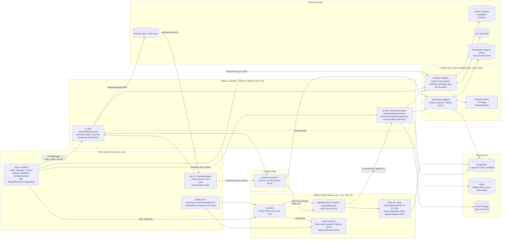
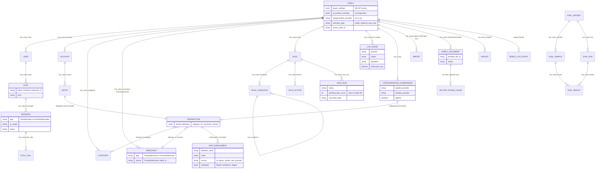

# Sure: AI / ML block diagram

A one-page orientation for developers new to Sure's AI and ML code: the main blocks, the models they write, and how a request moves through them. It covers only the workflows in [`01-ai-ml-workflow-map.md`](01-ai-ml-workflow-map.md), whose `W#` sections give the detail behind each box.

Checked against `main` @ `2250ba801` (2026-10-23). The 10 commits after this folder's reference commit `56105a3b5` don't change any AI path.

## 1. High-level flowchart

## 2. Models (erDiagram)

## 3. Legend

| Symbol | Meaning |
|---|---|
| Rectangle | Rails class or group of classes (controller, job, model, PORO) |
| Cylinder | Datastore or external service |
| Solid arrow | Direct call or job enqueue (the label says which) |
| Dotted arrow | Async broadcast (Turbo Streams over ActionCable) |
| `ai_high` / `ai_low` | Queues on the one-thread `ai` Sidekiq capsule. `ai_high` always runs first, but can't interrupt a running job. |
| `W#` | Workflow section in [`01-ai-ml-workflow-map.md`](01-ai-ml-workflow-map.md) |
| `\|\|--o{` (ER) | one-to-many. `}o--o\|` is an optional belongs_to. |

**Request flow**

- **Chat request:** `POST /chats` → `ChatsController` (`RequiresAiConsent`) → `Chat.start!` saves a `UserMessage`, whose `after_create_commit` enqueues `AssistantResponseJob` on `ai_high_priority`. The request returns right away. The job resolves a provider through `Provider::Registry`, runs `Assistant::Responder` (up to 8 tool rounds through `Assistant::Function::*`), and streams text back with `Message` `broadcast_append_to` / `broadcast_update_to`.
- **Background enrichment:** a sync's post-sync step enqueues `ApplyRulesJob` (default capsule). `Rule::Runner` takes a pg advisory lock and runs rules in order. The Merchant matcher (TF-IDF) and Category classifier (Bayes) run inline in Ruby with no network calls. AI rule actions enqueue `AutoCategorizeJob` / `AutoDetectMerchantsJob` in batches on `ai_low_priority`, and each finished job decrements `RuleRun.pending_jobs_count`. Every write goes through `Enrichable#enrich_attribute`, which skips locked attributes and records a `DataEnrichment` row.
- **External AI:** an MCP client calls `POST /mcp` (Doorkeeper token or `MCP_API_TOKEN`). `McpController` runs the same `Assistant::Function` classes **synchronously inside the web request**, with no LLM on Sure's side, except `import_bank_statement`, which calls the LLM from inside that request.
- **Documents:** a PDF upload creates a `PdfImport` and enqueues `ProcessPdfJob` (`ai_low`). The job has the LLM summarize the PDF, extract its transactions and classify it. It also puts the text into the vector store and emails the admin through `PdfImportMailer`. A non-PDF document is embedded synchronously inside the upload request.
- **LLM calls on a web thread:** bill smart-fill/configure, non-PDF document embedding, MCP `import_bank_statement` and the admin AI health probes call the model from a Puma thread instead of the job queue. A slow local model can tie up web threads.

## 4. Evidence and what's inferred

Read directly from `origin/main`: `Gemfile` (`ruby-openai`, `anthropic ~> 1.0`, `sidekiq`, `sidekiq-cron`, `doorkeeper`, `pundit`, `faraday-retry`, `pdf-reader`, `aws-sdk-s3`, `turbo-rails`, `redis`), the model associations above, the schema columns shown, `config/sidekiq.yml` capsules, `config/storage.yml`, `production.rb` (`redis_cache_store`, `ACTIVE_STORAGE_SERVICE`), `config/initializers/langfuse.rb` and the mailer call sites.

**Inferred or simplified (flagged):**

- `FAMILY ||--o{ ACCOUNT` and `ACCOUNT ||--o{ ENTRY`: I didn't grep these two associations. I took them from the `Entry belongs_to :account` side and from Sure's core domain.
- `VECTOR_STORE_CHUNK` isn't an ActiveRecord model. It's the raw-SQL `vector_store_chunks` table that `VectorStore::Pgvector` writes to, keyed by store id and file id. It isn't in `db/schema.rb`, and the adapter checks whether it exists at runtime. The link to `FAMILY_DOCUMENT` is logical, not a foreign key.
- **Redis for ActionCable:** `config/cable.yml` has a `redis` adapter on its third entry. I assumed that entry is production (dev uses `async`).
- **Channels:** there are no custom channels, only `ApplicationCable`. Every real-time update is a Turbo Stream broadcast, from `Message`, `Chat#add_error`, `GenerateInsightsJob` and the Bayes evaluation progress.
- **Langfuse** is called through a local `LangfuseTracing` class (`lib/`), not a gem.
- **Out of scope, though present:** Stripe (billing), OmniAuth/SAML (SSO), the bank-provider syncers, and `RuleNotificationMailer` (a rule email action, not AI).
- The box counts are grouped. "30/44 tools" and "1 thread" are the documented defaults, not measured runtime values.
