# Sure: AI / LLM and Ruby-ML workflows

How every workflow in Sure that calls an LLM, an embedding or classification service, or a home-grown Ruby model works, end to end.

| | |
|---|---|
| **Reference** | `we-promise/sure` `origin/main` @ `56105a3b5` (2026-10-22). It includes **[#4310](https://github.com/we-promise/sure/issues/4310)** (`d07e61b92`, "Add a tunable, self-testing Bayes classifier") and its follow-up [#4435](https://github.com/we-promise/sure/issues/4435). |
| **Paths** | All paths are repo-relative (`app/...`). `file:line` references were taken at that commit. |
| **Milestones** | PRs from [v0.7.6](https://github.com/we-promise/sure/milestone/22) (milestone 22, due 2026-10-31) and [v0.7.7](https://github.com/we-promise/sure/milestone/23) (milestone 23, due 2026-11-30) that shaped or will change a workflow are tagged inline as **Related PRs**. *Open* means not merged yet. |
| **Out of scope** | Provider-specific bank sync internals (Plaid, SimpleFIN and the 30+ `*_item` syncers) are covered only as far as they feed the AI/ML stages. |

---

## Contents

**Part A: Orientation**
- [A1. The big picture](#a1-the-big-picture)
- [A2. Background-job topology (queues, capsules, cron)](#a2-background-job-topology)
- [A3. Classification of every workflow](#a3-classification-of-every-workflow)
- [A4. Enrichment, locks and "who wins"](#a4-enrichment-locks-and-who-wins)

**Part B: Shared LLM plumbing**
- [B1. Provider resolution (which LLM gets called)](#b1-provider-resolution)
- [B2. How OpenAI / OpenAI-compatible is called](#b2-how-openai--openai-compatible-is-called)
- [B3. How Anthropic is called](#b3-how-anthropic-is-called)
- [B4. How Jev (TypeSafe classification) is called](#b4-how-jev-is-called)
- [B5. Embeddings and vector stores](#b5-embeddings-and-vector-stores)
- [B6. Cross-cutting: prompts, tracing, usage, errors](#b6-cross-cutting-prompts-tracing-usage-errors)

**Part C: Workflows**
- [W1. Family sync (the root of most automatic work)](#w1-family-sync)
- [W2. Transfer auto-matching (Ruby, SQL)](#w2-transfer-auto-matching)
- [W3. Provider-merchant logo backfill (non-LLM)](#w3-provider-merchant-logo-backfill)
- [W4. Rules sequencing (`Rule::Runner`)](#w4-rules-sequencing)
- [W5. Merchant matcher: near-duplicate merchant fill (Ruby ML, TF-IDF)](#w5-merchant-matcher)
- [W6. Category classifier: naive Bayes (Ruby ML)](#w6-category-classifier-bayes)
- [W7. Classifier settings page: Run / Clear locks / Test / Find best](#w7-classifier-settings-page)
- [W8. AI auto-categorization (LLM or Jev, plus shadow)](#w8-ai-auto-categorization)
- [W9. AI merchant detection (LLM)](#w9-ai-merchant-detection)
- [W10. Provider-merchant enhancement ("merchant embellishment", LLM)](#w10-provider-merchant-enhancement)
- [W11. PDF ingestion (LLM + vector store)](#w11-pdf-ingestion)
- [W12. Document upload and semantic search (embeddings)](#w12-document-upload-and-semantic-search)
- [W13. Built-in assistant chat (LLM with tools)](#w13-built-in-assistant-chat)
- [W14. External assistant (OpenClaw-style agent)](#w14-external-assistant)
- [W15. MCP endpoint (external AI calls into Sure)](#w15-mcp-endpoint)
- [W16. AI-triggering assistant tools (nested workflows)](#w16-ai-triggering-assistant-tools)
- [W17. Insights generation (deterministic Ruby)](#w17-insights-generation)
- [W18. "Dig in with AI" on an insight](#w18-dig-in-with-ai)
- [W19. Recurring / bills detection pipeline (Ruby heuristics)](#w19-recurring--bills-detection-pipeline)
- [W20. Bill smart-fill / smart-configure (LLM, synchronous)](#w20-bill-smart-fill--smart-configure)
- [W21. AI cache reset](#w21-ai-cache-reset)
- [W22. AI health probes (web + worker)](#w22-ai-health-probes)
- [W23. Evals and Langfuse experiments (rake)](#w23-evals-and-langfuse-experiments)

**Part D: Reference**
- [D1. Environment variables and settings (master table)](#d1-environment-variables-and-settings)
- [D2. Fan-out catalogue](#d2-fan-out-catalogue)
- [D3. Sync vs async catalogue](#d3-sync-vs-async-catalogue)
- [D4. Observations, quirks and possible bugs](#d4-observations-quirks-and-possible-bugs)

---

# Part A: Orientation

## A1. The big picture

There are four families of "intelligent" behaviour:

1. **LLM generation** through OpenAI (native), any OpenAI-compatible endpoint (Ollama, LM Studio, llama.cpp…), or Anthropic. Used for chat, categorization, merchant detection and enhancement, PDF reading and bill setup.
2. **Typed classification** through Jev (TypeSafe), used *only* for categorization and *only* when the family opts in.
3. **Embeddings and vector search** through OpenAI vector stores, pgvector or Qdrant, with embeddings from any OpenAI-compatible `/embeddings` endpoint. Used for document search.
4. **Pure-Ruby ML and heuristics**, with no network: naive Bayes (categories), TF-IDF near-duplicate matching (merchants), SQL transfer matching, recurring-pattern clustering and scoring, and insight generators.

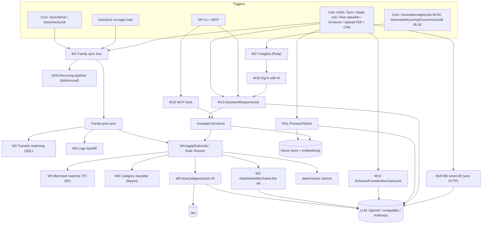

## A2. Background-job topology

> **Related PRs:** [#4237](https://github.com/we-promise/sure/issues/4237) AI capsule · [#4262](https://github.com/we-promise/sure/issues/4262) dev runs jobs through Sidekiq

`config/sidekiq.yml` defines **two capsules**:

| Capsule | Threads | Queues (strict / weighted) |
|---|---|---|
| default | `RAILS_MAX_THREADS - RAILS_AI_MAX_THREADS` (default 3-1 = **2**) | `scheduled`(10), `high_priority`(4), `medium_priority`(2), `low_priority`(1), `default`(1), all weighted |
| `ai` | `RAILS_AI_MAX_THREADS` (default **1**) | `ai_high_priority` then `ai_low_priority`, **strict order** |

Jobs relevant to this document:

| Job | Queue | Capsule | Calls out? |
|---|---|---|---|
| `AssistantResponseJob` | `ai_high_priority` | ai | LLM (chat) |
| `AutoCategorizeJob` | `ai_low_priority` | ai | LLM or Jev |
| `AutoDetectMerchantsJob` | `ai_low_priority` | ai | LLM |
| `EnhanceProviderMerchantsJob` | `ai_low_priority` | ai | LLM |
| `ProcessPdfJob` | `ai_low_priority` | ai | LLM + vector store |
| `SyncJob` | `high_priority` | default | providers |
| `SyncAllProvidersJob` | `high_priority` | default | n/a |
| `WorkerAiHealthCheckJob` | `high_priority` | default | LLM probes |
| `ApplyRulesJob` / `ApplyAllRulesJob` / `RuleJob` | `medium_priority` | default | runs Bayes and matcher **inline**; enqueues AI jobs |
| `BayesCategorizeJob` | `medium_priority` | default | none (Ruby) |
| `BayesEvaluationJob` | `low_priority` | default | none (Ruby) |
| `ClearBayesLocksJob` | `low_priority` | default | none |
| `ClearAiCacheJob` | `low_priority` | default | none |
| `IdentifyRecurringTransactionsJob` | `default` | default | none (Ruby) |
| `GenerateInsightsJob` | `scheduled` | default | none (Ruby) |
| `GenerateRecurringOccurrencesJob` | `scheduled` | default | none |
| `SyncAllJob` | `scheduled` | default | n/a |

Cron (`config/schedule.yml` + `AutoSyncScheduler`):

| Cron | Job | Notes |
|---|---|---|
| `Setting.auto_sync_time` in `auto_sync_timezone` (default 02:22 UTC) | `SyncAllJob` | Created or removed at Sidekiq boot by `AutoSyncScheduler.sync!` (`config/initializers/sidekiq.rb:66`) and on settings save. `AUTO_SYNC_ENABLED`. |
| hourly | `SyncHourlyJob` | Only `CoinstatsItem`. |
| 05:30 UTC | `GenerateRecurringOccurrencesJob` | Fans out per family. |
| 06:00 UTC | `GenerateInsightsJob` | Fans out per preview-enabled family. |
| hourly | `SyncCleanerJob` | Marks stale syncs and reaps stuck imports. |

## A3. Classification of every workflow

| # | Workflow | Kind | Entry | Async? | Network? |
|---|---|---|---|---|---|
| W1 | Family sync | orchestration | cron, login, UI, API | async | providers |
| W2 | Transfer matching | Ruby / SQL | post-sync | inside sync job | none |
| W3 | Logo backfill | heuristic | post-sync, enhancer | inside job | Brandfetch URL build |
| W4 | Rules sequencing | orchestration | post-sync, UI, assistant | async | none (enqueues AI) |
| W5 | Merchant matcher | **Ruby ML** (TF-IDF cosine) | rule, classifier Run | inside rule job | none |
| W6 | Bayes categorizer | **Ruby ML** (naive / complement NB) | rule, classifier Run | inside rule job | none |
| W7 | Classifier evaluation | **Ruby ML** (time-split eval, greedy search, ROC-AUC) | Settings → Classifier | async | none |
| W8 | AI auto-categorize | **LLM / Jev** | rule action | async (ai capsule) | yes |
| W9 | AI merchant detection | **LLM** | rule action | async (ai capsule) | yes |
| W10 | Merchant enhancement | **LLM** | Merchants page button | async (ai capsule) | yes |
| W11 | PDF ingestion | **LLM + embeddings** | Import upload, statement vault | async (ai capsule) | yes |
| W12 | Doc upload / search | **embeddings** | Import upload, assistant tool | sync HTTP / in chat | yes |
| W13 | Built-in assistant | **LLM + tools** | chat UI, API | async (ai capsule) | yes |
| W14 | External assistant | **external agent** | chat UI (ASSISTANT_TYPE=external) | async (ai capsule) | yes |
| W15 | MCP | external AI in | `POST /mcp` | **sync HTTP** | none outbound* |
| W16 | Assistant tools that trigger AI | nested | inside W13/W15 | mixed | mixed |
| W17 | Insights | Ruby deterministic | cron, refresh button | async | none |
| W18 | Dig in with AI | → W13 | insight card | async | yes |
| W19 | Recurring pipeline | Ruby heuristics / scoring | post-sync (debounced), buttons, cron | async / **sync HTTP** | none |
| W20 | Bill smart-fill / configure | **LLM** | bills dialogs | **sync HTTP** | yes |
| W21 | AI cache reset | data reset | debug page, model change | async | none |
| W22 | AI health | **LLM probes** | admin page, worker check | sync HTTP / async | yes |
| W23 | Evals | **LLM / Jev / Bayes** | rake | sync CLI | yes |

\* Except `import_bank_statement` and `search_family_files` (W16).

## A4. Enrichment, locks and "who wins"

Everything that writes a category or merchant goes through `Enrichable#enrich_attribute(attr, value, source:, metadata:)` (`app/models/concerns/enrichable.rb`). It:

- skips locked attributes (`transactions.locked_attributes ? 'category_id'`), unless `ignore_locks: true` (an explicit rule re-apply),
- writes a `DataEnrichment` row (`source`, `metadata`) for audit and as an "AI cache",
- returns true only when the value actually changed.

Sources seen across the app: `ai`, `bayes`, `similar`, `rule`, `user`, plus one per bank provider (`plaid`, `simplefin`, …).

| Writer | source | Locks? |
|---|---|---|
| AI auto-categorize (W8) | `ai` | **always** `lock_attr!(:category_id)` |
| AI merchant detection (W9) | `ai` | **always** `lock_attr!(:merchant_id)` |
| Bayes (W6) | `bayes` (metadata: confidence, model `bayes-2`, settings digest) | only if `lock_results` (stores `locked_by_bayes: true`) |
| Merchant matcher (W5) | `similar` | only if `lock_similar_merchants` (stores `locked_by_similar: true`) |
| Deterministic rules | `rule` | no |
| User edits | n/a | lock |

The `enrichable(:attr)` scope (= "not locked") is the pre-filter used by every AI/ML writer. So a lock set by AI stops later Bayes/rules **and** stops AI from re-running on that row.

---

# Part B: Shared LLM plumbing

## B1. Provider resolution

> **Related PRs:** [#4244](https://github.com/we-promise/sure/issues/4244) chat honours LLM_PROVIDER first · [#4249](https://github.com/we-promise/sure/issues/4249) LLM_PROVIDER env overrides stored choice · [#4245](https://github.com/we-promise/sure/issues/4245) per-task models (issue)

**Key files:** `app/models/provider/registry.rb`, `app/models/provider/llm_concept.rb`, `app/models/family.rb:174-250`, `app/models/assistant/provided.rb`, `app/models/chat.rb:59`.

Three different resolution paths exist.

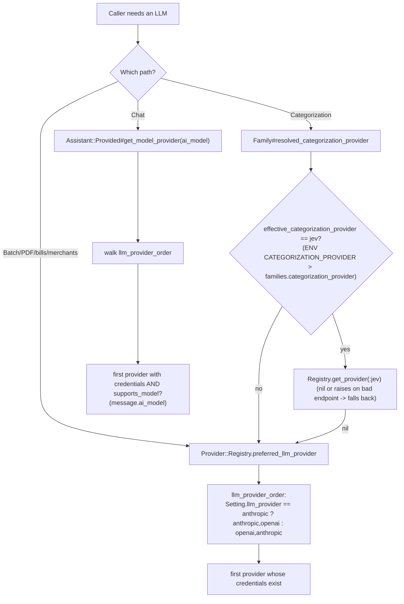

Building the providers (`Registry` private methods):

| Provider | Built when | Credentials | Endpoint | Model |
|---|---|---|---|---|
| `openai` | token present | `OPENAI_ACCESS_TOKEN` > `Setting.openai_access_token` | `OPENAI_URI_BASE` > setting (blank = api.openai.com) | `OPENAI_MODEL` > setting > `gpt-4.1`. **Required** when a custom `uri_base` is set (otherwise returns nil and logs an error). |
| `anthropic` | token present | `ANTHROPIC_ACCESS_TOKEN` > `ANTHROPIC_API_KEY` > setting | `ANTHROPIC_BASE_URL` > setting | `ANTHROPIC_MODEL` > setting > `claude-sonnet-4-6` |
| `jev` | key present | `JEV_API_KEY` > setting (deliberately **not** `OPENROUTER_API_KEY`) | `JEV_ENDPOINT` > setting > `https://api.typesafe.ai/v1/systemone` (https only, except loopback) | `JEV_MODEL` > setting > `jev-latest` |

`Setting.llm_provider` is resolved as `ENV["LLM_PROVIDER"]` first, then the DB field (`setting.rb:236`).

`Chat.default_model` (`chat.rb:59`) picks the model stamped on a new chat message: Anthropic's effective model if `llm_provider == anthropic` and Anthropic is configured, else OpenAI's, else Anthropic's.

## B2. How OpenAI / OpenAI-compatible is called

> **Related PRs:** [#4133](https://github.com/we-promise/sure/issues/4133) tool rounds replayed as message pairs · [#4261](https://github.com/we-promise/sure/issues/4261) json_mode in PDF extraction · [#3979](https://github.com/we-promise/sure/issues/3979) Gemini 3 via compatible endpoint · [#4291](https://github.com/we-promise/sure/issues/4291) Gemini 4 Argon · [#3694](https://github.com/we-promise/sure/issues/3694) *(open, v0.7.7)* model suggestions from /models · [#3605](https://github.com/we-promise/sure/issues/3605) *(open, v0.7.7)* reasoning effort setting

**Key files:** `app/models/provider/openai.rb`, `app/models/provider/openai/*`, `.../concerns/json_mode.rb`, `.../batch_slicer.rb`.

Two transports:

| Mode | When | API | Streaming | History |
|---|---|---|---|---|
| **Native** | no `uri_base`, or `OPENAI_SUPPORTS_RESPONSES_ENDPOINT=true` | `client.responses.create` (Responses API) | yes (SSE via `ChatStreamParser`) | server-side via `previous_response_id` |
| **Generic** | custom `uri_base` (default), or `OPENAI_SUPPORTS_RESPONSES_ENDPOINT=false` | `client.chat` (Chat Completions) | **no**: emits whole text as one fake chunk | rebuilt each turn from DB, trimmed by `Assistant::HistoryTrimmer` |

Batch operations (`auto_categorize`, `auto_detect_merchants`, `enhance_provider_merchants`):

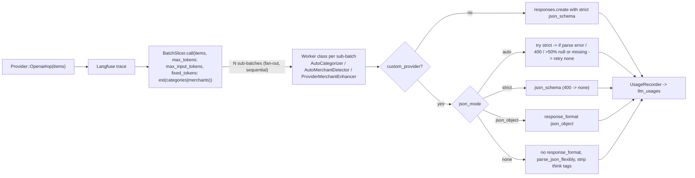

- **Token budget** (all ENV > Setting > default): `context_window` = `Assistant::TokenBudget.context_window` (`LLM_CONTEXT_WINDOW`), `max_response_tokens` (`LLM_MAX_RESPONSE_TOKENS`, default 512 for budget maths only), `system_prompt_reserve` (`LLM_SYSTEM_PROMPT_RESERVE`, 256), `max_history_tokens` (`LLM_MAX_HISTORY_TOKENS`). The response cap is only *sent* when explicitly configured.
- **JSON mode**: `LLM_JSON_MODE` > `Setting.openai_json_mode` > `auto`.
- **Headers**: `OPENAI_EXTRA_HEADERS` (JSON object). Values containing `{session_id}` are applied per chat request only.
- **Timeout**: `OPENAI_REQUEST_TIMEOUT` > setting > 60s.
- **Model allow-list** (native only): prefixes `gpt-4 gpt-5 gpt-6 o1 o3`. Custom endpoints accept any model.
- **PDF**: `supports_pdf_processing?` needs `OPENAI_SUPPORTS_PDF_PROCESSING` (default true) and either a custom endpoint or a vision-capable prefix.

## B3. How Anthropic is called

> **Related PRs:** [#4178](https://github.com/we-promise/sure/issues/4178) tool_choice auto for Claude models that reject a forced tool · [#4243](https://github.com/we-promise/sure/issues/4243) native Anthropic docs

**Key files:** `app/models/provider/anthropic.rb`, `app/models/provider/anthropic/*`.

- SDK `::Anthropic::Client`. Timeout `ANTHROPIC_REQUEST_TIMEOUT` (600s). Chat `max_tokens` = `ANTHROPIC_MAX_TOKENS` (4096).
- **Structured output = forced tool use**: every batch worker defines an output tool (`output_tool`) and sets `tool_choice` to that tool (`structured_output_tool_choice`; for models that can't force a tool, the instruction goes into the system prompt instead).
- **No `BatchSlicer`**: Anthropic batch calls send the caller's whole batch (already capped at `LLM_MAX_ITEMS_PER_CALL` by the rule action) in a single request.
- **Chat**: `messages.stream` when a streamer is given, else `messages.create`. History comes from DB records (`MessageFormatter`). The system prompt is sent as a block with `cache_control: ephemeral` (prompt caching). `tool_choice: none` on the final tool round.
- **PDF**: native `document` content block (`Anthropic::PdfProcessor`, `BankStatementExtractor`). No text-extraction step.

## B4. How Jev is called

> **Related PRs:** [#4401](https://github.com/we-promise/sure/issues/4401) redact Jev endpoint in settings

**Key file:** `app/models/provider/jev.rb` (implements `ClassificationConcept`, *not* `LlmConcept`).

- One HTTP POST **per transaction** (Jev takes one "state" per request). Requests run concurrently on a `Concurrent::FixedThreadPool` of `JEV_CONCURRENCY` (default 8), each wrapped in `Rails.application.executor.wrap`.
- Faraday with retry: 3 retries with backoff on POST, 429, 5xx and connection failure. Timeout `JEV_REQUEST_TIMEOUT` (30s), open timeout 5s.
- Each request asks a `choice` question over the category names, plus the sentinel `__uncategorized__` (mapped back to nil).
- It returns `CategoryDecision` with `confidence` and `probabilities`, which is what the confidence threshold in W8 can gate on. LLM answers can never be gated.

## B5. Embeddings and vector stores

**Key files:** `app/models/vector_store.rb`, `vector_store/registry.rb`, `vector_store/{openai,pgvector,qdrant,embeddable}.rb`, `app/models/family/vector_searchable.rb`.

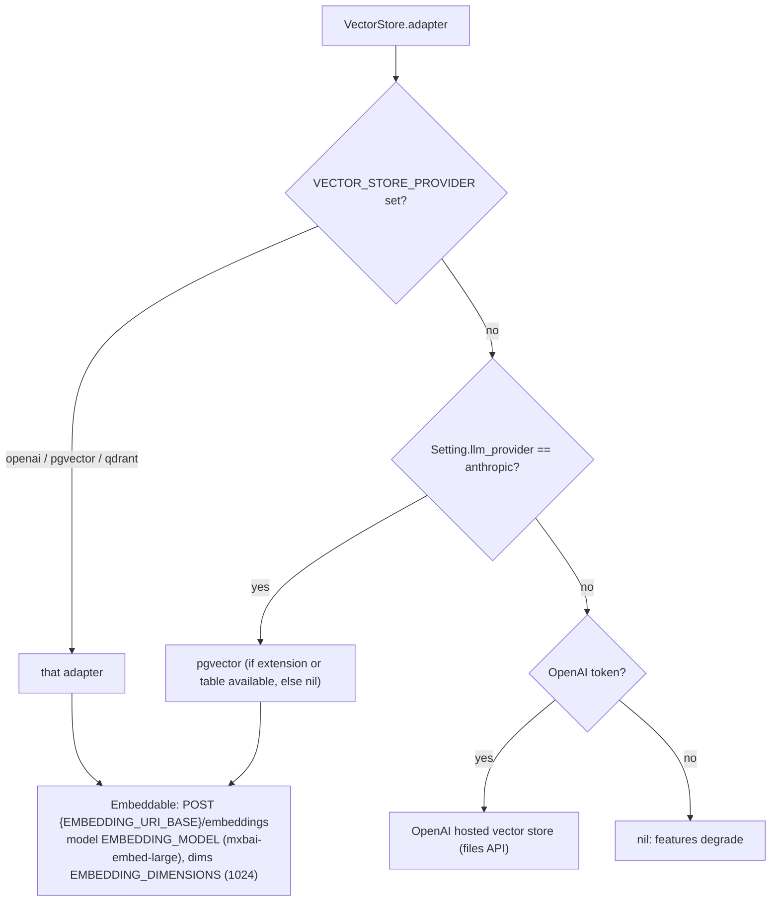

pgvector and Qdrant chunk the text (`Embeddable#chunk_text`) and embed it themselves. The OpenAI adapter uploads files to OpenAI's vector store and lets OpenAI embed them. The embedding token is `EMBEDDING_ACCESS_TOKEN` > `OPENAI_ACCESS_TOKEN`, and the endpoint is `EMBEDDING_URI_BASE` > `OPENAI_URI_BASE` > api.openai.com.

## B6. Cross-cutting: prompts, tracing, usage, errors

| Concern | Where | Behaviour |
|---|---|---|
| **Prompt overrides** | `Family::AiPromptable` (`families.ai_prompt_overrides` jsonb, edited at `/settings/ai_prompts`) | Keys: `chat_system`, `categorizer_openai`, `categorizer_anthropic`, `merchant_openai`, `merchant_anthropic`, `insight_dig_in`. Resolved as `family.ai_prompt(key) \|\| default`. The OpenAI override replaces **both** the simple (custom endpoint) and detailed (native) variants. Max 20,000 chars. |
| **Langfuse** | `LangfuseTraceable`, `config/initializers/langfuse.rb` | On when `LANGFUSE_PUBLIC_KEY` + `LANGFUSE_SECRET_KEY` are set (`LANGFUSE_HOST`). One trace per provider op. Chat traces carry `session_id` = chat id and `user_id` = SHA256(user id). |
| **Usage / cost** | `LlmUsage`, `Provider::*::Concerns::UsageRecorder` | Row per call in `llm_usages` (provider inferred from model, tokens, estimated cost; errors recorded with 0 tokens and an HTTP status). Needs `family:`. |
| **Debug log** | `DebugLogEntry.capture` | Categories `auto_categorization`, `rule_run`, `insights`, `ai_cache_reset`, … shown at `/settings/debug`. |
| **Result wrapper** | `Provider#with_provider_response` | Exceptions become `Provider::Response(success?: false, error:)`. Callers check `.success?`. |
| **AI consent / availability** | `User#ai_enabled?` = user toggle && `ai_available?` (assistant type ≠ `mcp_only` and a provider or external agent is configured; always true in managed mode) | Gates **chat** (`RequiresAiConsent`) and **bill AI** (`bills_one_shot_ai_available?`). **Rule-driven AI (W8/W9) is not gated per user.** It is gated by provider presence and by the rule existing. |

---

# Part C: Workflows

Each workflow lists: **Key files and functions**, a **diagram**, **Entry** and **Exit**, **Settings and env**, **Fan-outs**, and **Sync and async** behaviour.

---

## W1. Family sync

> **Related PRs:** [#4001](https://github.com/we-promise/sure/issues/4001) skip account sync for descriptive edits · [#3989](https://github.com/we-promise/sure/issues/3989) keep locked date/amount on re-import · [#3780](https://github.com/we-promise/sure/issues/3780) *(open, v0.7.7)* SimpleFIN backfill

Not AI itself, but it is the **trigger of almost every automatic AI/ML run** (rules → Bayes, matcher, AI jobs; recurring pipeline).

### Key files and functions
| File | Function |
|---|---|
| `app/models/concerns/syncable.rb` | `sync_later`: dedups against a `visible` (<5 min) sync, else creates a `Sync` and runs `SyncJob.perform_later` |
| `app/jobs/sync_job.rb` | `perform(sync, balances_only:)` → `sync.perform` |
| `app/models/sync.rb` | `perform` (AASM `start!`) → `syncable.perform_sync(self)` → `finalize_if_all_children_finalized` (row lock, complete/fail/stale, then `perform_post_sync` → `syncable.perform_post_sync` + `broadcast_sync_complete`; propagates to parent) |
| `app/models/family/syncer.rb` | `perform_sync`: `child_syncables.each(&:sync_later)` (every `*_items` association that includes `Syncable` + `accounts.manual`); `perform_post_sync`: `auto_match_transfers!`, `backfill_provider_merchant_logos`, `ApplyRulesJob.perform_later(family)` |
| `app/models/account/syncer.rb` | market data, `Balance::Materializer`, IBKR overrides, anchor gap check; `perform_post_sync` → `auto_match_transfers!(account:)` |
| `app/models/<provider>_item/syncer.rb` | import from provider API → process accounts (creates entries, `ProviderMerchant`s, provider-sourced enrichments) → `schedule_account_syncs(parent_sync:)` |
| `app/models/family/sync_complete_event.rb` | toasts, plus `RecurringTransaction.identify_patterns_for(family)` (→ W19) |
| `app/jobs/sync_all_job.rb`, `sync_hourly_job.rb`, `sync_all_providers_job.rb` | cron and API entry |
| `app/controllers/concerns/auto_sync.rb` | `before_action :sync_family` when last sync < today and `family.auto_sync_on_login` |

### Diagram
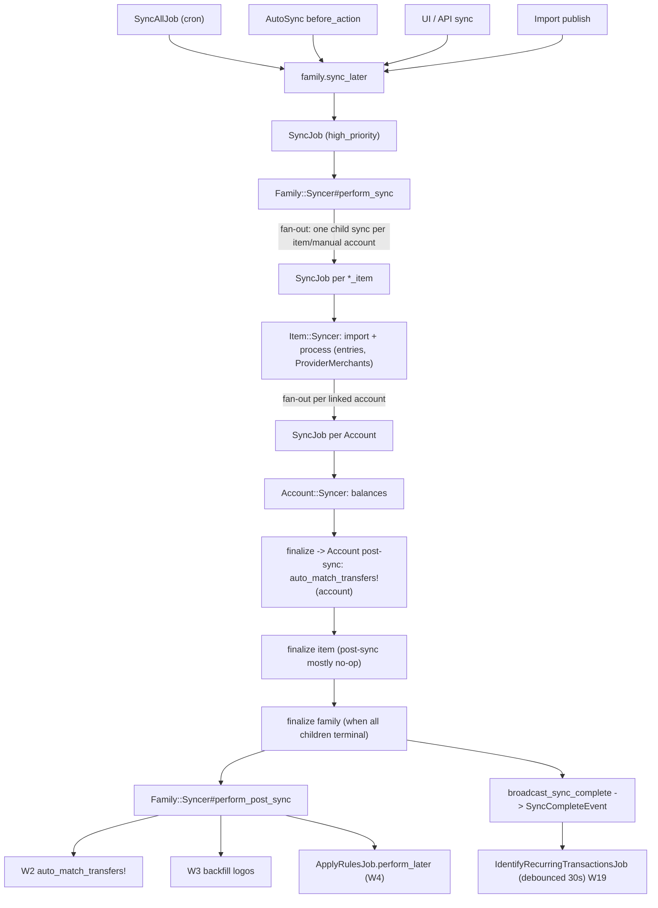

### Entry and exit
- **Entry:** `SyncAllJob` cron; `AutoSync` on first page load of the day; sync buttons; `SyncAllProvidersJob` (API); `Import#publish` → `family.sync_later`; FinanceKit downstream.
- **Exit:** family sync reaches `completed`/`failed`/`stale`. Post-sync runs **unless stale**, even on failure. Cancellation (`request_cancel!`) resolves to stale and skips post-sync.

### Settings and env
`AUTO_SYNC_ENABLED`, `AUTO_SYNC_TIME`, `AUTO_SYNC_TIMEZONE` (Settings → Self-hosting), `families.auto_sync_on_login`, `syncs_include_pending` / `PLAID_INCLUDE_PENDING` / `SIMPLEFIN_INCLUDE_PENDING`.

### Fan-outs
Family → N item syncs → M account syncs (each its own `SyncJob`). Post-sync then fans out to rules (W4) and the recurring pipeline (W19).

### Sync and async
Fully async. Parent completion is **event-driven bottom-up** (`finalize_if_all_children_finalized` from each child). Post-sync work (W2, W3) runs synchronously **inside the last finishing child's job thread**. Rules are enqueued.

---

## W2. Transfer auto-matching

> **Related PRs:** [#4303](https://github.com/we-promise/sure/issues/4303) matching controls beside amounts · [#4158](https://github.com/we-promise/sure/issues/4158) reset kept leg's kind · [#3224](https://github.com/we-promise/sure/issues/3224) *(open, v0.7.7)* categorize transfers on creation

### Key files and functions
`app/models/family/auto_transfer_matchable.rb`: `auto_match_transfers!`, `transfer_match_candidates`, `transfer_match_candidates_sql`, `find_or_create_transfer!`. Callers: `Family::Syncer#perform_post_sync` (whole family), `Account::Syncer#perform_post_sync` (per account), `Financekit::Downstream`.

### Algorithm (pure SQL plus greedy Ruby)
1. Candidate SQL (`UNION ALL`):
   - **rank 0**: same currency, `outflow.amount = -inflow.amount`, different accounts, within ±`date_window` (4) days.
   - **rank 1**: cross-currency, using the direct FX rate or a cross rate via the family currency, accepted within `1 ± tolerance`. On the automatic path, only when **both accounts are provider-linked** or a previously **confirmed transfer route** exists between the two accounts.
   - Excludes existing transfers and rejected pairs. Requires a member who can write to both accounts.
   - Ordered by `match_rank`, then `date_diff`.
2. Greedy pass: each transaction is used once. `Transfer.find_or_create_by!` runs inside a savepoint (tolerates concurrent syncs).
3. New transfers are **pending** until the user confirms.

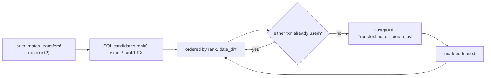

- **Entry:** post-sync (family and each account). The manual "match as transfer" dialog uses `transfer_match_candidates` with a wider window (30 days) and a tolerance of at least 10%.
- **Exit:** returns after all candidates are consumed. Errors bubble up to `Sync#perform_post_sync`, which logs them to Sentry and does not fail the sync.
- **Env:** `TRANSFER_MATCH_EXCHANGE_RATE_TOLERANCE` (default 0.1, capped at 0.5).
- **Fan-outs:** none.
- **Sync and async:** synchronous inside the sync job.
- **Interaction with AI/ML:** runs **before** rules, so transfer kinds are known. Bayes (`exclude_transfers`, and `UNCATEGORIZED_EXCLUDED_KINDS`) and the matcher (`TRANSFER_KINDS`) skip transfers.

---

## W3. Provider-merchant logo backfill

> **Related PRs:** [#4305](https://github.com/we-promise/sure/issues/4305) *(open, v0.7.6)* initials fallback + Brandfetch usage

`Family#backfill_provider_merchant_logos` → `ProviderMerchant.where(id: family txn merchant ids).backfill_logos`, which builds Brandfetch logo URLs from `website_url` (`BRAND_FETCH_CLIENT_ID`, `BRAND_FETCH_HIGH_RES_LOGOS`). No LLM. It runs on **post-sync** and at the **start of every W10 enhancer run**. Errors are swallowed (returns 0).

---

## W4. Rules sequencing

> **Related PRs:** [#4013](https://github.com/we-promise/sure/issues/4013) fixed order + stop processing · [#4089](https://github.com/we-promise/sure/issues/4089) starts with / ends with / regex · [#4246](https://github.com/we-promise/sure/issues/4246) tag not-equal / not-empty · [#4175](https://github.com/we-promise/sure/issues/4175) validate action and resource types · [#4109](https://github.com/we-promise/sure/issues/4109) reject null bytes · [#4211](https://github.com/we-promise/sure/issues/4211) skip email notifications for inactive rules · [#4176](https://github.com/we-promise/sure/issues/4176) *(open, v0.7.6)* email action baseline

The orchestrator that runs Bayes (W6), the matcher (W5) and the AI jobs (W8, W9) in user-defined order.

### Key files and functions
| File | Function |
|---|---|
| `app/jobs/apply_rules_job.rb` | post-sync: `Rule::Runner.new(family, rules: active, execution_type: "scheduled").run` (`retry_on LockBusy` 30s × 20) |
| `app/jobs/apply_all_rules_job.rb` | "Apply all" button: **all** rules, inactive ones included (`rules: family.rules`), `ignore_attribute_locks: true` |
| `app/jobs/rule_job.rb` | single rule (UI "Apply", assistant `apply_rule`): runs the active rules above first; `discard_on SafeRegex::TimeoutError` |
| `app/models/rule/runner.rb` | `run` → `with_family_lock` (pg advisory lock) → `run_rules` → `execute(rule)` → `rule.apply(scope:, claimed_ids:)`; `record_claims` |
| `app/models/rule.rb:233` | `apply`: per action, excludes ids already *claimed* for its attributes, calls `action.apply` |
| `app/models/rule/action_executor/*.rb` | 13 executors |
| `app/models/rule/registry/transaction_resource.rb` | `resource_scope` (visible, non-split-parent, `entry.date >= rule.effective_date`), `ACTION_EXECUTOR_CLASSES`, `offered?` (AI actions offered only with a provider) |
| `app/models/rule_run.rb` | `complete_job!` / `fail_job!` (async AI job callbacks, row-locked) |
| `app/models/family.rb:540-575` | classifier rules: `CLASSIFIER_ACTION_TYPES`, `add_classifier_rule!` (position 1, others shift), `after_create_commit :add_classifier_rules` |
| `db/migrate/20261020090001_add_classifier_rules.rb` | existing families get "Merchant matcher" (pos 1) and "Category classifier" (pos 2). **Active only if** the family already had an active AI rule of the matching type. |

### Semantics
- **Order:** `rules.ordered` = `position, created_at, id`.
- **Top rule wins:** after a rule runs, the matched ids are *claimed* for each attribute its actions `reserves_claimed_attributes?`. Lower rules skip those ids for that attribute. **The AI, Bayes and matcher actions return `reserves_claimed_attributes? = false`**, so they don't block lower rules, because they only fill what they can.
- **stop_processing:** matched ids are removed from every lower rule's scope.
- **Requested vs. above:** for `RuleJob`, active rules above the requested one run first (so the result equals the nightly run), and rules below don't run.
- **One run per family** (advisory lock). A busy lock raises `LockBusy` and the job retries.

### Diagram
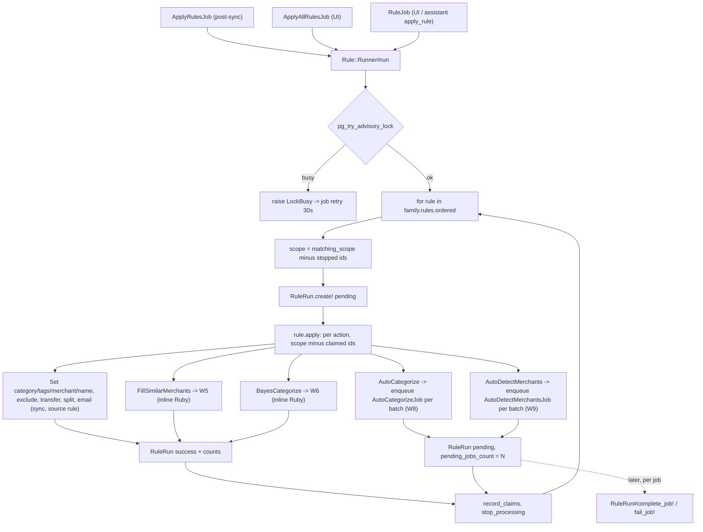

### Default order after [#4310](https://github.com/we-promise/sure/issues/4310)
```
1  Merchant matcher       (fill_similar_merchants)   W5
2  Category classifier    (bayes_categorize)         W6
3+ user rules, including any AI rules (auto_detect_merchants, auto_categorize)
```
So within one run the matcher fills merchants **before** Bayes reads them (with `merchant_field`/`merchant_name_words`), and Bayes categorizes **before** AI. AI only sees what Bayes left uncategorized, because the `AutoCategorizer` scope is `category_id: nil`. Users can reorder.

**Important timing nuance:** AI actions are *queued*. Their results land after the runner has finished, so a deterministic rule **below** an AI rule cannot see the AI's category or merchant in the same run (only in the next run).

### Entry and exit
- **Entry:** post-sync, "Apply all", per-rule "Apply" (`rules_controller.rb:63`, `ignore_attribute_locks: true`), assistant `apply_rule`, `rake rules:apply_all`.
- **Exit:** the runner returns `RuleRun[]`. A rule's failure is recorded (`RuleRun failed` + `DebugLogEntry rule_run`) and the remaining rules continue. `RuleJob` re-raises if the requested rule failed. Async AI runs finish later via `complete_job!`, which sets status `success` when `pending_jobs_count` reaches 0, unless a job failed.

### Settings and env
Rule `active`, `position`, `stop_processing`, `effective_date`, and conditions. The AI actions are offered when `family.resolved_categorization_provider` / `preferred_llm_provider` is present. Batch size: `LLM_MAX_ITEMS_PER_CALL` > `Setting.llm_max_items_per_call` > 25.

### Fan-outs
Per AI action: `ceil(enrichable / batch_size)` jobs. Per rule: one `RuleRun`.

### Sync and async
The runner is synchronous inside a `medium_priority` job (default capsule). **Bayes and the matcher run inline** in that job thread (CPU-bound Ruby). The AI actions are fire-and-forget into the `ai` capsule.

---

## W5. Merchant matcher

> **Related PRs:** [#4310](https://github.com/we-promise/sure/issues/4310) matcher and Bayes as rules · [#4435](https://github.com/we-promise/sure/issues/4435) migration version fix

Ruby ML: TF-IDF cosine over words and character 3-grams, then a neighbour-agreement vote.

### Key files and functions
| File | Function |
|---|---|
| `app/models/rule/action_executor/fill_similar_merchants.rb` | `execute(scope)` → `family.fill_similar_merchants(scope)` |
| `app/models/family.rb:525` | `fill_similar_merchants(scope)`: filter `merchant_id: nil`, not transfer kinds, `enrichable(:merchant_id)` → filler → `DebugLogEntry` |
| `app/models/family/similar_merchant_filler.rb` | `fill(ids)`, `pool`, `confirmed`, `own_copy_sql` |
| `app/models/family/similar_matcher.rb` | `neighbours`, `agreed`, `index`, `idfs`, `features` |

### Algorithm
1. **Pool** = the newest `max_training_transactions` (5,000) non-transfer transactions **with** a merchant. With `similar_skip_self`, it excludes the matcher's own unconfirmed copies younger than `similar_self_grace_days`.
2. **Features** per `entry.name`: lowercase unicode words (dropping all-digit tokens and reference codes like `2k4l19`), plus padded char 3-grams.
3. **IDF**: features in more than `max(pool × similar_common_share, 50)` documents are dropped. idf = `ln((N+1)/(df+1))+1`. tf is sublinear (`1+ln tf`). Vectors are L2-normalized. Words and grams are averaged.
4. **Neighbours**: similarity ≥ `similar_threshold` (0.9).
5. **Agreement**: at least `similar_min_neighbours` (2) neighbours have a merchant **and all have the same one**, else no fill.
6. `enrich_attribute(:merchant_id, source: "similar")`, and lock if `lock_similar_merchants`.

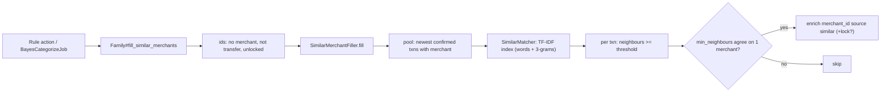

- **Entry:** the "Merchant matcher" rule (W4), or the Settings → Classifier **Run** button (`BayesCategorizeJob`, only if the matcher rule is active).
- **Exit:** returns the filled count (the integer counts as `modified` in `RuleRun`). Logs `DebugLogEntry auto_categorization`.
- **Settings** (`families.bayes_settings`, Settings → Classifier → Merchant matcher): `similar_threshold`, `similar_min_neighbours`, `similar_common_share`, `similar_skip_self`, `similar_self_grace_days`, `lock_similar_merchants`, `max_training_transactions`. Rule active/position.
- **Fan-outs:** none.
- **Sync and async:** synchronous, in-process, inside the rules job or `BayesCategorizeJob`.

---

## W6. Category classifier (Bayes)

> **Related PRs:** [#4310](https://github.com/we-promise/sure/issues/4310) · [#4435](https://github.com/we-promise/sure/issues/4435)

Ruby ML: multinomial or complement naive Bayes, with optional amount Gaussians and account/merchant fields.

### Key files and functions
| File | Function |
|---|---|
| `app/models/rule/action_executor/bayes_categorize.rb` | `execute(scope)` → `family.bayes_categorize_uncategorized(scope)` |
| `app/models/family.rb:506` | `bayes_categorize_uncategorized(scope)`: `category_id: nil`, not `UNCATEGORIZED_EXCLUDED_KINDS`, `enrichable(:category_id)` → `BayesCategorizer#classify_and_apply` → `DebugLogEntry` |
| `app/models/family/bayes_categorizer.rb` | `enough_training_data?`, `classify`, `probabilities`, `classify_and_apply`, `training_transactions`, `class_models`, `log_scores_for`, `token_log_likelihood`, `amount_log_likelihood`, `softmax` |
| `app/models/family/bayes_settings.rb` | `DEFAULTS`, `RANGES`, `CHOICES`, `digest`, `to_stored` (only non-default keys stored) |

### Algorithm
1. **Training set**: the newest `max_training_transactions` categorized transactions, minus `excluded_category_ids` (and their children), minus transfers (`exclude_transfers`), minus **Bayes' own unconfirmed labels** younger than `self_label_grace_days` (`skip_self_labels`, default on).
2. **Guard**: at least 20 training transactions and at least 2 categories, else a no-op.
3. **Tokens**: words of name (+ notes + merchant name), with tokenizer `word_split` = ascii / unicode / symbols, and optional `drop_numbers`, `keep_single_chars`, `drop_codes`, `bigrams`, `binary`. Optional `merchant:<id>` and `account:<id>` tokens. Optional `spread_filter` (drops tokens with an even rate across classes).
4. **Score**: `log P(c)` (uniform, or the empirical prior if `prior`), plus Σ token log-likelihoods with Lidstone `smoothing` (per field if `separate_fields`), plus (if `amount_field`) a per-direction × currency Gaussian on log10|amount| with variance shrinkage and a z-cap of 3. With `complement` (CNB, Rennie 2003) the scores use counts from all *other* classes, negated.
5. **Softmax**, then argmax. Apply only if confidence ≥ `threshold` (0.7).
6. `enrich_attribute(:category_id, source: "bayes", metadata: {confidence, model: "bayes-2", settings: digest, locked_by_bayes?})`, and lock if `lock_results`.

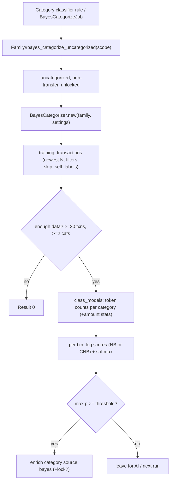

- **Entry:** the "Category classifier" rule (W4, position 2 by default), or Settings → Classifier **Run** (`BayesCategorizeJob`, which **always** runs Bayes, even when its rule is inactive).
- **Exit:** returns the modified count. Unanswered transactions stay uncategorized for later rules (AI) or the next sync.
- **Settings:** all `Family::BayesSettings::DEFAULTS` keys (Settings → Classifier sections Training / Words / Merchant / Amount / Account / Scoring / Classifier), plus rule active/position/conditions (conditions now replace the old account filter).
- **Fan-outs:** none.
- **Sync and async:** synchronous, in-memory model rebuilt per call (memoized per instance, never persisted). It runs on the default capsule, so it does not compete with the AI lane.

---

## W7. Classifier settings page

> **Related PRs:** [#4310](https://github.com/we-promise/sure/issues/4310)

**Controller:** `app/controllers/settings/classifiers_controller.rb` (admin only).

| Action | Route effect | Job | Work |
|---|---|---|---|
| `update` | save a section's settings (`update_bayes_settings!`); `reset` clears them and starts a "reset" evaluation | (`BayesEvaluationJob`) | |
| `rule` | toggle the matcher or Bayes rule active (asks to re-add if it was deleted) | none | `set_classifier_rule_active!` |
| `add_rule` | re-create the rule at position 1 | none | `add_classifier_rule!` |
| `run` | Run now | `BayesCategorizeJob` (medium) | matcher (if its rule is active), then Bayes, over **all** uncategorized transactions, **outside rule order** |
| `clear_locks` | Clear locks | `ClearBayesLocksJob` (low) | `family.clear_bayes_locks!`: unlocks only locks Bayes or the matcher set themselves and that still hold their value |
| `evaluate` / `find_best` / `apply_best` | Test / Find best / Apply | `BayesEvaluationJob` (low) | `Family::BayesEvaluation#run!` |
| `remember_weight` | cost-of-mistake weight (1-3) | none | Rails.cache |

### Evaluation (Ruby ML model selection)
`app/models/family/bayes_evaluation.rb`

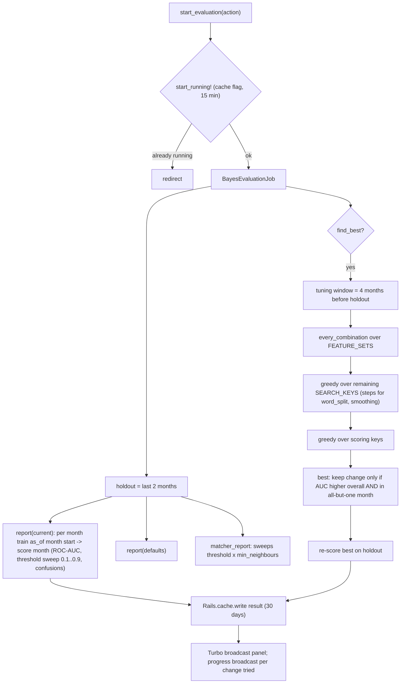

- **Entry:** buttons on Settings → Classifier.
- **Exit:** the result is cached under `cache_key(family)`, and a Turbo Stream replaces `classifier_evaluation`. `apply_best` writes the found changes, then runs a new "test".
- **Fan-outs:** none (the search is sequential; it can take minutes and shows progress).
- **Sync and async:** async, `low_priority`, not on the ai capsule.

---

## W8. AI auto-categorization

> **Related PRs:** [#4401](https://github.com/we-promise/sure/issues/4401) Jev endpoint redaction · [#4192](https://github.com/we-promise/sure/issues/4192) share permissions in bulk categorize

### Key files and functions
| File | Function |
|---|---|
| `app/models/rule/action_executor/auto_categorize.rb` | `execute`: logs cached/blocked ids, `enrichable(:category_id).in_batches(of: max_items_per_call)` → `family.auto_categorize_transactions_later(batch, rule_run_id:)`; returns `{async: true, jobs_count:}`; `label` shows a cost estimate for self-hosters (`LlmUsage.estimate_auto_categorize_cost`) |
| `app/models/family.rb:492-502` | `auto_categorize_transactions_later` → `AutoCategorizeJob.perform_later`; `auto_categorize_transactions(ids)` → `Family::AutoCategorizer#auto_categorize` |
| `app/jobs/auto_categorize_job.rb` | `ai_low_priority`; `rule_run.complete_job!` or `fail_job!` + re-raise (Sidekiq retries) |
| `app/models/family/auto_categorizer.rb` | `auto_categorize`, `categorization_provider` (memoized), `run_shadow`, `withhold?`, `record_shadow_comparisons`, `transactions_input`, `scope` |
| `app/models/family.rb:174-250` | `effective_categorization_provider`, `resolved_categorization_provider`, `categorization_model_name`, `effective_categorization_confidence_threshold`, `effective_categorization_shadow_rate`, `shadow_categorization_provider` |
| `app/models/provider/openai.rb:192` + `openai/auto_categorizer.rb` | slicing, native vs generic, JSON modes, fuzzy category-name normalization |
| `app/models/provider/anthropic.rb:100` + `anthropic/auto_categorizer.rb` | forced tool `output_tool` |
| `app/models/provider/jev.rb:157` | per-transaction `decide!` in a thread pool |
| `app/models/categorization_comparison.rb` | shadow comparison rows |

### Diagram
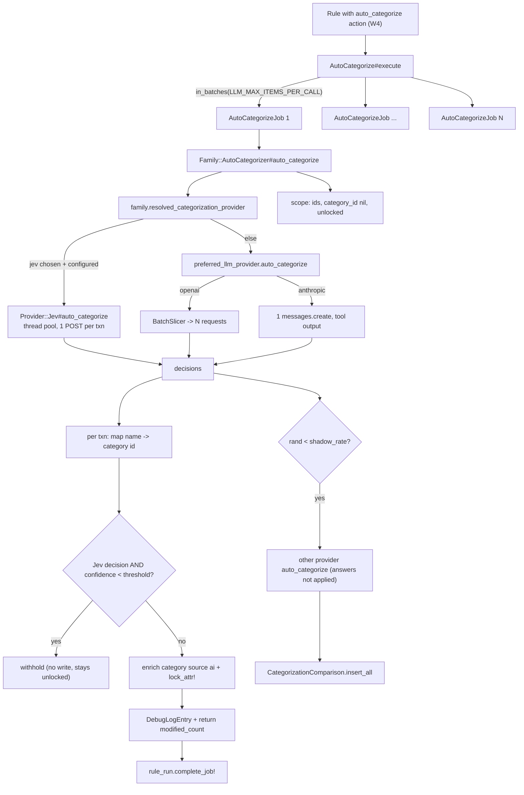

### Entry and exit
- **Entry:** only through a rule action (`auto_categorize`), triggered by W4 (post-sync, Apply, Apply all, assistant `apply_rule`). There is no direct UI button any more. The old "Bayes first inside auto_categorize" cascade was removed in [#4310](https://github.com/we-promise/sure/issues/4310) (Bayes is now its own rule).
- **Exit:** returns the modified count to `RuleRun#complete_job!`. On an exception: `fail_job!` + re-raise (Sidekiq retry). A failed provider response raises `Family::AutoCategorizer::Error`. Missing categories raise and log.

### Settings and env
| Setting | Effect |
|---|---|
| `families.categorization_provider` / `CATEGORIZATION_PROVIDER` | `jev` or LLM |
| `families.categorization_confidence_threshold` / `CATEGORIZATION_CONFIDENCE_THRESHOLD` | withhold low-confidence **Jev** answers |
| `families.categorization_shadow_rate` / `CATEGORIZATION_SHADOW_RATE` | sample runs and also ask the other provider |
| `LLM_PROVIDER` / `Setting.llm_provider` | OpenAI vs Anthropic order |
| `LLM_MAX_ITEMS_PER_CALL` | batch per job |
| `LLM_CONTEXT_WINDOW`, `LLM_MAX_RESPONSE_TOKENS`, `LLM_SYSTEM_PROMPT_RESERVE` | OpenAI sub-batching |
| `LLM_JSON_MODE` / `openai_json_mode` | OpenAI custom-endpoint output mode |
| `ai_prompt_categorizer_openai` / `_anthropic` | prompt override |
| `JEV_*` | Jev endpoint, model, concurrency, timeout |
| `RAILS_AI_MAX_THREADS` | how many AI jobs run at once |

### Fan-outs
1. Rule → N `AutoCategorizeJob`s.
2. OpenAI → `BatchSlicer` sub-requests (sequential).
3. Jev → one HTTP request per transaction (parallel, pool of 8).
4. Optional shadow → a second provider call per sampled run.

### Sync and async
Async (ai capsule, `ai_low_priority`, so behind chat). Inside a job, everything is synchronous except Jev's thread pool.

---

## W9. AI merchant detection

### Key files and functions
| File | Function |
|---|---|
| `app/models/rule/action_executor/auto_detect_merchants.rb` | batches → `family.auto_detect_transaction_merchants_later` |
| `app/jobs/auto_detect_merchants_job.rb` | `ai_low_priority`, RuleRun callbacks |
| `app/models/family/auto_merchant_detector.rb` | `auto_detect`, `find_matching_user_merchant`, `find_or_create_ai_merchant`, `enhance_provider_merchant` |
| `provider/openai/auto_merchant_detector.rb`, `provider/anthropic/auto_merchant_detector.rb` | prompts and parsing |

### Diagram
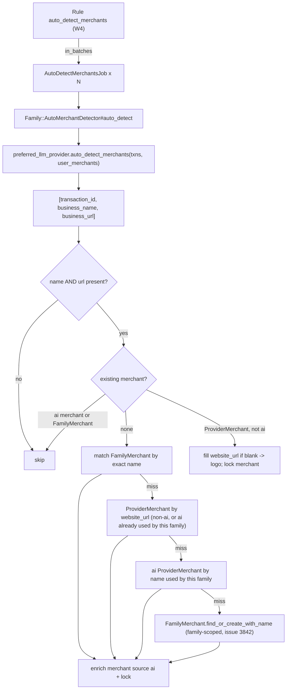

- **Entry:** rule action only (W4).
- **Exit:** modified count → `RuleRun#complete_job!`. A provider failure **logs and returns 0** (it does *not* raise, unlike W8), so the RuleRun counts it as success with 0 modified. Having no provider at all raises.
- **Settings:** `LLM_PROVIDER`, `LLM_MAX_ITEMS_PER_CALL`, the token budget, `LLM_JSON_MODE`, `ai_prompt_merchant_openai` / `_anthropic`, `BRAND_FETCH_*` (logo from website).
- **Fan-outs:** rule → N jobs. OpenAI → slicer sub-requests.
- **Sync and async:** async (ai capsule).

---

## W10. Provider-merchant enhancement

Adds a website (and so a logo) to provider-supplied merchants that lack one, then dedupes merchants that share the same website.

### Key files and functions
`app/controllers/family_merchants_controller.rb#enhance` (and `@llm_available`), `app/jobs/enhance_provider_merchants_job.rb`, `app/models/provider_merchant/enhancer.rb` (`batches`, `enhance`, `deduplicate_by_website`), `provider/*/provider_merchant_enhancer.rb`.

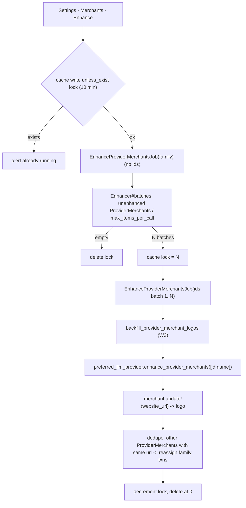

- **Entry:** the Merchants settings page button only.
- **Exit:** each batch job returns `{enhanced, deduplicated, logos}`. The last job deletes the lock. Failed provider results are skipped silently (`next unless result.success?`).
- **Settings:** LLM provider, `LLM_MAX_ITEMS_PER_CALL`, token budget, `LLM_JSON_MODE`, `BRAND_FETCH_*`.
- **Fan-outs:** a two-level job fan-out (1 → N jobs), then the OpenAI slicer inside each.
- **Sync and async:** async (ai capsule).
- **Note:** the button's availability uses `Provider::Registry.get_provider(:openai).present?` (see D4).

---

## W11. PDF ingestion

> **Related PRs:** [#4261](https://github.com/we-promise/sure/issues/4261) json_mode honoured · [#4054](https://github.com/we-promise/sure/issues/4054) statement period/balances from PDF text · [#4299](https://github.com/we-promise/sure/issues/4299) rejected statements stay in vault inbox · [#4263](https://github.com/we-promise/sure/issues/4263) devcontainer pgvector for document import

### Key files and functions
| File | Function |
|---|---|
| `app/controllers/imports_controller.rb:243` | PDF upload → `PdfImport.create_from_upload!` → `process_with_ai_later` |
| `app/models/pdf_import.rb` | `create_from_statement!` (statement vault), `process_with_ai_later` (row-locked claim → `ProcessPdfJob`), `process_with_ai`, `extract_transactions`, `generate_rows_from_extracted_data`, `reap_stuck!` |
| `app/jobs/process_pdf_job.rb` | `perform`: classify/summarize → vector upload → extract → rows → email → status; `discard_on Provider::Error` |
| `provider/openai/pdf_processor.rb` | `:auto`: text extraction (pdf-reader) → `client.chat`, else **vision** (PDF pages → images) |
| `provider/openai/bank_statement_extractor.rb` | page text → chunks of 3,000 chars → **one chat call per chunk** → dedupe |
| `provider/anthropic/pdf_processor.rb`, `anthropic/bank_statement_extractor.rb` | native `document` block, forced tool |
| `app/models/family/vector_searchable.rb` | `upload_document` → W12 |

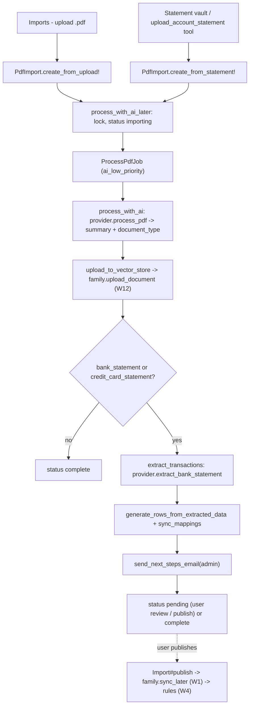

- **Entry:** PDF upload on the Import page, statement vault, the assistant's `upload_account_statement` tool (preview).
- **Exit:** `pending` (rows await review), `complete` (non-statement), or `failed` (with a sanitized error; a `Provider::Error` is discarded with no retry, other errors are retried by Sidekiq). `SyncCleanerJob` reaps stuck imports.
- **Settings and env:** `LLM_PROVIDER`; `OPENAI_SUPPORTS_PDF_PROCESSING`; a vision-capable model (OpenAI native); `LLM_MAX_RESPONSE_TOKENS` (reasoning models use `max_completion_tokens` only when explicit); `LLM_JSON_MODE`; `ANTHROPIC_MAX_TOKENS` / timeouts; vector store env (W12).
- **Fan-outs:** OpenAI extractor → one LLM call per 3,000-char chunk (sequential). The `:auto` PDF mode can make two attempts (text, then vision). Vector upload → embeddings batch calls.
- **Sync and async:** async (ai capsule). Publishing later triggers a normal sync → rules → AI enrichment of the imported rows.

---

## W12. Document upload and semantic search

> **Related PRs:** [#4263](https://github.com/we-promise/sure/issues/4263) pgvector in devcontainer · [#4203](https://github.com/we-promise/sure/issues/4203) family access checks for document blobs

### Key files and functions
`imports_controller.rb:283` (non-PDF documents uploaded **synchronously in the request**), `Family::VectorSearchable` (`ensure_vector_store!`, `upload_document`, `search_documents`, `remove_document`), `VectorStore::*` adapters, `Assistant::Function::SearchFamilyFiles`.

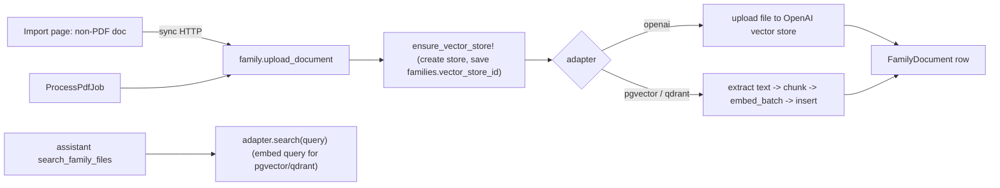

- **Entry:** document upload; PDF job; the assistant tool.
- **Exit:** a `FamilyDocument` (status ready) or nil (logged). Search returns chunks or `[]` (the tool returns a "provider_not_configured" hint when there is no adapter).
- **Env:** `VECTOR_STORE_PROVIDER`, `EMBEDDING_MODEL`, `EMBEDDING_DIMENSIONS`, `EMBEDDING_URI_BASE`, `EMBEDDING_ACCESS_TOKEN`, `OPENAI_ACCESS_TOKEN`/`OPENAI_URI_BASE` (fallbacks), `QDRANT_URL`, `QDRANT_API_KEY`, `LLM_PROVIDER` (anthropic ⇒ pgvector default).
- **Fan-outs:** embedding batches.
- **Sync and async:** the upload of a non-PDF document is synchronous in the web request. Search runs synchronously inside the chat job.

---

## W13. Built-in assistant chat

> **Related PRs:** [#4133](https://github.com/we-promise/sure/issues/4133) tool rounds · [#4244](https://github.com/we-promise/sure/issues/4244) chat routing · [#4421](https://github.com/we-promise/sure/issues/4421) mobile: full chat history · [#4295](https://github.com/we-promise/sure/issues/4295) *(open, v0.7.6)* demo assistant banner

### Key files and functions
| File | Function |
|---|---|
| `app/controllers/chats_controller.rb` | `new` (with `insight_id` prefill), `create` → `Chat.start!`, `retry`; `RequiresAiConsent` |
| `app/controllers/messages_controller.rb`, `api/v1/chats_controller.rb`, `api/v1/messages_controller.rb` | add message; API retry enqueues `AssistantResponseJob` |
| `app/models/chat.rb` | `start!`, `default_model`, `ask_assistant_later` (pending AssistantMessage, "busy" status if `BackgroundJobHealth.ai_busy?`), `ask_assistant`, `add_error`, `response_timeout`, undelivered-response watchdog handling |
| `app/models/user_message.rb` | `after_create_commit :request_response_later` |
| `app/jobs/assistant_response_job.rb` | `ai_high_priority` |
| `app/models/assistant.rb` | `for_chat` → Builtin or External by `effective_assistant_type`; `function_classes(user)` (preview and guest filtering) |
| `app/models/assistant/configurable.rb` | `STATIC_INSTRUCTIONS` (cache-stable), `session_context` (currency, date format, accounts, categories), intro-layout prompt with **no tools** |
| `app/models/assistant/builtin.rb` | `respond_to`: provider for model → `Responder` → stream text into `AssistantMessage`, persist tool calls, `latest_assistant_response_id` |
| `app/models/assistant/responder.rb` | tool loop (max `ASSISTANT_MAX_TOOL_CALL_ITERATIONS`=8 rounds; last round `tool_choice: :none`); `group_by_round`; history payloads |
| `app/models/assistant/function_tool_caller.rb` | executes functions, errors returned as `{error, hint}` data |
| `app/models/assistant/function/*.rb` | 30 tools by default (16 of them change data), 44 with preview features (statements, valuations, insights, bills) |
| `app/models/assistant/history_trimmer.rb`, `token_budget.rb`, `token_estimator.rb` | context fitting for the generic path |

### Diagram
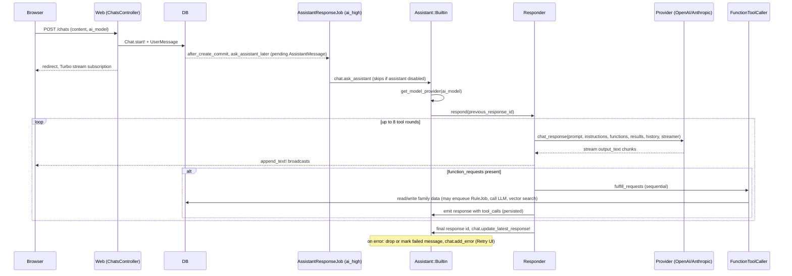

### Provider-specific shape
- **OpenAI native:** `previous_response_id` chaining. Only the new round's function results are sent.
- **OpenAI generic:** the full history is rebuilt from DB (`openai_messages_payload`) and trimmed. All in-flight rounds are replayed each request. **No streaming** (one chunk at the end), which is why `AI_RESPONSE_TIMEOUT` exists.
- **Anthropic:** history from `chat_message_records` via `MessageFormatter`; system prompt cached; streaming.

### Entry and exit
- **Entry:** chat UI (new chat, follow-up message, retry), API v1 chats/messages, "Dig in with AI" (W18, prefill only, the user must send).
- **Exit:** the AssistantMessage is complete and the chat's `latest_assistant_response_id` is updated. Error paths: `ToolCallLimitError`, `EmptyResponseError`, provider error → `chat.add_error` (classified: rate limit, temporary, auth). If the job never runs, the browser watchdog reports "undelivered" after `AI_RESPONSE_TIMEOUT` (≥30s, default 90s) and the server cleans up.

### Settings and env
`ASSISTANT_TYPE` / `families.assistant_type` (`builtin`/`external`/`mcp_only`), `LLM_PROVIDER`, model envs, `ASSISTANT_MAX_TOOL_CALL_ITERATIONS`, `AI_RESPONSE_TIMEOUT` / `Setting.ai_response_timeout`, the token-budget envs, `OPENAI_SUPPORTS_RESPONSES_ENDPOINT`, `OPENAI_EXTRA_HEADERS`, `ANTHROPIC_MAX_TOKENS`, `ai_prompt_chat_system`, the user's `ai_enabled`, `ui_layout` (intro ⇒ no tools), `preview_features_enabled` (extra tools), guest role (no family-config tools), Langfuse keys.

### Fan-outs
Up to 8 sequential LLM rounds per turn. Each round can call several tools (executed sequentially). Tools can fan out further (W16).

### Sync and async
Async (ai capsule, high lane, strict-first). Streaming to the browser over Turbo broadcasts.

---

## W14. External assistant

> **Related PRs:** [#4147](https://github.com/we-promise/sure/issues/4147) assistant types incl. mcp_only

`app/models/assistant/external.rb`, `assistant/external/client.rb`, `assistant/external/model_catalog.rb`.

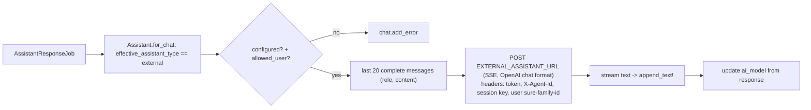

- **Entry:** the same as W13, when the family's assistant type is `external` (env `ASSISTANT_TYPE` overrides).
- **Exit:** a complete message, or a cleaned partial + `add_error`.
- **Env:** `EXTERNAL_ASSISTANT_URL`, `_TOKEN`, `_MODEL`, `_AGENT_ID` (legacy), `_SESSION_KEY`, `_ALLOWED_EMAILS`, `HTTP(S)_PROXY`/`NO_PROXY`. Settings fields of the same names.
- **Notes:** no Sure tools are passed. The external agent typically calls back into Sure via **MCP (W15)**. Sure records no `llm_usages` and no Langfuse trace for it.
- **Sync and async:** async (ai capsule), streaming.

---

## W15. MCP endpoint

> **Related PRs:** [#4147](https://github.com/we-promise/sure/issues/4147) mcp_only assistant type · [#3990](https://github.com/we-promise/sure/issues/3990) rule tools with mandatory preview · [#4157](https://github.com/we-promise/sure/issues/4157) unmatch_transfer tool · [#4163](https://github.com/we-promise/sure/issues/4163) MCP rule previews fix · [#4193](https://github.com/we-promise/sure/issues/4193) harden OAuth client registration · [#4063](https://github.com/we-promise/sure/issues/4063) *(open, v0.7.6)* delete_category, move categories · [#3025](https://github.com/we-promise/sure/issues/3025) *(open, v0.7.7)* practical financial CRUD tools

`app/controllers/mcp_controller.rb` (`POST /mcp`, JSON-RPC: `initialize`, `tools/list`, `tools/call`), `settings/mcp_controller.rb` (token management), Doorkeeper OAuth.

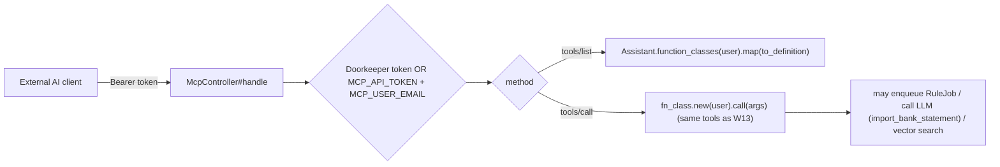

- **Entry:** an external MCP client. With `ASSISTANT_TYPE=mcp_only`, the in-app chat is disabled and MCP is the only AI surface.
- **Exit:** a JSON-RPC response (synchronous).
- **Env:** `MCP_API_TOKEN`, `MCP_USER_EMAIL`.
- **Sync and async:** synchronous HTTP. Side effects can be async (RuleJob).

---

## W16. AI-triggering assistant tools

> **Related PRs:** [#3990](https://github.com/we-promise/sure/issues/3990) preview token before apply_rule · [#3025](https://github.com/we-promise/sure/issues/3025) *(open, v0.7.7)* MCP-only destructive tools, idempotency keys

Tools in `app/models/assistant/function/` that start other AI/ML workflows:

| Tool | Triggers | Sync? |
|---|---|---|
| `apply_rule` | `rule.apply_later(ignore_attribute_locks:)` → `RuleJob` → W4 → possibly W5, W6, W8, W9 | async (enqueue) |
| `create_rule` / `update_rule` / `preview_rule` | rules incl. AI actions; preview evaluates conditions only | sync |
| `import_bank_statement` | `preferred_llm_provider.extract_bank_statement` (**a nested LLM call inside the chat job**) → creates an import | sync, nested in W13 |
| `upload_account_statement` (preview) | statement vault → `PdfImport` → W11 | async |
| `search_family_files` | vector search (W12) | sync |
| `get_insights` (preview) | reads W17 output | sync |
| `create_bill` / `update_bill` … (preview) | Bills (W19 data) | sync |

---

## W17. Insights generation

> **Related PRs:** [#4239](https://github.com/we-promise/sure/issues/4239) deterministic insight text + Dig in · [#4061](https://github.com/we-promise/sure/issues/4061) keep private accounts out of shared feed · [#4083](https://github.com/we-promise/sure/issues/4083) net worth velocity model · [#4002](https://github.com/we-promise/sure/issues/4002) *(open, v0.7.6)* spending vs normal (preview) · [#3442](https://github.com/we-promise/sure/issues/3442) *(open, v0.7.7)* weekly cleanup proactive chat

Deterministic Ruby. **No LLM** since [#4239](https://github.com/we-promise/sure/issues/4239) (`Insight::BodyWriter` is an i18n template).

### Key files and functions
`app/jobs/generate_insights_job.rb` (`fan_out`, `generate_for_family`, `upsert_insights`, `expire_stale_insights`, `broadcast_feed`, advisory lock), `app/models/insight/generator_registry.rb`, `insight/generator.rb`, `insight/generators/*.rb` (8 generators), `insight/body_writer.rb`, `app/controllers/insights_controller.rb#refresh`, `app/jobs/deliver_insight_notification_job.rb`.

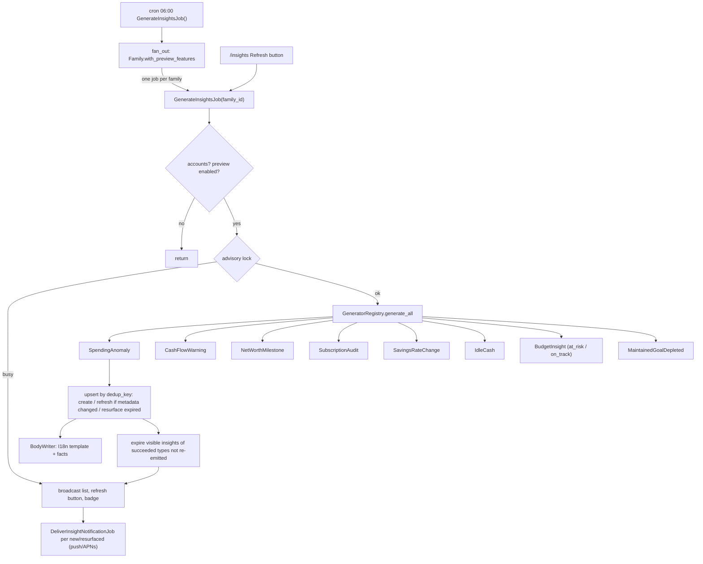

- **Entry:** the 06:00 UTC cron; the Refresh button.
- **Exit:** insights upserted, the feed broadcast, push notifications enqueued.
- **Settings:** the user's `preview_features_enabled` (family-level `with_preview_features`), family locale, push subscriptions.
- **Fan-outs:** cron → per-family jobs. Per family → 8 generators (sequential). New or resurfaced insights → notification jobs per subscription.
- **Sync and async:** async (`scheduled` queue). Generators are synchronous. A failing generator is logged and skipped, and its types are not expired.
- **Data dependency:** consumes the recurring occurrences (W19, cron at 05:30) and categories (W6, W8).

---

## W18. Dig in with AI

> **Related PRs:** [#4239](https://github.com/we-promise/sure/issues/4239)

`app/views/insights/_insight_card.html.erb` → `new_chat_path(insight_id:)`. `insights_helper.rb#insight_dig_in_available?` checks family `assistant_enabled?`, plus External configured or a `preferred_llm_provider` present. `insight_dig_in_prompt` fills `%{title} %{body} %{period} %{facts}` into the `ai_prompt_insight_dig_in` override or the i18n default. `ChatsController#new` prefills the composer.

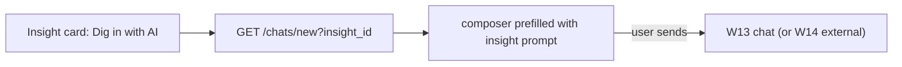

- **Entry:** an insight card button. **Exit:** hands off to W13 only after the user sends. Not sent automatically.
- **Settings:** `ai_prompt_insight_dig_in`, `ASSISTANT_TYPE`, the provider envs, the user's AI consent (asked on `chats#new`).
- **Sync and async:** synchronous page render, then the async chat.

---

## W19. Recurring / bills detection pipeline

> **Related PRs:** [#4024](https://github.com/we-promise/sure/issues/4024) N+1 in occurrences job · [#4286](https://github.com/we-promise/sure/issues/4286) eager-load recurrence rules · [#4136](https://github.com/we-promise/sure/issues/4136) preload when claiming patterns · [#4349](https://github.com/we-promise/sure/issues/4349) *(open, v0.7.6)* N+1 in price change detection · [#4222](https://github.com/we-promise/sure/issues/4222) duplicate suggestions after rename · [#4106](https://github.com/we-promise/sure/issues/4106) snoozed bills dating · [#4430](https://github.com/we-promise/sure/issues/4430) detected bill name · [#3858](https://github.com/we-promise/sure/issues/3858) *(open, v0.7.7)* Bills into Plan hub

Ruby heuristics and scoring. No LLM.

### Key files and functions
`app/models/recurring_transaction/pipeline.rb` (`run!`, `run_with_lock!`, `with_family_lock`), `identifier.rb` (amount clustering ±7.5%, cadence), `classifier.rb` (subscription vs bill keyword heuristics), `occurrence_generator.rb`, `matcher.rb` (scores payments against occurrences: exact ≥0.85 auto-link with an ambiguity margin of 0.15, high ≥0.60 suggest), `price_change_detector.rb`, `history_backfiller.rb`, `app/jobs/identify_recurring_transactions_job.rb` (debounced 30s, skipped while syncs are incomplete), `generate_recurring_occurrences_job.rb`.

```mermaid
flowchart TD
    S["SyncCompleteEvent (each sync)"] --> SCH["IdentifyRecurringTransactionsJob.schedule_for (30s debounce via cache timestamp)"]
    SCH --> J["job: stale? incomplete syncs? -> skip"]
    J --> LK["Pipeline.with_family_lock"]
    BTN["Bills / Recurring 'Identify' buttons (sync HTTP)"] --> RWL["run_with_lock!(backfill: true)"]
    LK --> RUN["Pipeline#run!"]
    RWL --> RUN
    RUN --> I["Identifier: cluster + cadence -> series (suggested)"]
    I --> O["OccurrenceGenerator per active series"]
    O --> MR["Matcher: repair_orphans! + run! (score, allocate)"]
    MR --> PC["PriceChangeDetector"]
    PC --> HB["HistoryBackfiller (6 months, only when backfill)"]
    CR["cron 05:30 GenerateRecurringOccurrencesJob"] -->|"fan-out per family"| OG["OccurrenceGenerator only (same lock)"]
```

- **Entry:** after every sync (debounced, so the last one wins), the Identify buttons (synchronous in the request), and the nightly occurrence cron.
- **Exit:** returns the pattern count, or nil when the lock is busy (buttons).
- **Settings:** `families.recurring_transactions_disabled`, per-series `amount_tolerance_pct`, user corrections (sticky).
- **Fan-outs:** cron → per-family jobs. Per family → per-series occurrence generation.
- **Sync and async:** async after sync, **synchronous** from the buttons.

---

## W20. Bill smart-fill / smart-configure

> **Related PRs:** [#4431](https://github.com/we-promise/sure/issues/4431) searchable category picker in bill form · [#4251](https://github.com/we-promise/sure/issues/4251) record payment button

LLM, **synchronous inside the web request**.

`app/controllers/recurring_transactions/smart_fills_controller.rb#create` (add-bill dialog, from a picked entry plus up to 40 similar charges), `app/controllers/bills/smart_configurations_controller.rb#show` (per bill, configure mode: only contradicted fields return), `app/models/recurring_transaction/ai_setup_suggester.rb` (`suggest_from_entries`, `suggest_configuration`, `normalize`), `provider/*/bill_setup_suggester.rb`.

```mermaid
flowchart LR
    U["Bills dialog: Smart fill / Smart configure"] --> G{"bills_one_shot_ai_available? (user ai_enabled + provider)"}
    G -->|no| X["feature guard"]
    G -->|yes| S["AiSetupSuggester (MAX_CHARGES 40)"]
    S --> P["preferred_llm_provider.suggest_bill_setup(charges, categories, current_config)"]
    P --> N["normalize: clamp presets/ranges, resolve category id"]
    N --> R["re-render dialog with proposal (user must apply)"]
```

- **Entry:** dialog buttons. **Exit:** a rendered dialog. Errors become a friendly message.
- **Settings:** the user's AI consent, `LLM_PROVIDER`, the model envs, `OPENAI_REQUEST_TIMEOUT` / `ANTHROPIC_REQUEST_TIMEOUT` (a slow local model blocks the request; Puma timeout applies). The prompt is not overridable.
- **Fan-outs:** none (one call; the OpenAI suggester can retry with a different `response_format`).
- **Sync and async:** **synchronous HTTP**. It is the only LLM call besides the health probes that runs on a web thread.

---

## W21. AI cache reset

`app/jobs/clear_ai_cache_job.rb` → `Transaction.clear_ai_cache(family)` / `Entry.clear_ai_cache(family)` (unlocks and removes `source: "ai"` enrichments so AI can run again).

- **Entry:** the debug or rules page button (`rules_controller.rb:200`), and **automatically for every family whenever `Setting.openai_model` changes** (`setting.rb:253`).
- **Exit:** a debug log in the `ai_cache_reset` category.
- **Sync and async:** async, `low_priority`. Fan-out: one job per family on a model change.
- Related: `ClearBayesLocksJob` (W7) is the Bayes/matcher counterpart (unlocks only, keeps values).

---

## W22. AI health probes

> **Related PRs:** [#4019](https://github.com/we-promise/sure/issues/4019) health check timeout setting

`app/models/ai_health.rb`, `ai_health/probe.rb`, `worker_ai_health.rb`, `app/jobs/worker_ai_health_check_job.rb`, `admin/system_health_controller.rb`.

```mermaid
flowchart LR
    A["Admin - System health"] -->|"sync HTTP, cached"| H["AiHealth.new(force_probes?)"]
    H --> PR["Probe: llm, function_calling, pdf_text, pdf_vision, vector_store/pgvector, embedding"]
    A -->|"Check worker"| W["WorkerAiHealth.request_check! -> WorkerAiHealthCheckJob (high_priority)"]
    W --> H2["AiHealth(run_probes, NullStore cache)"]
    H2 --> SN["WorkerAiHealth.record! snapshot (Rails.cache, 15 min)"]
```

- **Real provider calls**, kept bounded: a tiny chat, a forced tool call, a synthetic PDF and an embedding.
- **Env:** `AI_HEALTH_PROBE_TIMEOUT` / setting, `AI_HEALTH_PROBE_CACHE_TTL`, plus all provider envs.
- **Sync and async:** web probes are synchronous (cached). The worker probe is async on the default capsule's high_priority queue (so it checks the worker's network path, not the AI lane).

---

## W23. Evals and Langfuse experiments

`lib/tasks/evals.rake`, `app/models/eval/*` (datasets, runners: `categorization_runner`, `merchant_detection_runner`, `chat_runner`, `bayes_runner`; metrics; reporters: cascade, comparison, disagreement, recommendation), `eval/provider_factory.rb` (builds OpenAI, Anthropic or Jev by name), `eval/langfuse/*` (dataset export, experiment runner).

- **Entry:** `rake evals:run[dataset,model]`, `evals:compare`, `evals:cascade`, `evals:analyze`, `evals:smoke_test`, `evals:ci_regression`, `evals:langfuse:*`, `evals:export_manual_categories[family_id]`.
- **Exit:** `Eval::Run` / `Eval::Result` rows and console reports.
- **Fan-outs:** per-sample provider calls, batched with `LLM_MAX_ITEMS_PER_CALL`. `BayesRunner` builds and destroys a throwaway fixture family.
- **Sync and async:** synchronous CLI.

---

# Part D: Reference

## D1. Environment variables and settings

Precedence is **ENV > `Setting` (Settings → Self-hosting) > default** unless noted.

### LLM provider selection and connection
| ENV | Setting | Default | Used by |
|---|---|---|---|
| `LLM_PROVIDER` | `llm_provider` | `openai` | B1, W8-W11, W13, W20, vector default |
| `OPENAI_ACCESS_TOKEN` | `openai_access_token` | none | OpenAI, vector, embeddings fallback |
| `OPENAI_URI_BASE` | `openai_uri_base` | api.openai.com | custom endpoint ⇒ generic mode |
| `OPENAI_MODEL` | `openai_model` | `gpt-4.1` | changing it ⇒ ClearAiCacheJob for all families |
| `OPENAI_REQUEST_TIMEOUT` | `openai_request_timeout` | 60 | OpenAI HTTP |
| `OPENAI_EXTRA_HEADERS` | n/a | none | static or `{session_id}` headers |
| `OPENAI_SUPPORTS_RESPONSES_ENDPOINT` | n/a | auto (native only) | force native or generic chat |
| `OPENAI_SUPPORTS_PDF_PROCESSING` | n/a | true | PDF |
| `LLM_JSON_MODE` | `openai_json_mode` | `auto` | OpenAI structured output |
| `ANTHROPIC_ACCESS_TOKEN` / `ANTHROPIC_API_KEY` | `anthropic_access_token` | none | Anthropic |
| `ANTHROPIC_BASE_URL` | `anthropic_base_url` | SDK default | Anthropic |
| `ANTHROPIC_MODEL` | `anthropic_model` | `claude-sonnet-4-6` | Anthropic |
| `ANTHROPIC_REQUEST_TIMEOUT` | n/a | 600 | Anthropic HTTP |
| `ANTHROPIC_MAX_TOKENS` | n/a | 4096 | Anthropic chat |

### Budgets, batching and timeouts
| ENV | Setting | Default | Used by |
|---|---|---|---|
| `LLM_CONTEXT_WINDOW` | `llm_context_window` | 2048 (Ollama baseline) | slicer, history |
| `LLM_MAX_RESPONSE_TOKENS` | `llm_max_response_tokens` | 512 (budget only, sent only if set) | OpenAI |
| `LLM_SYSTEM_PROMPT_RESERVE` | n/a | 256 | OpenAI |
| `LLM_MAX_HISTORY_TOKENS` | n/a | derived | generic chat |
| `LLM_MAX_ITEMS_PER_CALL` | `llm_max_items_per_call` | 25 | rule AI batches, enhancer, evals |
| `ASSISTANT_MAX_TOOL_CALL_ITERATIONS` | n/a | 8 | chat |
| `AI_RESPONSE_TIMEOUT` | `ai_response_timeout` | 90s (min 30) | chat watchdog |
| `AI_HEALTH_PROBE_TIMEOUT` | `ai_health_probe_timeout` | n/a | probes |
| `AI_HEALTH_PROBE_CACHE_TTL` | n/a | default TTL | probes |
| `RAILS_MAX_THREADS` / `RAILS_AI_MAX_THREADS` | n/a | 3 / 1 | Sidekiq capsules |

### Categorization and Jev
| ENV | Family column / Setting | Default | Used by |
|---|---|---|---|
| `CATEGORIZATION_PROVIDER` | `families.categorization_provider` | `llm` | W8 |
| `CATEGORIZATION_CONFIDENCE_THRESHOLD` | `families.categorization_confidence_threshold` | **0.7** (schema; code comment says 0) | W8 (Jev only) |
| `CATEGORIZATION_SHADOW_RATE` | `families.categorization_shadow_rate` | 0 | W8 |
| `JEV_API_KEY` / `JEV_ENDPOINT` / `JEV_MODEL` | `jev_*` | none / typesafe / `jev-latest` | B4 |
| `JEV_CONCURRENCY` | n/a | 8 | B4 |
| `JEV_REQUEST_TIMEOUT` | n/a | 30 | B4 |

### Assistant surface
| ENV | Setting / column | Used by |
|---|---|---|
| `ASSISTANT_TYPE` | `families.assistant_type` (`builtin`/`external`/`mcp_only`) | W13, W14, W15, W18 |
| `EXTERNAL_ASSISTANT_URL` / `_TOKEN` / `_MODEL` / `_AGENT_ID` | `external_assistant_*` | W14 |
| `EXTERNAL_ASSISTANT_SESSION_KEY`, `EXTERNAL_ASSISTANT_ALLOWED_EMAILS` | n/a | W14 |
| `MCP_API_TOKEN`, `MCP_USER_EMAIL` | n/a (plus OAuth tokens in Settings → MCP) | W15 |
| n/a | `families.ai_prompt_overrides` (6 keys) | B6 |
| n/a | `users.ai_enabled`, `users.ui_layout`, `preview_features_enabled`, role | W13, W20 |

### Vector and embeddings
`VECTOR_STORE_PROVIDER`, `EMBEDDING_MODEL` (mxbai-embed-large), `EMBEDDING_DIMENSIONS` (1024), `EMBEDDING_URI_BASE`, `EMBEDDING_ACCESS_TOKEN`, `QDRANT_URL`, `QDRANT_API_KEY`.

### Ruby ML (`families.bayes_settings`, Settings → Classifier)
`threshold` 0.7, `lock_results` false, `max_training_transactions` 5000, `skip_self_labels` true, `self_label_grace_days` 90, `exclude_transfers` false, `excluded_category_ids`, `include_notes` true, `word_split` ascii, `drop_numbers`, `keep_single_chars` true, `drop_codes`, `spread_filter`/`spread_margin` 0.1, `bigrams`, `merchant_name_words` true, `amount_field`/`amount_by_direction`, `account_field`, `merchant_field`, `complement`, `smoothing` 1.0, `prior`, `binary`, `separate_fields`; matcher: `similar_threshold` 0.9, `similar_min_neighbours` 2, `similar_common_share` 0.2, `similar_skip_self` true, `similar_self_grace_days` 90, `lock_similar_merchants` false. **Rule active/position** for "Merchant matcher" and "Category classifier".

### Sync and other
`AUTO_SYNC_ENABLED`, `AUTO_SYNC_TIME`, `AUTO_SYNC_TIMEZONE`, `TRANSFER_MATCH_EXCHANGE_RATE_TOLERANCE`, `BRAND_FETCH_CLIENT_ID`, `BRAND_FETCH_HIGH_RES_LOGOS`, `LANGFUSE_PUBLIC_KEY`, `LANGFUSE_SECRET_KEY`, `LANGFUSE_HOST`.

## D2. Fan-out catalogue

| Where | From → to | Mechanism | Bound |
|---|---|---|---|
| Family sync | family → item/account syncs | `sync_later` → `SyncJob` | items + manual accounts |
| Item sync | item → account syncs | `schedule_account_syncs` | linked accounts |
| Post-sync | family → rules | `ApplyRulesJob` | 1 |
| Post-sync | sync complete → recurring | debounced job | last wins |
| Rule AI action | rule → AI jobs | `in_batches(max_items_per_call)` | ceil(n/25) |
| OpenAI batch op | job → HTTP | `BatchSlicer` | token budget |
| Jev | job → HTTP | thread pool | 1 per transaction, 8 concurrent |
| Shadow categorization | job → 2nd provider | `rand < rate` | 1 extra call per sampled run |
| Merchant enhancement | button → batch jobs | job re-enqueues itself | ceil(n/25) |
| PDF (OpenAI) | job → chunks | 3,000-char chunks | pages |
| PDF (OpenAI) | text → vision | fallback | ≤2 attempts |
| Chat | turn → rounds → tools | Responder loop | 8 rounds |
| Assistant tool `apply_rule` | chat → RuleJob → AI jobs | enqueue | as for rules |
| Insights cron | cron → families → generators → notifications | jobs | preview families |
| Recurring cron | cron → families | jobs | all non-disabled |
| Model change | Setting → ClearAiCacheJob | per family | all families |
| BayesEvaluation find_best | combinations / greedy | in-process loop | ~tens to hundreds of model fits |

## D3. Sync vs async catalogue

| Synchronous in a web request | Asynchronous (default capsule) | Asynchronous (ai capsule) |
|---|---|---|
| W20 bill smart-fill / configure (LLM) | W1 SyncJob | W13 / W14 AssistantResponseJob (high) |
| W22 AI health page probes | W4 rule jobs (W5, W6 inline) | W8 AutoCategorizeJob (low) |
| W12 non-PDF document upload (embeddings) | W7 BayesCategorizeJob, BayesEvaluationJob, ClearBayesLocksJob | W9 AutoDetectMerchantsJob (low) |
| W15 MCP tools/call | W17 GenerateInsightsJob | W10 EnhanceProviderMerchantsJob (low) |
| W19 Identify buttons (Ruby) | W19 IdentifyRecurringTransactionsJob | W11 ProcessPdfJob (low) |
| Rule preview, classifier page render | W21 ClearAiCacheJob, W22 worker probe | |

## D4. Observations, quirks and possible bugs

These came up during the trace. None were verified at runtime.

1. **Enhance button visibility ignores Anthropic.** `FamilyMerchantsController#index` sets `@llm_available = Provider::Registry.get_provider(:openai).present?`, but the job itself uses `preferred_llm_provider`. On an Anthropic-only install the button may be hidden or disabled even though the enhancer would work.
2. **Merchant detection hides provider failures.** `Family::AutoMerchantDetector#auto_detect` returns 0 on `!result.success?`, so the RuleRun shows success with 0 modified. W8 raises in the same situation, which marks the RuleRun failed and lets Sidekiq retry. The two are inconsistent.
3. **Stale comment in `Eval::Runners::BayesRunner`.** It still says Bayes is "the first stage … that `Family#auto_categorize_transactions` runs before any paid provider". After [#4310](https://github.com/we-promise/sure/issues/4310), `auto_categorize_transactions` is LLM-only ("The LLM only: Bayes is its own rule"), and the cascade is now the rule order.
4. **AI results arrive after the runner finishes.** A deterministic rule below an AI rule can't react to the AI's category or merchant until the next run (see W4). This matters when users put "if category is X then tag Y" under an AI rule.
5. **The Classifier "Run" ignores the rule's active flag for Bayes** (`BayesCategorizeJob` always runs Bayes; it gates only the matcher), and it ignores rule order and conditions. This is intentional per the job comment, but differs from the nightly behaviour.
6. **Migration activation rule.** `20261020090001` turns the classifier rules on only for families that already had an *active* AI rule of the matching type. Families without AI get them **inactive**. New families (`after_create_commit`) get them **active**.
7. **The AI lane is one thread by default.** `RAILS_AI_MAX_THREADS=1` means that a big rule run (many `AutoCategorizeJob`s) or a PDF will queue behind, but never in front of, chat (strict order). Chat is still blocked while a long AI job is *running*. `BackgroundJobHealth.ai_busy?` drives the "busy" bubble.
8. **Rule AI ignores the per-user AI opt-out.** Chat and bill AI check `User#ai_enabled?`, but AI rule actions only need a configured provider. Transaction text from every member's accounts can reach the provider once an admin creates an AI rule.
9. **Anthropic batch calls aren't token-sliced.** Unlike OpenAI's `BatchSlicer`, Anthropic sends the whole `LLM_MAX_ITEMS_PER_CALL` batch in one request. That's fine for cloud Claude, but a small-context Anthropic-compatible proxy could overflow.
10. **Changing the OpenAI model clears every family's AI cache.** `Setting#openai_model=` enqueues `ClearAiCacheJob` for every family, which unlocks AI-set categories and merchants so they become eligible again. Changing `ANTHROPIC_MODEL`, `LLM_PROVIDER`, or OpenAI via ENV does not do this.
11. **Confidence-threshold default mismatch.** `db/schema.rb` defaults `families.categorization_confidence_threshold` to **0.7**, but the comment on `Family#effective_categorization_confidence_threshold` says "Zero applies everything and is the default". It only affects Jev decisions (LLM answers are never gated), so on Jev a fresh family withholds every answer under 70% confidence.
12. **Bill smart-fill is synchronous.** On slow local models it can hit the web server timeout. The controller comment acknowledges this.
