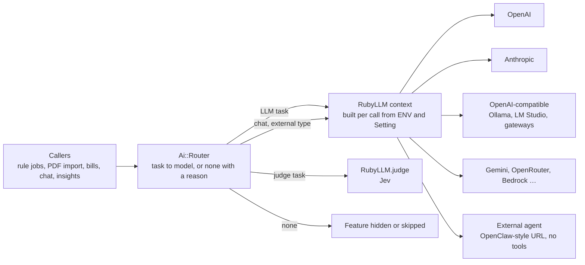

# Thought experiment: what if Sure's AI layer ran on RubyLLM?

**Companion to:** [`01-ai-ml-workflow-map.md`](01-ai-ml-workflow-map.md) (how it works), [`02-ai-architecture-review.md`](02-ai-architecture-review.md) (how it is built) and [`03-ai-user-perspective-review.md`](03-ai-user-perspective-review.md) (how it is used)
**Reference:** `we-promise/sure` `origin/main` @ `2250ba801` (2026-10-23), and [RubyLLM](https://github.com/crmne/ruby_llm) 2.1.1 (released 2026-10-11), read from the gem's source and its [documentation](https://rubyllm.com/getting-started/)
**Status:** a thought experiment, not a proposal. Nothing here was prototyped or run. It asks what would change, what would be lost, and which questions the project would have to answer first.

---

## 0. The question

02 recommends **one AI router** (S1) and **one structured-output primitive per transport** (S2), and it lists "don't introduce a general LLM framework or a new dependency" as a non-goal. This document runs the opposite experiment: suppose Sure dropped `ruby-openai` and `anthropic` and sent every model call through RubyLLM instead. How much code would go, which past PRs would not have been needed, does the result fit Sure's architecture, and does it answer S1?

A *minor* regression is allowed in this experiment. §7 lists the ones it would bring.

---

## 1. The setup

RubyLLM is a Ruby client for 19 providers (OpenAI, Anthropic, Gemini, Bedrock, Azure, OpenRouter, Ollama, Mistral, DeepSeek, xAI, TypeSafe and others) plus any OpenAI-compatible endpoint. It covers chat, tools, structured output, streaming, embeddings, PDFs and images as attachments, extended thinking, judgments (TypeSafe's Jev), a model registry with prices, a usage ledger, ActiveSupport notifications and OpenTelemetry tracing.

In the experiment, Sure keeps everything that is *about personal finance* (prompts, schemas, category matching, rule actions, tool functions, persistence) and hands everything that is *about talking to a provider* to RubyLLM:

Two pieces would still be Sure's own code:

- **`Ai::Router`** decides which model a task uses, or that it uses none. It owns ENV > Setting > default precedence, the Jev opt-in, the assistant type and the reason a feature is unavailable. RubyLLM has no concept of a task, a family or consent.
- **`Ai::StructuredCall`** owns Sure's JSON-mode policy: strict schema, `json_object` or none, and the Auto fallback ([#3602](https://github.com/we-promise/sure/issues/3602)). RubyLLM's `with_schema` always sends a strict schema, which some OpenAI-compatible servers reject (LM Studio, for one, per the comment in `app/models/provider/openai/concerns/json_mode.rb`). RubyLLM also does not strip `<think>` tags or recover JSON from prose, so one copy of `parse_json_flexibly` (`app/models/provider/openai/auto_categorizer.rb:367`) would stay.

Runtime settings are the main constraint on how RubyLLM is wired in. Sure's AI settings change at runtime from the Self-Hosting page, so a boot-time `RubyLLM.configure` would go stale. The router would build a `RubyLLM.context` for each call instead. Contexts are isolated and thread-safe, and contexts with the same connection settings share HTTP connections.

---

## 2. What RubyLLM would take over, and what would stay

| Concern today | Where it lives today | In the experiment |
|---|---|---|
| Three transports: OpenAI Responses, OpenAI-compatible Chat Completions, Anthropic Messages | `Provider::Openai` (`openai.rb:404`, `:498`), `Provider::Anthropic`, chat configs, parsers, stream parser, message formatter | RubyLLM protocols. One code path for every provider. |
| Response chaining through `previous_response_id` (native OpenAI only) | `Provider::Openai#native_chat_response` | Gone. RubyLLM uses the Responses API stateless (`store: false`) and replays history, so native and generic chat behave the same. |
| Tool loop, round limit, final round without tools | `Assistant::Responder#respond` (`responder.rb:30`) | RubyLLM's loop: `step` with a budget, `with_tool_options(choice: :none)`. Sure keeps the streaming and persistence callbacks. |
| Tool error hints | `Assistant::FunctionToolCaller#execute` (`function_tool_caller.rb:27`) | Stays, as a thin adapter that wraps each `Assistant::Function` as a `RubyLLM::Tool` with its existing JSON schema. MCP keeps calling the functions directly. |
| Structured output | per worker class; JSON-mode concern (`json_mode.rb:61`) | `with_schema` (OpenAI strict schema, Anthropic native `output_config`), or `with_provider_options(response_format:)`, behind `Ai::StructuredCall` |
| Anthropic forced-tool workaround | [#4178](https://github.com/we-promise/sure/issues/4178) | Not needed: Anthropic structured output is native, not a forced tool. |
| Gemini thought signatures on tool calls | [#3979](https://github.com/we-promise/sure/issues/3979), `tool_calls.extra_content` | RubyLLM's Chat Completions protocol round-trips `extra_content.google.thought_signature`. |
| Reasoning effort | [#3605](https://github.com/we-promise/sure/issues/3605) *(open, v0.7.7)* | `with_thinking(effort:)` |
| Model discovery | [#3694](https://github.com/we-promise/sure/issues/3694) *(open, v0.7.7)* | `RubyLLM.models.refresh` and `models.by_provider` |
| Pricing and cost | `LlmUsage::PRICING` (`llm_usage.rb:19`), about 120 hand-kept rows | Registry prices. OpenRouter-reported prices are used when present. Unknown prices stay `nil`, as they are today. |
| Usage records, including failures | two `UsageRecorder` concerns, `record_llm_usage` | One subscriber on `usage.ruby_llm`, which fires once per physical attempt, retries and failures included |
| Langfuse traces | `LangfuseTraceable` plus spans in every worker; `lib/langfuse_tracing.rb:6` | One subscriber on `chat.ruby_llm` that feeds the existing `LangfuseTracing`. See §7: RubyLLM's own OpenTelemetry spans carry no prompts or outputs. |
| Jev HTTP client and thread pool | `Provider::Jev` (`jev.rb:371`) | `RubyLLM.judge` with `provider: :typesafe`, or the OpenRouter `decisions` protocol. The https-only check and the gateway disclosure stay. |
| External assistant client | `Assistant::External::Client` (`client.rb`): hand-written SSE over `Net::HTTP`, proxy handling, retries | An OpenAI-compatible context pointed at `EXTERNAL_ASSISTANT_URL`, with `with_headers` for `X-Agent-Id` and `X-Session-Key`, the `user` field as an extra parameter, streaming and no tools. `Assistant::External` keeps its config, agent-id mapping, allow-list and 20-message window. External chats get the same usage and Langfuse subscriber; today they record neither. |
| Embeddings | `VectorStore::Embeddable#embed` (`embeddable.rb:88`) | `RubyLLM.embed` through a context |
| Request timeout, extra headers | `Provider::Openai.request_timeout`, `.extra_headers` | Context `request_timeout`; `with_headers`, with `{session_id}` substituted per chat |
| Outbound proxy | Each client reads the proxy variables its own way: Faraday (`ruby-openai`, Jev) reads `HTTPS_PROXY`, the anthropic SDK reads only `HTTP_PROXY`, and the external client reads both ([01 D4 #14](01-ai-ml-workflow-map.md#d4-observations-quirks-and-possible-bugs)) | One way: RubyLLM runs every provider on Faraday, which reads `HTTPS_PROXY` and `NO_PROXY` unless RubyLLM's own `http_proxy` setting is given. Pipelock's forward proxy would then see Anthropic calls without `HTTP_PROXY`. |
| History trimming for small context windows | `Assistant::HistoryTrimmer`, `TokenBudget` | Stays. RubyLLM's compaction is provider-side and covers OpenAI, xAI and Azure only. |
| Prompts, schemas, category and merchant normalisation, fuzzy matching | operation workers | Stays, once per operation instead of once per provider |
| Rule actions, enrichment locks, Sidekiq lanes, consent | rules, `Enrichable`, `config/sidekiq.yml`, `User#ai_available?` | Unchanged |

RubyLLM's Rails persistence (`acts_as_chat`) is not part of the experiment. Sure's `Chat`, `UserMessage`, `AssistantMessage` and `ToolCall::Function` records, and the mobile API that reads them, stay as they are. Each turn would rebuild a plain `RubyLLM::Chat` from those records with `add_message`.

**MCP is out of scope.** Sure is an MCP server ([01 W15](01-ai-ml-workflow-map.md#the-interface-sure-exposes)), and it stays one. `/mcp` calls the `Assistant::Function` classes directly and never calls a model, except through `import_bank_statement`, which would go through the router like any other PDF extraction. So the experiment doesn't change the MCP interface. RubyLLM's MCP add-on, [`ruby_llm-mcp`](https://www.rubyllm-mcp.com/), is an MCP *client*: it lets a RubyLLM chat use other servers' tools. It doesn't replace Sure's server, and Sure has no need to be an MCP client.

---

## 3. How much code would go

Measured with `wc -l` on `2250ba801`. The "after" column is an estimate. For the operation workers, a script counted the methods that carry domain logic (instructions, schemas, normalisers, builders), kept one copy where the OpenAI and Anthropic versions duplicate each other, and dropped the transport plumbing around them.

| Area | Lines now | Lines after (estimate) |
|---|---|---|
| Transports: `openai.rb`, `anthropic.rb`, chat configs, parsers, stream parser, message formatter, usage recorders, JSON-mode concern, batch slicer | 2,385 | ~150 |
| 12 operation workers (categorize, detect merchants, enhance merchants, PDF classify, statement extract, bill suggest; × OpenAI and Anthropic) | 3,183 | ~850 |
| `Provider::Jev` | 416 | ~200 |
| Chat loop: responder, tool caller, `Assistant::Provided`, builtin, history trimmer, token budget and estimator, `ToolCall::Function` | 561 | ~370 |
| `LlmUsage` (pricing table, cost and provider inference) | 297 | ~160 |
| Langfuse concern and initialiser (plus ~300 lines of span code inside the workers, counted above) | 149 | ~170 |
| Embedding client, registry LLM builders, `Chat.default_model` | ~130 | ~50 |
| External assistant client (`Assistant::External::Client`) | 176 | ~30 |
| **Total** | **~7,420** | **~1,980 plus ~250 new (router and structured call)** |

That is **roughly 5,000 lines of application code, about 70% of this layer**. Tests would shrink by another **2,500–3,000 lines** of the 5,229 in scope. Transport, parser, formatter, JSON-mode and tracing tests would be deleted. Operation tests would be rewritten as the cross-transport contract tests that 02 already calls for (O-B2). The OpenAI VCR cassettes would be re-recorded.

The bundle would lose `ruby-openai` and `anthropic`, and gain `ruby_llm` and `schematist`. Sure's Rails 8.1.3.1 and json 2.21.2 are within RubyLLM's supported range (JSON 3 needs Rails 8.1.4), and Faraday and the OpenTelemetry SDK are already in the bundle.

The other side of the ledger: Sure would stop owning about 5,000 lines and start depending on about 47,000 lines of someone else's library.

---

## 4. Replaying the PR history

> **Related PRs:** [#4291](https://github.com/we-promise/sure/issues/4291) · [#3979](https://github.com/we-promise/sure/issues/3979) · [#3771](https://github.com/we-promise/sure/issues/3771) · [#2690](https://github.com/we-promise/sure/issues/2690) · [#223](https://github.com/we-promise/sure/issues/223) · [#3605](https://github.com/we-promise/sure/issues/3605) *(open, v0.7.7)* · [#3694](https://github.com/we-promise/sure/issues/3694) *(open, v0.7.7)* · [#1968](https://github.com/we-promise/sure/issues/1968) *(closed)*

[#4291](https://github.com/we-promise/sure/issues/4291) ("support Gemini 4 Argon", +25/−6) added a row to `LlmUsage::PRICING`, a docs entry and a test. Replaying Sure's history against RubyLLM, PRs fall into three groups.

**Model support and pricing, the #4291 kind: 5 merged, 2 open, 1 closed.**

| PR | Change | With RubyLLM |
|---|---|---|
| [#4291](https://github.com/we-promise/sure/issues/4291) | Gemini 4 Argon pricing (+25) | Not in the 2.1.1 registry snapshot. It would arrive with a gem update or a registry refresh. OpenRouter users get the price from OpenRouter itself. |
| [#3979](https://github.com/we-promise/sure/issues/3979) | Gemini 3 models, thought signatures, `google/` and OpenRouter prefix stripping (+329) | Gemini 3.x is in the registry, and signatures round-trip in the protocol. |
| [#3771](https://github.com/we-promise/sure/issues/3771) | GPT-6 Sol and GPT-6.1 Sol (+577) | Both are in the registry. |
| [#2690](https://github.com/we-promise/sure/issues/2690) | Price refresh (+74) | Registry |
| [#223](https://github.com/we-promise/sure/issues/223) | The original cost estimation (+651) | Usage ledger plus registry |
| [#3605](https://github.com/we-promise/sure/issues/3605) *(open)* | Reasoning effort for OpenAI-compatible providers (+1,003) | `with_thinking(effort:)` plus a setting |
| [#3694](https://github.com/we-promise/sure/issues/3694) *(open)* | Model suggestions from `/models` (+474) | `RubyLLM.models.refresh` |
| [#1968](https://github.com/we-promise/sure/issues/1968) *(closed)* | A native Gemini provider (+292) | A `gemini_api_key` |

**Provider quirks and transport parity: 17 merged PRs, about 7,200 added lines.** On RubyLLM each would have been the library's job or a configuration line:

- Wire-format fixes: [#4178](https://github.com/we-promise/sure/issues/4178), [#4133](https://github.com/we-promise/sure/issues/4133), [#3727](https://github.com/we-promise/sure/issues/3727), [#2767](https://github.com/we-promise/sure/issues/2767), [#2755](https://github.com/we-promise/sure/issues/2755), [#1669](https://github.com/we-promise/sure/issues/1669), [#467](https://github.com/we-promise/sure/issues/467), [#225](https://github.com/we-promise/sure/issues/225), and the stream-error half of [#3767](https://github.com/we-promise/sure/issues/3767)
- Usage and tracing plumbing: [#2937](https://github.com/we-promise/sure/issues/2937), [#1144](https://github.com/we-promise/sure/issues/1144), [#360](https://github.com/we-promise/sure/issues/360)
- A cross-cutting fix that one call site had missed: [#4261](https://github.com/we-promise/sure/issues/4261). Any single structured-call primitive avoids this one, with or without RubyLLM.
- New transports: [#213](https://github.com/we-promise/sure/issues/213) (generic OpenAI API), and [#1983](https://github.com/we-promise/sure/issues/1983), [#1984](https://github.com/we-promise/sure/issues/1984) and [#1985](https://github.com/we-promise/sure/issues/1985) (Anthropic parity, about 3,400 lines). The domain parts of #1984 (batch operations and the cost ledger) would still have been written, but as a few dozen lines.

Of the 59 commits on `main` that touched the transport files, about 24 belong to the PRs above.

**Still needed with RubyLLM:** provider routing ([#4244](https://github.com/we-promise/sure/issues/4244), [#4249](https://github.com/we-promise/sure/issues/4249)), the Auto JSON fallback ([#3602](https://github.com/we-promise/sure/issues/3602)), Sidekiq lanes ([#4237](https://github.com/we-promise/sure/issues/4237)), prompt overrides ([#3373](https://github.com/we-promise/sure/issues/3373)), and timeouts and extra headers as Sure settings ([#3304](https://github.com/we-promise/sure/issues/3304), [#3362](https://github.com/we-promise/sure/issues/3362)).

---

## 5. How the experiment lines up with 02

| 02 item | Effect of the experiment |
|---|---|
| **S1 One AI router** | **Partly.** The transport part of *task → provider + model + transport* disappears, which leaves a router of about 150 lines. The task table, precedence, availability checks with reasons, Jev opt-in and assistant type are still Sure's code. |
| **S2 Structured-output primitive** | **Mostly.** One primitive over one client instead of one per transport. JSON-mode policy and tolerant parsing stay. |
| A1 resolution paths, Enhance button | The three paths (`registry.rb:26`, `provided.rb:4`, `family.rb:197`), `Chat.default_model` (`chat.rb:60`) and the OpenAI-only Enhance check (`family_merchants_controller.rb:32`) all become router calls. |
| A2 provider × operation matrix, B3 and P5 parity | Gone by construction: an operation works on every provider RubyLLM supports. |
| A10 observability, O-A4 correlation ID | `RubyLLM.workflow(id:)` tags every event in a sync or rule run with one ID. |
| [#4245](https://github.com/we-promise/sure/issues/4245) per-task models | One context and model per task |
| U11 local-model defaults | Chat streams on every provider, including local ones. Context windows come from the registry for known models. |
| U18 confirm before AI writes | `requires_approval` on tools, for in-app chat only |
| A3 batching, A4 rule ordering, A5 failure policy, A6 config registry, A7 lock policy, A8 lanes, A9 LLM calls on web threads, A11 consent | Not addressed. |
| Non-goal: "no general LLM framework or new dependency" | **In tension.** RubyLLM is a client library, not a LangChain-style framework, and it replaces two SDKs with one. But it is a much larger dependency than the ~200-line primitive 02 had in mind. |

---

## 6. Setups and transitions

Under the experiment, each of 03's three personas is a different answer from the router. Moving between them is a change of answer, not a change of code path.

### The three setups

**P1. No LLM.**
- `Ai::Router.for(task)` returns no model and a reason (for example `:no_provider`) for every LLM task. `available?(task)` is the one check the UI asks.
- RubyLLM loads but stays idle. It does not complain about missing keys, and no context is built. Model lookups would use the bundled registry snapshot and never `models.refresh`, so the app makes no outbound calls. That matters to 03's "persona 1 by conviction" (Firefly III users, §7.2).
- The matcher, Bayes, transfer matching, insights and bill detection run as they do today. None of them use RubyLLM.
- Every AI entry point (chat, Dig in with AI, smart-fill, Enhance merchants, AI rule actions, PDF import, document search) asks the same check, so they hide together.
- Jev is a separate `judge` task with its own opt-in, so a family can run Jev with no LLM.

**P2. One simple LLM.**
- A key, or an endpoint plus a model. Every task routes to it.
- Every operation works on that provider, and chat streams even on local models.
- The registry supplies context window and price for known models. A local model the registry does not know still needs a context-window setting, and its cost shows as N/A.

**P3. Custom: several models, external agents.** "External agents" covers three different setups:

| Setup | Chat | Background AI (categorize, PDF, bills) | Tools |
|---|---|---|---|
| `external` assistant type (OpenClaw-style URL and token) | Router returns the external agent as an OpenAI-compatible model with no tools, so chat goes through RubyLLM and is traced like builtin chat | Unchanged: still the configured LLM | The external agent's own |
| `mcp_only` assistant type | In-app chat off | Unchanged: still runs | MCP clients call the same `Assistant::Function` classes |
| Several models (local plus cloud, Jev) | Its own task entry | One entry per task | Unchanged |

### Transitions

**T1. Fresh install, no LLM.** The family gets the two classifier rules and nothing AI-related appears. One case today's code does not handle: an AI rule that already exists, from a Maybe upgrade or a provider removed later. Today `Rule::ActionExecutor::AutoCategorize#execute` (`auto_categorize.rb:40`) queues jobs without checking for a provider. Its label only adds "(no categorization provider configured)", and each job then raises, fails the rule run and is retried by Sidekiq. In the experiment the router knows there is no model before anything is queued, so the action could skip and record a reason. Which outcome is right is Q2.

**T2. No LLM → simple LLM.**
- The admin pastes a key or an endpoint. The next call builds a context from the new settings, so no restart is needed.
- The web and worker processes still read their own env (02 A12). A worker without the new ENV value keeps the old answer, and the health check would compare the two.
- Turning AI on stays three acts (provider, per-user consent, an AI rule). The router does not merge them; that is 03's U2.
- There are no AI-locked values or AI cache yet, so there is nothing to reset.
- The classifier rules sit above the new AI rule, so Bayes answers first and AI fills what is left. That is cheaper, but it is a behaviour the user is not told about.

**T3. Simple LLM → external agents.**
- `external`: only chat changes route. Categorization, PDF import and bills keep using the configured LLM. A user may read "external assistant" as "Sure stops calling an LLM" (Q6).
- `mcp_only`: chat disappears from the UI and background AI keeps running.
- Several models: each task gets its own entry. Chat on a fast cloud model still waits behind a slow local categorization batch, because they share the AI lane (02 A8). RubyLLM does not change that.
- Existing builtin chats stay readable. If a chat later continues on a different provider, RubyLLM replays it without the earlier provider's thinking blocks, which no other provider can verify.
- `requires_approval` covers in-app chat only. Writes by MCP clients and the external agent need their own confirmation or activity log (U13).

**T4. Simple LLM → no LLM.** The provider is removed. Open points:
- AI rules: skip, fail or deactivate (Q2)
- AI-locked categories and merchants: stay locked, or unlock (Q3)
- Old chats: read-only, or hidden
- Stored embeddings and LLM usage history: kept, or purged

**T5. Changing the model or provider within a setup.** Today the AI cache reset runs only when `openai_model` changes through the UI, not through ENV and not for Anthropic (02 A6). In the experiment the router is the one place a model change is visible, so it could own that side effect for every source. Prices and capabilities change with the model, and the rule label's cost estimate follows the registry.

**T6. Changing the embedding model.** Vectors already stored under the old model (and possibly another dimension) no longer match new queries. RubyLLM does not change this. The choice is to re-embed every document or to refuse the change (Q16).

---

## 7. What would get worse

These are the minor regressions the experiment would accept, plus the risks that would need checking.

| Area | Change | Size |
|---|---|---|
| Langfuse content | RubyLLM's OpenTelemetry spans export no prompts, outputs or tool arguments, by design: they carry model, provider, request parameters, finish reason, token usage and tool name. Full prompts and outputs must stay in Langfuse (Q11), so a subscriber on `chat.ruby_llm` is required. Its event payload carries the input messages and the response, so the subscriber has what it needs. The trace tree would look different. | Small, needs work |
| Chat on native OpenAI | Full history is replayed on every turn instead of chained by `previous_response_id`. That means more input tokens per tool round; OpenAI's prefix caching softens it. | Small |
| History trimming | Trimming would now apply to native OpenAI too, and the 2,048-token default context window would cut long chats short unless the window comes from the registry. | Small if the window comes from the registry; visible otherwise |
| Retries and timeouts | RubyLLM defaults to 3 retries and a 300 s timeout; Sure's default timeout is 60 s. A slow local model with retries could triple the wait. Contexts would need Sure's values. | Small |
| Pricing freshness | New models get prices when the gem's registry updates or a refresh runs. A refresh needs outbound network access. | Small |
| Error classes | `Faraday::BadRequestError` rescues become `RubyLLM` errors. Every failure policy in 02 A5 would need remapping. | Mechanical |
| Upstream pace | 2.0.0 shipped on 2026-09-18 and 2.1.1 on 2026-10-11. Most work comes from one maintainer. | A dependency risk |
| Unverified paths | Streaming tool calls on Ollama, llama.cpp and LM Studio; Gemini signatures through gateways; Anthropic native structured output on every Claude model Sure users run; the external agent path (Q19) | Unknown until tested |

---

## 8. Questions

The experiment does not answer these. Some are maintainer decisions; others need a test before anyone could rely on the numbers above.

### Policy

- **Q1.** Is "no LLM" an explicit, stored choice (03's Off tier, U1), or just the absence of a key? This decides whether AI pages hide or prompt for setup.
- **Q2.** When no provider is available, should an AI rule skip, fail or deactivate itself? Should its rule run show success, skipped or failed? (02 A5)
- **Q3.** Are AI-set values locked for good, unlocked when the provider or model changes, or kept as suggestions until accepted (U10)?
- **Q4.** For background AI, is consent a per-user or a household decision? Should AI rules skip accounts of members who declined (A11, U7)?
- **Q5.** Who can change instance-wide AI settings: any family admin, as today, or only a super-admin (U6)?
- **Q6.** Does the `external` assistant type mean only chat goes external, or that Sure makes no LLM calls of its own at all?
- **Q7.** Should agent and MCP writes need the same confirmation as in-app chat writes, and where would the human see them (U13, U18)?

### Architecture

- **Q8.** Where does the per-task routing table live (Setting, ENV, a declarative `sure-ai.yml`, or several), and in what order of precedence (S6, U12)?
- **Q9.** Does the router choose per instance only, or per family? Hosted multi-family instances may want per-family keys, which RubyLLM contexts would allow.
- **Q10.** May the model registry refresh over the network, and how often? Or is the bundled snapshot plus local price overrides enough?
- **Q11.** Must Langfuse keep full prompts and outputs? **Answered: yes.** RubyLLM's built-in OpenTelemetry tracing is not enough on its own, so the `chat.ruby_llm` subscriber in §2 and §7 is required. The subscriber could feed [`langfuse-rb`](https://github.com/simplepractice/langfuse-rb) (0.12.4, 2026-10-12; Langfuse v4 OTLP ingestion, experiments, scores) instead of Sure's own `LangfuseTracing` and `Eval::Langfuse` client (about 930 lines). Two things are not yet checked: whether it covers everything the experiment runner does, and whether it works with RubyLLM's events. Its prompt management would stay unused, because Sure keeps prompt overrides per family in its own database.
- **Q12.** Which provider errors mean "AI unavailable" and which mean "retry later" (timeout, 429, a 400 from a strict schema)?
- **Q13.** Does the 02 non-goal ("no new dependency") still hold, given that this replaces two SDKs with one library?

### Verification

- **Q14.** Do full-history replay and trimming change chat quality or cost on native OpenAI, compared with `previous_response_id` chaining today?
- **Q15.** Do Ollama, llama.cpp and LM Studio stream tool calls correctly through RubyLLM's Chat Completions protocol?
- **Q16.** On an embedding model change (T6), re-embed or refuse?
- **Q17.** Does Gemini behind an OpenAI-compatible gateway keep its thought signatures across tool rounds? The code is in RubyLLM, but untested against Sure.
- **Q18.** Can the operation contract tests (O-B2) run against both the current providers and RubyLLM, so each operation's output could be compared before old code is removed?
- **Q19.** Does the external agent keep today's behaviour through RubyLLM: no retry once streaming has started, `NO_PROXY` bypass, the model name read from the response, and the model list from `external/model_catalog.rb`? Does OpenClaw report usage in the stream, or does cost show as N/A?

---

## 9. Caveats

- No code was written and nothing was run. Every RubyLLM behaviour above comes from reading its 2.1.1 source and documentation.
- Line counts are exact for "now". The "after" figures are estimates from a method-level split of each file; a real port could land 10–20% either way.
- PR sizes are GitHub's additions and include tests and docs. Some PRs (for example [#225](https://github.com/we-promise/sure/issues/225) and [#3767](https://github.com/we-promise/sure/issues/3767)) mixed transport fixes with other work.
- RubyLLM's registry snapshot and model coverage were checked on 2026-10-23 and will drift.
