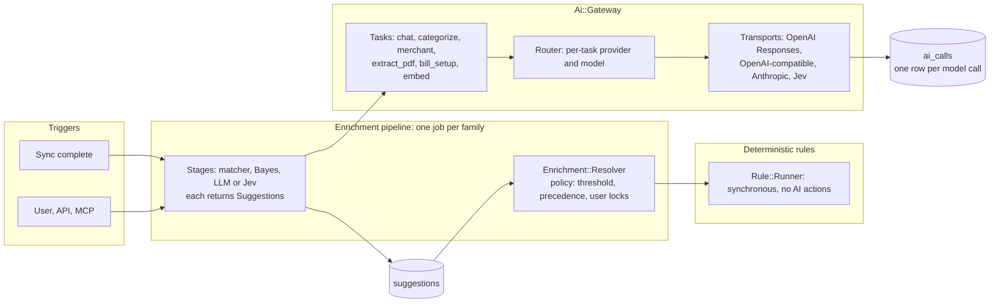

# Breaking-change option for the AI / ML refactor

**Option, not a decision.** [02 §5](02-ai-architecture-review.md#5-suggested-sequencing) sequences a refactor that keeps every existing interface. This document asks what we would build if breaking changes were allowed. For each change it says which interfaces in the [D5 interface register](01-ai-ml-workflow-map.md#d5-interface-register) break, which ones merge or disappear, and how to cut the work into pull requests that maintainers can approve one at a time.

> **Related PRs:** [#4310](https://github.com/we-promise/sure/issues/4310) classifiers as rules · [#4237](https://github.com/we-promise/sure/issues/4237) AI capsule · [#4444](https://github.com/we-promise/sure/issues/4444) *(open)* hold back AI jobs while a chat message is being written · [#4245](https://github.com/we-promise/sure/issues/4245) *(issue, open)* per-task models · [#4283](https://github.com/we-promise/sure/issues/4283) *(open, v0.7.6)* MCP-only scope · [#3025](https://github.com/we-promise/sure/issues/3025) *(open, v0.7.7)* MCP CRUD tools · [#4147](https://github.com/we-promise/sure/issues/4147) assistant types

| | |
|---|---|
| **Reference** | `main` @ `2250ba801` (2026-10-23). Interface IDs (I1–I27) and drift items are from [01 D5](01-ai-ml-workflow-map.md#d5-interface-register). |
| **IDs** | BC1–BC11 are the breaking changes. Other IDs (A*, S*, O-*, U*, W*, D*) refer to 01–03. |
| **Compared with 02** | 02's S1–S10 change internal interfaces only, except S4 and S8. This option goes further on five boundaries: locks, classifiers as rules, chat history, configuration and MCP. |

---

## Contents

- [0. Summary](#0-summary)
- [1. Target shape](#1-target-shape)
- [2. The breaking changes (BC1–BC11)](#2-the-breaking-changes)
- [3. Interface impact matrix](#3-interface-impact-matrix)
- [4. What gets simpler](#4-what-gets-simpler)
- [5. Pulling it apart for review](#5-pulling-it-apart-for-review)
- [6. Release plan](#6-release-plan)
- [7. What stays](#7-what-stays)
- [8. Decisions for maintainers](#8-decisions-for-maintainers)
- [9. Caveats](#9-caveats)

---

## 0. Summary

The root change: **AI and ML stop writing to transactions directly. Every classifier produces suggestions, and one resolver decides what is applied.** Most problems in 02 (A4, A5, A7, A10, D4 #2, #4, #8, #10) come from five writers, Bayes, the matcher, LLM categorization, LLM merchant detection and Jev, each handling locks, provenance, failure and ordering its own way.

| ID | Change | Boundary interfaces broken | Replaces (from 02) | Maintainer decision |
|---|---|---|---|---|
| BC1 | Suggestions + resolver instead of direct writes. Locks mean user intent only. | I9, I27 | S7, A7, O-A3 | **Yes** |
| BC2 | Classifiers leave Rules. An enrichment pipeline runs first, then deterministic rules. | I10, I11, I27 | S4, S9, A4 | **Yes**, reverses #4310's design |
| BC3 | One `Ai::Gateway`: tasks, router, transports. | none (internal I1–I5) | S1, S2, S3, A1, A2, A3 | No |
| BC4 | Chat history always rebuilt from the database. | I27 (`chats.latest_assistant_response_id`) | B2 native/generic split | **Yes** |
| BC5 | ENV for secrets and endpoints only. Tuning lives in the database, per task. | I26 | S6, A6, A12 | **Yes**, operator-facing |
| BC6 | No model calls on web threads. | I25 (MCP `import_bank_statement` result) | S8, A9 | **Yes** for MCP |
| BC7 | One AI lane with chat reservation and a per-family limit. | I23 (queue names) | A8 | No |
| BC8 | MCP as a public API: scopes, annotations, structured results, audit. | I16, I25 | A13, O-B1 parity | **Yes** |
| BC9 | One `ai_calls` table with correlation IDs. Langfuse becomes an exporter. | I27 (`llm_usages`) | A10, O-A4 | No |
| BC10 | Consent as an explicit policy, including per account. | I19 | A11, D4 #8 | **Yes**, policy |
| BC11 | `app/models/ai/` and `app/models/enrichment/` namespaces. `Family` loses its AI concerns. | none | S10, P4 | No |

---

## 1. Target shape

New interfaces, all internal unless marked:

| New interface | Contract | Replaces |
|---|---|---|
| `Ai::Gateway.call(task, input, family:, user:, context:)` | → `Ai::Result(ok?, output, error, ai_call_id)`. The only way application code reaches a model. | I1, I2, I4 call sites |
| `Ai::Task` | Data: `prompt_key`, `schema`, `build_input`, `map_output`, `unit` (per item or per batch), `budget`. One file per task. | 12 provider worker classes |
| `Ai::Router.for(task, family:)` | → `Route(provider, model, transport)` or `Unavailable(reason)`. `available?(task, family:, user:)`. | I4 (three paths), `Chat.default_model`, about 8 availability checks |
| `Ai::Transport#call(request)` | Owns JSON mode and fallback, think-tag stripping, forced tool use, retries, slicing, usage and tracing. | I5 per-worker calls, `BatchSlicer` |
| `Enrichment::Stage#suggest(transactions)` | → `[Suggestion]`. Matcher, Bayes, LLM and Jev stages. | I10 AI/ML executors, I21 `classify_and_apply` |
| `Enrichment::Resolver#resolve(suggestions)` | Applies under `Enrichment::Policy` (threshold per source, precedence, user locks). The only writer for AI/ML values. | I9 lock logic in five writers |
| `Suggestion` (**boundary**: new table) | `transaction_id`, `attribute`, `value`, `source`, `confidence`, `model`, `settings_digest`, `ai_call_id`, `status` (pending, applied, rejected, superseded). | `DataEnrichment` as AI cache, `CategorizationComparison`, `locked_by_*` flags |
| `AiCall` (**boundary**: new table) | `family`, `user`, `task`, `provider`, `model`, tokens, cost, latency, outcome, `correlation` (`sync_id`, `pipeline_run_id`, `chat_id`, `mcp_session`). | `llm_usages` |
| `AiJob` | Declares lane, failure policy (`retry`, `discard` or `record`), per-family concurrency key and trace context. | I12 copied callbacks, drift 5 |
| `AiConfig.key` | `env:` (secrets and endpoints only), `default:`, `clamp:`, `scope:` (instance, family or task). Generates the settings form, docs table and health display. | I26 hand-rolled precedence |
| `Ai::Consent.allowed?(task, family:, user:, account:)` (**boundary**: policy) | One check, used by the gateway. | I19 per-feature gates |

---

## 2. The breaking changes

Each change lists: **what**, **breaks** (boundary interfaces), **merges or removes** (simplification), **new**, **pull apart** (the PR slices) and **decision**.

### BC1. Suggestions and a resolver replace direct writes

> **Related PRs:** [#4310](https://github.com/we-promise/sure/issues/4310) Bayes and matcher lock options

- **What:** every AI/ML stage writes `Suggestion` rows. `Enrichment::Resolver` applies them under one policy. AI and Bayes stop setting locks. `locked_attributes` means "the user decided" and nothing else.
- **Breaks:**
  - **I9** `Enrichable`: AI/ML writers stop calling `enrich_attribute` and `lock_attr!` directly. The method stays for bank providers and deterministic rules.
  - **I27**: `transactions.locked_attributes` loses its AI and Bayes locks. The `locked_by_bayes` and `locked_by_similar` metadata flags and `categorization_comparisons` go. `data_enrichments` with source `ai`, `bayes` or `similar` stop being the AI cache.
- **Merges or removes:** `ClearAiCacheJob`, `ClearBayesLocksJob`, `Family#clear_bayes_locks!`, `Enrichable#clear_ai_cache`, the shadow-run code in `Family::AutoCategorizer` (`run_shadow`, `record_shadow_comparisons`), the `lock_results` and `lock_similar_merchants` settings, and the lock branches in five writers.
- **New:** `Suggestion`, `Enrichment::Resolver`, `Enrichment::Policy`.
- **It buys:**
  - Shadow runs become suggestions that are never applied.
  - Provenance and "why this category?" read straight from the rows.
  - Undo and re-resolve need no model call.
  - User corrections become eval data.
  - A model change no longer unlocks every family's data (D4 #10).
- **Pull apart:**
  1. Add the `suggestions` table and model. No callers.
  2. Dual-write: each stage also writes a suggestion. One PR per stage (matcher, Bayes, LLM, Jev). No behaviour change.
  3. Add the resolver behind a per-family flag, with contract tests that compare resolver output with today's writes on fixtures.
  4. Switch application to the resolver. One PR, behaviour change, ADR attached.
  5. Lock migration: keep user locks, drop AI and Bayes locks. Data migration on its own.
  6. Delete the clear-cache and clear-locks jobs, the shadow code and the lock settings.
- **Decision:** yes. It changes what a lock means to users who have relied on "AI set it, so it stays".

### BC2. Classifiers leave Rules; rules run after the pipeline

> **Related PRs:** [#4310](https://github.com/we-promise/sure/issues/4310) · [#4013](https://github.com/we-promise/sure/issues/4013) fixed order and stop processing

- **What:**
  - Post-sync runs one `EnrichFamilyJob`: matcher → Bayes → LLM or Jev, as configured stages. LLM stages are called synchronously inside the job, on the AI lane.
  - When the pipeline has resolved, the deterministic rules run on the resolved values, so rules always see AI results (A4, D4 #4).
  - Stage scope reuses `Rule::Condition`, which keeps the per-account filtering that #4310 moved into rule conditions.
- **Breaks:**
  - **I10**: the action keys `auto_categorize`, `auto_detect_merchants`, `bayes_categorize` and `fill_similar_merchants` leave `ACTION_EXECUTOR_CLASSES`. Existing `rule_actions` rows with those keys must be migrated.
  - **I11**: users can no longer place a classifier between two deterministic rules. Classifiers always run before all rules.
  - **I27**: `rule_runs.pending_jobs_count` and the async `{async: true, jobs_count:}` return shape go.
- **Merges or removes:**
  - I12 (`complete_job!`, `fail_job!`), the async branch of `Rule::Runner#run_counts`, `BayesCategorizeJob` and the Classifier "Run" special path (S9).
  - `AutoCategorizeJob` and `AutoDetectMerchantsJob` as rule-driven jobs.
  - The classifier-rule methods on `Family` (`classifier_rules`, `add_classifier_rule!`, `set_classifier_rule_active!`) and the `add_classifier_rules` callback.
- **New:** `Enrichment::Stage`, `EnrichFamilyJob`, a stage-configuration UI (Settings → Classifier becomes the pipeline page).
- **Candour:** this reverses the design #4310 merged and the migration it shipped. Users lose the ability to order classifiers among their rules, and get correct ordering and one place to configure classification instead. The ADR should say so plainly.
- **Pull apart:**
  1. `Enrichment::Stage` wrappers around the existing matcher, Bayes and AI code. No callers.
  2. `EnrichFamilyJob` behind a flag, running the stages, with the rule actions still in place.
  3. The UI for stage configuration.
  4. Data migration: each classifier rule becomes a stage (keeping its conditions and active flag). AI rule actions inside user rules become stages too, with a release note.
  5. Remove the four executors, the async rule-run path and `BayesCategorizeJob`.
- **Decision:** yes.

### BC3. One `Ai::Gateway`: tasks, router and transports

> **Related PRs:** [#4245](https://github.com/we-promise/sure/issues/4245) *(issue, open)* per-task models · [#4244](https://github.com/we-promise/sure/issues/4244) chat routing · [#4249](https://github.com/we-promise/sure/issues/4249) LLM_PROVIDER first

- **What:** operations become `Ai::Task` data. Transports own every cross-cutting concern. The router picks provider and model **per task**.
- **Breaks:** no boundary. I1–I5 are internal. Per-task model settings are new configuration (BC5).
- **Merges or removes:**
  - I1 and I2 merge into one task interface. That fixes drift 1–3: concept signatures that don't match their implementations, the undeclared `extract_bank_statement`, and Jev's duck-typed `auto_categorize`.
  - I4's three resolution paths and `Chat.default_model` go. I8's private provider clients (drift 4) go too: probes call the gateway with a probe task.
  - I5 becomes transport-owned, so a worker can no longer forget usage or tracing.
  - About 12 worker classes under `provider/openai/` and `provider/anthropic/`, and most of `provider/openai.rb` (939 lines).
- **RubyLLM:** with breaking changes allowed, it is a fair candidate for the **transport** layer only ([04](04-rubyllm-thought-experiment.md)). Keep Sure's own task layer either way. Decide with the contract tests, not up front.
- **Pull apart:**
  1. Cross-transport contract tests per operation (O-B2), with no production change.
  2. `Ai::Router` delegating to the three existing paths. Then move callers over one PR at a time: chat, categorization, batch operations, PDF, bills, probes. Then delete the old paths.
  3. One task per PR, covering both providers. Go smallest first: `bill_setup` (169-line OpenAI suggester, synchronous, no batching) → `enhance_merchants` → `detect_merchants` → `categorize` (Jev and shadow) → `extract_pdf` (vision, chunking, vector store) → `chat` last.
  4. Delete each worker class in the PR that replaces it.
- **Decision:** no. It is internal and can start before the others.

### BC4. Chat history always rebuilt from the database

> **Related PRs:** [#4133](https://github.com/we-promise/sure/issues/4133) tool rounds as message pairs · [#4421](https://github.com/we-promise/sure/issues/4421) mobile full chat history

- **What:** drop OpenAI Responses `previous_response_id` chaining. Every provider shares one history, trimming and tool-round path, with streaming everywhere.
- **Breaks:** I27 `chats.latest_assistant_response_id` (dropped). Old chats continue from database history, so nothing is lost.
- **Merges or removes:** the native/generic split in `Provider::Openai#chat_response` (`native_chat_response` and `generic_chat_response`, about lines 404–698), the "no streaming" generic path, and `Chat#update_latest_response!`.
- **Costs:** more input tokens on native OpenAI per turn, mostly offset by prompt caching.
- **Pull apart:**
  1. Move chat transport out of `provider/openai.rb` (pure move).
  2. Make the generic path stream.
  3. Switch native to rebuilt history behind a setting.
  4. Remove `previous_response_id` and the column.
- **Decision:** yes. It trades token cost for one code path.

### BC5. ENV for secrets and endpoints only; tuning per task in the database

> **Related PRs:** [#4249](https://github.com/we-promise/sure/issues/4249) · [#4019](https://github.com/we-promise/sure/issues/4019) health check timeout setting

- **What:**
  - ENV keeps only credentials, endpoints and process sizing (`*_ACCESS_TOKEN`, `*_URI_BASE`, `QDRANT_URL`, `RAILS_AI_MAX_THREADS`).
  - Everything else becomes `AiConfig` keys with one source each, editable in the UI, with per-task rows for provider, model, JSON mode, context window, batch size and thresholds.
  - On first boot, existing ENV tuning values are imported into the database, with a deprecation warning for one release.
- **Breaks:** I26. About 25 tuning variables in D1 stop being read after the deprecation release (for example `LLM_JSON_MODE`, `LLM_MAX_ITEMS_PER_CALL`, `LLM_CONTEXT_WINDOW`, `CATEGORIZATION_*`, `OPENAI_MODEL`, `ANTHROPIC_MODEL`). Compose files, Helm values and quadlets that set them need editing.
- **Merges or removes:** about 40 precedence methods (S6), the "field disabled when ENV is set in the web process" logic, the web/worker drift table in D3, and the single-line permit list in `hostings_controller.rb` (519 lines).
- **Pull apart:**
  1. `AiConfig` registry with today's precedence, generating the docs table. No behaviour change.
  2. Move keys onto it one group per PR: budgets, JSON mode, categorization, assistant, vector.
  3. Per-task rows (#4245).
  4. Import and deprecation.
  5. Removal of ENV reads after one release.
  6. Split `hostings_controller.rb` per settings section.
- **Decision:** yes. It is operator-facing.

### BC6. No model calls on web threads

> **Related PRs:** [#4251](https://github.com/we-promise/sure/issues/4251) record payment button · [#4431](https://github.com/we-promise/sure/issues/4431) bill form category picker

- **What:** bill smart-fill and smart-configure, non-PDF document embedding and MCP `import_bank_statement` move to AI-lane jobs. The UI gets a Turbo stream. MCP gets a pending import it can poll. Health probes stay the one allow-listed exception.
- **Breaks:** I25: MCP `import_bank_statement` returns a pending import id instead of the extracted result. I24 gains new targets for the bill dialog.
- **Merges or removes:** the four web-thread paths in D3.
- **Pull apart:** one PR per path: bills, document upload, MCP import.
- **Decision:** yes for the MCP contract change. No for the bills and upload paths, which stay UI-compatible.

### BC7. One AI lane, with chat reservation and a per-family limit

> **Related PRs:** [#4237](https://github.com/we-promise/sure/issues/4237) AI capsule · [#4444](https://github.com/we-promise/sure/issues/4444) *(open)* hold back AI jobs while a chat message is being written

- **What:**
  - Keep a single AI lane by default. On a single-GPU local setup, two concurrent requests only fight over the GPU.
  - Make chat priority structural with the reservation approach in #4444, instead of relying on strict queue order alone.
  - Add a per-family concurrency key, so one family's big import can't fill the lane.
  - Offer a separate `ai_chat` capsule as a deployment option for cloud providers, not the default.
- **Breaks:** I23. AI job class names change with BC2 and BC3 (`EnrichFamilyJob` replaces the rule-driven AI jobs). Each rename keeps a forwarding shim class for one release so queued jobs still run.
- **Merges or removes:** `BackgroundJobHealth.ai_busy?` special-casing tied to `RAILS_AI_MAX_THREADS == 1` (D3) moves into the reservation.
- **Pull apart:**
  1. `AiJob` base with lane and failure policy (S5): one PR per job.
  2. Reservation (#4444).
  3. Per-family limit.
  4. Optional chat capsule.
- **Decision:** no, apart from accepting #4444's approach.

### BC8. MCP as a public API

> **Related PRs:** [#4283](https://github.com/we-promise/sure/issues/4283) *(open, v0.7.6)* · [#3025](https://github.com/we-promise/sure/issues/3025) *(open, v0.7.7)* · [#4147](https://github.com/we-promise/sure/issues/4147) · [#3990](https://github.com/we-promise/sure/issues/3990) rule tools with preview

- **What:**
  - `mcp:read` and `mcp:read_write` scopes.
  - Tool `annotations` (`readOnlyHint`, `destructiveHint`).
  - `outputSchema` and `structuredContent`.
  - An audit row (an `AiCall` with task `mcp_tool`) for every tool call.
  - Each tool declares its surfaces (chat, MCP or both), so MCP-only CRUD tools (#3025) stop forcing the chat and MCP registries apart.
- **Breaks:**
  - I16: the tool result shape changes (structured content alongside text), and a declared `surfaces` attribute is added.
  - I25: tokens with the interim `mcp` scope from #4283 map to `mcp:read_write`, and `read`-only grants become possible.
- **Merges or removes:** the guest and preview filtering duplicated between chat and MCP moves into `surfaces` and `Assistant.function_classes`.
- **Pull apart:**
  1. Scopes (building on #4283).
  2. Annotations from a per-tool `read_only?` flag. One PR adds the flag to all tools mechanically.
  3. Structured results.
  4. Audit rows.
  5. Surfaces.
- **Decision:** yes, client authors need a changelog entry.

### BC9. One `ai_calls` table with correlation

- **What:** an `AiCall` row per model call (including Jev and MCP tool calls), written by the transport, with `correlation` IDs. Langfuse becomes an exporter of the same events.
- **Breaks:** I27: `llm_usages` is replaced. The usage page and `LlmUsage.estimate_auto_categorize_cost` read the new table. Keep a view named `llm_usages` for one release if anything outside the app reads it.
- **Merges or removes:** both `UsageRecorder` concerns, per-worker `log_langfuse_generation`, and `record_llm_usage` in each provider.
- **Pull apart:**
  1. New table and transport writes (dual-write).
  2. Readers switch.
  3. Remove `llm_usages` writes.
  4. Langfuse exporter.
- **Decision:** no.

### BC10. Consent as an explicit policy

> **Related PRs:** [#4061](https://github.com/we-promise/sure/issues/4061) private accounts out of the shared feed

- **What:** `Ai::Consent.allowed?(task, family:, user:, account:)`, checked by the gateway. It covers a family policy, the per-user opt-out (which pipeline AI then respects), and per-account exclusion, so private accounts never reach a provider.
- **Breaks:** I19. Rule-driven AI starts honouring user opt-outs (D4 #8), so some families will see less AI categorization.
- **Merges or removes:** `RequiresAiConsent`, `bills_one_shot_ai_available?` and the per-feature checks collapse into one call.
- **Pull apart:**
  1. Policy object and tests.
  2. Gateway check.
  3. Account exclusion UI.
- **Decision:** yes. It is a privacy policy.

### BC11. Namespaces and the `Family` split

- **What:** `app/models/ai/` (gateway, tasks, transports, router, consent, config) and `app/models/enrichment/` (stages, suggestions, resolver, policy). `Family` keeps `has_many :suggestions` and loses the I13 facade.
- **Breaks:** nothing at a boundary.
- **Merges or removes:** I13 (`family.rb:174–592`).
- **Pull apart:** pure-move PRs only, each touching one concern, landed early to reduce merge conflicts. Optionally enforce the boundary with `packwerk`. That is a new dependency and 02 lists new dependencies as a non-goal, so it needs its own case.
- **Decision:** no.

---

## 3. Interface impact matrix

What happens to each D5 interface under this option. **Kept** = unchanged. **Internal change** = reshaped with callers in the same PR. **Broken** = a boundary change needing migration or a release note. **Removed** = replaced by a new interface.

| ID | Interface | Fate | By |
|---|---|---|---|
| I1 | `Provider::LlmConcept` | Removed, becomes `Ai::Task` + `Ai::Transport` | BC3 |
| I2 | `Provider::ClassificationConcept` | Removed, Jev becomes a transport | BC3 |
| I3 | `Provider::Response` | Internal change, becomes `Ai::Result` with a declared failure policy | BC3, BC7 |
| I4 | Provider resolution | Removed, becomes `Ai::Router` | BC3 |
| I5 | Tracing and usage | Removed, transport-owned | BC3, BC9 |
| I6 | `VectorStore::Base` | Kept. Embeddings go through the gateway's `embed` task. | BC3 |
| I7 | `Family::VectorSearchable` | Internal change, upload moves to a job | BC6, BC11 |
| I8 | `AiHealth::Probe` | Internal change, probes call the gateway | BC3 |
| I9 | `Enrichable` | **Broken** for AI/ML writers. Kept for bank providers and rules. | BC1 |
| I10 | `Rule::ActionExecutor` keys | **Broken**: four keys removed | BC2 |
| I11 | `Rule::Runner` semantics | **Broken**: classifiers no longer orderable among rules | BC2 |
| I12 | `RuleRun` job callbacks | Removed | BC2 |
| I13 | `Family` AI/ML facade | Removed, moves into the namespaces | BC11 |
| I14 | Sync hooks | Kept. Post-sync enqueues `EnrichFamilyJob` instead of `ApplyRulesJob`. | BC2 |
| I15 | `Assistant::Base#respond_to` | Kept | — |
| I16 | `Assistant::Function` | **Broken**: result shape, `surfaces`, `read_only?` | BC8 |
| I17 | `Chat` / `Message` | Internal change, `update_latest_response!` removed | BC4 |
| I18 | `Family::AiPromptable` keys | **Broken** where provider-specific keys (`categorizer_openai`, `categorizer_anthropic`, …) collapse to per-task keys. A migration copies the active provider's override. | BC3 |
| I19 | AI consent | **Broken**: becomes one policy, rule AI starts honouring opt-outs | BC10 |
| I20 | `Insight::Generator` | Kept | — |
| I21 | Bayes and matcher | Internal change, wrapped as stages | BC2 |
| I22 | `Eval::Runners::Base` | Internal change, runners call the gateway and read suggestions | BC1, BC3 |
| I23 | Sidekiq jobs | **Broken**: renames with one-release shims | BC2, BC7 |
| I24 | Turbo Stream targets | Internal change, new targets for bills and the pipeline page | BC2, BC6 |
| I25 | HTTP endpoints | **Broken**: MCP scopes, results, `import_bank_statement`. API v1 chats kept. | BC6, BC8 |
| I26 | Configuration keys | **Broken**: tuning ENV removed after deprecation | BC5 |
| I27 | Persisted AI data | **Broken**: `suggestions` and `ai_calls` added. `llm_usages`, `categorization_comparisons`, `pending_jobs_count`, `latest_assistant_response_id` and AI/Bayes locks removed. | BC1, BC2, BC4, BC9 |

---

## 4. What gets simpler

| Today | After | From |
|---|---|---|
| Three provider-resolution paths, about 8 availability checks, `Chat.default_model`, private probe clients | One router, one `available?` | BC3 |
| 2 concept modules whose signatures don't match their implementations (drift 1–3) | One task interface | BC3 |
| About 12 provider worker classes with copied JSON-mode, usage and tracing code | One file per task, transports own the rest | BC3 |
| Three batching layers (`in_batches`, `BatchSlicer`, Jev pool) | A task declares its unit and budget, the transport slices | BC3 |
| Lock logic in five writers, `locked_by_*` flags, two clear jobs | One resolver and policy | BC1 |
| Shadow categorization code and `categorization_comparisons` | Unapplied suggestions | BC1 |
| Async rule actions, `pending_jobs_count`, `complete_job!`/`fail_job!`, results that arrive after the runner | Pipeline first, rules after, synchronous | BC2 |
| Classifier "Run" path that differs from the nightly run | One pipeline | BC2 |
| Native and generic chat paths, one without streaming | One history path, streaming everywhere | BC4 |
| About 40 precedence methods, web/worker config drift | `AiConfig` keys | BC5 |
| Four LLM paths on web threads | One allow-listed probe path | BC6 |
| Failure handled four ways (retry, discard, record, ignore) | Declared per `AiJob` | BC7 |
| Usage in `llm_usages`, traces in Langfuse, nothing for MCP | One `ai_calls` row per call, with correlation | BC9 |
| Per-feature consent gates, rule AI ungated | One policy | BC10 |

---

## 5. Pulling it apart for review

### Rules for every PR

1. **One PR touches one register row** (one I-ID), or adds one new interface.
2. **Pure moves are separate from behaviour changes.** A move PR is reviewed with `git diff --color-moved` and should show no logic change.
3. **A boundary change never rides along with an internal refactor.** Boundary PRs carry an ADR link, a release note and a migration if data changes.
4. **Contract tests land before the code they protect.** Any PR that changes an interface's behaviour must show those tests passing on both sides of the change.
5. **New code lands unused first** (no callers, or behind a flag). Switch-over is its own small PR. Deletion is its own PR.

### Files to split first

These are the largest AI/ML files on `main`. Each split is a pure-move PR that unblocks parallel work. [06](06-ai-file-split-review.md) adds the evidence: MVC-boundary crossings, files spanning several resources, and the files most open PRs collide on, and says whether each split belongs before, with or independently of the refactor.

| File | Lines | Split |
|---|---|---|
| `app/models/provider/openai.rb` | 939 | Chat transport (lines ~404–698) out of the batch operations |
| `app/models/family.rb` | 938 | AI/ML facade (I13, lines 174–592) into `Family::Classification`, later `Enrichment` |
| `app/models/pdf_import.rb` | 596 | AI processing (`process_with_ai`, extraction, row generation) out of the import record |
| `app/models/provider/openai/auto_categorizer.rb` | 533 | Shared JSON-mode and fallback code into the transport (vs 176 lines for Anthropic) |
| `app/controllers/settings/hostings_controller.rb` | 519 | One controller per settings section |
| `app/models/provider/openai/auto_merchant_detector.rb` | 493 | As the categorizer |
| `app/models/family/bayes_evaluation.rb` | 480 | Search (`find_best`) apart from reporting |
| `app/models/rule.rb` | 466 | Untouched until BC2, then the AI branches go |
| `app/models/ai_health.rb` | 407 | Probes onto the gateway (BC3) |

### Suggested PR sequence

| Step | PRs | Kind | Reviewer load |
|---|---|---|---|
| 1 | Contract tests per interface (I1, I2, I9, I10, I16, I23, I24) | Tests only | Low |
| 2 | Pure-move splits from the table above, BC11 namespaces | Move | Low |
| 3 | `AiJob` base, one job per PR | Internal | Low |
| 4 | `Ai::Router` delegating, then callers one by one | Internal | Low |
| 5 | Tasks one by one, smallest first | Internal | Medium |
| 6 | `ai_calls` dual-write, `AiConfig` registry | Internal | Low |
| 7 | `suggestions` dual-write, one stage per PR | Internal | Low |
| 8 | ADRs for BC1, BC2, BC4, BC5, BC8, BC10 | Decision | Maintainers |
| 9 | Boundary switches, each with its migration and release note | **Boundary** | Maintainers |
| 10 | Deletions | Internal | Low |

Steps 1–7 change no boundary and are good `good-agent-task` material (O-B9 in 02). Only steps 8 and 9 need maintainer judgement.

---

## 6. Release plan

1. **Release N.**
   - Contract tests, splits, `AiJob`, router, tasks.
   - `ai_calls`, `AiConfig` and suggestion dual-writes.
   - No user-visible change.
2. **Release N+1.**
   - The resolver applies changes, and AI and Bayes locks are dropped (BC1).
   - Classifier rules become pipeline stages (BC2).
   - ENV tuning is imported, with deprecation warnings (BC5).
   - MCP scopes and annotations ship (BC8).
   - Consent policy (BC10).
   - Job shims for renamed classes.
3. **Release N+2.**
   - Remove deprecated ENV reads, job shims, `llm_usages`, `previous_response_id` (BC4) and old code paths.
   - MCP structured results and the `import_bank_statement` pending-import contract (BC6), with a changelog entry for client authors.

---

## 7. What stays

- **In-memory Bayes and the TF-IDF matcher.** Training per run means no model state to migrate, and evaluation stays simple. They just become stages.
- **Postgres with pgvector as the default vector store, and Sidekiq.**
- **Insights and recurring detection.** Deterministic Ruby, reading resolved data.
- **`Assistant::Base#respond_to` and the external assistant (W14).**
- **API v1 chats** for the mobile app.

---

## 8. Decisions for maintainers

| Decision | Change | Trade-off |
|---|---|---|
| Reverse classifiers-as-rules | BC2 | Correct ordering and one configuration place, against #4310's user-orderable classifier rules |
| AI no longer sets locks | BC1 | Clear lock meaning, undo and provenance, against "AI set it, so it stays" |
| Drop server-side chat state | BC4 | One code path and streaming everywhere, against more input tokens on native OpenAI |
| Move tuning out of ENV | BC5 | One source per key and no web/worker drift, against editing operators' compose, Helm and quadlet files |
| MCP contract changes | BC6, BC8 | Read-only grants, annotations, audit and no web-thread LLM calls, against breaking existing MCP clients |
| Consent covers rule AI and private accounts | BC10 | Privacy and consistency, against less automatic categorization for some families |

Everything else is internal and can proceed as small PRs without a decision.

---

## 9. Caveats

- Line counts and `file:line` references are from `main` @ `2250ba801` and will drift.
- Counts marked "about" are carried over from 02 and not re-measured here.
- Behaviour claims about Sidekiq job renames (queued jobs failing to deserialize without a shim) are general Sidekiq and ActiveJob behaviour. I haven't tested them in Sure.
- Drift 6 in D5 (`vector_store_chunks` missing from `schema.rb`) is unverified for CI and the devcontainer.
- The token-cost effect of BC4 was not measured.
