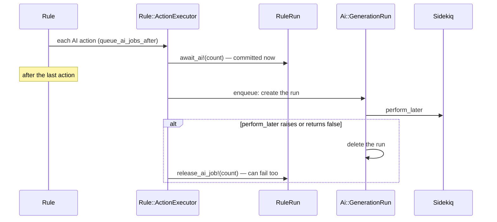

# AI generation outbox: record the job with its count, queue after commit, deliver again

Status: planned 2026-11-23, not built · Its own PR, delivered with PR 4 (Sequencer), after #5608 (stack #5504) · Companion to
[`ai-plumbing-redesign.md`](ai-plumbing-redesign.md), [`ai-generation-windowing.md`](ai-generation-windowing.md)
and [`rubyllm-workbench-comparison.md`](rubyllm-workbench-comparison.md). The problem comes from
#5077 ("Release a rule run's awaited count when releasing it fails too"), and CodeRabbit's last
finding on #5608. The pattern comes from RubyLLM Workbench's
[showcase](https://github.com/yorzi/rubyllm-workbench/blob/main/docs/SHOWCASE.md) ("Outbox vs
enqueue after save").

Code references are to `feat/ai-5077-followups` at `ce9ccbd47`. Versions are Rails 8.1.4.1,
Sidekiq 8.0.5 (OSS) and ruby_llm 2.2.3.

Each decision is tagged **[product]**, meaning it changes what a user or self-hoster sees and is
@josh-sanders' call, or **[technical]**, meaning the code or a dependency forces it.

**Summary.** Today a rule run counts an AI job, queues it, and gives the count back when queuing
fails. Giving it back is a second write that can fail too, and then the run waits for good. This
is the last "two failures in a row" case left after #5608. An outbox removes the give-back: the
count and the job to run commit in one transaction, the job is queued only after that commit, and
a delivery job queues it again if the queuing failed or the job never started. Nothing is ever
given back, so nothing can fail on top of it. #5608's step claims already make a second copy of
a job harmless, which is the half of Workbench's pattern Sure has.

## 1. Where things stand after #5608



- `RuleRun#await_ai!` counts each job and its transactions while the actions run (`ce9ccbd47`),
  and the jobs are queued after the last action, so none can finish the run early.
- `Ai::GenerationRun.enqueue` creates the run, then calls `perform_later`; if queuing fails it
  deletes the run, and the executor's `AiJob#release!` gives the count back with
  `RuleRun#release_ai_job!`. A failure there is logged, and the run waits for good.
- `Ai::GenerationJob` saves the next step's arguments in `ai_generation_runs.next_job` when it
  commits a step, and clears `next_job` when a step's job starts (#5608, `9a9cf04f1`). If
  queuing the next job fails, `enqueue_next` raises `ActiveJob::EnqueueError` and the job gives up.
- `Ai::GenerationRun.sweep` deletes runs idle for 7 days, without telling the requester.

## 2. The change

```mermaid
sequenceDiagram
  participant RA as Rule#apply
  participant EX as Rule::ActionExecutor
  participant RR as RuleRun
  participant GR as Ai::GenerationRun
  participant Q as Sidekiq
  participant D as Ai::GenerationDeliveryJob
  RA->>EX: each AI action: collected, nothing written
  Note over EX,GR: one transaction, after the last action
  EX->>RR: await_ai!(count)
  EX->>GR: create the run, next_job = step 0's arguments
  Note over EX,GR: commit
  GR->>Q: perform_later (after commit)
  alt queuing fails
    GR-->>GR: logged; next_job stays
    D->>GR: every 15 min: runs with next_job, idle > 1 h
    D->>Q: perform_later(next_job), touch the run
  end
```

1. **`Ai::GenerationRun.enqueue` writes the outbox row.** [technical] In one transaction it
   creates the run with `next_job` set to step 0's arguments (the `run_id`, `cursor: 0`,
   `pending: []`, `step: 0` and the requester's own). After the commit it calls `perform_later`.
   A raise or a `false` is logged and left for delivery. `enqueue` returns `true` once the run is
   saved, and raises only when saving it fails.
2. **Counting moves into that transaction.** [technical] `Rule::ActionExecutor.queue_ai_jobs_after`
   collects each AI action's transactions and queuing block while the actions run, then in one
   transaction calls each job's `RuleRun#await_ai!` and creates its run. Every `perform_later`
   runs after that commit, so no job can finish the run before every job is counted.
   - If the transaction fails, nothing was counted and no run exists: the rule fails as any
     failed action does, and there's nothing to give back.
   - An executor called on its own (tests, a single action) does the same for its one job.
   - When an action raises, the jobs collected before it are still counted and queued, as today.
3. **Giving counts back is deleted.** [technical] `RuleRun#release_ai_job!`, `AiJob#release!` and
   the give-back paths in `queue_ai_jobs_after` go. Their tests become tests that a failed
   transaction leaves no count and no run.
4. **A failed queue of the next step stops failing the run.** [technical] `Ai::GenerationJob`
   already saves `next_job` in the transaction that commits a step. If queuing that job fails,
   `enqueue_next` logs it and leaves it for delivery, instead of raising `EnqueueError` and giving
   up.
5. **`Ai::GenerationDeliveryJob`.** [product] Runs every 15 minutes, by sidekiq-cron in
   `config/schedule.yml` like `PushDelivery`'s claim timeout. For runs with `next_job` set and
   `updated_at` older than an hour, it queues `next_job` again and touches the run.
   - A job clears `next_job` when it starts, so a run is delivered again only when its next job
     never started: the queue refused it, raised, or lost it before it ran.
   - A job queued behind other families' work for more than an hour gets a second copy. That's
     expected: the step claims make the second copy stop, or re-queue the step after it, without
     a second model call.
   - At most 3 deliveries per step, counted in `next_job["deliveries"]`. After that the run is
     left to the 7-day sweep.

## 3. What it doesn't cover

- **A job lost after it started.** It cleared `next_job`, then the worker died and Sidekiq OSS
  didn't put it back (a hard kill; a graceful shutdown re-queues it). Its run is never delivered
  again, and the 7-day sweep deletes it without telling the requester, so a `RuleRun` waits for
  good. The fix is the other half of Workbench's pattern: a recovery job that, for a run idle
  past a limit, delivers its step again or ends it through `give_up`, so the requester always
  hears. It needs a marker that a step started (the job clears `next_job`, so the marker would
  be a separate `started_at`). Planned separately, for #5077.
- **Exactly-once model calls.** Two copies of a step that both start before either commits both
  call the model; one commits and the other stops at its claim (#5608). The outbox doesn't
  change that, and Workbench states the same limit.

## 4. Side effects

- **`ProviderMerchant::Enhancer`** drops its family lock when `enqueue` reports nothing queued.
  With the outbox it holds the lock while delivery is pending. The lock lives 10 minutes against
  the hour before a run is delivered again, so a second enhancement run can start in between.
  It ties into #5077's "Merchant enhancement lease owned by its run".
- **Upgrade.** Runs queued before the release have no `next_job`, so the delivery job never
  touches them; they finish or are swept as today. No migration: `next_job` exists (#5608).

## 5. Choices to confirm

| Choice | Proposed | Why |
|---|---|---|
| Deliver again after a run is idle | 1 hour | Longer than a normal queue wait, so second copies stay rare |
| Delivery job cadence | every 15 minutes | Matches `PushDelivery`'s claim timeout; cheap, one indexed query |
| Deliveries per step | 3 | A queue that refuses three times needs an operator, not a fourth try |
| Recovering a job lost after it started | out of this PR | Needs a started marker and a policy for the requester; §3 |
| A batch that can't be queued | the outbox, not #5710's or #5608's behaviour | Call by @josh-sanders, 2026-11-24. #5710 (on `main`) fails the run and still queues the batches after it; #5608 gives the counts back and queues nothing after it. Both are replaced here. |

## 6. Tests

- A rule with two AI actions: both counted and both runs created in one transaction, queued only
  after it commits; the existing race test still passes.
- The transaction fails (a run can't be saved): no count, no run, the rule fails, the run is
  finished.
- `perform_later` returns `false` or raises: the count stays, the run keeps `next_job`, the rule
  run is pending, and `Ai::GenerationDeliveryJob` queues it after an hour.
- The next step can't be queued: the step stays committed, `next_job` stays, no give-up; the
  delivery job queues it.
- A second copy delivered while the first waits in the queue: one model call per step, and the
  run counts each batch once.
- The delivery cap: after 3 deliveries the run isn't queued again.
- `ProviderMerchant::Enhancer` with a refused queue: the lock stays, and the run is delivered.
