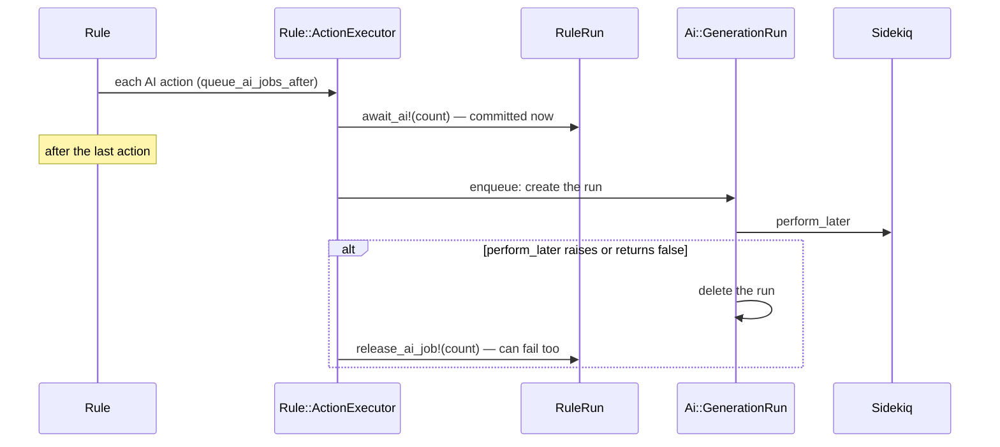

# AI generation outbox: record the job with its count, queue after commit, deliver again

Status: planned 2026-11-23, not built · Its own PR, the first in the stack after #5504
([`stack-sequencer-off-the-web-thread.md`](stack-sequencer-off-the-web-thread.md)), before the
sequencer · Lessons from Workbench's code added 2026-11-24 (O1–O6) · Companion to
[`ai-plumbing-redesign.md`](ai-plumbing-redesign.md), [`ai-generation-windowing.md`](ai-generation-windowing.md)
and [`rubyllm-workbench-comparison.md`](rubyllm-workbench-comparison.md). The problem comes from
#5077 ("Release a rule run's awaited count when releasing it fails too"), and CodeRabbit's last
finding on #5608. The pattern comes from RubyLLM Workbench's
[showcase](https://github.com/yorzi/rubyllm-workbench/blob/main/docs/SHOWCASE.md) ("Outbox vs
enqueue after save").

Code references are to `feat/ai-5077-followups` at `ce9ccbd47`. Versions are Rails 8.1.4.1,
Sidekiq 8.0.5 (OSS) and ruby_llm 2.2.3.

O1–O6 are the lessons from RubyLLM Workbench's code, listed in
[`stack-sequencer-off-the-web-thread.md`](stack-sequencer-off-the-web-thread.md) §3e.

Each decision is tagged **[product]**, meaning it changes what a user or self-hoster sees and is
@josh-sanders' call, or **[technical]**, meaning the code or a dependency forces it.

**Summary.** Today a rule run counts an AI job, queues it, and gives the count back when queuing
fails. Giving it back is a second write that can fail too, and then the run waits for good. This
is the last "two failures in a row" case left after #5608. An outbox removes the give-back: the
count and the job to run commit in one transaction, the job is queued only after that commit, and
a delivery job queues it again if the queuing failed, the job never started, or it died
during its step. Nothing is ever
given back, so nothing can fail on top of it. #5608's step claims already make a second copy of
a job harmless, which is the half of Workbench's pattern Sure has.

## 1. Where things stand after #5608



- `RuleRun#await_ai!` counts each job and its transactions while the actions run (`ce9ccbd47`),
  and the jobs are queued after the last action, so none can finish the run early.
- `Ai::GenerationRun.enqueue` creates the run, then calls `perform_later`; if queuing fails it
  deletes the run, and the executor's `AiJob#release!` gives the count back with
  `RuleRun#release_ai_job!`. A failure there is logged, and the run waits for good.
- `Ai::GenerationJob` saves the next step's arguments in `ai_generation_runs.next_job` when it
  commits a step, and clears `next_job` when a step's job starts (#5608, `9a9cf04f1`). If
  queuing the next job fails, `enqueue_next` raises `ActiveJob::EnqueueError` and the job gives up.
- `Ai::GenerationRun.sweep` deletes runs idle for 7 days, without telling the requester.

## 2. The change

```mermaid
sequenceDiagram
  participant RA as Rule#apply
  participant EX as Rule::ActionExecutor
  participant RR as RuleRun
  participant GR as Ai::GenerationRun
  participant Q as Sidekiq
  participant D as Ai::GenerationDeliveryJob
  RA->>EX: each AI action: collected, nothing written
  Note over EX,GR: one transaction, after the last action
  EX->>RR: await_ai!(count)
  EX->>GR: create the run, next_job = step 0's arguments
  Note over EX,GR: commit
  GR->>Q: perform_later (after commit)
  alt queuing fails
    GR-->>GR: logged; next_job stays
    D->>GR: every 15 min: runs with next_job, idle > 1 h
    D->>Q: perform_later(next_job), touch the run
  end
```

1. **`Ai::GenerationRun.enqueue` writes the outbox row.** [technical] In one transaction it
   creates the run with `next_job` set to step 0's arguments (the `run_id`, `cursor: 0`,
   `pending: []`, `step: 0` and the requester's own). After the commit it calls `perform_later`.
   A raise or a `false` is logged and left for delivery. `enqueue` returns `true` once the run is
   saved, and raises only when saving it fails.
2. **Counting moves into that transaction.** [technical] `Rule::ActionExecutor.queue_ai_jobs_after`
   collects each AI action's transactions and queuing block while the actions run, then in one
   transaction calls each job's `RuleRun#await_ai!` and creates its run. Every `perform_later`
   runs after that commit, so no job can finish the run before every job is counted.
   - If the transaction fails, nothing was counted and no run exists: the rule fails as any
     failed action does, and there's nothing to give back.
   - An executor called on its own (tests, a single action) does the same for its one job.
   - When an action raises, the jobs collected before it are still counted and queued, as today.
3. **Giving counts back is deleted.** [technical] `RuleRun#release_ai_job!`, `AiJob#release!` and
   the give-back paths in `queue_ai_jobs_after` go. Their tests become tests that a failed
   transaction leaves no count and no run.
4. **A failed queue of the next step stops failing the run.** [technical] `Ai::GenerationJob`
   already saves `next_job` in the transaction that commits a step. If queuing that job fails,
   `enqueue_next` logs it and leaves it for delivery, instead of raising `EnqueueError` and giving
   up.
5. **`Ai::GenerationDeliveryJob`.** [product] Runs every 15 minutes, by sidekiq-cron in
   `config/schedule.yml` like `PushDelivery`'s claim timeout. For runs with `next_job` set and
   `updated_at` older than an hour, it queues `next_job` again and touches the run.
   - **`next_job` stays until the step commits** (O1, call by @josh-sanders, 2026-11-24). The
     commit that claims a step writes the next step's `next_job`, or deletes the run with the
     last step. Today a job clears it when it starts (`generation_job.rb:39` at `14ae81544`),
     which leaves a job lost mid-step with nothing to deliver.
     - So a run is delivered again when its next job never started (the queue refused it,
       raised, or lost it), and also when the job died during its step.
     - A live step isn't mistaken for a dead one: each step touches the run when it loads, and a
       step's route budget is minutes, well under the hour.
   - **The idle check uses the database's clock:** `updated_at < now() - interval '1 hour'` in
     SQL (O2).
   - A job queued behind other families' work for more than an hour gets a second copy. That's
     expected: the step claims make the second copy stop, or re-queue the step after it, without
     a second model call.
   - **At most 3 deliveries per step**, counted in `next_job["deliveries"]`.
     - The count goes up in the same `UPDATE … WHERE … deliveries < 3 RETURNING id` that selects
       the run, before enqueueing, so two overlapping cron runs can't both pass the cap (O3).
     - After the third, the run gives up through its requester (`give_up` → `ai_failed`, "the job
       couldn't be queued"), so a rule run finishes as failed instead of waiting for the 7-day
       sweep, which never tells it (O4, call by @josh-sanders, 2026-11-24).
   - **Visible.** Each redelivery and each give-up writes a `DebugLogEntry` (category `ai`).
     `SidekiqHealth` counts runs whose `next_job` has been idle for more than an hour (O5).

## 3. What it doesn't cover

- **A job lost after it started is now covered** (O1). The step keeps `next_job` until it
  commits, so a worker killed mid-step leaves the run to be delivered again after an hour, and
  after 3 deliveries the requester hears (O4). No `started_at` column is needed.
- **Exactly-once model calls.** Two copies of a step that both start before either commits both
  call the model; one commits and the other stops at its claim (#5608). With O1 this also
  happens when a replay of the step before queues a step that's still running. The outbox
  doesn't change that, and Workbench states the same limit (its `docs/ARCHITECTURE.md:457`).

## 4. Side effects

- **`ProviderMerchant::Enhancer`'s family lock goes.** It's a 10-minute boolean lock, which runs
  out while a run waits an hour for delivery, so a second enhancement run could start in between.
  - The lease becomes "an unfinished `enhance_merchants` `Ai::GenerationRun` exists for the
    family". It ends when the run ends or the 7-day sweep deletes it.
  - This closes #5077's "Merchant enhancement lease owned by its run".
- **Upgrade.** Runs queued before the release have no `next_job`, so the delivery job never
  touches them; they finish or are swept as today. No migration: `next_job` exists (#5608).

## 5. Choices to confirm

| Choice | Proposed | Why |
|---|---|---|
| Deliver again after a run is idle | 1 hour | Longer than a normal queue wait, so second copies stay rare |
| Delivery job cadence | every 15 minutes | Matches `PushDelivery`'s claim timeout; cheap, one indexed query |
| Deliveries per step | 3 | A queue that refuses three times needs an operator, not a fourth try |
| Recovering a job lost after it started | in this PR: `next_job` stays until the step commits (O1) | Call by @josh-sanders, 2026-11-24, after Workbench's lease recovery; §2 |
| After the delivery cap | give up through the requester (O4) | Call by @josh-sanders, 2026-11-24; the sweep never tells a rule run |
| A batch that can't be queued | the outbox, not #5710's or #5608's behaviour | Call by @josh-sanders, 2026-11-24. #5710 (on `main`) fails the run and still queues the batches after it; #5608 gives the counts back and queues nothing after it. Both are replaced here. |

## 6. Tests

- A rule with two AI actions: both counted and both runs created in one transaction, queued only
  after it commits; the existing race test still passes.
- The transaction fails (a run can't be saved): no count, no run, the rule fails, the run is
  finished.
- `perform_later` returns `false` or raises: the count stays, the run keeps `next_job`, the rule
  run is pending, and `Ai::GenerationDeliveryJob` queues it after an hour.
- The next step can't be queued: the step stays committed, `next_job` stays, no give-up; the
  delivery job queues it.
- A second copy delivered while the first waits in the queue: one model call per step, and the
  run counts each batch once.
- `ProviderMerchant::Enhancer` with a refused queue: a second enhancement waits while the first
  run exists, and the run is delivered.
- A worker killed mid-step (after the step loaded, before it committed): `next_job` is still set,
  and the delivery job queues the step after an hour (O1).
- The cap: after the third delivery the requester's `ai_failed` runs once, and the rule run
  finishes as failed (O4). Two delivery jobs at once pass the cap once (O3).
- The queue took the job but the answer was lost, so the job is delivered twice: one commit and
  one count (O6, as Workbench's `agent_run_delivery_dispatcher_job_test.rb:85`).
