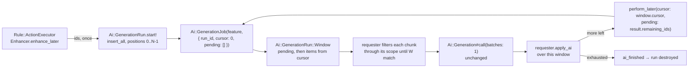

# Linear AI generation runs: windowed requesters and a run snapshot

Status: analysis and plan, 2026-11-21 · Companion to [`ai-plumbing-redesign.md`](ai-plumbing-redesign.md)
and [`pr-2c-generations.md`](pr-2c-generations.md). The problem comes from #5077, comment 6
(raised in review of #4775). The implementation is its own PR, stacked on 3a (§7).

Code references are to `refactor/ai-plumbing` at `c9b953993`. Versions are Rails 8.1.4.1
(activejob 8.1.4.1), Sidekiq 8.0.5 (OSS), ruby_llm 2.1.1 and Ruby 3.4.9.

Each decision is tagged **[product]**, meaning it changes what a user or self-hoster sees and is
@josh-sanders' call, or **[technical]**, meaning the code or a dependency forces it.

**Summary.** A run of N transactions takes about N/B `Ai::GenerationJob`s. Each one reloads,
re-filters and rebuilds input for *every* remaining transaction, and re-serialises every
remaining id into the next job's payload. That is O(N²/B) work in total, and O(N²/B) bytes
through Redis. `Ai::Generation` is not the cause, because it only ever sends one slice. The fix
has two parts. The requesters read only a **window** of ids per job, about one batch's worth.
The run's id list is kept in a **snapshot table**, so a job carries a run id, a cursor and at
most one window of pending ids. Every job then touches O(W) rows and carries an O(W) payload,
and the whole run is O(N). `Ai::Generation`, `Ai::Batch`, failover, escalation, token-budget
splitting and bisection stay as they are. So do the fairness of one batch per job (M2) and the
retry policy. ActiveJob::Continuable and RubyLLM Workbench were examined. Neither addresses
these execution paths, and Continuable conflicts with M2 and with the job's retry policy (§2).

## 1. Root cause

### 1.1 The execution path

```mermaid
sequenceDiagram
  participant AE as Rule::ActionExecutor#enqueue_ai_job
  participant F as Family#auto_*_later
  participant J as Ai::GenerationJob (job k)
  participant R as Requester (AutoCategorizer / AutoMerchantDetector)
  participant G as Ai::Generation#call(batches: 1)
  AE->>F: scope.select(:id) — all N ids
  F->>J: perform_later(feature, { ids: N ids })
  loop N/B times
    J->>R: from_ai_job(ids: N − kB ids)
    R->>R: protected/cached plucks, none?, count — IN (N − kB)
    R->>R: transactions_input — load + preload + map N − kB rows
    R->>G: generation with N − kB items
    G->>G: first_slice → B items; on_routes / split_on / bisect inside the slice
    G-->>J: Result(remaining: N − (k+1)B item hashes)
    J->>R: apply_ai — scope.where(id: decided) ∩ IN (N − kB)
    J->>J: perform_later(ids: N − (k+1)B ids)
  end
```

### 1.2 Where each job does O(N) work

| Step | Code | Cost per job |
|---|---|---|
| Rebuild the requester from all remaining ids | `Ai::GenerationJob#requester` → `from_ai_job(ids:)` (`app/jobs/ai/generation_job.rb:84`) | O(N) deserialisation |
| Protected and cached checks | `Family::AutoCategorizer#ai_generation` → `cached_transaction_ids`, `protected_transaction_ids` (`app/models/family/auto_categorizer.rb:27-28, 186-196`) | 2 × `pluck` with `IN (N)` |
| Emptiness and count | `scope.none?`, `scope.count` (`auto_categorizer.rb:32, 36`; `auto_merchant_detector.rb:237, 242`) | 2 × `IN (N)` |
| **Load and map every remaining row** | `transactions_input` (`auto_categorizer.rb:174`; `auto_merchant_detector.rb:314`): `scope.map` with `includes(:category, :merchant, :entry)` | **N records × 3 preloads + N hashes: the main cost** |
| Generation copies the list | `Ai::Generation#call_batched`: `items.dup`, `remaining - slice` (`app/models/ai/generation.rb:173, 201`) | O(N) arrays |
| Batch sizing | `Ai::Batch.first_slice` (`app/models/ai/batch.rb:463`) stops at the cap | O(B), already lazy |
| Shadow sampling | `Ai::Shadow.enqueue`: `generation.items - result.remaining` (`app/models/ai/shadow.rb`) | O(N) |
| Apply | `apply_ai` locks `scope.where(id: decided)`, where `scope` is still `where(id: transaction_ids)` (`auto_categorizer.rb:58`; `auto_merchant_detector.rb:254`); logs `transaction_ids - result.remaining_ids` (`auto_categorizer.rb:84`) | `IN (N)` + O(N) |
| Re-enqueue the rest | `perform_later(feature, args.merge(ids: result.remaining_ids))` (`generation_job.rb:39`) | **O(N) payload** |
| Merchant enhancement | `ProviderMerchant::Enhancer#unenhanced_merchants` loads every remaining merchant, and `merge_websites_saved_since` queries them all (`app/models/provider_merchant/enhancer.rb:449-453, 503, 528`) | O(M) |

Each job uses at most B items, yet over N/B jobs the work adds up to Σ(N − kB) ≈ **N²/2B** row
loads and as many serialised ids.

### 1.3 How big it is

Payload and serialisation were measured with `ActiveJob::Arguments.serialize`/`deserialize` and
JSON, using UUID ids (Sure's primary keys) and B = 25. The row reload is an estimate, at about
30–50 µs per Active Record object over three preloads.

| N | Jobs | Payload per job | ActiveJob (de)serialise, whole chain | Redis bytes, whole chain | Row reload, whole chain (estimated) |
|---|---|---|---|---|---|
| 10,000 | 400 | 380 KB | ~0.5 s | 78 MB | ~5–10 min of worker time |
| 100,000 | 4,000 | 3.8 MB | ~46 s | 7.8 GB | many hours |

There are two independent quadratics:

1. **The DB/ORM rebuild.** This is the dominant cost: rows, preloads, hashes and `IN (N)`
   queries in every job.
2. **The shrinking id list in every Sidekiq payload.** Small at 10k. At 100k it means multi-MB
   jobs in Redis, the retry set and the Sidekiq UI.

`Ai::Generation` is **not** a cause. `call_batched` sends `Ai::Batch.first_slice` only, and
`on_routes` (failover and escalation), `split_on`/`answer_pieces` (overflow halving and smaller
fallback caps) and `bisect` all work inside that slice.

## 2. Approaches examined

### 2.1 ActiveJob::Continuable (Rails 8.1)

- **Compatibility:** present in activejob 8.1.4.1 (`lib/active_job/continuable.rb`,
  `continuation.rb`, `continuation/step.rb`). Sidekiq 8.0.5's own ActiveJob adapter implements
  `stopping?` (`lib/active_job/queue_adapters/sidekiq_adapter.rb:110`; Changes.md, #6732). So it
  would work on Sure's stack.
- **What it does:** a job declares `step`s, and a step can carry a `cursor` (`set!`,
  `advance!`, `checkpoint!`). Progress is written into the job payload under `"continuation"`
  **only when the job is interrupted**, that is when `checkpoint!` finds `queue_adapter.stopping?`
  during a Sidekiq shutdown, or when an error is raised after the cursor has advanced. Otherwise
  every step runs in **one execution**.
- **Against Sure's paths:**
  - **It doesn't remove the rebuild.** The requester is still built from `ids:`. A cursor over a
    constant id list keeps the payload at O(N) on every resume, and the list never shrinks. Each
    resume still loads every row unless the requester is windowed, and windowing (§2.3) is the
    real fix whether or not Continuable is used. **[technical]**
  - **It conflicts with M2.** Looping over every batch in one execution holds an AI worker thread
    for the whole run, which is 400 LLM calls at 10k transactions. One batch per job so that
    families take turns is a decided product call (§11; `rubyllm-spike-report.md` register).
    Keeping the turns would mean forcing an interrupt after every batch through
    `interrupt!(reason:)`, which is `:nodoc:` API. That is today's re-enqueue with extra steps.
    **[product: M2 stays]**
  - **It conflicts with the retry policy.** `resume_errors_after_advancing` defaults to true, so
    any error after the cursor has advanced is resumed through `retry_job(wait: 5.seconds)`. That
    bypasses `retry_on` (back-off and attempts), `discard_on` and `give_up`, so the requester
    might never hear. It also shares the `executions` counter (`executions_for`). It would have
    to fit `Ai::GenerationJob#retry_job`'s override, which gives up when a retry isn't queued,
    and PR 4's `Busy` re-enqueue. **[technical]**
- **Verdict:** not for this problem. Continuable suits one long unit of work that can't be split
  across jobs, where a deploy should resume it rather than restart it: page-by-page document
  reading (2e), or PR 6's agent loops.

### 2.2 RubyLLM Workbench

Workbench (`yorzi/rubyllm-workbench`, `3c9162d`; see
[`rubyllm-workbench-comparison.md`](rubyllm-workbench-comparison.md)):

- `AgentRunJob` (`app/jobs/agent_run_job.rb`) includes `ActiveJob::Continuable`, but uses it only
  as a shutdown-safe `checkpoint!` around its agent step loop (`execute_agent_steps`). The state
  lives in the database: a `Run` with a frozen `input_snapshot_json`, its Attempts and its
  messages. **The job carries only `run_id`.** It rebuilds the agent from the snapshot on every
  resume and claims the Run with a lease. It does no item batching.
- **What transfers:** the snapshot pattern, where *the job carries a run id and its inputs are
  frozen in rows*. That is §2.5. The shape of the snapshot can't be copied as is: one JSON
  snapshot read by every job would bring back O(N) work per job. For N items the snapshot must be
  one row per item, read with a cursor. Workbench's drift check (refuse to call once the input
  has changed) matches what the requester's scope re-filter already does: items locked or
  categorised since the run started drop out. **[technical]**
- **What doesn't transfer:** the lease, Attempts and the per-Run evidence. They suit interactive,
  auditable runs, and the comparison doc already ruled them out for high-volume background
  features (its §2 verdict).

### 2.3 Window the requester's input (lazy, incremental enumeration)

Each job reads only enough ids to fill one batch, filters them through the requester's own
scope, and builds input for the ones that pass. Ids that are already categorised, locked or gone
are counted as handled and skipped. The window W is the largest `batch_size` among the feature's
routes, so a batch is never smaller than today. The generation receives ≤ W items.

- **`Ai::Generation` is unchanged.** `first_slice` still sizes the batch for the route's
  `batch_size` and token budget. Failover, overflow halving, smaller fallback caps, escalation,
  bisection and `answered_before` all work inside that slice, as now. `Result#remaining`
  (unanswered transient items and token-budget leftovers, ≤ W) goes to the front of the next job,
  which keeps today's order. **[technical]**
- **It fixes quadratic 1.** On its own it leaves quadratic 2, because the rest of the ids would
  still travel in each payload.

### 2.4 A lazy item source inside `Ai::Generation`

`items` would become an enumerator that `first_slice` pulls from. Cursor and scope knowledge
would then live in the generic layer. `Result#remaining` would mix item hashes with ids not yet
pulled, and `Eval::GenerationClient`'s direct `call!` would need the same source. The outcome is
the same as §2.3, in the wrong layer. **Rejected.** **[technical]**

### 2.5 Move the id snapshot into a table

The tables are `ai_generation_runs` and `ai_generation_run_items(run_id, position, item_id)`.
A job reads `position >= cursor ORDER BY position LIMIT k`, which is an index range scan of
O(W). The payload holds `run_id`, `cursor` and `pending` (≤ W). This fixes quadratic 2, and with
§2.3 the whole run is **O(N)**. It costs a migration, a model, deleting the rows on finish or
give-up, and a sweep for orphans. **[technical]**

A `uuid[]` or JSON column on one run row wouldn't do. Postgres detoasts the whole value on every
read, so every job would read O(N) bytes again.

### 2.6 Other native options

| Option | Why not |
|---|---|
| Fan out at enqueue (`perform_all_later` with W ids per job) | Linear, but a family gets K chains in the rotation instead of one, which breaks M2. `pending_jobs_count` would become K per AI action. **[product]** |
| `Sidekiq::IterableJob` (OSS since 7.3) | The native Sidekiq version of Continuable, with the same single-execution fairness problem. It isn't ActiveJob either. |
| Sidekiq Pro Batches | Not available: Sure runs OSS Sidekiq. |
| `RubyLLM::Batch` (provider batch APIs, ruby_llm 2.1.1 `lib/ruby_llm/batch.rb`) | Hours of latency, no OpenAI-compatible or llama.cpp servers, no failover. A different product, out of scope. |
| Rails keyset batching (`in_batches`, `find_each`) | Can't re-derive a rule's matching set later. It is used inside §2.5 for the sweep and the bulk insert. |

### 2.7 Comparison

| | Removes 1 (rebuild) | Removes 2 (payload) | Complexity | Fairness (M2) | Retries / `Busy` | Generation unchanged |
|---|---|---|---|---|---|---|
| Continuable | no | no | medium | breaks, or `:nodoc:` API | conflicts | yes |
| Window (§2.3) | **yes** | no | low | kept | same args, idempotent | **yes** |
| Lazy in generation (§2.4) | yes | no | medium–high | kept | ok | no |
| Snapshot table (§2.5) | no, alone | **yes** | medium | kept | same args, idempotent | yes |
| **Window + snapshot** | **yes** | **yes** | medium | kept | same args, idempotent | **yes** |
| Fan-out | yes | yes | low | breaks | ok | yes |

## 3. Recommendation: window + snapshot

Use both §2.3 and §2.5 (call by @josh-sanders, 2026-11-21). Every job then touches O(W) rows and
carries an O(W) payload, and a run is O(N) in total: one bulk insert at enqueue, each id read
about once, and one delete at the end. It is the simplest design that removes both quadratics
while leaving `Ai::Generation` and M2 as they are. It needs neither Continuable nor Workbench's
machinery. Workbench supplies only the pattern of a job that carries a run id.



## 4. Implementation outline

This is for its own PR under #5077, stacked on 3a (§7). It touches `Ai::GenerationJob`, which
PR 4 (`Busy` re-enqueue) and 3b also touch. The `Busy` re-enqueue replays the same arguments, so
the two compose. Whichever lands second rebases. On 3a, the requesters' `from_ai_job`,
`initialize`, `ai_finished` and transaction input live in one place, `RuleRun::AiProgress`
(3a's `058942628`), so the window goes there once instead of into each requester.

### 4.1 Schema

The migration uses the current Rails version. It is not run automatically.

- `ai_generation_runs`: `id uuid`, `family_id uuid` (foreign key, `on_delete: :cascade`),
  `feature string`, `item_count integer`, timestamps, and an index on `created_at`.
- `ai_generation_run_items`: `run_id uuid` (foreign key, cascade), `position integer` and
  `item_id uuid`, with a primary or unique key on `(run_id, position)`. `item_id` has no foreign
  key, because it can name a transaction or a merchant.

### 4.2 New classes

- **`Ai::GenerationRun`** (`app/models/ai/generation_run.rb`), with `belongs_to :family`:
  - `self.start!(family:, feature:, ids:)` creates the row and `insert_all`s the items in slices
    of 5,000.
  - `ids_from(position, limit)` is a `pluck(:position, :item_id)` over a range.
  - `outstanding(cursor)` is `item_count - cursor`.
  - `self.sweep(older_than: 7.days)` is called from `DataCleanerJob`.
- **`Ai::GenerationRun::Window`** (a PORO) is built by the job from `(run, cursor, pending, size)`.
  - `take_matching { |chunk| matching_ids }` yields `pending` first, then chunks of up to 500
    ids read from the table, in order. It stops once `size` ids match, and puts the cursor just
    after the last id it consumed. Ids it didn't look at stay in the table instead of moving to
    `pending`.
  - It exposes `examined_ids`, `cursor`, `exhausted?` and `outstanding`.
  - Windows where nothing matches are passed over within one job. Each id is examined about
    once in the whole run.
- **`Ai::Config#window_for(feature)`** (`app/models/ai/config.rb`, beside `batch_size_for`)
  returns the largest `batch_size` among `routes_for(feature)`, or `DEFAULT_BATCH_SIZE`.

### 4.3 Changed classes

- **`Ai::GenerationJob`** (`app/jobs/ai/generation_job.rb`):
  - The arguments become `{ run_id:, cursor:, pending:, family_id:, rule_run_id: }`. `applied`
    and `answered_before` are unchanged.
  - `requester` loads `Ai::GenerationRun.find_by(id:, family_id:)`. A missing run (finished,
    swept or cascaded away) drops the job with a log line, as a deleted family does today. The
    job passes `window:` to `from_ai_job`.
  - The next job is `args.merge(cursor: window.cursor, pending: result.remaining_ids)`. There is
    more to do when `result.remaining.any? || !window.exhausted?`.
  - `finish` (inside its deadlock-retry loop) and `give_up` destroy the run *after* the
    requester has heard.
  - `retry_on` and PR 4's `Busy` re-enqueue replay the same arguments, so they get the same
    window.
- **`Ai::Requester`** (`app/models/ai/requester.rb`): the contract comment says
  `from_ai_job(window:, family_id:, …)`, and that `transaction_ids` is the window's
  `examined_ids`.
- **`Family::AutoCategorizer`** and **`Family::AutoMerchantDetector`**:
  - `ai_generation` calls `window.take_matching { |chunk| scope_for(chunk).pluck(:id) }`, then
    loads only those rows with `includes(:merchant, :entry)`. The unused `:category` preload
    goes.
  - The protected and cached checks, and their debug logs, run over the examined ids.
  - `scope_for(ids)` replaces the scope built over every id. `apply_ai` locks
    `scope_for(decided_ids)`, and `requested_transaction_ids` comes from the window.
  - `nil` from `ai_generation` now means the run is exhausted, so the job's existing `finish`
    path stays correct.
- **`RuleRun::AiProgress`** (`app/models/rule_run/ai_progress.rb`):
  - `report_batch` keeps `handled = transaction_ids.size - result.remaining.size`, now over the
    window. Skipped ids are counted there, as the first batch counts them today.
  - `release_unhandled` adds `window.outstanding`, the ids not yet examined. A give-up halfway
    through then still releases the whole run, and `transactions_awaiting_ai` reaches 0.
- **`ProviderMerchant::Enhancer`**:
  - `enhance_later` snapshots the unenhanced provider merchant ids into a run when the user
    clicks. Today the first job takes that snapshot. **[product]**
  - The first job (cursor 0, nothing pending) still backfills logos before any AI call.
  - `merge_websites_saved_since` and `unenhanced_merchants` work over the window. Deduplication
    is idempotent, so an id read twice is harmless.
- **Enqueue sites:**
  - `Family#auto_categorize_transactions_later` and `#auto_detect_transaction_merchants_later`
    call `Ai::GenerationRun.start!`, then enqueue with `cursor: 0, pending: []`.
  - `Rule::ActionExecutor#enqueue_ai_job`'s failure branch, which already releases the wait,
    also destroys the run.

### 4.4 Unchanged

`Ai::Generation`, `Ai::Batch`, `Ai::Result`, the transports, `Ai::ShadowJob` (it carries
fingerprint ids only) and `Eval::GenerationClient`. `Ai::Shadow.enqueue`'s
`items - remaining` becomes O(W) without an edit.

### 4.5 Behaviour changes for the PR description

- The "cache used" and "blocked by enrichment protection" debug logs are written once per window
  rather than once per run. The ids they cover are the same. **[technical]**
- `ai_failed`'s `requested_transaction_ids` holds the window, plus an `outstanding_count`.
  **[technical]**
- Items reach the model in the order they were enqueued, not in database order.
  **[technical]**
- The enhancer takes its snapshot when the user clicks (above). **[product]**
- **Upgrade.** Jobs already queued with the old `ids:` arguments have no run. Either the upgrade
  note says to let the AI queues drain, as 2c's did, or a job with `ids:` and no `run_id` starts
  a run from those ids once, as a forwarder for one release. **[product: decide in the PR]**

## 5. Tests

- **Linearity:** an architecture test, `test/architecture/ai_generation_linear_test.rb`.
  - It runs a stubbed transport over N = 200 and N = 2,000 with `batch_size` 10.
  - Per job, it counts `instantiation.active_record` records and the bytes of
    `ActiveJob::Arguments.serialize`.
  - It asserts that:
    - the maximum per job is the same at both sizes, and ≤ W plus preloads;
    - the payload stays within a bound in O(W);
    - there are N/B jobs;
    - every transaction is applied;
    - the run's rows are gone at the end.
- **A large set end to end:** 1,000 transactions through a rule run, mixing locked, cached and
  already-categorised ones. `transactions_awaiting_ai` reaches 0, `transactions_modified` is
  right, and `GET /api/v1/rule_runs/:id/progress` reports finished.
- **Windows where nothing matches** are passed over within one job and counted as handled. The
  job doesn't finish while ids remain.
- **Token budget:** a small `context_window` makes `first_slice` take fewer than W. The leftovers
  go to `pending` (≤ W), and the next job sends them first. `ai_batch_split_test` and
  `ai_escalation_test` pass unchanged.
- **An interrupted batch:** every route times out after part of the slice was answered. The
  answers are applied, the unanswered ids go to `pending`, the cursor doesn't move, and the next
  job answers the pending ids first.
- **Retries:**
  - A timeout retried by `retry_on` replays the same arguments, and nothing is applied or
    counted twice.
  - A deadlock in `apply_ai` rolls back and is counted again on the retry.
  - A retry or next batch that can't be queued gives up and releases the outstanding ids.
- **Giving up halfway:** `ai_failed` releases the rest of the window plus `outstanding`. The
  RuleRun ends failed with nothing awaited, and the run is deleted.
- **A stray job:** a job whose run is gone is dropped without telling the requester a second
  time. Deleting a family cascades its runs away.
- **`Busy`** (once PR 4 lands): the same arguments give the same window.
- **Merchant enhancement:**
  - The snapshot is taken at the click, and only the first job backfills.
  - The lock is held across batches and released when the run finishes or fails.
  - A merchant that another family's run gave a website in the meantime is still
    deduplicated.
- **`Ai::GenerationRun`:**
  - `start!` inserts in slices, and `ids_from` returns ids in order.
  - `sweep` deletes old runs.
  - Tenancy: `find_by(id:, family_id:)`.
- **The migration** runs up, down and up again on a development database.

## 6. Verification for the PR

- `bin/rails test` in full, plus the AI and rule areas #4775 lists. `bin/rubocop` and
  `bin/brakeman`.
- A benchmark script in the test environment: 10,000 transactions with a stubbed transport,
  timing each job, to show that the time per job stays flat.
- One live run of about 500 transactions on venus llama.cpp.

## 7. Where it sits

### 7.1 Not part of the sequencer (PR 4)

The quadratic isn't PR 4's to solve. **[technical]**

- **Different layer.** The sequencer decides *when* a request runs: lane order, the gate for
  each local host, interrupts and `Busy`. It sits in the transport's instrumenter and never sees
  requesters, scopes or a run's items. The quadratic is about *how much* each job loads and
  carries, which happens in the requester and the job's arguments before any request reaches
  the gate.
- **Cloud endpoints have no gate.** A large categorize run on OpenAI or Anthropic is just as
  quadratic, so a fix in the sequencer would miss it.
- **Coupling.** Putting item cursors, domain scopes and RuleRun progress into the sequencer would
  mix scheduling with domain data access.

They do interact (`pr-4-sequencer.md`):

- `Busy` re-enqueues replay the job's arguments every 5–15 s while a local host is busy or the
  typing hold is on. Without this fix, each replay rebuilds every remaining item and re-serialises
  every remaining id. With it, each replay costs one window.
- `Busy` mustn't destroy the run, just as it doesn't call `ai_failed`.
- A `Busy` re-enqueue that can't be queued should give up as the "next batch couldn't be queued"
  path does: release what's outstanding and destroy the run. Test it in whichever PR lands second.

**The hook for a future scheduler.** Fairness between families comes from each job re-enqueuing
at the back of its queue (M2). If that ever moves into a scheduler, for example picking the next
family's run in turn or sharing capacity fairly between families, `ai_generation_runs` is what it
would read: every run in progress, by family and feature, with its cursor. That would be new work
after PR 4, not part of it. **[product, if it's ever proposed]**

### 7.2 Position in the stack

**Stacked on 3a. Merged after 3a, before or after PR 4, whichever is ready first.**
**[product: the order is @josh-sanders' call]**

- **Not in 2f.** 2f is the release branch for 2a–2e and is in review. A migration and a change to
  the job's arguments would widen it, and the quadratic is slow but correct.
- **Not between 2f and 3a.** 3a's `058942628` moves the requesters' shared code into
  `RuleRun::AiProgress`, the same code this PR rewrites. Landing first would conflict with that
  move and write the window into three requesters instead of one.
- **On 3a, beside PR 4.** PR 4 also starts from 3a. The two share one file, `Ai::GenerationJob`,
  where PR 4 adds a `Busy` rescue and this PR changes the arguments, the next enqueue, `finish` and
  `give_up`. The conflict is small. Landing this first means PR 4's `Busy` replays never run the
  quadratic rebuild. 3b rebases onto both.

