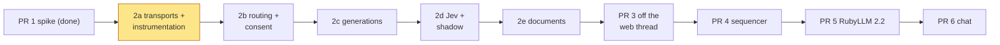
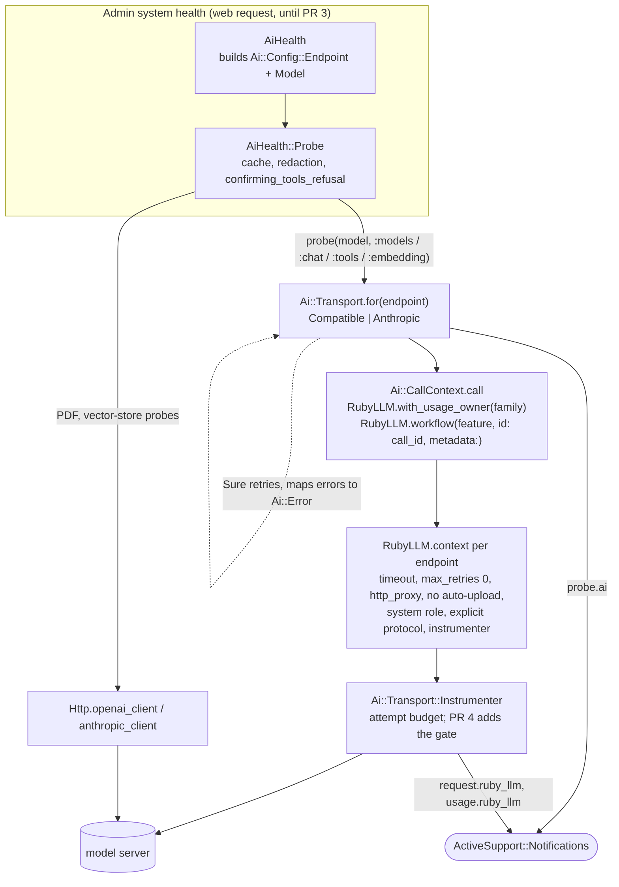
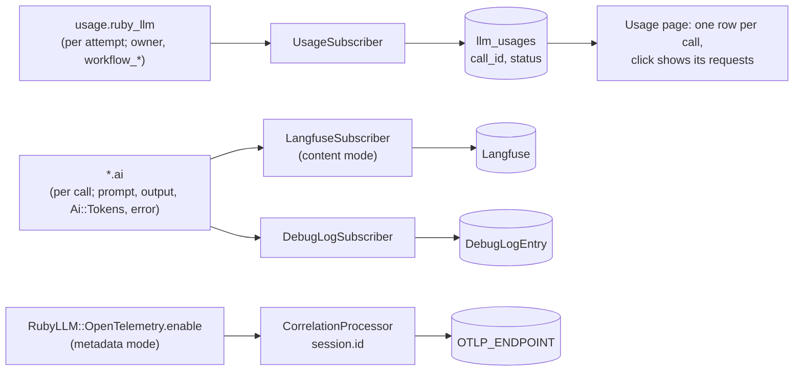

# PR 2a: transports and instrumentation (implementation plan)

**Companion to:** [`ai-plumbing-redesign.md`](ai-plumbing-redesign.md) §19 (2a) and
[`rubyllm-spike-report.md`](rubyllm-spike-report.md).
**Base:** `we-promise/sure` `origin/main` @ `139cd8983` (2026-11-06), RubyLLM 2.1.1.
**Status:** the plan the 2a PR is built from. Like every product decision here, it stays open to
evidence. Calls by @josh-sanders during development of PR #4440 are marked.

## What 2a is

PR 2 comes in five parts, merged in order, all in v0.7.7. 2a is the foundation:

- the `compatible` and `anthropic` transports with `probe`;
- `Ai::Transport::Http`;
- `Ai::Result`, and `Ai::Error` with `NoCredit` and `ModelMissing`;
- a time budget for each attempt;
- the instrumentation subscribers, with the correlation id;
- usage per request, with the usage page grouped per call (`llm_usages.call_id` and `status`);
- both tracing modes;
- the proxy fix, which skips loopback;
- the transport contract test and the AI test helpers.

`AiHealth::Probe` calls `transport.probe`, which fixes drift bug 6. *Deletes:* the probe's own
clients.

A transport call arrives only with its first caller (§19), so 2a implements only `probe`.
`generate` comes in 2c, `judge` in 2d, `embed` in 2e and `converse` in PR 6. The subscribers and
the new usage columns get their production traffic from 2c on. Until then, today's recorders
write rows with a null `call_id`, which count as calls of one request each.

## Decisions

**Calls by @josh-sanders during development of PR #4440:**

1. **Where it's built.** A branch from `origin/main` (`feat/ai-transports-instrumentation`)
   with none of #4440's commits. #4440 keeps the documents, this plan included.
   2b is built on the same branch and goes into the same PR, we-promise/sure#4765, because the
   maintainer wants fewer PRs ([`pr-2b-routing-and-consent.md`](pr-2b-routing-and-consent.md)).
2. **How far the proxy fix reaches.** Everything `Ai::Transport::Http` builds, **plus** today's
   `Provider::Openai` client and `Assistant::External::Client`.
   - This is an exception to §19's principle: a few lines in code that 2e and PR 6 delete,
     allowed because OpenAI-compatible production calls get the resolver now.
   - Anthropic production calls can't be covered, because the `anthropic` gem takes no proxy.
     They get it when they move onto RubyLLM (2c, PR 6).
3. **The tracing mode is inferred, with no AI ENV added (§4.7):**

   | Set | Mode |
   |---|---|
   | `LANGFUSE_PUBLIC_KEY` and `LANGFUSE_SECRET_KEY` | `content`, as today |
   | only `OTLP_ENDPOINT` (and `OTLP_HEADERS` for auth, `k=v,k=v`) | `metadata` |
   | both | `content`, with a boot warning |
   | neither | `off` |

   `OTLP_ENDPOINT` and `OTLP_HEADERS` are short names, passed explicitly to
   `OpenTelemetry::Exporter::OTLP::Exporter.new(endpoint:, headers:)`. They're used instead of
   the standard `OTEL_EXPORTER_OTLP_TRACES_ENDPOINT`, which is too long.
4. **The probe check is a setting of the endpoint.** Whoever configures the endpoint sets it:
   the instance admin, or a family admin for its own key. 2a builds it, but nothing can change
   it from its default until PR 7.
   - `Ai::Config::Endpoint#probe_check` is `:models`, which makes no chat call, or `:chat`.
     `:chat` sends "Reply with OK" for about 16 output tokens; it catches `NoCredit` and
     `ModelMissing`, and compares the model name the response gives.
   - The default is `:models` on every protocol, so a probe makes no chat call unless an
     admin asks for one. Native OpenAI and Anthropic already list models today; for
     OpenAI-compatible servers this is a change, because today's probe sends a chat completion
     to them.
   - What `:models` can't see:
     - an empty balance (`NoCredit`);
     - LM Studio answering for a model it hasn't loaded;
     - a wrong key on a server whose model list needs none, such as OpenRouter's public
       `/models`.

     The function-calling probe still makes a real request, so it catches these. An admin who
     wants the check itself to see them sets `:chat` from PR 7.
   - 2a adds no UI, `Setting` or ENV for it. PR 7 adds `ai_endpoints.probe_check` to the
     endpoint form and the config file; PR 9 adds it to `ai_endpoint_credentials`, beside the
     family's own key.
   - `:models` goes through `Http.openai_client` and `Http.anthropic_client` (`models.list`,
     `models.retrieve`). RubyLLM 2.1.1 has no public model listing per context:
     `Provider#list_models` is `:nodoc:`, and `Models.refresh` rewrites the shared registry.
5. **This plan lives in #4440**, linked from §19 and §21. The 2a PR description links to it.

**Found in RubyLLM 2.1.1's source, which shapes the design:**

- **Retries happen inside one `request.ruby_llm`.** `Transport::Connection#instrument_request`
  wraps `connection.post`, and Faraday's retry middleware runs inside it. The usage middleware
  sits inside the retry middleware, so `usage.ruby_llm` fires once per attempt, and nothing runs
  before a retry. So **RubyLLM's `max_retries` is 0 on every context, and the transport retries
  itself** up to the endpoint's `max_retries`, with backoff. That lets it:
  - map OpenAI's 429 `insufficient_quota` to `NoCredit` *before* retrying, as §9 asks;
  - check the attempt budget between tries;
  - give PR 4's gate one HTTP request per `request.ruby_llm`.

  The spike criterion "the endpoint's settings override the default retries" still holds.
- **`RubyLLM.workflow(name, id:, metadata:)`** is public. It adds `workflow_id`,
  `workflow_name`, `workflow_parent_id` and `workflow_metadata` to every RubyLLM event. On
  2.1.1 its context lives in `Thread.current`, so tool threads don't inherit it (2.2 moves it to
  fiber storage, #1327).
- **`RubyLLM.with_usage_owner(owner)`** is public. It uses fiber storage, which threads inherit,
  and `usage.ruby_llm` carries the owner.
- **Errors:** RubyLLM raises `PaymentRequiredError` for a 402 and for a 400 saying "credit
  balance is too low". OpenAI's spent balance arrives as a plain `RateLimitError`.
  `ModelNotFoundError` isn't a `RubyLLM::Error`.

## How it fits together

## Following the spike report

| Spike decision or finding | Where it lands in 2a |
|---|---|
| Adopt RubyLLM, `~> 2.1`, locked at 2.1.1 | Step 1 |
| Public API only (#1291, #1071) | `context`, `chat`, `generate`, `with_*`, `embed`, `workflow`, `with_usage_owner`, `OpenTelemetry.enable`. No `Accounting::*` or `Support::*` |
| Usage ledger off; never create `ruby_llm_usages`; don't rely on `Usage.ledger = nil` | Step 1: initializer note, plus a test that the table doesn't exist |
| One `llm_usages` row per request, from `usage.ruby_llm`, with call context and `call_id`; the page shows calls, a click shows the requests | Steps 7–9 |
| `Ai::Usage` named `Ai::Tokens`; the prompt is `input + cache_read` (RubyLLM's `input` excludes cached tokens) | Step 3 |
| Reported cost first (`tokens.reported_cost`, OpenRouter's BYOK upstream included), else the model's prices | Step 7 |
| Both tracing modes in 2a, never together, `content` the default | Step 7; decision 3 |
| Endpoint settings override retries and timeout | Steps 6–7 (Sure owns retries) |
| `openai_use_system_role` on both `:openai` and `:openrouter` | Step 6 |
| Always pass `protocol:`; OpenRouter's app name and URL; the `:openrouter` provider for OpenRouter | Step 6 |
| `auto_upload_large_files = false` | Step 6 |
| Check that `embed` returns one vector per text (#1269) | Step 6, in the `:embedding` probe |
| Error mapping, including `NoCredit` (Anthropic's 400, OpenAI's 429 `insufficient_quota`, OpenRouter's 402), `ModelMissing`, `ModelNotFoundError` outside `RubyLLM::Error`, and LM Studio's string errors | Steps 2, 6, 13 |
| A probe compares the model's name (LM Studio) | Step 6 |
| Proxy: one resolver, HTTPS then HTTP, `NO_PROXY`, loopback skipped; the docs say `NO_PROXY` matches the host as written | Steps 4, 11, 14 |
| One URL normaliser: a bare host gets `/v1`, a path such as `/v1beta/openai` is kept | Step 4 (Chatwoot's P3 lesson) |
| The `.ai` event records each file's name and size, never its bytes | Step 6 (`Base#event_*`, unused until 2c and 2e) |
| No `ruby_llm-monitoring`, which rewrites app-wide inflections | Step 1 note |
| `pipelock:ignore` tags move with their lines; example keys are `${VAR}` | Steps 4 and 11; verification |
| **Not in 2a:** probes as jobs on the endpoint's timeout (PR 3); live cassettes for Anthropic's and OpenAI's successful paths (2c); `previous_response_id`, the deadline in the stream callback, and the final round with `tool_choice: none` (PR 6) | Still on old code |

## RubyLLM from 2.1.1 to `main`: what lands with 2.2

All 458 commit summaries in `v2.1.1..main` (2026-10-12 to 2026-11-06) were read. 2.2 is
unreleased, and v2.1.1 is still the newest tag. The commits below touch this work. 2a is built
to survive them, and this table is the upgrade checklist for PR 5.

| Commit | Change in 2.2 | Effect | Where |
|---|---|---|---|
| #1333 `4303c8b1` | `OpenTelemetry.enable(content: true)` puts prompts, outputs and tool arguments on spans (off by default) | `metadata` mode's privacy now rests on a setting, not on missing code. Call `enable(content: false)` explicitly on 2.2, and keep the test that no span carries content | 2a step 7; PR 5 |
| #1407 `f800fa5b` | Timeouts, refused or dropped connections and TLS failures raise `RubyLLM::ConnectionError` (with `timeout?`), not Faraday errors | The mapping handles both: Faraday errors on 2.1.1; on 2.2, `ConnectionError#timeout?` → `Timeout`, otherwise `Unreachable` | 2a steps 2, 6, 13 |
| #1379, #1382, #1410 | Options a protocol or operation can't carry raise `ArgumentError` instead of being dropped | Probes send only options every protocol carries; `ArgumentError` from RubyLLM maps to `Refused` (our bug). 2c's per-preset reasoning effort mustn't send what a server can't take | 2a step 6; 2c |
| #1099, #1126, #1156 | Tokens stay unknown (`nil`) when no usage is reported or the connection dropped | `Ai::Tokens` is nil-safe and doesn't turn unknown into 0. A usage row with unknown tokens stores 0 tokens and a nil cost, with `tokens_unknown` in its metadata | 2a steps 3, 7 |
| #1199 `22fa1854` | Interrupted attempts record usage | More `usage.ruby_llm` events; the subscriber maps every status | 2a step 7; PR 4 |
| #1061, #1267, #1273, #1409, #1418, `cc22543e` | Anthropic streamed input tokens, vLLM cache writes, Cohere reasoning tokens, per-request tier pricing, reported costs repriced | Counts and costs change on upgrade; re-record the usage-normalisation cassettes | PR 5 |
| #1327 `c19d8989` | Workflow context moves from `Thread.current` to fiber storage, so child fibers and threads inherit it | On 2.1.1, tool threads lose `workflow_*`. `Ai::CallContext` keeps its own fiber copy, so Sure doesn't depend on it | 2a step 5; PR 6 |
| #1268, #1353 | `config.redact_error_messages` moves provider text to `Error#provider_message`, `#response_body` and `#error_code`; credentials are kept out of errors | On 2.2, turn it on and classify from `error_code` and `response_body`. In 2a, the `Redactor` scrubs messages before logs and Langfuse | 2a step 7; PR 5 |
| #1191 `6fc0a7ea` | Connection settings are resolved per request | Revisit the spike's note on the 64-entry connection cache before any per-call timeout | PR 4, PR 6 |
| #1297, #1160, #1092 | `embed` raises on too few vectors, pairs vectors by row index and keeps the Array shape | 2a's one-vector-per-text check becomes redundant on 2.2; it stays until then | 2a step 6; 2e |
| `9c05bff2` | Bedrock's and vLLM's context-length wording recognised | Both join the `ContextTooLong` contract cases | 2a step 13 |
| #1380 `277b23c2` | `tool_calls` becomes a collection of `ToolCall` | Read it either way | 2a step 6; PR 6 |
| #1438 `873fc2b4` | Internal helpers hidden from the documented API | A "RubyLLM surface" test lists every RubyLLM method Sure calls and fails if one goes | 2a step 13 |
| #1294 `2bb83097` | Models resolve to configured providers first | Check that `assume_model_exists` with an explicit `provider:` still bypasses the registry | PR 5 |
| #1264, #1437, #1165 | Judgments through the Decisions API (OpenRouter, Azure), answers matched by name | Jev on OpenRouter comes back, as planned | 2d, PR 5 |
| #1405 `2885c593` | Splits inline `<think>` tags on Chat Completions when asked | It may replace Sure's own `<think>` stripping | 2c (keep Sure's on 2.1.1) |
| #1302, #1163, #1282 | Structured output parsed from the final answer only; refusals surface as content; Gemini schemas nested deeper than 32 levels go via `$defs` | They change `generate`'s parsing | 2c / PR 5 |
| `bf1ff089`, #1223, #1422, #1448 | One process per persisted chat; queued messages join a running turn; chat owners | Evidence for PR 5's chat-storage spike, and for what happens to a message sent mid-turn | PR 5, PR 6 |
| #1460 `a578db3d`, #1457, `7ae3880d`, `2157e7df` | `around_tool_call`, exclusive tools, a tool's `read_only` against `requires_approval`, permission modes | `around_tool_call` can carry the lane in place of `SureTool`'s wrapper; `read_only` maps onto #4628's classification | PR 6 |
| #1283, `85bae960` | Deferred tool search on providers without native tool search | It could cut the 12k-token tool list on llama.cpp | PR 6 |
| #1368, #1444 | `Agent.chat_model` renamed `chat_class`; `Tool#ask` renamed `request_input` | §8.4 says `chat_model`; update the plan text in PR 5 | PR 5 |

Nothing here blocks 2a on 2.1.1.

## Steps (one commit each)

0. **Setup.** A worktree from `origin/main`; `bundle install` on Ruby 3.4.9.
1. **Gem.**
   - `gem "ruby_llm", "~> 2.1"`, locked at 2.1.1.
   - `config/initializers/ruby_llm.rb`: `config.logger = Rails.logger` and no global keys, so
     every call goes through a per-endpoint `RubyLLM.context`. A comment records the railtie's
     side effects: `acts_as`, the AS::Notifications instrumenter, the blob hook and the usage
     ledger.
   - Check how Zeitwerk inflects `ruby_llm_*` file names (RubyLLM registers the acronym), and
     name the adapter to match.
2. **`app/models/ai/error.rb`.**
   - The whole §9 taxonomy, each class carrying `status`.
   - `Ai::Error.from_ruby_llm(error)`, and `.for_status(status, message, body)` for the
     ruby-openai paths.
   - Each provider's context-length wording.
   - Credit: a 402, "credit balance is too low", `insufficient_quota` or
     `credit_balance_exhausted`.
   - Missing model: a 404 that names the model, or `model_not_found`.
   - Works on 2.1.1 and 2.2 alike:
     - Faraday timeouts and connection errors (2.1.1), and `RubyLLM::ConnectionError` with
       `timeout?` (2.2), map to `Timeout` or `Unreachable`;
     - `ModelNotFoundError` maps to `ModelMissing`;
     - an `ArgumentError` from RubyLLM's option checks maps to `Refused`.
3. **Value types.**
   - `Ai::Tokens` (`Data`: `input_tokens, output_tokens, cache_read_tokens, cache_write_tokens,
     cost`): `+`, `prompt_tokens`, `.from_ruby_llm(tokens, cost)`. Nil-safe: an unknown count
     stays `nil`, as on 2.2.
   - `Ai::Result`, as in §9.
   - `Ai::Config::Endpoint`: `name, protocol, preset, base_url, api_key, extra_headers, location,
     timeout_seconds, max_retries, responses_api, probe_check`, with `local?`.
   - `Ai::Config::Model`: `endpoint, name, capabilities, context_window, max_output_tokens,
     embedding_dimensions, input_cost_per_mtok, output_cost_per_mtok`, with `capable?`.

   2b's `Ai::Config` holds these, and PR 7's snapshot copies AR rows into them. In 2a, prices
   default from `LlmUsage.find_pricing` until presets carry them (PR 7).
4. **`Ai::Transport::Http`.**
   - `proxy_for`: HTTPS, then HTTP; `NO_PROXY` through `URI::Generic.use_proxy?`; loopback
     skipped (`127.0.0.0/8`, `::1`, `localhost`).
   - `compatible_base`.
   - `headers`, keeping today's `{session_id}` split.
   - SSL through `SslConfigurable#faraday_ssl_options`.
   - Builders: `ruby_llm_context(endpoint)`, `openai_client` (ruby-openai with a Faraday block
     for the proxy and SSL), `anthropic_client` (documented as taking no proxy), `faraday` and
     `net_http_proxy`.
   - The `pipelock:ignore` tags move here.
5. **`Ai::CallContext`**, a thin layer over RubyLLM's documented scopes.
   - `.job(correlation_id) { }` → `RubyLLM.workflow("sure.job", id: correlation_id)`, for 2c's
     jobs.
   - `.call(feature:, model:, family:, budget:) { }` → `RubyLLM.with_usage_owner(family)` around
     `RubyLLM.workflow("ai.#{feature}", id: call_id, metadata: { feature:, endpoint:, model:,
     family_id: })`.
   - A fiber-local copy, so Sure's own code (`.ai` events, the OTel processor) never reads
     RubyLLM's internals.

   `Ai::Transport::Instrumenter` wraps the configured instrumenter. It checks the call's attempt
   deadline at each `request.ruby_llm` and raises `Ai::Error::Timeout`. PR 4 adds the gate here.
6. **Transports.**
   - `Ai::Transport::Base`: §7's interface; `probe`; Sure's retry loop (backoff, `NoCredit`
     before any retry, the budget between tries); the `instrument(".ai")` helper and
     `event_request`/`event_attachments`.
   - A shared RubyLLM adapter:
     - context: `request_timeout`, `max_retries 0`, `http_proxy`,
       `auto_upload_large_files false`, `openai_use_system_role`, OpenRouter's app headers, the
       instrumenter;
     - `assume_model_exists: true`, and an explicit `protocol:`;
     - error mapping.
   - `Compatible` (`:openai` and `:openrouter`) and `Anthropic`, with `Ai::Transport.for`.
   - `probe(model, check)`:
     - `:models`: the model is listed, through `Http`'s clients;
     - `:chat`: text plus the returned model name, or `ModelMissing`;
     - `:tools`: one forced or auto tool call, true or false, with `tool_calls` read as a Hash
       (2.1.1) or a collection (2.2, #1380);
     - `:embedding` (Compatible only): the dimensions, and one vector per text.
   - Each probe emits `probe.ai` with `feature: :probe` and no owner, so it writes no usage row.
   - Probes send only options every protocol carries (#1379, #1382).
7. **Instrumentation** (`config/initializers/ai_instrumentation.rb`, `app/models/ai/instrumentation/*`).
   - `UsageSubscriber` (`usage.ruby_llm`) writes a row only when the owner is a `Family`:
     - `provider` = the endpoint name, `operation` = the feature, both from
       `workflow_metadata`; `model`;
     - tokens with the cached split, cost and `status`;
     - `call_id` = `workflow_id`;
     - `metadata`: `{ route:, error_class:, correlation_id: workflow_parent_id }`.
   - `LangfuseSubscriber` (`/\.ai\z/`, `content` mode, through the existing
     `Rails.configuration.x.langfuse`): the correlation id is the session, cached tokens are
     counted, `probe.ai` is skipped.
   - `DebugLogSubscriber`: `DebugLogEntry.capture` on failure or unavailable, with
     provider/source metadata. It skips `probe.ai`, which `AiHealth::Probe` already logs.
   - `Ai::Instrumentation::Redactor`: one helper that all three use.
   - `MetadataTracing`: an app-owned `TracerProvider` and an OTLP exporter on
     `OTLP_ENDPOINT`/`OTLP_HEADERS`; `CorrelationProcessor` sets `session.id`; then
     `RubyLLM::OpenTelemetry.enable`, with `content: false` passed explicitly once the gem takes
     it (2.2). A test fails if any span carries content.
   - `Ai::Instrumentation.mode`: decision 3.
   - `ComparisonSubscriber` waits for 2d.
8. **Migration** `AddCallIdAndStatusToLlmUsages` (`Migration[8.1]`).
   - `call_id`: uuid, null, indexed.
   - `status`: string, not null, default `succeeded`, checked to be succeeded, failed or
     cancelled.
   - Backfill `failed` where `metadata ? 'error'`.
   - `LlmUsage` gets a `status` enum; a `before_validation` derives it for rows today's recorders
     write, so they need no edits.
   - `LlmUsage.calls(scope)` groups by `COALESCE(call_id, id)`, and the statistics count calls.
9. **Usage page** (`settings/llm_usages/show`).
   - One row per call, summed.
   - A call with several requests expands (`DS::Disclosure` or `DS::ExpandToggle`) to each
     request's status, tokens, cost and error.
   - Functional tokens and `t()` only; no new CSS.
10. **`AiHealth::Probe` on transports.**
    - `llm` → `probe(endpoint.probe_check)`, which is `:models` by default on every protocol.
      Compatible servers' chat-completion probe (`openai_chat_completion_available?`) goes.
    - `function_calling` → `probe(:tools)` inside `confirming_tools_refusal`, with `:chat` as
      the control; `endpoint.responses_api` picks the Responses variant.
    - `embedding` → `probe(:embedding)`.
    - The PDF and vector-store probes take their clients from `Http`.
    - Delete `openai_client`, `anthropic_client`, `embedding_client` and `openai_model_ids`.
    - Failure codes map from `Ai::Error`. The new codes `no_credit`, `unauthorized` and
      `unreachable` get i18n.
    - The timeout stays `Probe.timeout`, because probes run on the web thread until PR 3.
11. **Decision 2.**
    - `Provider::Openai#initialize` takes `Http`'s proxy and SSL block.
    - `Assistant::External::Client#resolve_proxy` becomes `Http.proxy_for`. This fixes its
      scheme-only lookup and its CIDR `NO_PROXY` bug.
12. **`test/support/ai_test_helper.rb`.**
    - `ai_endpoint` and `ai_model`, `with_ai_call_context`, `capture_ai_events`,
      `stub_ai_transport`.
    - `with_ai_cassette(preset, name)`: cassettes under `test/vcr_cassettes/ai/<preset>/`,
      localhost recorded inside the block, keys filtered, recording with `RECORD_CASSETTES=1`.
    - Later parts add their own: 2b `with_ai_routes`/`without_ai`, 2c `stub_ai`, PR 3
      `with_ai_capsule`.
13. **Contract test** (`test/architecture/ai_transport_contract_test.rb`), run over every
    transport.
    - Error mapping: 401, 402, 403, a 404 naming the model, 408, 429, a 429
      `insufficient_quota` (one request, no retry), 500, 503, 529, each context-length 400
      (vLLM and Bedrock included), a refused connection, a read timeout.
    - Retries equal `max_retries`, and the budget stops them.
    - Usage normalisation, and the proxy matrix.
    - No `OpenAI::Client.new`, `Anthropic::Client.new` or `Faraday.new` under `app/models/ai/`
      outside `transport/http.rb`.
    - The RubyLLM surface test (#1438).
    - `probe` on cassettes: llama.cpp live, and the error paths of no-credit Anthropic and
      OpenAI keys → `NoCredit`.

    Unit tests for:
    - `Http`, `Error`, `Tokens`, `CallContext` and the instrumenter;
    - each subscriber, and `MetadataTracing` (no content in any span);
    - the `LlmUsage` migration and grouping, and the usage page;
    - `probe_test`, rewritten onto WebMock and cassettes;
    - the proxy in `Provider::Openai` and the external client.
14. **Docs.**
    - `docs/llm-guides/ai-pipeline.md`, "Transports and instrumentation", linked from
      `AGENTS.md`.
    - `docs/hosting/ai.md`: the tracing modes and `OTLP_ENDPOINT`/`OTLP_HEADERS`; proxy coverage
      (Anthropic later; `NO_PROXY` matches the host as written); usage now one row per request.

## The 2a PR description

- **Links:** this file, and §19's entry for 2a.
- **Diagrams:** the two mermaid diagrams above.
- **Reviewer guide:** read `ai/transport/base.rb` and `http.rb` first, then
  `instrumentation/usage_subscriber.rb`. It lists what moved and what was deleted.
- **Pipelock:** the `pipelock:ignore` tags that moved.
- **Decision 2:** recorded as an exception to the principle.
- **Upgrade note:** queries that count `llm_usages` rows as calls; `OTLP_ENDPOINT`.
- **Still on old code:**
  - every AI call except probes;
  - the usage recorders;
  - per-worker Langfuse tracing;
  - Anthropic's production client, without a proxy;
  - probes on the web thread.

## Verification

- `bin/rails test`, the whole suite, plus `test/architecture` and `test/models/ai`.
- `bin/rubocop`, `bundle exec erb_lint --lint-all`, Biome, `bin/brakeman --no-pager`, and the
  settings system tests.
- Live, through `bin/rails runner`: `AiHealth.new(force_probes: true)` against a llama.cpp
  server and the no-credit Anthropic and OpenAI keys. This records the cassettes.
- `content` mode against a self-hosted Langfuse with a stubbed `generate.ai`. `metadata` mode
  through `OTLP_ENDPOINT`, with no content in any span.
- A logging forward proxy with `HTTPS_PROXY` only, then `HTTP_PROXY` only: check `NO_PROXY`, and
  that loopback is skipped.
- Pipelock's secret scan on the diff; no key-shaped strings in cassettes or fixtures.
