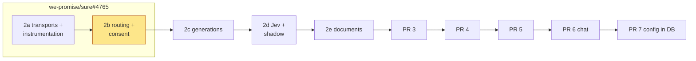
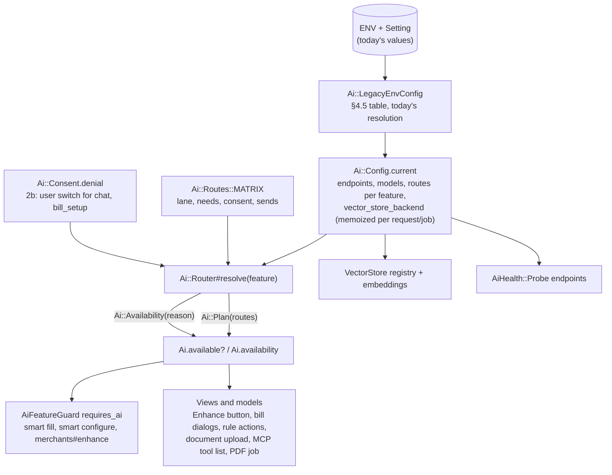
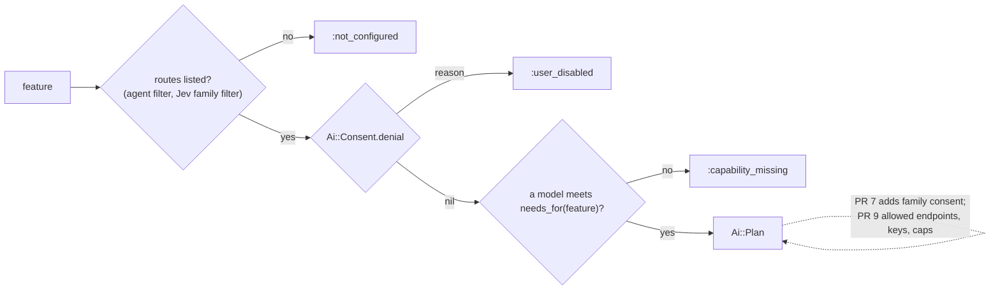

# PR 2b: routing and consent (implementation plan)

**Companion to:** [`ai-plumbing-redesign.md`](ai-plumbing-redesign.md) §19 (2b),
[`pr-2a-transports-and-instrumentation.md`](pr-2a-transports-and-instrumentation.md) and
[`rubyllm-spike-report.md`](rubyllm-spike-report.md).
**Base:** 2a's branch `feat/ai-transports-instrumentation`, rebased on `we-promise/sure`
`origin/main` @ `3758cb8aa` (2026-11-06), RubyLLM 2.1.1.
**PR:** we-promise/sure#4774 (`feat/ai-2b-routing`), part of the stack 2a #4773 → 2b #4774 → 2c #4775 → 2d #4765 → 2e #4771. 2a–2d were first built on one PR, #4765, and split at their commit boundaries (call by @josh-sanders during development of PR #4440); the delivery notes below describe the one-PR build.
**Status:** the plan the 2b commits are built from. Like every product decision here, it stays
open to evidence. Calls by @josh-sanders during development of PR #4440 are marked.

## What 2b is

PR #4440's redesign (`docs/proposals/v0.8/ai-plumbing-redesign.md`, §19) has every AI feature
ask one router "what may run for this feature, family and user, and if nothing, why?".

Today seven or more checks answer that question, each in its own way, and they have drifted:

- **Drift bug 1:** the Enhance merchants button looks only for OpenAI
  (`FamilyMerchantsController#index`), so on an Anthropic-only install it's hidden although the
  enhancer works.
- **Drift bug 5:** embeddings read only ENV (`VectorStore.embedding_uri_base` and
  `embedding_access_token`), never the values saved in Settings.
- Rule actions, the bills dialogs, PDF import, MCP's tools and document upload each look up
  providers in their own way.

2b adds:

- `Ai::Config`, built per process by `Ai::LegacyEnvConfig` from today's ENV and `Setting`, using
  the §4.5 table;
- `Ai::Routes` with its `sends:` manifest, `Ai::Router`, and `Ai::Consent` with the user switch;
- `Ai.available?` and `Ai.availability`, `AiFeatureGuard`, `Family::AiSettings` and `Sure/NoAiEnv`.

Every non-chat availability check moves onto the router. *Deletes:* those checks and their test
stubs.

**Delivery (call by @josh-sanders during development of PR #4440):** 2b goes onto the same PR as
2a, draft we-promise/sure#4765 (branch `feat/ai-transports-instrumentation`), because the
maintainer wants fewer PRs. §19 and the 2a plan's decision 1 say so.

## Decisions

**Calls by @josh-sanders during development of PR #4440:**

1. **Same PR as 2a** (above).
2. **Chat buttons outside chat keep today's gate until PR 6.** These are the bills AI review, the
   bills prompt chips, "Review with AI" and "Dig in with AI".
   - `bills_one_shot_ai_available?` keeps only its chat users, renamed `bills_ai_chat_available?`
     with the same expression, on the agreement test's allowlist.
   - The smart-fill and smart-configure dialogs move to `requires_ai :bill_setup`.
3. **PDF import checks in the job, as today.** `PdfImport#process_with_ai`, `#extract_transactions`
   and the `import_bank_statement` tool ask `Ai.availability(:extract_pdf)` in place of
   `preferred_llm_provider.present?`, and raise with the router's reason. The upload still always
   queues the job. The PDF-capability check (`supports_pdf_processing?`) stays with the PDF
   workers until 2e's "Read as".

**Already decided in #4440, which 2b follows:**

- The user switch keeps today's checks (§6). Chat and bills need `users.ai_enabled`; PDF import,
  embedding and document search don't. Background features have no consent line until PR 7.
- Bills ask for the switch itself (the column), not `User#ai_enabled?`, which also means "chat
  works". The side effect §6 names therefore goes: an `mcp_only` family's bill AI no longer turns
  off with chat. Release note: "bill AI depends on its own consent, not on chat".
- An AI-dependent MCP tool is listed only when its feature is available (§14).
  `import_bank_statement` gets this in 2b. `search_family_files` stays always listed: its
  metadata fallback is 2e's, with #3422.
- `Ai::Config` is per process, so the web and the workers can disagree, as today, until PR 7. The
  upgrade guide says to give both the same AI variables.
- There's no deprecation warning yet. It arrives with `ai:export_config` in PR 7, the first time
  there's somewhere to move to.
- `Family::AiSettings` holds every family AI setting, and `family.rb` gains one `include` (§6).

**Technical choices that follow from today's behaviour (no product change):**

- **The snapshot is memoized per request or job, not per process lifetime.** It's built on first
  use in each execution through `ActiveSupport::CurrentAttributes` (`Ai::Config::Current`), so a
  setting saved in the UI takes effect on the next request, as today. §4.6's version stamp
  replaces this in PR 7. `Ai::Config.expire` resets it, for tests and `Setting` writes.
- **Capabilities on legacy models reproduce today's answers:**
  - `structured_output` on every LLM model.
  - `tools` and `streaming` only when today's `supports_model?` accepts the model, so native
    OpenAI with `o4-mini` resolves chat to `:capability_missing`. Chat is allowlisted until PR 6.
  - `vision` and `documents` from `supports_pdf_processing?`, recorded for 2e.
  - `judge` on Jev, plus `calibrated_confidence` on the cloud vendor host.
  - `embedding` on the embed route's model.
- **Jev serves only families that chose it, until 2d.** The `categorize` route lists Jev first
  when it's configured and its endpoint is allowed (`Provider::Jev.endpoint_allowed?`), then the
  LLMs in `llm_provider_order`. A Jev entry serves a family only when
  `effective_categorization_provider == "jev"`: one line in `Ai::Route#serves?`, which 2d deletes
  with `families.categorization_provider`. That's today's per-family rule.
- **`embed` is listed only when today's `VectorStore.adapter` would build one.** That includes
  `VectorStore::Pgvector.available?`, so the router and the store never disagree.
  - With `VECTOR_STORE_PROVIDER=openai`, or by today's default from the OpenAI token, the route
    is the OpenAI endpoint with `vector_store: true`.
  - Otherwise it's an embedding endpoint, and `vector_store_backend` holds `pgvector` or `qdrant`.
- **Drift bug 5 is fixed in the resolution.** The embed endpoint's URL and key fall back to the
  `Setting` OpenAI values, as every other AI setting does:
  - URL: `EMBEDDING_URI_BASE`, then `OPENAI_URI_BASE`, then `Setting.openai_uri_base`, then
    today's default.
  - Key: `EMBEDDING_ACCESS_TOKEN`, then `OPENAI_ACCESS_TOKEN`, then `Setting.openai_access_token`.

  `VectorStore` reads its embedding endpoint and model from `Ai::Config`.
- `shadow_categorize` gets no route until 2d. Nothing asks for it before then.

## How it fits together

## Following #4440 and the spike report

| Decision or finding | Where it lands in 2b |
|---|---|
| Per-process config until PR 7; web and workers may disagree (register; §19) | Step 2; upgrade note |
| The old AI ENV keeps working, read the way today's code reads it (§4.5; call) | Step 2; config test over C1–C9 |
| The user switch: today's checks, chat and bills only; nothing added to the prompt (register; §6) | Step 4 |
| `stored_document_text` in chat's manifest from PR 2 (§5.1) | Step 3. Fixes §5.1's "2b's migration" to "PR 7's consent migration" |
| `search_family_files` always listed, with its fallback (register; §14) | Unchanged in 2b; the fallback is 2e's with #3422 |
| #3422's order (register; §5.5) | Not merged as of 2026-11-06. If it lands first, its indexing check becomes `Ai.available?(:embed, family:, user:) && user.ai_enabled` |
| One ordered list per feature (register; §5.2) | `Ai::Config` routes; failover is 2c's |
| No RubyLLM `with_fallbacks` (register) | The router hands over a list; nothing in RubyLLM is configured |
| Jev without custom paths (register; §4.5) | 2d. 2b lists Jev's endpoint as today's code resolves it |
| A family's own key, cost caps, allowed endpoints (register; §4.2) | PR 9. The router has no line for them (§5.3) |
| Two-level consent (register; §6) | PR 7. 2b has no family line |

**RubyLLM upstream (2.1.1 → `main`):** routing and consent are Sure's own, and none of the 458
commits read for 2a changes them.

- #1294 (models resolve to configured providers first) doesn't reach Sure: transports pass
  `assume_model_exists` with an explicit `provider:`.
- RubyLLM's model registry (`RubyLLM.models.find(id).capabilities`) isn't used for routing.
  - It doesn't know local models.
  - Its function-calling list differs from today's OpenAI prefix allow-list, so using it would
    change chat availability.
  - Capabilities stay in Sure's config, and PR 7's presets may seed them from the registry.
- The `ai-pipeline.md` section says the router and consent are deliberately outside RubyLLM, as
  rubyllm.com describes the gem: a client, not a policy layer.

## Steps (one commit each, on `feat/ai-transports-instrumentation`)

0. **Rebase** onto `origin/main` (4 commits behind; none of them AI). Run the 2a tests.

1. **`Family::AiSettings`.** A pure move of `family.rb:172–252` into
   `app/models/family/ai_settings.rb`:
   - `effective_categorization_provider`, `effective_assistant_type`, `assistant_enabled?`;
   - `resolved_categorization_provider`, `categorization_model_name`;
   - the threshold, shadow rate, `shadow_categorization_provider`, `configured_jev_provider`;
   - their validations.

   Add `chat_mode_external?`, which reads `effective_assistant_type == "external"` until PR 6
   and PR 7. `family.rb` gains `include AiSettings`. No behaviour change, and `family_test` passes
   unchanged.

2. **`Ai::Config` and `Ai::LegacyEnvConfig`.**
   - `Ai::Config::Endpoint` gains `vector_store`, `agent` and `agent_settings` (allowed emails,
     agent id, session key), with redacted `inspect`.
   - `Ai::Config::Model` gains `batch_size` (from `LLM_MAX_ITEMS_PER_CALL`), unused until 2c.
   - `Ai::Route` is `Data(feature, position, model, condition)`. It has `endpoint`, `agent?`,
     `model_capable?(needs)` (a hash of needs: either set qualifies), `serves_user?(user)` (agent
     allowed emails) and `serves?(family)` (the Jev family filter).
   - `app/models/ai/config.rb`: a frozen snapshot of `endpoints`, `models`, `routes` (feature →
     ordered `Ai::Route`s), `routes_for(feature)` and `vector_store_backend`.
     - `.current` memoizes per execution (`Ai::Config::Current < CurrentAttributes`).
     - `.expire` resets it; `.with(config) { }` overrides it for tests.
   - `app/models/ai/legacy_env_config.rb`: the §4.5 table, resolving each value exactly as today.
     It reuses today's resolvers so the two can't drift:
     - `Provider::Openai.effective_model`, `.request_timeout`, `.extra_headers` (static only) and
       `#supports_responses_endpoint?`;
     - `Provider::Anthropic.effective_model`, `Provider::Jev.effective_*`;
     - `Provider::Registry.llm_provider_order`;
     - `Assistant::External.config`.

     Endpoints:
     - `openai`, or `openai_compatible` when there's a URI base. It's local for http and cloud
       for https, and gets no model or routes when there's a URI base and no model (today's
       registry nil);
     - `anthropic`, `jev`, `embed`, and the external assistant (`agent: true`).

     Routes:
     - `chat`: model routes, then the agent endpoint;
     - `bill_setup`, `extract_pdf`, `detect_merchants`, `enhance_merchants`: in
       `llm_provider_order`;
     - `categorize`: Jev first with its family condition, then the LLMs;
     - `embed`.
   - `Ai::Config.current` runs `LegacyEnvConfig.build`; PR 7 swaps in the tables.

3. **`Ai::Routes`** (`app/models/ai/routes.rb`): §5.1's `MATRIX` word for word, with `fetch`,
   `needs_for`, `source_of`, `consent_key` and `sends_for`. `queue_for` and `QUEUES` wait for 2c's
   first job.
   - i18n in `config/locales/models/ai/en.yml`: one description per `sends:` key, and the six
     consent-row labels.

4. **`Ai::Router`, `Ai::Consent`, `Ai::Availability`, `Ai::Plan`, and `app/models/ai.rb`.**
   - The router is §5.3's code without the PR 7 and PR 9 lines, plus `route.serves?(family)` in
     the listed filter.
   - `Ai::Consent.denial`: `USER_SWITCH = %i[chat bill_setup]`, returning `:user_disabled` when
     the consent key is in it and `!user&.ai_enabled`. A comment says PR 7 replaces it with
     `spec[:consent] == :user` and the family lines.
   - `Ai::Availability`: `Data(reason)`, with `available?` and `message_for(user)`. Messages for
     `:not_configured`, `:capability_missing` and `:user_disabled` live in
     `config/locales/models/ai/en.yml`. The admin and user variants follow §16's "only someone
     who can act".
   - `Ai.available?(feature, family:, user: nil)`, `Ai.availability(...)` and `Ai.plan(...)`.

5. **`AiFeatureGuard`** (`app/controllers/concerns/ai_feature_guard.rb`): §15's code.
   - HTML redirects back with `message_for`; JSON gets 403 `{ error: "ai_unavailable", reason: }`.
   - Used by:
     - `Bills::SmartConfigurationsController` and `RecurringTransactions::SmartFillsController`
       (`requires_ai :bill_setup`, after `ensure_recurring_enabled`);
     - `FamilyMerchantsController` (`requires_ai :enhance_merchants, only: :enhance`; today
       `#enhance` has no check).

6. **Move every non-chat check onto the router** (drift bugs 1 and 5):

   | Today | 2b |
   |---|---|
   | `FamilyMerchantsController#index` `get_provider(:openai).present?` | `Ai.available?(:enhance_merchants, family:, user:)` |
   | `bills_one_shot_ai_available?` in the smart-configure drawer and smart-fill form | `Ai.available?(:bill_setup, family:, user:)` |
   | `TransactionResource#auto_categorization_enabled?` / `#auto_merchant_detection_enabled?` | `Ai.available?(:categorize / :detect_merchants, family:)` |
   | `GetUncategorizedTransactions#enrichment_diagnostic` `preferred_llm_provider.present?` | `Ai.available?(:categorize, family:)`; the field name is kept |
   | `PdfImport#process_with_ai`, `#extract_transactions`, `ImportBankStatement#call` `provider_not_configured` | `Ai.availability(:extract_pdf, ...)`; raise or return its reason (decision 3) |
   | `Assistant.function_classes` lists `import_bank_statement` always | Each function may declare `ai_feature :extract_pdf`; it's listed only when that feature is available (§14) |
   | `ImportsController` document upload and `document_upload_supported_extensions` `VectorStore.adapter` | `Ai.available?(:embed, family:, user:)`, then the adapter's extensions |
   | `SearchFamilyFiles#call` `provider_not_configured` | `Ai.availability(:search_documents, ...)` |
   | `ProcessPdfJob#upload_to_vector_store` | `Ai.available?(:embed, family:)` |
   | `VectorStore::Registry.adapter_name`, `VectorStore.embedding_*` | From `Ai::Config`: the embed route's endpoint and model, and `vector_store_backend` |
   | `RulesController#auto_categorize_estimate`, `AutoCategorize#label` via `categorization_model_name` | `Ai.plan(:categorize, family:).routes.first.model.name`; delete `categorization_model_name` |
   | `AiHealth::Probe#config_endpoint` / `#config_model` | `Ai::Config.current` endpoints and models, with the probe timeout passed to `probe` |

   **Kept until PR 6 (chat):** `User#ai_available?` and `#ai_enabled?`, `RequiresAiConsent`,
   `Api::V1::BaseController#require_ai_enabled`, `insight_dig_in_available?`,
   `bills_ai_chat_available?` (decision 2), `Chat.default_model` and `get_model_provider`.

   **Kept until their part:** provider resolution for the calls themselves, which agrees with the
   router and is checked by the config test: `preferred_llm_provider` until 2e,
   `resolved_categorization_provider` until 2c, Jev until 2d.

7. **Tests.**
   - `test/support/ai_test_helper.rb`:
     - `AI_TEST_CONFIG`, §17's setup: cloud `openai` (`gpt-4.1-mini`, every LLM capability),
       local `gpu` (`qwen3-8b`), `embed`, cloud `jev`, and an `agent`, with every feature
       routed.
     - `with_ai_routes(feature: ["endpoint/model", ...]) { }` and `without_ai { }`, which run
       through `Ai::Config.with`.
   - Replace the availability stubs:
     - `preferred_llm_provider` stubs that only decided availability (bills, smart fill and
       configure, transaction resource, insights stay, merchants);
     - the transaction-resource tests' 8 `resolved_categorization_provider` stubs;
     - the `categorization_model_name` stubs;
     - the `VectorStore::Registry.stubs(:adapter)` stubs used for availability.

     Stubs that still feed a provider into a call stay until that call's part.
   - New unit tests: `ai/config_test` (snapshot and memo), `ai/legacy_env_config_test` (each
     §4.5 row), `ai/routes_test`, `ai/router_test` (each reason, the Jev family filter, the agent
     filter, `needs` hashes), `ai/consent_test`, `ai_feature_guard_test`, `family/ai_settings_test`.
   - `test/architecture/`:
     - `ai_routing_matrix_test.rb` (§17, the parts that apply now): lanes, consent levels,
       non-empty `sends:` with i18n, snake_case keys with no provider or model names, `shadow_`
       pairs, `consent_as` at the same level, exactly six consent keys with labels. The
       generation-declaration check arrives with 2c.
     - `ai_config_test.rb` (legacy half): over C1–C9 from #4440's E2 experiment plus mixed setups
       (a Jev-choosing family beside an LLM family; both keys with `LLM_PROVIDER=anthropic` and
       `EMBEDDING_URI_BASE`; a `Setting`-only install):
       - each feature's first route is today's provider and model;
       - the embed route is today's adapter and embedding endpoint, except the drift bug 5 cases,
         which are listed.
     - `ai_agreement_test.rb` (E2): in each setup, every entry point gives the same answer as
       `Ai.available?`. Entry points:
       - the Enhance button (renders `/family_merchants`);
       - the smart-configure and smart-fill dialogs;
       - both rule actions offered;
       - the document upload card (`imports/new`);
       - MCP `tools/list` for `import_bank_statement`;
       - the PDF job's check, `search_family_files`, and the uncategorized-transactions diagnostic.

       Chat's entry points (chat page, API, Dig in, bills review and chips) are asked too, with a
       commented allowlist of their known disagreements (C6, C8, `mcp_only`, external). PR 6
       empties it, and a test fails when an entry is no longer needed.
     - `ai_feature_guard_test.rb`: every AI-starting controller action declares `requires_ai`,
       with the chat controllers allowlisted until PR 6. `requires_ai` reads only
       `Ai.availability`.

8. **`Sure/NoAiEnv`** (`lib/rubocop/cop/sure/no_ai_env.rb`, loaded like `SortedList`):
   - It flags `ENV[...]` and `ENV.fetch` of §4.7's prefixes with §4.7's message.
   - `.rubocop.yml` excludes `app/models/ai/legacy_env_config.rb`, plus a commented allowlist of
     today's files (about 25, from the 134 reads), which may only shrink.
   - `test/lib/rubocop/cop/sure/no_ai_env_test.rb` covers the cop's cases and checks that every
     allowlisted file still has a violation, so a fixed file has to leave the list. ERB isn't
     linted; the hostings views' ENV reads go in PR 7.

9. **Docs.**
   - `docs/llm-guides/ai-pipeline.md` gains "Routing and consent (PR 2b)": where things live,
     rules (ask `Ai.available?`, never a provider; no AI ENV; add a feature to `MATRIX` with
     `sends:` and i18n), and tests (`with_ai_routes`, `without_ai`, the agreement test).
   - A generated routing and manifest table in the same guide (`bin/rails ai:routes_doc`), checked
     by `ai_routing_matrix_test`.
   - `docs/hosting/ai.md`:
     - embeddings take the saved OpenAI URL and key when `EMBEDDING_*` isn't set;
     - Enhance merchants appears with Anthropic;
     - give web and worker the same AI variables.

10. **#4440 docs** (on `proposal/v0.8-ai-workflow-reviews`, `~/src/sure-pr4440`):
    - Write `docs/proposals/v0.8/pr-2b-routing-and-consent.md` from this plan, with its
      diagrams, the compliance table and the RubyLLM note.
    - In §19, "each part its own PR" becomes "2a and 2b share #4765"; 2b links to the plan file.
      Add a §21 row.
    - The 2a plan's decision 1 notes the shared PR.
    - Fix §5.1's "2b's migration" to "PR 7's consent migration".
    - Note for 2e's plan: chat still uses `llm_provider_order` (`get_model_provider`) after 2e,
      so 2e can't delete it outright.

11. **PR #4765:** retitle it "AI plumbing 2a and 2b: transports, instrumentation, routing and
    consent". Add a 2b section to the body: problem, what it adds (the diagrams), reviewer guide
    (read `routes.rb`, `router.rb`, `legacy_env_config.rb`, then the agreement test), deleted,
    decisions, still on old code, upgrade notes, validation.

## Upgrade notes and release notes (2b)

- Enhance merchants appears on Anthropic-only installs (drift bug 1).
- Embeddings on installs configured in Settings use the saved OpenAI URL and key when
  `EMBEDDING_*` isn't set. Before, they went to api.openai.com without a key (drift bug 5).
- Bill AI depends on the user's AI switch, not on chat working, so an `mcp_only` family's bill AI
  follows its own switch.
- MCP clients don't see `import_bank_statement` when no model can extract a statement.
- The smart-fill, smart-configure and merchants-enhance endpoints answer an unavailable feature
  with a redirect and the reason (JSON: 403 `ai_unavailable` with a `reason`), not a bare 403.

## Verification

- `bin/rails test`, the full suite. Compare it
  with 2a's baseline: 13 known failures, all on `main`.
- `test/architecture` and `test/models/ai` on their own, and `test/lib/rubocop`.
- `bin/rubocop` (with `Sure/NoAiEnv` on), `bundle exec erb_lint --lint-all`, `npm run lint`,
  `bin/brakeman --no-pager`.
- The settings, bills and merchants system tests where Selenium is available; otherwise they stay
  open on #4765.
- `bin/rails runner` in a dev environment with the C3 setup (Anthropic only). `Ai.availability` for
  each feature matches today's, except `:enhance_merchants`, which is now available. The rendered
  `/family_merchants` is checked through the integration test, never through `rails server`.
- `git grep` shows no remaining non-chat `preferred_llm_provider.present?`,
  `get_provider(:openai).present?` or `resolved_categorization_provider.present?` availability
  checks.

## As built

Where the commits differ from the steps above, and why:

- **The snapshot is rebuilt when an input changes.** `Ai::Config.current` keeps one snapshot per
  request or job, keyed by a fingerprint of the AI ENV and `Setting` fields it reads
  (`Ai::LegacyEnvConfig.fingerprint`). A value saved in the UI therefore applies on the next read,
  as today, including later in the same request and in tests that change ENV.
- **No `batch_size` on `Ai::Config::Model` yet.** It arrives with its first caller, 2c's batches.
- **The uncategorized-transactions diagnostic asks for `detect_merchants`.** Its
  `llm_provider_configured` field meant "an LLM provider" (`preferred_llm_provider`), which is
  `detect_merchants`' route exactly. `categorize` also counts Jev.
- **The health probes take the configured endpoint**, with the URL and key `AiHealth` resolved
  and the probe's timeout. As a result they send only the static `OPENAI_EXTRA_HEADERS`; 2a's
  probe sent a `{session_id}` header literally.
- **`import_bank_statement` answers with the router's reason** (`reason:` beside today's
  `error: "provider_not_configured"`) when it's called while `extract_pdf` is unavailable.
- **The agreement test renders the merchants page and the import page**, and asks the rule
  registry, the tool list, the diagnostic and chat's three entry points. The bills dialogs are
  covered by their controller tests, which run on the router (`use_ai_routes`, `use_no_ai`).
- **`Sure/NoAiEnv` checks `app/`, `config/` and `lib/`.** Tests set and read AI ENV on purpose,
  and migrations are history, so neither is checked.
- **One more failure on `main`:** `RecurringTransaction::AllocatorTest` "a payment fully linked to
  an active bill cannot be re-linked to another active bill" fails on `origin/main` @ `3758cb8aa`
  (from #3663) as on this branch.
