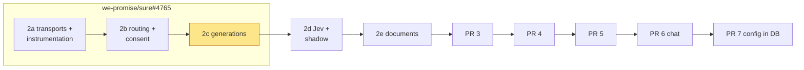
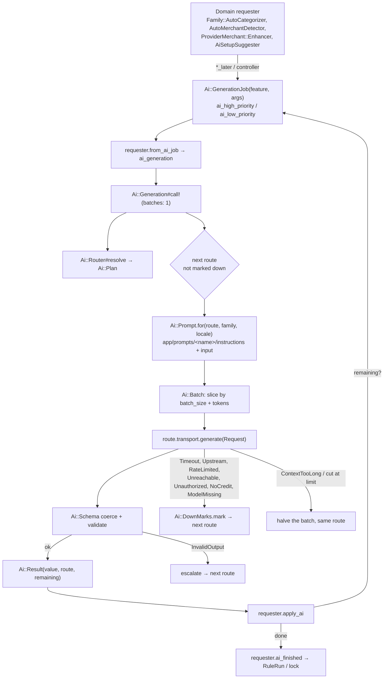
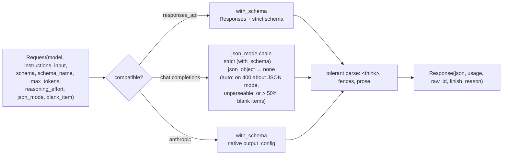

# PR 2c: generations (implementation plan)

**Companion to:** [`ai-plumbing-redesign.md`](ai-plumbing-redesign.md) §19 (2c),
[`pr-2a-transports-and-instrumentation.md`](pr-2a-transports-and-instrumentation.md),
[`pr-2b-routing-and-consent.md`](pr-2b-routing-and-consent.md) and
[`rubyllm-spike-report.md`](rubyllm-spike-report.md).
**Base:** 2b's head on `feat/ai-transports-instrumentation`, rebased on `we-promise/sure`
`origin/main`, RubyLLM 2.1.1.
**PR:** we-promise/sure#4775 (`feat/ai-2c-generations`), part of the stack 2a #4773 → 2b #4774 → 2c #4775 → 2d #4765 → 2e #4771. 2a–2d were first built on one PR, #4765, and split at their commit boundaries (call by @josh-sanders during development of PR #4440); the delivery notes below describe the one-PR build.
**Status:** the plan the 2c commits are built from. Like every product decision here, it stays
open to evidence. Calls by @josh-sanders during development of PR #4440 are marked.

## What 2c is

After 2b, every non-chat feature asks the router whether it may run. The calls themselves still
go through eight hand-written workers:
`Provider::{Openai,Anthropic}::{AutoCategorizer, AutoMerchantDetector, ProviderMerchantEnhancer, BillSetupSuggester}`,
about 2,230 lines. Each worker has its own copy of the following:

- its prompt (heredocs);
- JSON recovery (`parse_json_flexibly` and `strip_thinking_tags`, in five copies);
- the JSON-mode fallback;
- Langfuse spans;
- usage recording;
- error policy.

The drift is real:

- **Failure usage:** Anthropic records usage when a bill setup fails and OpenAI doesn't (drift
  bug 2).
- **Failure handling** differs per feature (drift bug 3):
  - `Family::AutoCategorizer` raises;
  - `AutoMerchantDetector` returns 0;
  - `ProviderMerchant::Enhancer` skips the batch without logging it.
- **Anthropic batching:** Anthropic batches aren't token-sliced.
- **Bill setup's JSON mode:** bill setup ignores `LLM_JSON_MODE`.
- **Batch size per job:** a job holds its thread for every sub-batch.

2c is §19's third part:

- `transport.generate` with the JSON-mode policy;
- `Ai::Generation`, `Ai::Schema`, `Ai::Prompt`, `Ai::Batch`;
- `Ai::Requester` and `Ai::GenerationJob`, with small batches and failover and escalation down
  the list (§5.4);
- the ERB prompt files, word for word, with the override key collapse (§8.3);
- reasoning effort on route entries (#3605), with its per-preset mapping;
- four features, each with its requester: `bill_setup`, `categorize` (the generation),
  `detect_merchants` and `enhance_merchants`;
- live cassettes for Anthropic's and OpenAI's successful paths;
- the recorded-eval CI gate, the `ai-live` label, and the batch fairness and split tests.

*Deletes:* the eight workers and `Family#resolved_categorization_provider`.

**Delivery (call by @josh-sanders, 2026-11-06):** 2c goes onto we-promise/sure#4765 with 2a and 2b
(branch `feat/ai-transports-instrumentation`, worktree `~/src/sure-ai-2a`). Two follow-ups:

- §19 says so;
- the PR is retitled to cover 2a–2c.

## Decisions

**Calls by @josh-sanders during development of PR #4440:**

1. **Same PR as 2a and 2b.**
2. **Legacy lists name the preferred provider only.**
   - `Ai::LegacyEnvConfig` lists only the first configured LLM in each generation feature's
     route. Those are `bill_setup`, `detect_merchants`, `enhance_merchants`, `extract_pdf`, and
     `categorize` after its Jev entry.
   - Today `preferred_llm_provider` picks one provider and its error stands. 2c's failover
     would otherwise send a family's transactions to a second company during an outage.
   - Failover and escalation still ship, and are tested on `AiTestHelper.test_config`. They take
     effect once an admin lists routes (PR 7).
   - `chat`'s list is unchanged: chat still resolves its own provider until PR 6.
   - The agreement and config tests keep passing, since they check the first route.
3. **Bill setup follows the same JSON policy as the other features (§7):**
   - native OpenAI: the Responses API with a strict schema;
   - custom servers: the endpoint's JSON mode (`LLM_JSON_MODE`, default `auto`);
   - Anthropic: `with_schema` (decision 7).

   Auto's null-ratio fallback doesn't apply to `bill_setup`, because null is a normal answer
   in configure mode. Its chain moves on only after a 400 or unparseable output. Release note:
   bill setup honours `LLM_JSON_MODE`.
4. **One folder per prompt.** The folder is `app/prompts/<name>/` and holds two files:
   - `instructions.txt.erb`, the system prompt;
   - `input.txt.erb`, the user message.

   Translations sit beside them as `instructions.<locale>.txt.erb`. This is RubyLLM's agent
   convention (`app/prompts/<agent>/instructions.txt.erb`). A route entry's `prompt:` still
   names one thing, the folder. §8.3's "`<name>.txt.erb`" becomes "`<name>/`" in #4440.
5. **Key collapse in 2c.**
   - The keys collapse as follows:
     - `categorizer_openai` and `categorizer_anthropic` become `categorize_transactions`;
     - `merchant_openai` and `merchant_anthropic` become `detect_merchants`.
   - A data migration keeps the override that matches the family's provider today
     (`Setting.llm_provider`, then whichever key exists).
   - When both overrides exist and differ, the other one goes to a `DebugLogEntry`. The prompts
     page shows it once, in a disclosure, until the admin next saves.
6. **No job shims.** `AutoCategorizeJob`, `AutoDetectMerchantsJob` and
   `EnhanceProviderMerchantsJob` are deleted outright.
   - A job still queued under an old class at the upgrade lands in Sidekiq's dead set, and a rule
     run waiting on it stays pending.
   - The upgrade note says to let the `ai_*` queues drain before upgrading.
   - §19's "shims for one release" line goes for these jobs.
7. **One structured-output call on both protocols: `with_schema`.**
   - RubyLLM sends `response_format` on compatible servers and Anthropic's native
     `output_config` on Anthropic.
   - The forced/`auto` tool choice goes, and so do #4513's reminder retry and the tool names.
   - Anthropic's prompts lose the one sentence that names the tool ("…and return the result via
     the report_… tool"). That's recorded as the only change to prompt text, and the golden test
     lists it.
   - **Gate:** a live check with a funded Anthropic key must show the current Claude models
     accept `output_config`, the ones that refuse a forced tool included. It runs first, in
     step 5.
   - If the check fails, 2c keeps the forced tool for Anthropic as §7 has it, and the prompts
     stay word for word.
   - Compatible servers keep their JSON-mode chain either way, because local servers differ.

**Already decided in #4440, which 2c follows:**

- **Prompts:** today's prompts move word for word (§8.3, §20). There are eleven variants:
  categorize, detect and enhance each have OpenAI's detailed prompt, the simplified one for
  custom servers and Anthropic's, and bill setup has OpenAI's and Anthropic's.
  `LegacyEnvConfig` sets each route entry's `prompt:` to the variant today's code sends.
  Merging the variants is a later PR, gated by evals.
- **Overrides** are plain text, never compiled. A family's override replaces the instructions,
  exactly as today.
- **The JSON-mode chain:**
  - `auto` stops on a 400 that isn't about the JSON mode;
  - each attempt has a time budget (register: the `auto` chain);
  - the order is §7's, strict → json_object → none. Today's three workers skip json_object;
    the upgrade notes say so.
- **Reasoning effort** is per route entry and passed through with no allowlist. A 400 retries
  once without both `response_format` and the effort; a retry after unusable output keeps the
  effort. Only `compatible` sends it, and probes never do.
- **One way to fit the model** (§8.1):
  - batches are capped by `batch_size` and the tokens left for input;
  - an overflow (`ContextTooLong`, or an answer cut at the output limit) is halved on the same
    route;
  - only a single item that still can't fit escalates.
- **Small batches:** one batch per job, and the rest is re-enqueued at the back of the queue
  (§11). Lanes map onto today's queues until PR 4: interactive goes to `ai_high_priority`;
  prompt and background go to `ai_low_priority`.
- **Down marks** cover the smallest thing the error proves broken, for 60 s in `Rails.cache`
  (§5.4).
- **Escalation** (`InvalidOutput`, `ContextTooLong`) moves down the list without marking
  anything down.

**Technical choices that keep today's behaviour:**

- **Jev stays on `Provider::Jev` until 2d.**
  - When the plan's first route is a `judge` model, `Family::AutoCategorizer#ai_generation`
    returns `Family::AutoCategorizer::JevCall`. It's a private class of about 25 lines that
    calls `Provider::Jev#auto_categorize` and wraps the answer in an `Ai::Result`. 2d replaces
    it with `Ai::Judgements::CategorizeTransaction`.
  - There's no failover from Jev, as today.
  - The shadow run stays inline in the primary job, as today. Its LLM side now runs
    `Ai::Generations::CategorizeTransactions` on the plan's first non-judge route. 2d moves it
    to `Ai::ShadowJob`.
- **The output keeps the domain's shape.** Generations return category and merchant *names*.
  The requester maps a name to an id with OpenAI's normaliser (exact, then case-insensitive,
  then fuzzy). Anthropic gains the fuzzy step; its tool's `enum` already limits answers to the
  family's names.
- **One schema per feature, valid in OpenAI's strict mode** (§17). Categorize's nullable fields
  accept both `null` and `"null"` (`type: ["string","null"]`, `enum: [*names, "null", nil]`),
  which covers both prompts' wording. OpenAI's schema names stay as they are and name the schema
  on both protocols.
- **Token budgets on legacy models:**
  - `batch_size` comes from `LLM_MAX_ITEMS_PER_CALL`, else 25.
  - On a custom OpenAI-compatible server (`OPENAI_URI_BASE`), `context_window` comes from
    `LLM_CONTEXT_WINDOW`, else 2048: today's `Assistant::TokenBudget`, a guard for small local
    models.
  - On native OpenAI and on Anthropic, `context_window` is set only when `LLM_CONTEXT_WINDOW` is
    set explicitly, so their batches are capped by `batch_size` alone. Today's Anthropic batches
    aren't token-sliced. Native OpenAI's were, against the 2048 default, but a cloud model's
    window is far larger, and once the budget counts the prompt and schema (below) the default
    would cut a categorize batch from 16 transactions to 7 (call by @josh-sanders during review
    of #4775, 2026-11-09).
  - `max_output_tokens` is `LLM_MAX_RESPONSE_TOKENS` when set, as today's
    `explicit_max_response_tokens`. Batching reserves 512 tokens when it's unset. On Anthropic
    it's `ANTHROPIC_MAX_TOKENS`, else 4096.
  - The budget is estimated from the rendered prompt and the schema, not a flat 256-token
    reserve, as §8.1 says. On a custom server's 2048 window that means smaller batches: 9
    transactions instead of 16 on the simplified categorize prompt with 20 categories. The
    upgrade notes say so.
- **JSON mode on legacy endpoints:** OpenAI's endpoint gets `json_mode` from `LLM_JSON_MODE`,
  then `Setting.openai_json_mode`, then `auto`. `Provider::Openai::Concerns::JsonMode` reads it
  there for the PDF workers until 2e, which clears its `Sure/NoAiEnv` entry.
- **The Responses API runs only when the endpoint has `responses_api`**, as §7 says. A custom
  endpoint with `OPENAI_SUPPORTS_RESPONSES_ENDPOINT=true` now uses it for generations too.
  Today only chat did. Upgrade note.
- **Message roles:** on native OpenAI, the batch's data goes as the `user` message. Today it's a
  `developer` message, and RubyLLM 2.1.1 has no developer role for input. The text is
  unchanged.
- **Reasoning effort has no source in 2c unless #3605 merges first.** If it does, the
  `OPENAI_REASONING_EFFORT` and `Setting.openai_reasoning_effort` values go onto every route
  entry the OpenAI side serves (§4.5). No new ENV either way (§4.7).
  - The per-preset `none` mapping is a table in the transport, keyed by preset:
    - `llama_cpp`: `chat_template_kwargs: {enable_thinking: false}`;
    - `ollama` and `openrouter`: `none` as given.
  - Legacy endpoints have preset `:openai` or none, so the table waits for PR 7's presets, as
    the spike recorded.
- **Bill setup stays on the web thread** until PR 3. `RecurringTransaction::AiSetupSuggester` is
  its requester and calls the generation's `call!` directly.

## How it fits together

## Following #4440 and the spike report

| Decision or finding (register, §) | Where it lands in 2c |
|---|---|
| Adopt RubyLLM 2.1.1, public API only (register) | `generate` uses `chat`, `with_instructions`, `with_schema`, `with_thinking`, `with_max_output_tokens`, `with_provider_options`, `with_tools`, `with_tool_options`, `add_message`, `generate`, `Message#finish_reason`, `render_prompt`. The surface test gains each one |
| The `auto` chain, stopping on non-JSON 400s, with a budget per attempt (register; §7) | Step 5. Ported from the spike's `Ai::Transport::JsonMode`, with today's per-item null heuristic in place of the spike's top-level one |
| `<think>` stripping is Sure's on 2.1.1 (criteria; small fix) | Step 5's tolerant parser, one copy in place of five |
| Anthropic models that reject a forced tool (#4513; criteria) | Decision 7: `with_schema` sends no tool, so the problem goes away, once the live check passes. If it fails, step 5 ports the spike's forced/`auto` tool path |
| Anthropic's structured output through a forced tool (§7) | Changed by decision 7, behind its live check. §7's Anthropic row is updated in step 15 |
| The Responses `generate` through RubyLLM (criteria; small fix) | Step 5. Live cassette in step 13 |
| Prompts as ERB through `render_prompt`, overrides plain text (register; §8.3) | Steps 3 and 9 |
| Prompts and models unchanged (register; §20) | Step 1's golden texts; the evals before and after |
| One way to fit the model; split on overflow (register; §8.1) | Step 6 and `ai_batch_split_test` |
| Small batches re-enqueued; local 10, cloud 25 (register; §11) | Step 7 and `ai_batch_fairness_test`. Legacy models keep today's `LLM_MAX_ITEMS_PER_CALL` until presets (PR 7) |
| Down marks: server, key or model (call; spike "Failover on a gateway") | Step 6 and `ai_escalation_test`, without the sequencer cases (PR 4) |
| No RubyLLM `with_fallbacks` (register) | Sure's loop is the only failover layer |
| Reasoning effort per route entry; `none` mapped per preset; settings a server can't honour are accepted silently (spike "Turning reasoning off") | Step 5. Checking effort in probes waits for PR 3's probe jobs |
| Live cassettes for Anthropic's and OpenAI's successful paths (§19; the spike's keys had no credits) | Step 13. Needs funded keys, which only @josh-sanders holds |
| A row per request, failures included (§10; 2a) | Unchanged: the transports emit `generate.ai`, and `usage.ruby_llm` writes the rows, which fixes drift bug 2 |
| Generations only in AI jobs (§8.1) | True for the three background features. `bill_setup` stays on the web thread until PR 3 (§19's "Still on old code") |

**RubyLLM API (rubyllm.com/api, `main`, checked against 2.1.1):**

- **Used:** `Chat#generate` (one completion, no tools run), the `with_*` setters above,
  `Message#finish_reason` (`:length` triggers a split) and `RubyLLM.render_prompt`.
  - `render_prompt` runs plain `ERB.new` with no trim mode, so prompt files are written so that
    they render byte for byte. A golden test checks each one.
  - Partials use `render "shared/…"`.
- **`with_schema` on Anthropic** sends Anthropic's native `output_config`. 2c uses it
  (decision 7), so both transports make the same call, behind the live check.
- **Not used:**
  - `ask` and `complete` (RubyLLM's own loop), `with_fallbacks` (failover is Sure's) and
    `Message#parsed` (Sure parses tolerantly);
  - `RubyLLM.batch` (provider batches, refused on Gemini's free tier in the spike);
  - `Chat#count_tokens` (Anthropic blocks it without credits, and llama.cpp has no endpoint for
    it). `Ai::Batch` keeps Sure's estimator.
  - `RubyLLM::Evaluation`: Sure's evals stay, as the spike compared.
- **Tests:** `Chat#render` gives the request payload with no HTTP call, which the transport's
  stubbed tests use to assert each JSON mode's payload.

**RubyLLM 2.2 items that touch 2c** (from the 2a plan's table):

| Commit | Change | In 2c |
|---|---|---|
| #1379, #1382, #1410 | Options a protocol can't carry raise `ArgumentError` | Effort goes only to protocols that carry it. `ArgumentError` maps to `Refused` (2a), so it never feeds the 400 fallback |
| #1405 | `<think>` split on Chat Completions when asked | Sure's parser stays on 2.1.1. PR 5 checks whether turning it on can replace the parser |
| #1302, #1163, #1282 | Structured output parsed from the final answer only; refusals as content; Gemini `$defs` | Sure reads `message.content`, not `parsed`. A refusal answered as text fails as `InvalidOutput` and escalates. PR 5 re-records the cassettes |
| #1099, #1126, #1156 | Unknown tokens stay `nil` | 2a's `Ai::Tokens` already handles it |

## Steps (one commit each, on `feat/ai-transports-instrumentation`)

0. **Rebase** onto `origin/main` and run the 2a/2b tests. Check whether #3605 has merged. If it
   has, add its effort mapping to step 2 and convert its tests in step 11.

1. **Golden prompt texts, captured before anything moves.** A test-support script renders each of
   the eleven variants through today's workers, with fixed inputs, into
   `test/fixtures/files/ai_prompts/<variant>.{instructions,input}.txt`:
   - two transactions and two categories;
   - two merchants;
   - a fill and a configure bill setup.

   Committed alone, so the review sees today's text first. Step 3's golden test compares against
   these files. For Anthropic's four instructions it allows exactly one difference: the removed
   tool sentence (decision 7).

2. **Config fields and legacy values.**
   - `Ai::Config::Model` gains `batch_size`, `context_window` and `max_output_tokens`.
   - `Ai::Config::Endpoint` gains `json_mode`.
   - `Ai::Route` gains `prompt`, `json_mode` and `reasoning_effort`, with `json_mode` falling
     back to the endpoint's, plus `judge?`.
   - `Ai::LegacyEnvConfig` fills them as the technical choices above say:
     - each entry's `prompt:` is today's variant (`categorize_transactions`,
       `categorize_transactions_simple`, `categorize_transactions_anthropic`, and so on);
     - generation routes list only the first LLM (decision 2).
   - `Provider::LlmConcept.max_items_per_call` goes. The rule actions ask
     `Ai.plan(...).model.batch_size`.
   - `JsonMode#default_json_mode` reads the endpoint.
   - Tests: the `legacy_env_config` rows, and `ai_config_test`'s setups extended with prompts
     and budgets.

3. **Prompt files and `Ai::Prompt`.**
   - Eleven folders under `app/prompts/`, each with `instructions.txt.erb` and `input.txt.erb`.
     Locals are the items, categories or merchants, and `configure_mode`.
   - `Ai::Prompt.for(feature, route:, family:, locale:)` returns `{instructions:, input:}`.
     Which prompt runs (§8.3):
     1. the family's override, for `categorize_transactions` and `detect_merchants`, which
        replaces the instructions;
     2. the route entry's `prompt:`;
     3. the feature's default.
   - The locale is the user's for `bill_setup` and the family's otherwise, falling back to the
     base file.
   - `ai_prompts_test` checks:
     - each folder's render equals step 1's golden text;
     - every `prompt` key has a folder;
     - every locale file has a base;
     - no orphan folders;
     - no prompt text in locale YAML.

4. **`Ai::Schema`** (`app/models/ai/schema.rb`). It coerces the parsed JSON against the schema:
   - `"null"` becomes nil;
   - numeric strings become numbers;
   - unknown enum values become nil;
   - declared key aliases are mapped (today's `TRANSACTION_ID_KEYS` and the rest);
   - items without an id are dropped;
   - an array wrapper key (`categorizations`, `merchants`) is found where today's parsers find
     it.

   Anything else invalid raises `Ai::Error::InvalidOutput`. `ai_schemas_test` checks every
   generation's schema is valid JSON Schema and strict-compatible.

5. **`transport.generate`.**
   - `Ai::Transport::Base::Request` and `Response` are `Data` types.
   - `Compatible#generate`:
     - the Responses API with a strict schema, or chat completions through `JsonMode`'s chain;
     - the schema example appended in `none` mode;
     - tolerant parsing;
     - effort through `with_thinking(effort:)`, or the preset's `none` mapping through
       `with_provider_options`;
     - the 400 retry without format and effort.
   - **First, the live check (decision 7):** with a funded Anthropic key, one `with_schema` call
     each on a forced-capable model (Haiku 4.5) and on models that refuse a forced tool (Sonnet
     5.5, Opus 5.5).
     - The recordings become cassettes.
     - If any model refuses `output_config`, stop and decide with @josh-sanders before going on with the
       forced-tool fallback.
   - `Anthropic#generate`: `with_schema(name:, schema:)`, then `max_output_tokens`, through the
     same tolerant parser as compatible servers.
   - Both run inside 2a's `attempt` and `instrument("generate", …)`, with `budget:` from the
     endpoint's timeout.
   - `Response#finish_reason` normalises `:length` and Anthropic's `max_tokens`.
   - `ai_transport_contract_test` gains `generate`, stubbed through WebMock:
     - each JSON mode's payload (`Chat#render`);
     - the 400 retry dropping effort;
     - an unusable-output retry keeping it;
     - `<think>`, fences and wrong keys;
     - Anthropic's `output_config` payload;
     - each provider's context-length 400 mapping to `ContextTooLong`.

6. **`Ai::Generation`, `Ai::Batch` and `Ai::DownMarks`.**
   - `Ai::Generation` is §8.1's base class. Its class macros are `feature`, `prompt`, `schema`
     (a constant or a method), `schema_name`, `tool`, `batch`, `merge … by:` and `blank_item`.
   - `call(batches: nil, cancelled: nil, plan: nil)` and `call!`. `plan:` lets the shadow and
     the evals pin routes.
   - The loop:
     1. resolve the plan;
     2. pick the first route not marked down;
     3. render the prompt;
     4. slice the batch;
     5. generate;
     6. coerce;
     7. on an overflow, split and retry the halves on the same route;
     8. on a failover error, mark down and take the next route;
     9. on `InvalidOutput` or `ContextTooLong` with a single item, escalate.
   - `Ai::Result` (§9; new here, not in 2a) carries `route`, `failed_over_from` and `remaining`.
   - `Ai::Batch` holds the slicing rule moved from `Provider::Openai::BatchSlicer`, with each
     item costed by `Assistant::TokenEstimator`.
   - `Ai::DownMarks` keeps the three keys of §5.4 in `Rails.cache` for 60 s.
   - `ai_escalation_test` (the parts that don't need the sequencer) and `ai_batch_split_test`.

7. **`Ai::Requester`, `Ai::Requesters` and `Ai::GenerationJob`.**
   - The job is §8.1's: the queue comes from the lane (mapped onto today's two queues), with
     `retry_on` and `discard_on` as §9 lists them.
   - `requester.ai_failed` runs on a discard or once the retries run out.
   - `Ai::CallContext.job` (new here, not in 2a) wraps it with the correlation id: `rule_run_id`,
     else `family:<id>:<feature>`. 2c also carries the id into `Call`, the `.ai` payload, the
     Langfuse session, OTel `session.id` (a span processor) and `llm_usages.metadata`.
   - A requester whose `ai_generation` is nil (nothing to do) finishes with 0.
   - `AutoCategorizeJob`, `AutoDetectMerchantsJob` and `EnhanceProviderMerchantsJob` are
     deleted, with no shims (decision 6), along with their tests and their entries in
     `sidekiq_config_test`.
   - `Ai::Routes.queue_for` arrives here.
   - `ai_batch_fairness_test`: two families' imports on one thread each get a result before
     either finishes.

8. **The four features. Deletes the eight workers.**
   - `Ai::Generations::{CategorizeTransactions, DetectMerchants, EnhanceMerchants, SuggestBillSetup}`.
   - The requesters:
     - **`Family::AutoCategorizer`:** `from_ai_job` (ids, `family_id`, `rule_run_id`).
       `ai_generation` returns the generation, or `JevCall` on a judge route. Its apply step
       keeps today's logic unchanged: enrichment and lock, `withhold?`, the debug log entries,
       and the inline shadow run with `CategorizationComparison`.
       - The `DebugLogEntry` `provider:` field is now the route's endpoint name.
       - It no longer raises when there are no categories: it logs, as today, and finishes
         with 0.
     - **`Family::AutoMerchantDetector`:** the same pattern. It fails through `ai_failed` and
       a `DebugLogEntry` in place of a silent 0 (drift bug 3).
     - **`ProviderMerchant::Enhancer`:** the logo backfill stays first and stays non-AI. The
       enhance lock is released in `ai_finished` and `ai_failed`. This replaces the job's
       counter.
     - **`RecurringTransaction::AiSetupSuggester`:** `call!` on the web thread. `Error` keeps
       its messages for the two controllers.
   - `family.*_later` and `FamilyMerchantsController#enhance` enqueue `Ai::GenerationJob`.
   - **Deleted:**
     - the eight worker classes and `Provider::Openai::BatchSlicer`;
     - `Provider::Anthropic::Concerns::StructuredOutput` and `FORCED_TOOL_CHOICE_MODELS`, which
       stay only while the 2e PDF workers include them;
     - the four feature methods on `Provider::Openai` and `Provider::Anthropic`, with their
       traces and `slice_for_context`;
     - `Provider::LlmConcept`'s four `Data` types and stubs;
     - `Family#resolved_categorization_provider`;
     - `Provider::Openai::Concerns::UsageRecorder`'s callers among these. The concern stays for
       the PDF workers until 2e.
   - `shadow_categorization_provider` stays until 2d. Only its LLM branch changes, to the
     generation.

9. **The prompt key collapse.**
   - A data migration collapses the keys in `families.ai_prompt_overrides`, following
     decision 5. It's written, never run here.
   - `Family::AiPromptable`:
     - `KEYS` become `chat_system`, `categorize_transactions`, `detect_merchants` and
       `insight_dig_in`;
     - `DEFAULTS` render the variant this install's plan uses;
     - `WRAPPER_KEYS` are re-keyed;
     - `custom_openai_provider?` goes in favour of the route's prompt.
   - `settings/ai_prompts`: one field per feature, plus the dropped-override disclosure, built
     with `DS::Disclosure` and `t()`.
   - Tests: the migration over both-differ, one-only and none; the promptable and controller
     tests.

10. **Evals on generations, and the CI gates.**
    - `Eval::ProviderFactory` builds a one-route `Ai::Config` for the run's provider, model and
      config, and the runners call the generation under `Ai::Config.with`. Jev stays on its
      provider until 2d. That clears its `Sure/NoAiEnv` entry.
    - The categorization, merchant and Langfuse experiment runners move to generations.
    - **The recorded gate:** a new `ci.yml` job, `ai_evals`, runs when a PR touches
      `app/prompts/**`, `app/models/ai/generations/**`, `app/models/ai/schema.rb` or
      `config/ai/**`.
      - It runs `evals:ci_regression` on `categorization_golden_v1_light` and
        `merchant_detection_golden_v1` with VCR replaying `test/vcr_cassettes/ai/evals/`.
      - The cassettes match on method and URI and play in order, so they catch parsing,
        coercion and mapping regressions, and not prompt quality.
    - **The `ai-live` label:** a workflow on `pull_request: labeled` runs, with keys from
      repository secrets:
      - the same datasets live, posting the accuracy change as a comment;
      - the contract suite with VCR off (`AI_LIVE=1`). Presets with no secret are skipped and
        listed.
    - `llm-evals.yml` calls the same job on tags.

11. **Tests.**
    - `stub_ai(feature, returns:/raises:)` in `test/support/ai_test_helper.rb` stubs the
      transport's `generate` and records requests. Coercion, instrumentation and the requester
      still run.
    - Convert the family, enhancer, suggester, job, rule-action, controller and eval tests:
      96 stubs of `preferred_llm_provider`, `resolved_categorization_provider` and the feature
      methods, across 19 files.
    - Delete the worker tests: OpenAI's and Anthropic's categorizer, merchant and enhancer
      tests, `structured_output_retry_test`, and their sections of `openai_test`. Their cases
      move to the transport contract and the generation tests: auto mode, aliases and `<think>`.
    - `ai_routing_matrix_test` gains the generation-declaration check: every generation
      declares a feature in `MATRIX` and has a test file.

12. **Cops.**
    - `Sure/NoPromptHeredoc` (§17) flags heredocs over 10 lines in `app/models/ai/**` and
      `app/controllers/**`. It starts with an allowlist (bills' `REVIEW_PROMPT`, until PR 6),
      and its test checks the allowlist can only shrink.
    - `Sure/NoAiEnv`'s allowlist loses every "# 2c" entry: the five worker files,
      `llm_concept.rb`, `json_mode.rb`, `eval/provider_factory.rb` and `ai_promptable.rb`.

13. **Live cassettes** (needs funded keys, which only @josh-sanders holds).
    - Recorded with `RECORD_CASSETTES=1` and funded OpenAI and Anthropic keys, plus the venus
      llama.cpp key:
      - `generate` on each transport for `bill_setup` and `categorize`;
      - OpenAI's Responses path;
      - Anthropic's `output_config`, recorded by step 5's check.
    - The eval cassettes for step 10's gate come from the same run.
    - Until funded keys are available, these tests are skipped with a reason, and the PR's checklist
      leaves them open, like 2a's probe cassettes.

14. **Docs.**
    - `docs/llm-guides/ai-pipeline.md` gains "Generations (PR 2c)":
      - how to add a generation, with its prompt folder, schema and requester;
      - the JSON-mode policy;
      - batches and overflow;
      - failover and escalation;
      - `stub_ai`;
      - the eval gates and `ai-live`.
    - `docs/hosting/ai.md`:
      - `LLM_JSON_MODE` now covers bill setup;
      - Anthropic batches are token-sliced only when `LLM_CONTEXT_WINDOW` is set;
      - the Responses override covers generations.
    - Release notes, as in the upgrade notes below.

15. **#4440 docs** (`~/src/sure-pr4440`; this step can run first so #4765 can link the plan):
    - Write `docs/proposals/v0.8/pr-2c-generations.md` from this plan.
    - §19: 2c joins #4765, and its entry links to the plan.
    - Add a §21 row.
    - §8.3: prompt folders, and the Anthropic sentence that named the tool is dropped.
    - §5.4 and §4.5: legacy routes list only the preferred LLM.
    - §7's Anthropic row: `with_schema` and native `output_config`.
    - §19 and §18: no job shims; let the queues drain.
    - The register rows for decisions 2–7.

16. **PR #4765:**
    - retitle it "AI plumbing 2a–2c: transports, instrumentation, routing, consent and
      generations";
    - add a 2c section to the body: problem, what it adds (the diagrams), the reviewer guide,
      what's deleted, decisions, still on old code, upgrade notes, validation;
    - force-push only with @josh-sanders's approval.

    Reviewer guide, in reading order:
    1. `generation.rb`
    2. `compatible.rb#generate`
    3. one generation and its prompt folder
    4. `Family::AutoCategorizer`
    5. the escalation test

## Still on old code after 2c

- Jev's calls (`Provider::Jev`, `JevCall`) and the inline shadow run move in 2d.
- The PDF and statement workers, the usage recorders and `preferred_llm_provider` move in 2e.
- Chat moves in PR 6.
- Bill setup runs on the web thread until PR 3.
- Configuration stays on the hostings page until PR 7.

## Upgrade notes and release notes (2c)

- Bill setup honours `LLM_JSON_MODE`, and on native OpenAI it uses a strict schema.
- `auto` JSON mode tries `json_object` between strict and none.
- On native OpenAI, batches are no longer cut to fit a 2048-token window unless
  `LLM_CONTEXT_WINDOW` is set: they hold up to `LLM_MAX_ITEMS_PER_CALL` items (default 25), so a
  stock install makes fewer, larger calls.
- On a custom OpenAI-compatible server, batches are sized from the actual prompt and schema
  within `LLM_CONTEXT_WINDOW` (default 2048), so a small window means smaller batches and more
  calls.
- Anthropic batches are token-sliced when `LLM_CONTEXT_WINDOW` is set.
- `OPENAI_SUPPORTS_RESPONSES_ENDPOINT=true` on a custom server now applies to background AI as
  well as chat.
- AI jobs run one batch per job and re-enqueue the rest, so a large rule run takes turns with
  other families' work.
- Failed merchant detection and enhancement now appear in the debug log.
- Prompt overrides are one per feature. Where a family had two different overrides, the prompts
  page shows the one that was dropped.
- Let the `ai_high_priority` and `ai_low_priority` queues drain before upgrading. Old AI job
  classes are gone, so a job still queued under one goes to Sidekiq's dead set.
- Anthropic background calls use Anthropic's native structured output instead of a tool.

## Verification

- `bin/rails test`, the full suite, never in two worktrees at once. Compare against 2b's
  baseline: 14 failures, all of which also fail on `main`.
- `test/architecture`, `test/models/ai` and `test/lib/rubocop` on their own. Golden prompts:
  every variant renders byte for byte.
- `bin/rubocop` (with `NoAiEnv` and `NoPromptHeredoc`), `bundle exec erb_lint --lint-all`,
  `npm run lint` and `bin/brakeman --no-pager`.
- System tests (`PARALLEL_WORKERS=1`, the pod's Selenium):
  - bills smart-fill and smart-configure;
  - the merchants Enhance button;
  - the rules auto-categorize confirmation;
  - the settings AI prompts page.
- Pipelock `git scan-diff`.
- `bin/rails runner` in the pod, against venus llama.cpp through the C2 setup (custom endpoint).
  @josh-sanders starts it with the key: one `categorize` batch end to end, then `llm_usages` rows grouped
  by `call_id`. Recorded only when run.
- `git grep` finds none of these left:
  - `auto_categorize(`, `auto_detect_merchants(`, `enhance_provider_merchants(` and
    `suggest_bill_setup(` on providers;
  - `resolved_categorization_provider`;
  - `parse_json_flexibly` outside the PDF workers.

## As built

The 2c commits on `feat/ai-transports-instrumentation` (#4765), 16 of them, follow the steps
above. Where they differ:

- **Order.** The old job classes go with their feature's move (steps 8a–8c), not in step 7, so
  every commit passes the suite. Categorization and merchant detection land in one commit,
  because the evals' new client (step 10) covers both.
- **The evals moved in step 8.** `Eval::GenerationClient` runs the generations on the run's own
  endpoint and model and answers in the `Provider::Response` the runners already read;
  `Eval::ProviderFactory` reads the install's OpenAI endpoint from `Ai::Config`. Chat evals keep
  `Provider::Openai` until PR 6. `evals:smoke_test` runs the categorize generation too.
- **No schema example in `none` mode.** §7 appends one; today's prompts for custom servers
  already show the shape, and appending would change them, so nothing is appended.
- **`llm-evals.yml` is unchanged.** `ai-evals.yml` (recorded, on AI changes) and `ai-live.yml`
  (the label) are new; the tag workflow keeps running as it did.
- **The override keys** were read per protocol for two commits (Ai::Prompt's interim map), then
  collapsed in step 9. The prompts page's field labels now use absolute i18n keys: rendered
  inside the section layout, the relative ones resolved against the partial and showed
  "translation missing", which is also true of the chat and dig-in labels on `main`.
- **Bill setup's confidence** has no range in the schema: today's suggester clamps an
  out-of-range value to 0..1, and a range would turn it into nil.
- **Restored diagnostics.** The categorizer still logs "Jev is misconfigured; falling back to the
  LLM provider" when a family chose Jev and it can't be built, and its completion entry still
  lists the cached and blocked transactions.
- **`Sure/NoPromptHeredoc` starts empty.** Nothing in its scope is over ten lines once the prompts
  moved, so it has no allowlist, and its test keeps it that way.
- **Open:** the live check behind decision 7 and every live cassette need funded keys.
  `test/models/ai/live/generate_live_test.rb` skips each case until its cassette exists;
  `ai-evals.yml` reports nothing to replay until `test/vcr_cassettes/ai/evals/` is recorded.

**Validation:** full suite 14,904 runs, 0 errors, 14 failures, the same 14 that fail on `main`;
110 system tests for settings, admin, bills, imports, rules, chats and categories (remote
Chromium, `PARALLEL_WORKERS=1`) pass; RuboCop (with both Sure cops), erb_lint, Biome and
Brakeman are clean; Pipelock 3.6.0's diff scan finds nothing.
