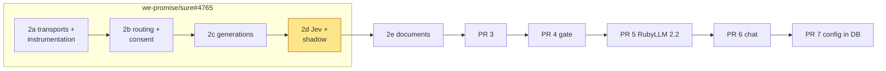
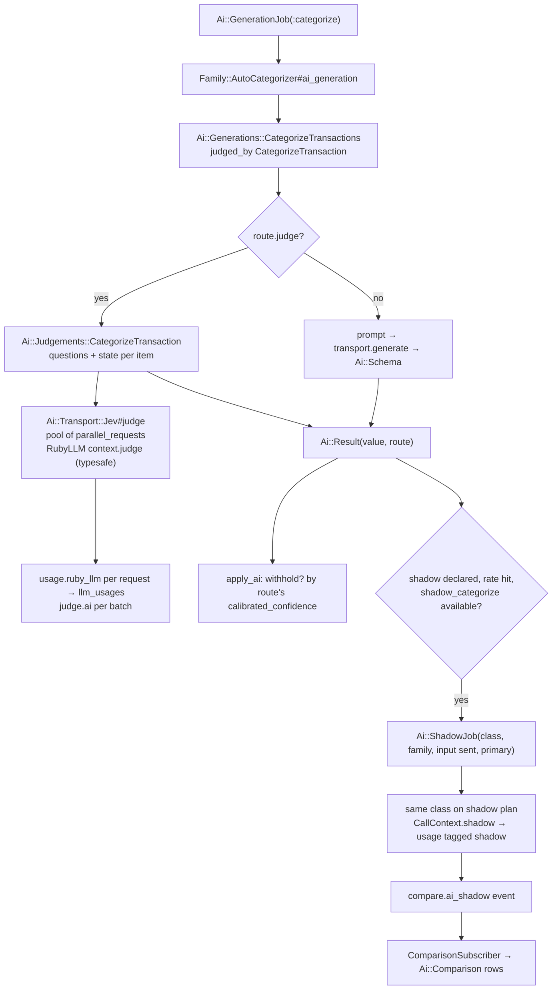
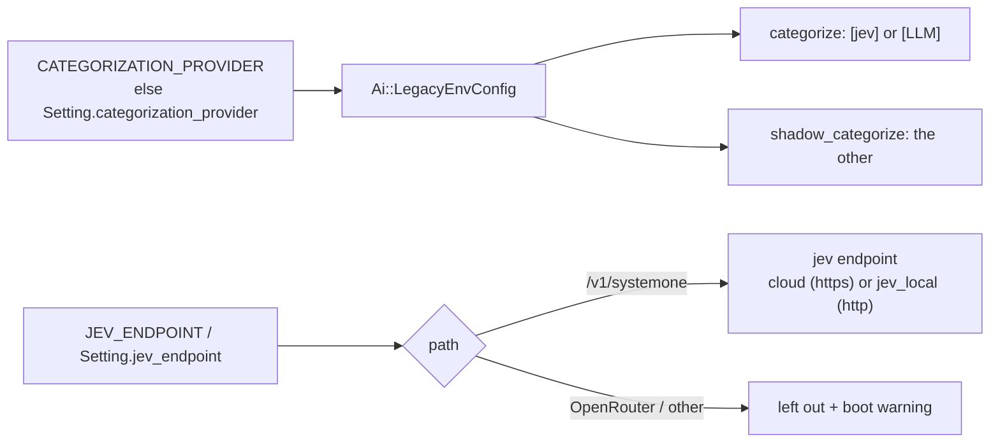

# PR 2d: Jev and shadow runs (implementation plan)

**Companion to:** [`ai-plumbing-redesign.md`](ai-plumbing-redesign.md) §19 (2d),
[`pr-2a-transports-and-instrumentation.md`](pr-2a-transports-and-instrumentation.md),
[`pr-2b-routing-and-consent.md`](pr-2b-routing-and-consent.md),
[`pr-2c-generations.md`](pr-2c-generations.md) and
[`rubyllm-spike-report.md`](rubyllm-spike-report.md).
**Base:** 2c's head on `feat/ai-transports-instrumentation`, rebased on `we-promise/sure`
`origin/main`, RubyLLM 2.1.1.
**PR:** we-promise/sure#4765 (`feat/ai-transports-instrumentation`), part of the stack 2a #4773 → 2b #4774 → 2c #4775 → 2d #4765 → 2e #4771. 2a–2d were first built on one PR, #4765, and split at their commit boundaries (call by @josh-sanders during development of PR #4440); the delivery notes below describe the one-PR build.
**Status:** the plan the 2d commits are built from. Like every product decision here, it stays
open to evidence. Calls by @josh-sanders during development of PR #4440 are marked.

## What 2d is

After 2c, every LLM generation goes through `Ai::Generation`, the transports and the instrumentation. Jev
doesn't. It still uses `Provider::Jev` (416 lines), which is hand-written in several ways:

- **Wire code:** its own Faraday client, retries and parsing.
- **Fan-out:** its own 8-thread pool.
- **Usage:** none recorded.
- **Endpoint:** any full URL (`JEV_ENDPOINT`).
- **2c's bridge:** `Family::AutoCategorizer::JevCall` calls it.

Shadow runs are also still today's code:

- `run_shadow` runs inline in the primary job and holds its AI thread (drift bug 8).
- It's symmetric through `Family#shadow_categorization_provider`.
- It writes `CategorizationComparison`, which only categorization can use.

2d is §19's fourth part. Its scope:

- the `jev` transport as a thin adapter over RubyLLM's `judge`, so Jev's requests pass the usage path and,
  from PR 4, the gate;
- `Ai::Judgement` and `categorize`'s judgement, with the class switched per route;
- `Ai::ShadowJob`, `Ai::Comparison` and `ComparisonSubscriber`, usable by any feature;
- the shadow rate read from the family, as today, until PR 7.

*Deletes:*

- `Provider::Jev` and `Provider::ClassificationConcept`;
- `Family#shadow_categorization_provider`;
- `CategorizationComparison`;
- `families.categorization_provider`;
- the `:jev_family` condition;
- `JevCall` and the inline `run_shadow`.

**Delivery (call by @josh-sanders during development of PR #4440):**

- 2d goes onto we-promise/sure#4765 with 2a–2c: branch `feat/ai-transports-instrumentation`, worktree
  `~/src/sure-ai-2a`.
- §19 says so.
- The PR is retitled to cover 2a–2d.

## Decisions

**Calls by @josh-sanders during development of PR #4440 (2026-11-06):**

1. **Same PR as 2a–2c.**
2. **`families.categorization_provider` goes in 2d, as §19 says. The Jev choice becomes instance-wide.**
   - **New setting:** `Setting.categorization_provider` (`llm` | `jev`, default `llm`).
     - It's set in the hostings page's selector. The `update` action already requires
       `manages_instance_settings`.
     - The preview gate stays on the selector.
   - **Data migration (written, not run):** on an instance with exactly one family, the migration copies
     that family's column into the setting. It then drops the column and its check constraint.
   - **Multi-family instances** copy nothing.
     - Upgrade note: picking Jev now sends every family's categorization to Jev.
     - Per-family routes come with PR 7.
   - **`Ai::LegacyEnvConfig`** reads `ENV["CATEGORIZATION_PROVIDER"]`, then the setting.
     - That's the same ENV-then-`Setting` rule every deprecated variable follows, so a C9 install
       (ENV only) keeps Jev.
     - §4.5's "Dropped" becomes "the instance's choice until the deprecated ENV path goes".
   - **Routes need no per-family condition any more.** `Ai::Route#condition` and `serves?` are deleted.
     The legacy routes are:
     - `categorize`: `[jev]` when the choice is Jev and Jev can be built, else `[preferred LLM]`;
     - `shadow_categorize`: the other one, as today's `shadow_categorization_provider`. It's left out
       when the other one doesn't exist.
3. **No failover from Jev, as today.** The legacy `categorize` route lists one entry, as 2c's decision 2
   does for every generation route.
   - When Jev can't be built, `LegacyEnvConfig` leaves it out and the LLM serves. The requester keeps
     today's `DebugLogEntry`, "Jev is misconfigured; falling back to the LLM provider".
   - Failover from Jev to an LLM, which switches class, still ships and is tested on
     `AiTestHelper.test_config`. It takes effect when routes are editable (PR 7).

**Already decided in #4440, which 2d follows:**

- **Jev goes through RubyLLM's `judge`.** It uses the `typesafe` provider, an isolated context per
  endpoint, and `assume_model_exists`.
- **Supported paths:** only TypeSafe-style `<base>/v1/systemone`. `LegacyEnvConfig` strips the path
  for `typesafe_api_base`.
  - An OpenRouter URL (`…/alpha/decisions`) is left out with a boot warning naming PR 5 (RubyLLM 2.2,
    #1264).
  - Any other path is also left out with a warning, and `categorize` uses its next route.
  - The settings form refuses both, with a message that names the supported form. Release note.
- **The fan-out stays Sure's.**
  - `judge` runs a batch on a pool of the endpoint's `parallel_requests`. That's `JEV_CONCURRENCY`, else
    the preset's default: 8 on cloud `jev`, 1 on `jev_local`.
  - One transaction per request, as today. Packing (the spike: 58% fewer tokens) waits for an eval.
- **The threshold gates only answers from a model with `calibrated_confidence`** (§6).
  - Cloud `jev` has it; `jev_local` (an http endpoint) doesn't.
  - `withhold?` reads `result.route.model.capable?(:calibrated_confidence)`, which replaces 2c's
    `calibrated: true` flag.
- **One value shape.** The judgement returns the generation's
  `{ categorizations: [{ transaction_id:, category_name:, confidence:, probabilities: }] }`, and the
  domain maps names, as 2c does.
- **Shadow runs (§8.2):**
  - their own job, in the background lane, for any feature;
  - the job gets the input actually sent and the primary's answer;
  - they're never applied;
  - only `ComparisonSubscriber` writes `Ai::Comparison`;
  - the rate is the family's `effective_categorization_shadow_rate` until PR 7;
  - `CategorizationComparison` rows migrate.
- **https for cloud endpoints, http for local ones** (§7). Today http is allowed only on loopback, so a
  legacy http Jev on any local host (`http://jev:8080`) is now accepted as `jev_local`. Upgrade note.

**Technical choices:**

- **`Ai::Transport::Jev#judge(request)`.**
  - **Request and response:**
    - `Base::JudgeRequest(feature, family, model, states: {id => Hash}, questions:)`;
    - `JudgeResponse(answers: {id => {name => RubyLLM answer} | nil}, usage:)`.
  - **Call scope:** it runs inside `Ai::CallContext.call` and `instrument("judge", …)`, so one `judge.ai`
    event covers the batch. Each request is wrapped in `attempt`, which uses Sure's retries, as for
    `generate`.
  - **Pool threads:** each one re-enters the call through a new `Ai::CallContext.within(call)`. It
    re-applies Sure's fiber key, `RubyLLM.with_usage_owner` and `RubyLLM.workflow`, which 2.1.1 keeps
    per thread. It also runs inside `Rails.application.executor.wrap`. This way every request's
    `usage.ruby_llm` becomes an `llm_usages` row with the call's id.
  - **Errors:**
    - A failover error (`Unauthorized`, `NoCredit`, `Upstream` after retries, `Timeout`) ends the batch.
    - A malformed answer (RubyLLM's "invalid judgment" on a 200) answers that one item `nil`.
    - When every item is malformed, the batch raises `InvalidOutput`.
- **Questions are always Hashes, never blocks.** In 2.1.1, `Judge::Builder` inherits from `Object`, so
  a block-declared option named like a Kernel method calls it (fixed upstream in #1196, after 2.1.1).
  Category names are option keys, so the transport refuses a Proc, and a test checks it.
- **`Ai::Generation` gains `judged_by Ai::Judgements::CategorizeTransaction`.**
  - The loop keeps routes whose model meets either set of needs.
  - `run(route, slice)` builds the judgement on a `judge` route and the generation otherwise, so
    batching, splitting, down marks and failover stay in one loop.
  - Judge routes have no prompt: `fixed_tokens` is 0, and `Ai::Batch` slices by `batch_size` only.
- **`Ai::Judgement`** is a small base class:
  - `feature`, the same initializer, `with_items`;
  - `questions`, `state_for(item)`, `value_from(answers)`;
  - `run(route)`.

  `CategorizeTransaction` moves over these unchanged:

  - `CATEGORY_INSTRUCTIONS`;
  - the `__uncategorized__` sentinel (mapped to nil);
  - the hierarchy hints;
  - the 255-option limit (`Refused`);
  - the confidence clamped to 0..1.
- **Shadow runs are declared on the generation:** `shadow compare: ->(value) { … }`, which runs through
  `instance_exec` so it can map names to category ids. It covers the judgement too, since the value
  shape is the same.
  - **Enqueueing:** after a successful call that isn't itself a shadow run, `Ai::Shadow.enqueue` checks
    four things:
    - the class declares `shadow`;
    - `shadow_<feature>` is in `MATRIX`;
    - `rand <` the rate (categorize: the family's; any other: 0 until PR 7);
    - the router resolves the shadow feature.

    It then enqueues `Ai::ShadowJob(class name, family_id, shadow_arguments, primary: {route, values})`.
  - **The job:**
    - it runs on `Ai::Routes.queue_for(:shadow_categorize)`;
    - it runs the class on the shadow plan inside `Ai::CallContext.shadow`, which tags requests
      `shadow: true` and records their usage under the `shadow_categorize` operation;
    - it never retries (`discard_on Ai::Error::Base`, with a warning).
  - **Comparison event:**
    - §10 subscribes `ComparisonSubscriber` to `generate.ai` and `judge.ai`.
    - Those events carry the raw JSON before coercion, one per batch piece, so the job emits one
      `compare.ai_shadow` event with both sides' compared values. The name is outside `/\.ai\z/`, so
      Langfuse and the debug log ignore it.
    - `ComparisonSubscriber` is its only reader, and §10's line is updated.
- **`ai_comparisons` table:**
  - **Columns:**
    - `feature`, `family_id`;
    - `subject` (polymorphic, uuid);
    - `primary_route` and `shadow_route` (jsonb: endpoint, model, prompt, overrides);
    - `primary_value` and `shadow_value` (string ids);
    - `primary_confidence` and `shadow_confidence`;
    - `agreed`;
    - `metadata` (jsonb);
    - timestamps.
  - **Agreement, as today:** both models abstaining counts as agreeing; a missing answer doesn't.
  - **The migration** copies each `categorization_comparisons` row:
    - category names map to the family's ids by exact name;
    - the names and `shadow_probabilities` go into `metadata`;
    - `agreed` and the timestamps are kept;
    - the old table is dropped.
  - **`_categorization_shadow_results`** reads `Ai::Comparison`. It shows a category by id, then the
    migrated name, then "no category", and names each provider by the route's endpoint.
- **Settings readers:**
  - `Provider::Jev`'s class helpers move to `Ai::LegacyEnvConfig::Jev`
    (`app/models/ai/legacy_env_config/jev.rb`):
    - `api_key`, `effective_endpoint` and `effective_model`;
    - `redacted_endpoint`, `effective_host`, `effective_proxied?` and `VENDOR_HOST`;
    - `endpoint_allowed?`, plus the path check.
  - The hostings views and controller call them there.
  - `Sure/NoAiEnv`'s allowlist swaps `provider/jev.rb` for this file.
- **Evals:**
  - `Eval::ProviderFactory#build_jev` builds an `Eval::GenerationClient` on a `jev` endpoint with
    capabilities `judge` and `calibrated_confidence`.
  - `Categorization` gains `confidence:` and `probabilities:`, which the categorization runner already
    reads.
  - `evals.rake`'s example uses the TypeSafe form.
- **Test support:** `stub_ai` also fakes `judge`. The block gets the `JudgeRequest` and returns answers
  by id.

## How it fits together

## Following #4440 and the spike report

| Decision or finding (register, §) | Where it lands in 2d |
|---|---|
| Jev moves to RubyLLM's `judge` in PR 2 (register) | Step 1. `Provider::Jev`'s wire code, retries and pool go |
| No custom Jev paths; OpenRouter waits for 2.2 (register, §4.5, §18) | Step 2: the path check, boot warnings, form validation and release note |
| The fan-out is Sure's; packing waits for an eval (spike "Jev") | Step 1's pool of `parallel_requests`, one state per request |
| 402 → `NoCredit` (spike "Jev") | Already mapped in 2a's adapter. The contract test covers it for Jev |
| RubyLLM's usage ledger off; Jev reaches `llm_usages` through `judge` (register, §10) | Step 1: a row per request through `usage.ruby_llm` and the pool's re-entered context |
| The gate is in RubyLLM's instrumenter; "Jev's transport has to take it itself" (register) | Not needed: Jev's requests now go through Sure's instrumenter, so PR 4's gate sees them |
| Calibrated confidence is a model capability (§6) | Step 5's `withhold?`. Upgrade note for `jev_local` |
| Shadow runs: any feature, their own job, the family's rate until PR 7 (register, §8.2) | Step 6 |
| `CategorizationComparison` → `Ai::Comparison`, rows copied (§18) | Step 6's migration |
| No family provider choice (§6, §18) | Step 4 (decision 2), with an instance setting until PR 7 |
| https for cloud, http for local (§7) | Step 2 |
| `ai_shadow_test` (§17) | Step 6 |
| `ai_transport_contract_test`: judge (§17, §19) | Step 1 |

**RubyLLM API (rubyllm.com/api Judge and Judgment, checked against the 2.1.1 source):**

- **Used:**
  - `RubyLLM.context` with `typesafe_api_key` and `typesafe_api_base`;
  - `Context#judge(input, questions:, model:, provider: :typesafe, assume_model_exists: true)`;
  - Hash questions `{ category: { type: :choice, instructions:, options: } }`;
  - `Judgment#[]`, `#tokens` and `#model`;
  - `Choice#choice`, `#probabilities` and `#confidence`.

  The surface test gains each one.
- **Not used:**
  - `Judge` subclasses and block-built questions (the #1196 Kernel-name issue in 2.1.1);
  - `with:` images;
  - `metadata:` and `owner:` per call: `Ai::CallContext` sets the workflow and the usage owner;
  - `default_judgment_model`.

  RubyLLM has no batch or concurrency for judgments (the docs and source agree), so the pool stays.
- **Parsing:** in 2.1.1 a missing `confidence` raises "invalid judgment" for the whole request. Sure
  answers that item nil, where today it applied a confidence of 0 and withheld the answer. Either way
  the transaction isn't applied. Upgrade note.

**RubyLLM upstream since 2.1.1 that touches 2d:**

| PR | Change | In 2d |
|---|---|---|
| #1264 (merged 2026-10-26) | OpenRouter judgments through the Decisions API | PR 5 brings OpenRouter's Jev back |
| #1392 (2026-11-02) | Standalone operations, `judge` included, run through one `Operation`; public keywords kept | PR 5 re-records the Jev cassettes |
| #1196 (2026-10-17) | Judge builder becomes a `BasicObject` | Sure passes only Hashes (above) |
| #1008, #1165, #1437 | OpenAI Decisions (`gpt-6-luna`), answers by name, Azure Decisions | Not used. Possible `judge` presets after PR 5 |

## Steps (one commit each, on `feat/ai-transports-instrumentation`)

0. **Rebase** onto `origin/main` and run the 2a–2c tests. Check `main` for Jev and hostings changes
   since `3758cb8aa`.

1. **The `jev` transport.**
   - `Ai::Transport::Jev` (`judge` and `probe :models`), with `JudgeRequest` and `JudgeResponse` on
     `Base`.
   - `Ai::Transport.for(:jev)`.
   - `Ai::CallContext.within`.
   - `Ai::Config::Endpoint#parallel_requests`, if absent.
   - Tests: `test/architecture/ai_transport_judge_test.rb`, with WebMock on `/v1/systemone`:
     - the payload;
     - parsing;
     - the in-flight cap;
     - 401, 402, 429 retried, 5xx;
     - one malformed item, and all malformed;
     - a usage row per request with the call id;
     - one `judge.ai` event;
     - an http local base;
     - a Proc refused.

2. **Legacy Jev endpoint and settings readers.**
   - `Ai::LegacyEnvConfig::Jev`, with the path rules and boot warnings, and `parallel_requests` from
     `JEV_CONCURRENCY` or the preset.
   - The hostings controller's endpoint validation, with http allowed for local endpoints.
   - `legacy_env_config_test` rows: TypeSafe, OpenRouter left out, another path left out, loopback and
     compose-network http.

3. **`Ai::Judgement`, `Ai::Judgements::CategorizeTransaction` and `judged_by`.**
   - The loop switches class per route.
   - `stub_ai` fakes `judge`.
   - `jev_test`'s cases are ported to `test/models/ai/judgements/categorize_transaction_test.rb`:
     criteria, sentinel, limit, clamp.
   - `generation_test`: a judge route, and failover from Jev to an LLM on `test_config`.

4. **The instance-wide Jev choice (decision 2).**
   - `Setting.categorization_provider`.
   - The migration copies a single family's choice and drops the column.
   - `LegacyEnvConfig` builds the `categorize` and `shadow_categorize` routes.
   - `Ai::Route` loses `condition` and `serves?`, along with its call in the router.
   - `Family::AiSettings` loses `CATEGORIZATION_PROVIDERS`, `effective_categorization_provider`,
     `shadow_categorization_provider` and `configured_jev_provider`.
   - The selector posts the setting.
   - `en.yml`'s changed strings ("for this family" becomes "for this instance"); the stale fr, nl and
     zh-CN keys are removed so they fall back to English.
   - Tests:
     - migration tests (one family Jev, one family LLM, two families);
     - `ai_legacy_setups` C9 and M1;
     - the agreement and config tests;
     - the hostings controller test;
     - `test/system/settings/categorization_provider_test.rb`.

5. **The requester.** `Family::AutoCategorizer`:
   - drops `JevCall`, `jev_decisions`, `run_shadow`, `shadow_on_llm`, `shadow_jev_provider`,
     `record_shadow_comparisons` and `provider_key`;
   - gates `withhold?` on the route's capability;
   - logs the debug entry's `provider:` as the route's endpoint name;
   - keeps the misconfigured-Jev log.

   `auto_categorizer_test` uses the Jev cases through `stub_ai`.

6. **Shadow runs.**
   - The `shadow` macro, `Ai::Shadow`, `Ai::ShadowJob`, `Ai::CallContext.shadow` (in the metadata, so
     usage rows carry `shadow: true` and the `shadow_categorize` operation).
   - The `compare.ai_shadow` event and `Ai::Instrumentation::ComparisonSubscriber`.
   - `Ai::Comparison` and its migration (copy, drop `categorization_comparisons`).
   - `Family has_many :ai_comparisons`.
   - The view.
   - Deletes `CategorizationComparison`.
   - Tests:
     - `test/architecture/ai_shadow_test.rb`: shadow implies `compare:` and a `shadow_` row; only the
       subscriber writes `Ai::Comparison`, checked by grep;
     - the shadow job tests: sampling at rate 0 and 1, the input sent, rows, abstention against
       missing, a failure swallowed, the transaction untouched, the usage tag;
     - the migration test;
     - `ai_lane_test`'s job list, if present.

7. **Evals.**
   - `build_jev` goes through `Eval::GenerationClient`.
   - `Categorization` gains confidence.
   - `experiment_runner_test`'s Jev cases.
   - The rake help text.

8. **Deletes and cops.**
   - `Provider::Jev`, `Provider::ClassificationConcept`, the `:jev` entry in `Provider::Registry`,
     `jev_test`.
   - The `.rubocop.yml` allowlist.
   - The routing-matrix check that every judgement's feature matches its generation's.

9. **Live check (no funded key needed).**
   - `test/models/ai/live/judge_live_test.rb` on OpenCode Zen (`https://opencode.ai/zen/v1/systemone`,
     `jev-1.13-free`, anonymous key `public`), as the spike did. It's recorded with
     `RECORD_CASSETTES=1` and replayed in CI.
   - `ai-live.yml` runs it live.

10. **Docs.**
    - `docs/llm-guides/ai-pipeline.md` gains "Judgements and shadow runs (PR 2d)":
      - adding a judgement;
      - `judged_by`;
      - `shadow compare:`;
      - `stub_ai` for `judge`.
    - `docs/hosting/ai.md`'s Jev section:
      - the supported path, and OpenRouter until PR 5;
      - the instance-wide choice;
      - http local;
      - `JEV_CONCURRENCY`;
      - the threshold and `jev_local`.
    - Release notes.

11. **#4440 docs** (`~/src/sure-pr4440`; this step can run first so #4765 can link the plan):
    - `docs/proposals/v0.8/pr-2d-jev-and-shadow-runs.md` from this plan.
    - §19's 2d entry: on #4765, with this session's calls.
    - §4.5's `CATEGORIZATION_PROVIDER` row.
    - §6's "No family provider choice" (an instance choice until PR 7).
    - §8.2: the compare event, `compare` on the generation, and trial prompts as folders.
    - §10's subscriber line.
    - §18's rows: the instance-wide choice, http local, and the malformed answer.
    - A §21 row.
    - Register rows for decisions 2 and 3.

12. **PR #4765.**
    - Retitle it "AI plumbing 2a–2d: transports, instrumentation, routing, consent, generations, Jev
      and shadow runs".
    - Add a 2d section to the body: problem, diagrams, reviewer guide, deletes, decisions, upgrade notes,
      validation.
    - Force-push only with the author's approval.

    Reviewer guide, in reading order:
    1. `transport/jev.rb`
    2. `judgements/categorize_transaction.rb`
    3. `generation.rb#run`
    4. `shadow_job.rb` and `comparison_subscriber.rb`
    5. the migrations

## Upgrade notes and release notes (2d)

- **Jev endpoints:** only the TypeSafe-style `…/v1/systemone` path works. OpenRouter's Jev stops working
  until PR 5 (RubyLLM 2.2), and any other path isn't supported. The settings form refuses both.
- **The Jev choice is instance-wide.**
  - A single-family instance's choice is copied.
  - On a multi-family instance, families that chose Jev go back to the LLM. Choosing Jev now applies to
    every family.
- **A self-hosted (http) Jev works on any local host,** not just loopback.
  - It defaults to 1 request at a time unless `JEV_CONCURRENCY` is set.
  - The confidence threshold doesn't gate it, since it has no `calibrated_confidence`.
- **Jev calls now appear on the usage page,** a row per transaction request.
- **Shadow runs** run as their own job after the primary batch. Existing comparisons are kept.
- **A malformed Jev answer** leaves that transaction uncategorized. Today it was withheld with a
  confidence of 0.
- **Let the AI queues drain before upgrading,** as for 2c.

## Verification

- `bin/rails test`, the full suite, never in two worktrees at once. Compare against 2c's baseline:
  14 failures, all of which also fail on `main`.
- `test/architecture`, `test/models/ai` and `test/models/family` on their own.
- `bin/rubocop`, `bundle exec erb_lint --lint-all`, `npm run lint`, `bin/brakeman --no-pager`.
- System tests (`PARALLEL_WORKERS=1`, the pod's Selenium): the categorization provider settings and the
  rules auto-categorize confirmation.
- Pipelock `git scan-diff`.
- The live judge test against OpenCode Zen, recorded through the pod's Pipelock.
- `bin/rails runner` in the pod: a Jev family's batch end to end, with `llm_usages` rows grouped by
  `call_id`. A shadow run at rate 1 then gives `ai_comparisons` rows.
- `git grep` finds none of these left:
  - `Provider::Jev`, `ClassificationConcept`;
  - `shadow_categorization_provider`, `CategorizationComparison`;
  - `categorization_provider` outside the migration and `Setting`;
  - `:jev_family`, `JevCall`.

## As built

The 2d commits on #4765 follow this plan, with these differences:

- **Steps 4 and 5 are one commit.** The instance-wide choice and the requester's move to the
  judgement touch the same tests. In that commit the inline shadow already runs the generation on
  the `shadow_categorize` plan, so it covers Jev through the judgement; step 6 moves it to the job.
- **The selector is read-only for anyone who can't manage instance settings.** `update` already
  required it; the select is now disabled for everyone else, and the system tests that switch it
  sign in as a super admin.
- **`shadow` takes `subject:` as well as `compare:`**, naming the class each item id belongs to,
  for `Ai::Comparison#subject`.
- **The legacy Jev endpoint keeps today's three retries** (`max_retries: 3`), since the
  hand-written client retried 429s, 5xxs and dropped connections three times.
- **The misconfigured-Jev debug entry records a `reason`** (`path`), not an error class: nothing
  raises any more, because the config leaves an unreachable endpoint out.
- **The transport's probe refuses** ("Jev has no health probe yet"); Jev was never probed, and
  PR 3's probe jobs can add one.
- **The live check was recorded, not left open**: OpenCode Zen's free Jev needs no funded key.
  Its cassette matches on the body, because the fan-out's two requests arrive in either order.
- **Evals refuse an unreachable Jev endpoint** with an error naming it, as the config leaves it
  out.
- **The classification provider walkthrough became "Adding a judgement"**
  (`docs/llm-guides/adding-a-judgement.md`), keeping its rules on the new plumbing.
- **Pipelock's diff scan** reads `JEV_API_KEY=<value>` in docs as a secret, so the examples show
  a placeholder.

Checks at the last 2d commit, before the branch was rebased onto `499bfd87b` (whose #4768 fixes
the allocator test): the full suite, 14,920 runs, has the same 14
failures as 2c, all also failing on `main`; the full system suite, 333 runs, has 2 failures, the
combobox dark-theme colour checks, which fail the same way on `main`; RuboCop, erb_lint, Biome,
Brakeman and Pipelock's diff scan are clean.
