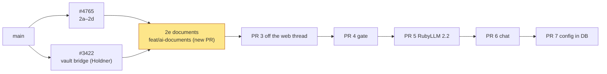
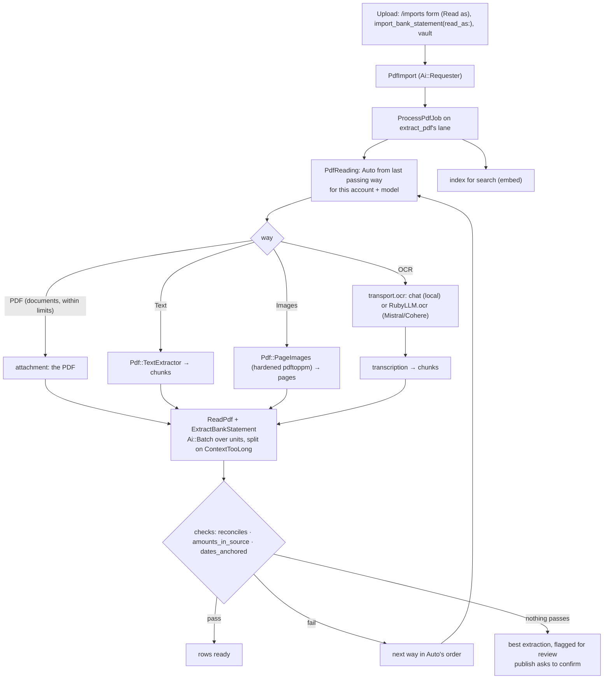
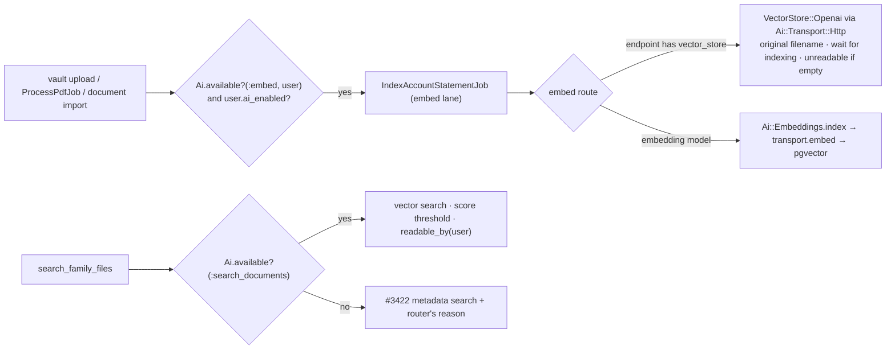

# PR 2e: Documents (implementation plan)

**Companion to:** [`ai-plumbing-redesign.md`](ai-plumbing-redesign.md) §19 (2e), §5.5, §8.1 and §14,
[`pr-2c-generations.md`](pr-2c-generations.md),
[`pr-2d-jev-and-shadow-runs.md`](pr-2d-jev-and-shadow-runs.md) and
[`rubyllm-spike-report.md`](rubyllm-spike-report.md).
**Base:** #4765's head (2a–2d) on `feat/ai-transports-instrumentation`, with #3422
(`Holdner:mcp/document-vault`) merged in, RubyLLM 2.1.1.
**PR:** we-promise/sure#4771 (`feat/ai-documents`), after 2d (#4765, which contains 2a–2c) and #3422. 2a–2d are now their own stacked PRs: 2a #4773, 2b #4774, 2c #4775, 2d #4765.
**Status:** the plan the 2e commits are built from. Like every product decision here, it stays
open to evidence. Calls by @josh-sanders during development of PR #4440 are marked.

## Context

After 2d, every AI call except chat, PDF import and documents goes through the plumbing: the
transports, `Ai::Generation`, the router and the instrumentation. PDF import and documents are
still on today's code.

- **PDF import:** three per-provider classes per step.
  - `Provider::Openai::{PdfProcessor, BankStatementExtractor}` and the Anthropic pair: 906 lines.
  - Their own usage recorders, JSON-mode and structured-output concerns, and Langfuse traces.
  - The five-page image limit, and `detail: "low"`, which shrinks a page to 512 pixels.
  - An unhardened `pdftoppm`: no timeout, every page rendered, the worker's environment inherited.
  - No checks on what the model returned.
- **Embeddings:** a hand-built Faraday client in `VectorStore::Embeddable`. It has no proxy, no
  usage rows and no error mapping, and pgvector reads `EMBEDDING_DIMENSIONS` from ENV.
- **The OpenAI vector store adapter** has the spike's five bugs:
  - it doesn't wait for indexing;
  - a scan indexes as empty;
  - files outlive removal;
  - results show temp-file names;
  - there's no score threshold.

  It also skips `Ai::Transport::Http`.

2e is §19's fifth part, and per §19 its scope is:

- `transport.embed`;
- `extract_pdf` with the per-upload "Read as" switch;
- Auto's input step, which tunes itself per account;
- pages batched by `Ai::Batch` with no page limit;
- the extraction checks, offered for review;
- the hardened page rendering;
- OCR route entries;
- `embed` and `search_documents`;
- the vector store fixes;
- #3422's pieces moved onto the plumbing;
- the deletes.

**Delivery (call by @josh-sanders, 2026-11-06):**

- **A new PR into `main`**, branch `feat/ai-documents` in a new worktree `~/src/sure-ai-2e`.
- **Its base merges two open PRs:**
  - #4765 (`fork/feat/ai-transports-instrumentation`, 2a–2d, head `35164876c`, CI green);
  - #3422 (`Holdner:mcp/document-vault`, head `3d2659c63`, still open, moved to the `future`
    milestone).
- **The description** says it comes after both, lists their commits as not part of this PR, and
  links this plan.

## Decisions

**Calls by @josh-sanders during development of PR #4440 (2e planning):**

1. **OCR: code now, configuration in PR 7.**
   - **What ships:** the two-step OCR path and its tests, on `AiTestHelper.test_config`.
   - **Until PR 7:**
     - the deprecated ENV builds no OCR entry, so "Read as: OCR" is greyed out with "needs an OCR
       route entry";
     - scans read through page images on a vision model, or are `Unavailable` (`no_text_layer`).
   - **No new ENV or hostings fields** (§4.7).
2. **Mistral and Cohere OCR ship stubbed, marked untested.**
   - **What ships:** the `ocr` call, the `mistral` and `cohere` presets, and WebMock tests.
   - **The live test** (`test/models/ai/live/ocr_live_test.rb`) is skipped until `MISTRAL_LIVE_API_KEY`
     or `COHERE_LIVE_API_KEY` is set.
   - **The docs and §8.1** say they're untested live. Nothing reaches them until PR 7 anyway.
3. **Files left on OpenAI by earlier removals: a release note only.**
   - From 2e on, files are deleted when a document is removed and when the family is deleted.
   - The note says older removals may have left files, and how to find them in OpenAI's dashboard.

4. **`OPENAI_SUPPORTS_PDF_PROCESSING=false` keeps turning PDF import off,** as today; an admin
   sets it per model from PR 7 (see "As built").
5. **The search score threshold** (after live testing): 0.3 stays the default, calibrated on
   OpenAI's vector store. From PR 7 it's a setting per embedding model for both stores; 2e
   documents that now.
6. **Embedding dimensions** (after live testing): PR 7 resolves a model whose dimensions don't
   match the chunks table. 2e keeps today's request (no `dimensions`) and fails a mismatch as
   `InvalidOutput`.

**Already decided in #4440, which 2e follows (§5.5, §8.1, §14, the register):**

- **Auto's order:**
  1. the PDF itself, when the model has `documents` and the file is within the preset's PDF limits;
  2. otherwise the text layer, in chunks sized to the context window, with rows deduplicated
     across chunk boundaries;
  3. when the text is empty or fails its checks:
     - page images, if the model has `vision`;
     - otherwise OCR, if the route has an OCR entry;
  4. otherwise `Unavailable` (`no_text_layer`), so an empty text layer is never sent.
- **Auto tunes itself per account:** it starts from the last way that passed for the same account
  and model.
- **"Read as" per upload:** Auto, PDF, Images, OCR or Text. It's on the form and is an optional
  argument of `import_bank_statement`. An option the route can't do is greyed out with the reason.
- **Checks on every extraction:**
  - `reconciles`: uses #4054's balances from the text when they're found;
  - `amounts_in_source`;
  - `dates_anchored` ≥ 0.5.

  A failing extraction is offered for review and never dropped: its rows show with the failed checks
  above them, and publishing asks for confirmation.
- **No page limit.** Each page or chunk is costed, and `Ai::Batch` splits on `ContextTooLong`.
- **A hardened `pdftoppm`**, keeping #3275's choice:
  - an empty environment;
  - a process group killed on a timeout;
  - CPU and memory limits;
  - a page range;
  - a 25 Mpx guard before rendering;
  - a size check after it.
- **Large-file upload stays off,** so PDFs go inline.
- **Attachments are checked before sending:** a route that sends images needs `vision`, so
  llama.cpp's 500 isn't taken for an outage.
- **The `embed` route picks the vector adapter**, which stays pluggable.
- **The OpenAI vector store fixes:**
  - wait for indexing;
  - record an empty index as unreadable;
  - delete the file from the Files API;
  - upload under the original filename;
  - a score threshold;
  - build the client through `Ai::Transport::Http`.
- **#3422 on the plumbing:**
  - its indexing job on `embed`'s lane, queued only when `Ai.available?(:embed, family:, user:)` and
    the uploader's `ai_enabled?`. The switch stays an explicit check, because `Ai::Consent` checks it
    only for chat and bills;
  - `search_family_files` always listed, falling back to the metadata search with the router's
    reason;
  - `get_document_text`'s note on scans.
- **`Provider::Openai::UsageCost` stays,** because chat uses it (`openai.rb:714`). It goes with chat
  in PR 6, and §10's "PR 2e" for it is corrected.
- **`llm_provider_order` stays until PR 6.**

**Technical choices:**

- **`Request#attachments`.** It holds `Ai::Attachment = Data.define(:filename, :content_type, :data)`.
  - **Compatible and Anthropic:** the RubyLLM adapter adds them with
    `with: RubyLLM::Attachment.new(StringIO, filename:, resolution: :high)`. `:high` sends images at
    `detail: high`.
  - **Before sending,** the transport raises `Refused`:
    - for an image when the model lacks `vision`;
    - for a PDF when it lacks `documents`.
  - **The event** records name and size through the existing `event_attachments`.
- **`documents` from the deprecated ENV:** only the Anthropic endpoint and the OpenAI endpoint on
  `api.openai.com`.
  - **Why:** the spike found llama.cpp and Gemini's compatible API refuse RubyLLM's `file` part, and
    OpenRouter bills parsing it.
  - **`vision`** keeps today's rule.
  - **`LegacyEnvConfig#llm_model`** stops asking `supports_pdf_processing?`.
- **Preset PDF limits** go in code until PR 7's preset files:
  `Ai::Config::Endpoint::PDF_LIMITS = { anthropic: { bytes: 32.megabytes, pages: 100 }, openai: { bytes: 32.megabytes, pages: 100 } }`.
- **`transport.embed(EmbedRequest(feature, family, model, texts, task_type))`** returns
  `EmbedResponse(vectors, usage)`.
  - **Compatible** calls `ruby_llm_context.embed(texts, model:, dimensions:, assume_model_exists: true)`
    and checks one vector per text (#1269/#1297) and each vector's dimensions; a mismatch is
    `InvalidOutput`.
  - **One `embed.ai` event per call**, without the texts. Usage reaches `llm_usages` through
    `usage.ruby_llm`, as for Jev.
  - **`task_type`:** `RETRIEVAL_DOCUMENT` for indexing and `RETRIEVAL_QUERY` for search. Gemini and
    Vertex read it; others ignore it.
  - **Anthropic** doesn't implement it.
  - **Not used:** `with:` multimodal PDF embedding (`gemini-embedding-2`), `sparse_vectors` and
    `title:`.
- **`transport.ocr(OcrRequest(feature, family, model, pages: [Ai::Attachment]))`** returns
  `OcrResponse(pages: [markdown], usage)`.
  - **On a `mistral` or `cohere` preset** it calls `ruby_llm_context.ocr`:
    - Mistral takes the page range of the PDF;
    - Cohere takes one page image per call, which 2.1.1 requires;
    - RubyLLM records no tokens for OCR (#1392), so the usage row carries `pages` in its metadata.
  - **On any other compatible endpoint** it's a chat call:
    - page images, with the model's own prompt from `app/prompts/ocr/<model.ocr_prompt>/`, which
      ships `unlimited_ocr_2` and `markdown`;
    - one user message per page for templates that need it;
    - the end-of-sentence token stripped.
  - **`Ai::Config::Model` gains `ocr_prompt`.** The field is built now, with no UI or ENV until PR 7.
- **Pages:**
  - **`Pdf::PageImages.render(content, pages:)`** is ported from the spike with the `pdftoppm`
    renderer only:
    - `Process.spawn({}, …, unsetenv_others: true, pgroup: true, rlimit_cpu: 60, rlimit_as: 1.gigabyte)`;
    - a 30 s timeout that kills the group;
    - `-f/-l`;
    - the MediaBox guard before rendering;
    - a 1×1 check after it.

    It fails with a coded error, keeping #3275's admin reason.
  - **`Pdf::TextExtractor`** stays the text-layer reader.
- **The two generations (§5.2: `extract_pdf` covers both):**
  - `Ai::Generations::ReadPdf`:
    - today's `process_pdf`: summary, `document_type` from `Import::DOCUMENT_TYPES`, institution,
      period, balances, currency, account holder;
    - one call;
    - its input is the first PDF/text/images unit.
  - `Ai::Generations::ExtractBankStatement`:
    - transactions plus period and balances;
    - batched over input units with per-item cost: text chunks by tokens, page images at a fixed
      estimate;
    - merges rows across units, deduplicating at boundaries (#846);
    - opening balance from the first unit, closing balance from the last;
    - `checks(value, source_text:)` ported from the spike.
  - **Prompts:** `app/prompts/{read_pdf,extract_bank_statement}/` (instructions + input). The
    heredocs move there, with Anthropic variants only where 2c needed them.
- **`Ai::PdfReading`, the input step:**
  - **`ways(plan)`** gives each way's availability and reason, for the form and the tool.
  - **`units(way)`** gives a PDF attachment, text chunks, page images, or OCR transcriptions as text.
  - **`run`** walks Auto's order, starting from `PdfImport.last_passing_way(account:, model:)`.
  - **On a failed check** it falls back to the next way. If nothing passes, it keeps the best
    extraction, flagged.
- **`pdf_imports` columns, via the `imports` table** (migration written, not run):
  - `read_as` (requested);
  - `read_with` (used);
  - `read_model`;
  - `extraction_checks` (jsonb).
- **Re-reading a badly read statement:** "Read again as…" on the import page (`PdfImport#reread!(read_as)`)
  clears unpublished rows and re-queues the job.
- **`ProcessPdfJob` stays the orchestrator.**
  - It moves to `Ai::Routes.queue_for(:extract_pdf)`.
  - It calls the generations, not `preferred_llm_provider`.
  - It discards `Ai::Error::{Unavailable,Refused,…}` with the router's reason in `error`.
  - `PdfImport` includes `Ai::Requester` (correlation id `pdf_import_id`).
- **`Ai::Embeddings`:**
  - `index(texts, family:)` uses feature `:embed`;
  - `query(text, family:, user:)` uses `:search_documents`.

  Both resolve the route, run `transport.embed` inside `Ai::CallContext`, and fail over. They replace
  `VectorStore::Embeddable#embed`/`embed_batch`.
- **pgvector:**
  - takes its dimensions from the route model's `embedding_dimensions`, which drops its NoAiEnv
    entry;
  - search drops results under a similarity floor (`MIN_SCORE`).
- **The OpenAI vector store adapter:**
  - **Client:** `Ai::Transport::Http.openai_client(endpoint)`.
  - **Upload:** from a temp directory under the original filename.
  - **Status:** the document is `processing` until `VectorStore::IndexStatusJob` (embed lane, bounded
    polls) sets it:
    - `ready`;
    - `unreadable` when `usage_bytes` is 0 (a new status);
    - `error` on `failed`.
  - **Removal:** `remove_file` also deletes the file. `delete_store` deletes the store's files and
    then the store. `Family` `before_destroy` deletes its store.
  - **Search:** `ranking_options: { score_threshold: MIN_SCORE }`.
  - **Threshold:** both use a 0.3 starting point. The spike's relevant hit was 0.84 and the wrong ones
    0.14–0.17, so it's a heuristic, noted in the docs.
- **Off the web thread? Not in 2e.** The non-PDF document upload and both MCP tools still run on
  the web thread, through the plumbing, until PR 3 (§19).
- **Health probe:** `AiHealth::Probe#pdf_processing` sends the synthetic PDF through
  `transport.probe(model, :documents)`, a new check, instead of building the deleted workers.

## How it fits together

## Following #4440, the spike and upstream

| Decision or finding (register, §) | Where it lands in 2e |
|---|---|
| Auto's order, with native PDF within the preset's limits (register, §8.1) | Step 5, `PdfReading` |
| Auto tunes itself per account (§8.1) | Step 5, `last_passing_way` and the columns |
| "Read as" per upload, greyed out by capability (register, §8.1) | Step 6: the form, the tool argument and "Read again as…" |
| Checks; a failing extraction is offered for review (register, #3105, #1753, #4054) | Steps 5 and 6 |
| No page limit; split on overflow (register) | Step 5, `Ai::Batch` with per-item cost |
| Hardened `pdftoppm` (register, #3275) | Step 4 |
| Auto-upload off; PDF inline (register, #1985) | Already set in 2a. Step 1 adds a test |
| Check `vision` before sending images; no 400 retry (spike) | Step 1 (2c's JSON chain already stops on attachment 400s) |
| Images at high detail, not `low` (spike, §8.1) | Step 1 (`resolution: :high`) |
| Local OCR as a two-step route, a prompt per model, `--special`/EOS (register, spike) | Step 3, with test config only (decision 1) |
| Mistral/Cohere through `RubyLLM.ocr` with live cassettes (register) | Step 3, stubbed (decision 2) |
| `embed` returns one vector per text (spike "Small fixes") | Step 2 |
| Vector store fixes (register, §5.5, spike) | Step 7 |
| #3422: lane, gate with the user's switch, metadata fallback, scan note (§5.5, §14) | Step 8 |
| The usage recorders go; `UsageCost` stays for chat (§10) | Step 9. §10 is corrected |
| `ai_documents_test` (§17) | Step 8 |
| The `mcp_ai_tools_test` rows that apply before PR 3 (§17) | Step 8: listing and the fallback |

Upstream PRs whose goals 2e keeps:

- **#808:** text chunks for small models.
- **#846:** rows deduplicated across chunks.
- **#1985:** native PDF inline.
- **#3191:** text first, now Auto's start when there's no native PDF.
- **#3275:** `pdftoppm` and a concrete failure reason.
- **#3105:** reconciling against existing entries, untouched. "Nothing disappears silently" is now
  the review flag.
- **#1753:** the vault, with review before import.
- **#4054:** metadata balances in `reconciles`.
- **#961, #1211, #1986:** the pluggable store.
- **#3422:** all of it, moved onto the plumbing.

**RubyLLM API (rubyllm.com/api Attachment, OCR, `RubyLLM.ocr` and Embedding, checked against the
2.1.1 source):**

- **Used:**
  - `Attachment.new(io, filename:, resolution:)`;
  - `Context#embed(texts, model:, dimensions:, task_type:, assume_model_exists:)` and
    `Embedding#vectors`/`#tokens`;
  - `Context#ocr(file, model:, provider:, assume_model_exists:, pages:, provider_options:)`,
    `OCR#pages` (`Page#markdown`) and `#markdown`.

  The surface test gains each one.
- **Not used:**
  - `with:` embeddings;
  - `sparse_vectors`;
  - `title:`;
  - `embed_later`/`batch`;
  - `metadata:` and `owner:` per call, since `Ai::CallContext` sets them;
  - `default_ocr_model`/`default_embedding_model`;
  - OCR's `images` and `tables`.
- **2.1.1 limits that Sure guards:**
  - embeddings in response order and short responses (#1160, #1297, after 2.1.1): the vector-count
    check;
  - Cohere takes one image per OCR call;
  - OCR reports no tokens;
  - `auto_upload_large_files` defaults to true.

**RubyLLM upstream since 2.1.1 that touches 2e:**

| PR | Change | In 2e or later |
|---|---|---|
| #1160, #1297 | Embeddings paired by index; raise on fewer vectors | 2e checks it itself; PR 5 keeps the check as a guard |
| #1369 | `Embedding#vector` | Not used (2e passes arrays) |
| #1392 | `embed`/`ocr` through one `Operation`; OCR `usage: false` | PR 5 re-records the embed/OCR cassettes |
| #1162, #1113, #1161 | Gemini/Bedrock embedding tokens | Usage counts change at PR 5 |
| #1295, #1301, #1332, #1502 | Responses `file_url`, OpenAI upload field order, large attachments | Watch at PR 5. 2e sends inline only |
| None | A PDF `file` part still goes to llama.cpp/Gemini-compatible | 2e decides from `documents` |

## Steps (one commit each, on `feat/ai-documents`)

0. **#4440 docs first** (`~/src/sure-pr4440`), so the PR can link them:
   - `docs/proposals/v0.8/pr-2e-documents.md` from this plan;
   - §19:
     - the 2e entry becomes a new PR after #4765 and #3422, with the 2e calls;
     - the "#3422 may land before or after" sentence becomes "lands first; 2e is stacked on it";
   - §5.5: "the plan works whichever lands first" becomes "#3422 lands first; 2e moves its pieces onto
     the plumbing";
   - §8.1: OCR configuration from PR 7, and cloud OCR untested live;
   - §10: `UsageCost` goes in PR 6;
   - §17: `ai_documents_test`'s 2e rows;
   - §21: a row;
   - register rows for decisions 1–3.
1. **Branch.**
   - Create the worktree `~/src/sure-ai-2e` from `fork/feat/ai-transports-instrumentation`.
   - Fetch `Holdner/sure mcp/document-vault` and merge it (a merge commit, not a rebase, so #3422's
     commits stay Holdner's).
   - **Resolve:**
     - `process_pdf_job.rb`: the embed gate at the top, then #3422's lock and dedup;
     - `search_family_files.rb` and its test: #3422's fallback, with the branch's
       `Ai.available?(:search_documents)` and `use_ai_routes`/`use_no_ai`.
   - Run the AI and documents tests.
2. **Attachments.**
   - `Ai::Attachment`, `Request#attachments`, the adapter's `with:` and Anthropic's document and
     image blocks.
   - Capability refusal before sending, and the `documents` rule in `LegacyEnvConfig`.
   - `PDF_LIMITS`.
   - Tests: the contract test's attachment rows (stubbed payloads per transport, `detail: high`, PDF
     refused without `documents`, image refused without `vision`, event without bytes,
     `auto_upload_large_files` false).
3. **`transport.embed`.**
   - `EmbedRequest`/`EmbedResponse`, `Compatible#run_embed`, the `embed.ai` event, `FakeTransport#run_embed`.
   - `Ai::Embeddings.index`/`query`.
   - Tests: WebMock rows for vector count, dimensions, usage rows and the event; a live cassette on
     the pod's llama.cpp embedding server, recorded through Pipelock.
4. **`transport.ocr`.**
   - The chat path with `ocr_prompt` and EOS stripping.
   - The RubyLLM path on the `mistral`/`cohere` presets (Cohere per page).
   - `Ai::Config::Model#ocr_prompt`, and the prompts `app/prompts/ocr/{unlimited_ocr_2,markdown}/`.
   - Tests:
     - stubbed rows;
     - `ocr_live_test.rb` skipped without keys;
     - a local OCR cassette on the venus llama.cpp, if Unlimited-OCR-2 is loadable then.
5. **`Pdf::PageImages`.**
   - The hardened `pdftoppm`.
   - `page_images_test`, ported: empty env, group kill, page range, MediaBox guard, 1×1 check, and
     the missing binary keeping #3275's reason.
6. **The generations and the input step.**
   - `ReadPdf`, `ExtractBankStatement` (schema, merge, checks) and `Ai::PdfReading`.
   - Prompts, and `Ai::Routes::PROMPTS`/`LegacyEnvConfig` entries for `extract_pdf`.
   - The two sample statements in `test/fixtures/files/statements/`.
   - Tests:
     - stubbed extraction per way;
     - Auto's order and fallback;
     - tuning per account;
     - checks on the spike's recorded right and wrong extractions (14/12);
     - batching with no page limit (a stubbed model refusing more than N pages);
     - `Unavailable` for a scan with no vision or OCR.
7. **PDF import on the plumbing.**
   - `PdfImport` as a requester; the migration for the four columns; `ProcessPdfJob`.
   - "Read as" on the upload form (`DS::Select` with disabled options and reasons).
   - The review flag:
     - a `DS::Alert` above the rows listing the failed checks;
     - `turbo_confirm` on publish;
     - the mailer's wording.
   - "Read again as…".
   - `ImportBankStatement`'s `read_as` argument and `ai_feature`-only gate.
   - The health probe's `:documents` check.
   - Tests:
     - `process_pdf_job_test`, `pdf_import_test` and `pdf_import_reconciliation_test` on `stub_ai`;
     - controller tests for the form and re-reading;
     - a system test for "Read as", the review flag and confirming the publish.
8. **Vector stores.**
   - pgvector and Embeddable on `Ai::Embeddings`, with the dimensions from the model and `MIN_SCORE`.
   - The OpenAI adapter fixes, `VectorStore::IndexStatusJob`, the `unreadable` status, and the
     family's `before_destroy`.
   - Tests: the adapter (WebMock), the polling outcomes, delete paths, the threshold.
9. **#3422 on the plumbing.**
   - **`IndexAccountStatementJob`:**
     - `queue_as Ai::Routes.queue_for(:embed)`;
     - `AccountStatement#index_in_vector_store_later` gated on
       `Ai.available?(:embed, family:, user: Current.user) && Current.user.ai_enabled?`;
     - the job re-checks `Ai.available?(:embed, family:)`.
   - **`SearchFamilyFiles`:** search runs through `family.search_documents(…, user:)`, which uses
     `Ai::Embeddings.query`. The fallback carries the router's reason.
   - **The scan note** in `AccountStatement::TextExtractor` and `GetDocumentText`'s description
     names the "Read as" way the family's `extract_pdf` route can do (Images or OCR), or says none is
     set up.
   - **#3422's tests** move from `VectorStore.stubs` to `use_ai_routes`/`use_no_ai`.
   - **Adds `test/architecture/ai_documents_test.rb`:**
     - indexed only when `embed` is available and the uploader's switch is on;
     - search returns only readable documents;
     - `search_family_files` is always listed.
10. **Deletes and cops.**
    - **Classes and concerns:**
      - `Provider::{Openai,Anthropic}::{PdfProcessor,BankStatementExtractor}`;
      - both `Concerns::UsageRecorder`s;
      - `Openai::Concerns::JsonMode`;
      - `Anthropic::Concerns::StructuredOutput`.
    - **Provider methods:**
      - `Provider::Anthropic.structured_output_*`;
      - `process_pdf`/`extract_bank_statement`/`supports_pdf_processing?`;
      - `native_pdf_completion_limit?`;
      - `PdfProcessingResult`.
    - **Their Langfuse traces and tests.**
    - **`Provider::Registry.preferred_llm_provider`:**
      - `insights_helper` and `bills_helper` ask chat's own availability check until PR 6;
      - `AiHealth` uses the route;
      - its stubs go.
    - **The `:classification` leftover** in `Provider::Registry::CONCEPTS`.
    - **`.rubocop.yml`:** the "# 2e" NoAiEnv entries go.
    - **`git grep`:** none of these names are left.
11. **Docs.**
    - `docs/llm-guides/ai-pipeline.md` "Documents (PR 2e)": attachments, `embed`, `ocr`, the input
      step, checks, adding a way of reading.
    - `docs/hosting/ai.md`:
      - PDF import (Read as, review, no page limit, `pdftoppm` hardening);
      - vector stores (threshold, deletion, status);
      - OCR from PR 7;
      - cloud OCR untested live.
    - The release and upgrade notes below.
12. **Validation and the PR.**
    - All the checks below.
    - Push `feat/ai-documents` to the fork.
    - Open a draft PR into `main`: "AI plumbing 2e: documents".
    - **Its body:**
      - "Comes after #4765 and #3422; review and merge those first. Commits up to the merge of #3422
        aren't part of this PR";
      - the problem, diagrams, reviewer guide, deletes, decisions, upgrade notes and validation;
      - a link to the plan.

    Reviewer guide, in reading order:
    1. `ai/pdf_reading.rb`
    2. `generations/extract_bank_statement.rb`
    3. `pdf/page_images.rb`
    4. `transport` attachments/embed/ocr
    5. `vector_store/openai.rb`
    6. the #3422 merge-resolution commit

## Upgrade notes and release notes (2e)

- **Let the AI queues drain before upgrading,** as for 2c. `ProcessPdfJob`'s arguments are unchanged,
  but its provider classes are gone.
- **PDF import reads every page,** where it used to read 5 images. Images go at high detail, so a scan
  costs more tokens on a cloud vision model.
- **OpenAI-compatible servers** get the text layer or page images, never the PDF itself. Only
  OpenAI's own API and Anthropic get the PDF.
- **An extraction that fails its checks** shows a warning, and publishing it asks for confirmation.
- **"Read as: OCR"** needs an OCR route, configurable from PR 7. Mistral and Cohere OCR are untested
  live.
- **OpenAI vector store:**
  - documents show "processing" until OpenAI has indexed them;
  - a scan shows "unreadable";
  - removing a document or deleting the family deletes its files on OpenAI;
  - files left by earlier removals aren't found, and the note says how to look for them.
- **Search drops weak matches,** under a 0.3 score.
- **pgvector's dimensions** come from the embed route's model. `EMBEDDING_DIMENSIONS` is still read
  through the deprecated path, so there's no change for operators.
- **Vault statements are indexed** only for users with AI on, as #3422 does.

## Verification

- **Tests:** `bin/rails test`, the full suite, never in two worktrees at once. Compare against 2d's
  baseline of 14 failures, all of which also fail on `main`.
- **Focused runs:**
  - `test/architecture`;
  - `test/models/ai`, `pdf`, `vector_store` and `account_statement`;
  - `test/jobs`;
  - the imports controllers.
- **Linters and scans:** `bin/rubocop`, `bundle exec erb_lint --lint-all`, `npm run lint`,
  `bin/brakeman --no-pager`, Pipelock `git scan-diff`.
- **System tests** (`PARALLEL_WORKERS=1`, the pod's Selenium): PDF upload with "Read as", the
  review flag, re-reading.
- **Live (pod, through Pipelock):**
  - the embedding cassette on venus llama.cpp;
  - the two sample statements through `ProcessPdfJob` on venus Qwen3.6 (text) and on a free vision
    model via OpenRouter (images), with `llm_usages` rows grouped by `call_id` and the checks
    recorded.
- **`git grep`** finds none of these left:
  - `PdfProcessor`, `BankStatementExtractor`;
  - `UsageRecorder`, `JsonMode`, `StructuredOutput`;
  - `preferred_llm_provider`, `supports_pdf_processing`;
  - `EMBEDDING_DIMENSIONS` outside `legacy_env_config.rb`.

## As built

Branch `feat/ai-documents` (josh-sanders/sure): #4765's head `35164876c` with #3422's head
`3d2659c63` merged in (`825731239`, conflicts in `process_pdf_job.rb` and `search_family_files.rb`
and its test), then 13 commits, 135 files, +3,219 −3,721 lines. Where the commits differ from the
plan above:

- **Mistral OCR reads page images, one per request, like Cohere,** not the PDF with a page range.
  One path for both services keeps the hardened `pdftoppm` as the only PDF parser on the way, and
  makes each usage row one page.
- **`PdfImport` isn't an `Ai::Requester`.** `ProcessPdfJob` stays the orchestrator (read, index,
  extract, rows, email) and opens `Ai::CallContext.job("pdf_import:<id>")` for the correlation id.
- **OCR prompt folders are `app/prompts/ocr_<name>/`** (`markdown`, `unlimited_ocr_2`), named by
  `Ai::Config::Model::OCR_PROMPTS`; `extract_pdf`'s two generations run their own folders
  (`read_pdf`, `extract_bank_statement`) and aren't in `LegacyEnvConfig::PROMPTS`, so a route
  entry's `prompt:` doesn't apply to them. `extract_pdf`'s needs became
  `{ generation: [structured_output], ocr: [ocr] }`, so a route can list an OCR model.
- **`extract_bank_statement`'s prompt is the spike's**, which produced the measured results, with
  today's rules (document order, last four digits, null rather than guesses) and a line for a
  batch that holds part of a statement. `read_pdf`'s instructions are today's OpenAI text.
- **`OPENAI_SUPPORTS_PDF_PROCESSING=false` keeps turning PDF import off** (call by @josh-sanders
  during development of PR #4440: keep today's behaviour, simple until PR 7 exposes the setting to
  the admin). The deprecated ENV lists the preferred LLM in `extract_pdf`'s route only when it has
  `vision`, today's `supports_pdf_processing?`, so the flag, or an OpenAI model without vision,
  leaves PDF import unavailable (`not_configured`) rather than failing after the upload. A first
  build mapped the flag to `vision` alone, which read text layers with it off; that was reverted.
- **`preferred_llm_provider`'s two chat callers** ("Dig in with AI", the bills AI review) ask
  `Assistant.builtin_provider`, the same lookup kept with chat until PR 6. `AiHealth` reads
  `extract_pdf`'s route for what the PDF probes can check; the probes run the synthetic statement
  through `ReadPdf`.
- **Re-reading** clears the unpublished rows and resets the rows counter
  (`Import::Row`'s counter cache makes `rows_count` read-only); a re-read import isn't uploaded to
  the vector store twice (`pdf_import_id` in the document's metadata).
- **`search_family_files` loses its own Langfuse trace**: the query's embedding is an `embed.ai`
  call, traced like any other. Its fallback reason is the router's (`not_configured`,
  `no_user_consent`, …), or `no_vector_store`.
- **RubyLLM 2.1.1 keeps embedding rows in the server's order** (#1160 sorts by index after 2.1.1);
  today's client sorted them. OpenAI-compatible servers answer in order; PR 5 brings the fix.
- **Not run:** the migration `20261107090000_add_pdf_reading_to_imports` (schema.rb edited by
  hand); the live embedding cassette (`embed_live_test`, venus llama.cpp) and a local OCR cassette,
  which need the llama.cpp key; and the live statements through `ProcessPdfJob`.

**Checks at `495fe315b`:** full suite 14,963 runs, 13 failures, all in 2d's baseline (Wise*,
BinanceItems, Budget, Demo::FinancekitGenerator); the affected system tests (28 runs) pass with
the pod's Selenium; RuboCop, erb_lint, Biome, Brakeman and Pipelock's diff scan are clean.

**Live testing (2026-11-07, at `3ebdc4931`).** Keys: venus llama.cpp, Gemini (`gemini-3.5-flash-lite`
on its OpenAI-compatible API) and OpenRouter's free models; the OpenAI key had expired and the
Anthropic key was refused.

- **Recorded:** `embed_live_test` (granite, 384 dimensions) on 2e, and 2c's `generate_live_test` on
  qwen3.6, committed to #4775 and merged forward to 2d and 2e.
- **The sample statements read right:**
  - **BAC:** 13/13 exact on qwen3.6 (text) and on Gemini (Auto chose text; Images also 13/13).
  - **Impact scan:** 21/21 on Gemini (Auto chose images); `Unavailable` (`no_text_layer`) on qwen3.6,
    with nothing sent.
  - **OpenRouter's free vision models** (Nemotron VL, dots) added the row the scan's two pages
    disagree on. `reconciles` failed and both were flagged, as the checks are meant to do.
- **`ProcessPdfJob` on the deprecated ENV** (an OpenAI-compatible URL pointed at Gemini): 21 rows
  in two of three runs; the third added the disputed row and was flagged.
  `OPENAI_SUPPORTS_PDF_PROCESSING=false` shows `not_configured`.
- **Fixed after live testing:**
  - **Text chunking** built `/.{1,N}/m`, which Onigmo refuses above 100,000, so the text layer
    failed on any window above about 57k tokens. It now slices the string (`62671e238`).
  - **The deprecated ENV's 2,048-token baseline** made a scan go one page per request, and the
    scan's second page, the same rows by type, doubled them. Today's PDF import ignores that
    baseline, so `extract_pdf`'s model has no window unless `LLM_CONTEXT_WINDOW` is set, and text
    with an unknown window is chunked at today's 3,000 characters (`3ebdc4931`).
  - **The `pdftoppm` hang test** counted an unreaped zombie as alive under a parallel run
    (`235399afe`).
- **Still not run:**
  - **OpenAI and Anthropic:** the PDF-file way, 2c's decision 7 and the OpenAI vector store.
  - **Local OCR:** Unlimited-OCR-2 isn't loaded on venus.
  - **Mistral and Cohere:** decision 2.
  - **The migration.**

**Checks at `3ebdc4931`:** full suite 14,967 runs, 14 failures: the 13 in the baseline and
`Settings::HostingsControllerTest`'s market-data cron check, which races other workers on the
shared Redis and passes on a re-run. 46 system tests pass. RuboCop, Brakeman and Pipelock's
diff scan are clean.

**Live testing, second round (2026-11-07, at `9973b4bb7`).** venus llama.cpp served
`unlimited-ocr-2` (:8180) and `openjev-27b` (:8182); the dev pod gained Ollama 0.40.12 with
gpt-oss-20b from a local GGUF, and OpenClaw 2026.10.8. One model ran at a time.

- **Local OCR:**
  - **Recorded:** `ocr_live_test` on the scan's first page.
  - **"Read as: OCR"** then a text model read BAC 13/13, and the checks passed.
  - **The scan's second page loops** on this server's conversion of the model (empty table cells,
    or a numbered run, to the token limit, at temperature 0 too), so its extraction was flagged.
    The spike read it on another conversion with both pages in one request. That's server-side,
    to revisit with PR 7's OCR configuration.
- **Ollama, through the deprecated `OPENAI_URI_BASE`:**
  - categorize, merchant detection and bill setup answer in the schema;
  - BAC imports 13/13 through the text layer;
  - the scan gets the `no_text_layer` message.
  - As on `main`, the embed route then points at an OpenAI vector store on Ollama's URL (404).
- **OpenClaw over Sure's MCP server** (Sure booted inside a test):
  - accounts and net worth through `get_accounts`, on Gemini and on Ollama's gpt-oss-20b;
  - `import_bank_statement` driven by the agent, 13 rows with the checks passed;
  - document search through the metadata fallback;
  - Sure's external assistant mode round trip (chat → OpenClaw → `get_balance_sheet` → reply).
- **Fixed after this round:**
  - **An outage on a later way** dropped the extraction in hand; it's now kept and flagged.
  - **The image 500 from servers without a vision projector** is `Refused`, not `Upstream`.
  - **AI cassettes** record `<FILE>` for inline files, after a base64 page image tripped
    Pipelock's AWS key pattern.
- **pgvector search** (Gemini `gemini-embedding-001` at 3,072 and venus granite at 384, the test
  database's column resized for each):
  - **It works:** the vault statement is indexed, `search_family_files` finds it, and the OpenClaw
    agent answers a question about it over MCP.
  - **A dimension mismatch** (asked for 1,024, got 3,072) fails as `InvalidOutput`. Sure sends no
    `dimensions`, as today.
  - **`MIN_SCORE` 0.3 doesn't filter on pgvector:** unrelated text scored 0.47 (Gemini) and 0.77
    (granite), against 0.63 and 0.85 for relevant text. The 0.3 comes from the OpenAI store's
    scores.
- **Found, not fixed here:**
  - **Sure answers MCP notifications with 204** (on `main` too). MCP's Streamable HTTP transport
    says 202. Pipelock 3.6.0 rejects 204, so OpenClaw through Pipelock's MCP proxy, the compose
    example's setup, fails at the handshake. With 202 (tried by patching it in a test) it lists
    the 35 tools.
  - **`DELETE /mcp` is a 404**; the spec suggests 405.
  - **Sure's MCP tools carry no safety annotations,** so OpenClaw would ask for approval for every
    call in its prompting modes.
  - **OpenJev isn't a System One server** (`/v1/systemone` is a 501 "not a decision model"); it
    would need a lettered-options adapter.

**Checks at `9973b4bb7`:** full suite 14,971 runs, the 13 baseline failures only; the PDF, imports
and chats system tests pass; RuboCop and Pipelock's diff scan are clean.

**Anthropic with a key that has no credit (2026-11-07, at `d69281531`).** Anthropic checks credit
before validating a request (an unknown model, a missing `max_tokens` and `count_tokens` all get
the credit error), so decision 7 and the PDF document block stay unchecked. What ran:

- the model-list probe passes and the chat probe is `NoCredit`;
- `generate` is `NoCredit` after one request, though the endpoint allows two retries, on Haiku
  4.5 and 5.5, Sonnet 5.5, Opus 5.5 and Fable 5.1; a wrong key is `Unauthorized`;
- a [Claude, Gemini] route fails over to Gemini;
- PDF import on `ANTHROPIC_API_KEY` alone routes to `claude-sonnet-4-6` with `documents`.
- **Fixed:** the failed import showed "Processing failed: NoCredit"; it shows the provider's message
  again, as `Provider::Error` did.

**Cohere with a trial key (2026-11-07, at `61b9a1222`).**

- **Cohere OCR runs live:** `parse-v5.0` through `RubyLLM.ocr`, one page image per request, and
  `ocr_live_test` is recorded. The test's default model was `cohere-parse-v1`, which Cohere doesn't
  have. Decision 2 now covers Mistral only.
- **The scan through Auto:** Cohere OCR, then `command-a-03-2025` on Cohere's OpenAI-compatible
  API, read 21/21 rows, and the checks passed. It's the first OCR read of the scan that passed;
  venus's OCR model loops on page 2.
- **BAC read as OCR:** 13/13 exact, and the checks passed. The three generations also answer on
  `command-a`.
- **Cohere's strict schemas are narrower.** It refuses `type: ["object", "null"]` and an integer
  `minimum`. 2c's `auto` then retries once in `none` (#3605), and BAC's text layer came back as
  non-JSON (`InvalidOutput`, reported, not imported). Trying `json_object` before `none` after a
  schema-validation 400, or a per-preset schema dialect in PR 7, would cover it; that's for
  @josh-sanders to decide.
- **pgvector on `embed-v4.0`** (1,536 dimensions): relevant text scored 0.52 and 0.38, and
  unrelated text had no hits, so 0.3 filters on this model. That's more evidence for decision 5's
  per-model threshold.
