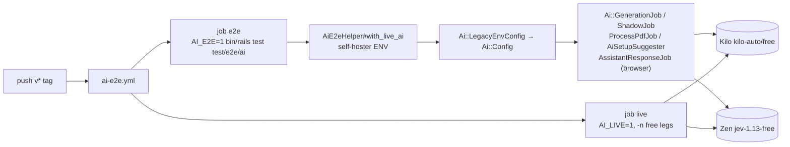

# PR 2f: AI end to end on release tags (implementation plan)

**Companion to:** [`ai-plumbing-redesign.md`](ai-plumbing-redesign.md) §19 (2a–2e) and
[`pr-2e-documents.md`](pr-2e-documents.md).
**Base:** `feat/ai-2f-review` (2a–2e plus 2f's ruby_llm 2.2 and review work).
**PR:** we-promise/sure#4892, commit `fd3c6eb4f`, after 2a #4773 → 2b #4774 → 2c #4775 → 2d #4765 → 2e #4771.
**Status:** built and verified live on 2026-11-12. Calls by @josh-sanders during development of
PR #4440 are marked.

## Context

After 2e the plumbing has three kinds of test, and none of them runs the app against a real model:

| Kind | Runs | Covers |
|---|---|---|
| Unit, `stub_ai` | every PR | coercion, failover, requesters, instrumentation, without HTTP |
| Recorded evals, `ai-evals.yml` | PRs touching AI paths | parsing and mapping against recorded answers |
| Live, `test/models/ai/live/` | the `ai-live` label | one transport call per route, built by hand |

What none of them checks is the path a release ships: the AI ENV a self-hoster sets, read by
`Ai::LegacyEnvConfig`, routed, run in the job or page a user hits, answered by a real model and
applied to the family's records, with usage rows written. 2f adds that check and runs it on
every `v*` tag, alphas and stable (call by @josh-sanders).

## Decisions

| Question | Decision | Why |
|---|---|---|
| What runs | New app-path tests in `test/e2e/ai/`, plus the free legs of `test/models/ai/live/` | The live suite already covers transports; the gap is the entry points (call by @josh-sanders) |
| Providers | Kilo's `kilo-auto/free` as the LLM, OpenCode Zen's `jev-1.13-free` as the judge | Free, so a tag run costs nothing (call by @josh-sanders) |
| Keys | None needed: both answer anonymously (Kilo checked 2026-11-12, chat completions and Responses). `KILO_API_KEY` and `KILO_ORG_ID` secrets are sent when set (`X-KiloCode-OrganizationId`, call by @josh-sanders), for rate limits | No leg skips for a missing secret |
| On failure | Red run like the other tag workflows; the release isn't blocked | Same as `llm-evals.yml` (call by @josh-sanders) |
| Configuration | ENV only, through `Ai::LegacyEnvConfig`: `OPENAI_URI_BASE`, `OPENAI_MODEL`, `OPENAI_EXTRA_HEADERS`, `JEV_*`, `CATEGORIZATION_PROVIDER` | The real path; `AiTestHelper.test_config` would skip it |
| Assertions | Shape: records changed, answers within the family's own values, `llm_usages` rows succeeded, no error `DebugLogEntry` | Accuracy is the evals' job; a free model's answer varies |
| Opt-in | `AI_E2E=1`, test-only, like `AI_LIVE` | `bin/rails test` stays offline |
| Embeddings | Not covered | Neither provider has a free embedding model |

## How it fits together

| Test | Drives | Asserts |
|---|---|---|
| `categorize_test`: Kilo | `Ai::GenerationJob(:categorize)` | a transaction categorized, only with the family's categories; usage rows |
| `categorize_test`: Jev | same, `CATEGORIZATION_PROVIDER=jev` | the route is the judge; categorized as above |
| `categorize_test`: shadow | Kilo primary, Jev shadow, `CATEGORIZATION_SHADOW_RATE=1` | one `Ai::Comparison` per transaction; each holds the primary's answer |
| `detect_merchants_test` | `Ai::GenerationJob(:detect_merchants)` | merchants assigned; usage rows |
| `bill_setup_test` | `RecurringTransaction::AiSetupSuggester#suggest_from_entries` | a proposal, a preset frequency, the family's category or none |
| `pdf_import_test` | `PdfImport.create_from_upload!` (`read_as: "text"`) → `ProcessPdfJob` on `bac_ocr.pdf` | a statement, rows extracted, checks recorded (passed or flagged) |
| `chat_system_test` | the browser sends a question; the job answers | a complete answer, a tool call, the answer rendered |

## Steps (one commit, `fd3c6eb4f`)

1. `test/support/ai_e2e_helper.rb`: the `AI_E2E` skip, `with_live_ai(jev:, **env)` over
   `with_ai_live`, `assert_ai_usage`, `assert_no_ai_errors`.
2. `test/e2e/ai/*_test.rb`, as in the table.
3. `generate_live_test.rb`: a `kilo/kilo-auto/free` route (chat completions, auto JSON mode).
4. `.github/workflows/ai-e2e.yml`: `v*` tags and `workflow_dispatch`; jobs `e2e` (Chrome,
   poppler) and `live` (`-n "/kilo-auto\/free|test_jev: /"`, so the paid routes in the same files
   stay with `ai-live`).
5. `ai-pipeline.md` and `testing.md`.

## As built

What changed from the first plan, found by running it live:

- **Timeout.** The free model read the 13-row statement in 50–85 s; the 60-second default
  (`Provider::Openai::DEFAULT_REQUEST_TIMEOUT`) cut it. The helper sets
  `OPENAI_REQUEST_TIMEOUT=300`, as a self-hoster on a slow gateway would.
- **Context window.** `LLM_CONTEXT_WINDOW=32000`: a custom URL gets the 2,048-token guard for
  small local models otherwise, which chat's tool list doesn't fit.
- **Output cap on the live route.** `kilo-auto/free` routes to reasoning models; at the live
  test's 1,024-token cap bill setup stopped at the output limit in 3 of 4 runs. The route takes
  `max_output_tokens: 8192` (3 of 3 pass). The app path has no cap and was unaffected.
- **One e2e job, not two.** The chat test needs Chrome anyway, and one serial process keeps the
  live calls within the free tiers' rate limits.
- **No skips for missing keys**, since both providers are keyless.

## Verification

- `AI_E2E=1 DISABLE_PARALLELIZATION=true bin/rails test test/e2e/ai`: 7 runs, 51 assertions, 0
  failures (about 1.5 minutes). Without `AI_E2E`: 7 skips.
- `AI_LIVE=1 … bin/rails test test/models/ai/live -n "/kilo-auto\/free|test_jev: /"`: 4 runs, 0
  failures.
- `actionlint` on the workflow; `bin/rubocop` on the changed files: clean.
- Full suite: 16,103 runs; 14 failures, all outside AI (Wise, Budget, Binance, Demo, provider
  import), and the same tests fail with this change's one shared line (the `test_helper.rb`
  require) removed.
- Locally the chat test needs `CAPYBARA_APP_HOST=host.containers.internal`: the Selenium in the
  sure-dev pod can't reach the toolbox's 127.0.0.1.
- First real run: the next alpha tag.
