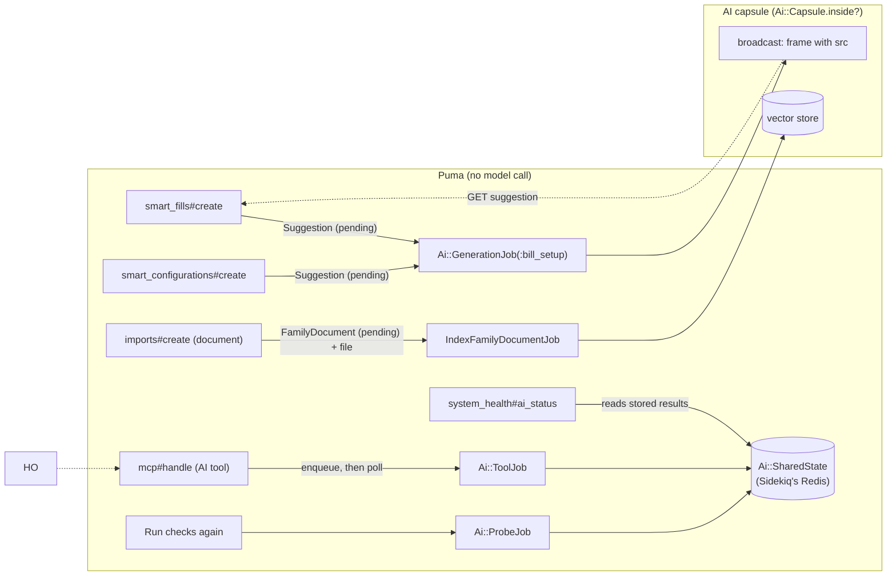

# PR 3: Off the web thread (development plan)

**Companion to:** [`ai-plumbing-redesign.md`](ai-plumbing-redesign.md) §19 (PR 3), §7 (transports
run only inside the AI capsules), §11 ("No LLM call on a web thread"), §12, §13, §14, §15 and §17,
and [`pr-4-sequencer.md`](pr-4-sequencer.md), which is built at the same time.
**Base:** `feat/ai-2f-review` @ `d55dc808a` (2a–2e plus 2f, ruby_llm 2.2.0).
**Branch:** `feat/ai-3-off-web-thread`, worktree `~/src/sure-ai-3`. Step 1 is built first; PR 4's
branch `feat/ai-4-sequencer` starts from that commit, and the rest of both PRs proceeds in parallel
(calls by @josh-sanders, 2026-11-13).
**Merge order:** PR 3 first, then PR 4 rebased onto it, **both in the same release**: until PR 4
lands, the jobs PR 3 creates for interactive work share the single `ai` thread with background
work (see [Coordination with PR 4](#coordination-with-pr-4)).
**Status:** plan; every decision below was made by @josh-sanders on 2026-11-13.

## Context

After 2f, every AI call except chat goes through the plumbing (`Ai::Generation`, the router, the
transports, the instrumentation), but five paths still call a model from a Puma thread. All five
were checked on `d55dc808a`:

| Path | Entry point | The call it makes on the web thread |
|---|---|---|
| Smart-fill (add-bill dialog) | `RecurringTransactions::SmartFillsController#create` | `RecurringTransaction::AiSetupSuggester#suggest_from_entries` → `Ai::Generations::SuggestBillSetup` |
| Smart-configure (per bill) | `Bills::SmartConfigurationsController#show` | `AiSetupSuggester#suggest_configuration` → the same generation |
| Non-PDF document upload | `ImportsController#create_document_import` | `Family#upload_document` → the vector store's upload (pgvector embeds the text) |
| MCP AI tools | `McpController#handle_tools_call` | `import_bank_statement` → `Ai::PdfReading#extract`; `search_family_files` → embeds the query (`search_documents`) |
| Health probes | `Admin::SystemHealthController#ai_status` | `AiHealth.new(force_probes:)` → `AiHealth::Probe` → `transport.probe` |

A sixth caller, `WorkerAiHealthCheckJob`, runs probes on `high_priority`, in the default capsule,
not an AI one. The evals (`app/models/eval/generation_client.rb`, run by `lib/tasks/evals.rake`)
also call generations outside any capsule, on purpose.

Why it matters (§11, 02 A9): a call on the web thread holds a Puma thread for as long as the model
takes, can't take the gate that puts chat first (drift bug 7), and on a slow local model can outlast
a reverse proxy's timeout. Nothing stops a new feature from adding another such call (02 A9), so
PR 3 ends with an executable check: **a transport called outside the AI capsules raises** in
development and test.

What 2c–2e already built and PR 3 reuses:

- `Ai::GenerationJob` with the requester protocol (`from_ai_job`, `ai_generation`, `apply_ai`,
  `ai_failed`, `ai_finished`, `ai_cancelled?`) and `Ai::Requesters::CLASSES`.
- `Ai::Error::Cancelled`, `Ai::Result#cancelled?`, and the `cancelled:` callable that
  `Ai::Generation#call`, `Ai::PdfReading#read` and `#extract` already take: the generation checks it
  before a single call and before each batch.
- `Ai::Routes.queue_for(feature)`: every job picks its queue from the feature's lane.
- `FamilyDocument` already has `has_one_attached :file` and a `pending` status.

## Scope (§19, PR 3)

1. Smart-fill and smart-configure through `RecurringTransaction::Suggestion` and a Turbo Stream.
2. Non-PDF document embedding as a job.
3. `Ai::ProbeJob`, keeping #3155's cache, "Run checks again" and "opening a tab triggers no AI request".
4. The two MCP AI tools' model calls through `Ai::ToolJob` and its result handoff, with one
   change an MCP client sees: `import_bank_statement` becomes idempotent (§14).
5. Cancellation: the `cancelled` statuses, `ai_cancelled?` on each requester, the checks in the
   plumbing (§12) and `DELETE` on the resource that started the work (§15).
6. Capsule-only enforcement, now that no AI call is left on a web thread.
7. The capsule-only and completion-hook tests.

Not in PR 3: lanes, queues, the gate, interrupts and the typing hold (PR 4); chat's stop button
(see decision 4); the health page redesign (PR 8); configuration (PR 7).

## Decisions

**Already made (by @josh-sanders during development of PR #4440):**

- Smart-fill and smart-configure render a skeleton, enqueue a job on the interactive lane, and
  receive the result as a Turbo Stream broadcast, the same pattern as
  `Chat#broadcast_pending_status`. Same dialog, same bounded charge history, nothing applied until
  the user checks it (§11).
- Only the MCP tools' model call moves (§14). The one change an MCP client sees is that
  `import_bank_statement` becomes idempotent per `PdfImport` (2026-11-13, step 6).
  `search_family_files` waits up to 30 s, then answers "busy, try again"; `import_bank_statement`
  waits up to the route's time budget. The asynchronous `import_bank_statement` with a pending
  import (05 BC6) stays with the MCP work-pack.
- `AiHealth::Probe` keeps its caching, redaction, debug logging and `confirming_tools_refusal`; only
  the probe itself moves into a job, whose result arrives by Turbo Stream (§13).
- Cancellation is cooperative, as #2685's is: nothing is killed mid-write (§12).
- Develop PR 3 and PR 4 on separate branches, PR 4 starting from PR 3's step 1 (2026-11-13).

**Decided by @josh-sanders, 2026-11-13** (each changes or settles the proposal):

1. **The escape hatch is `Ai::Capsule.outside { }`, not `Ai::Sequencer.outside_capsule { }`.**
   §7 and §17 name a method on `Ai::Sequencer`, which PR 4 creates. Building both PRs in parallel,
   a shared new file would conflict and make PR 3 depend on PR 4. PR 3 owns `Ai::Capsule`
   (`inside?`, `outside`, `check!`, and the `ApplicationJob` hook that marks AI jobs); PR 4 owns
   `Ai::Sequencer` (lanes and gates). The
   gate lives in RubyLLM's instrumenter, so code running inside `Ai::Capsule.outside` passes
   its host's gate in its own process with no extra code. The cop becomes `Sure/AiOutsideCapsule`
   on `Ai::Capsule.outside`. §7 and §17 are updated in the same PR.
2. **What a job hands to the web goes through `Sidekiq.redis`, not `Rails.cache`.** §14 puts the
   MCP handoff in `Rails.cache`, and #3155's probe cache and `WorkerAiHealth` already live there.
   But `Rails.cache` isn't shared between processes on every install:
   - development: `:null_store`, or a per-process `:memory_store` after `bin/rails dev:cache`;
   - test: `:null_store`;
   - production: Redis only when `REDIS_URL` is set (`config/environments/production.rb`). A
     Sentinel install sets `REDIS_SENTINEL_HOSTS` instead, so web and worker each get their own
     file store.

   Until now the probes ran in the process that showed them, so this never mattered. Once a worker
   writes and the web reads, it does: on those installs every MCP AI call would time out, and the
   health tab would never show a result. Sidekiq's Redis is shared on every install, since jobs
   can't run without it, and `ChatReservation` (#4444) already uses it.
   - One small `Ai::SharedState` (`write(key, value, expires_in:)` and `read(key)`, JSON over
     `Sidekiq.redis`) holds the tool results (`ai/tool_results/<job id>`, 2 minutes, as §14 has
     them), the probe results and the worker snapshot.
   - PR 4's gate state uses it too.
   - The MCP session ids that `McpController` keeps in `Rails.cache` have the same problem. They
     stay as they are: that's not AI work.
3. **The broadcast replaces a frame that reloads itself; it doesn't render the form.** A Turbo
   broadcast renders outside a request, so a `form_with` in it carries no valid authenticity token
   and the dialog's form would fail CSRF on submit. The job broadcasts a `turbo-frame` whose `src`
   is the suggestion's `show` URL. The browser fetches it in a normal request, and the form renders
   with its token, prefilled from the stored result. One extra request per suggestion, and a page
   reload still shows the result.
4. **Chat's stop button moves to PR 6.** §12 lists `cancelled` on `Message` among PR 3's statuses,
   but today's chat (`Assistant::Responder` over `Provider::Openai`'s streaming) is deleted in PR 6.
   A stop built on it now would be temporary code, and §19's principle allows that only where
   it makes the whole order clearly better. PR 3 cancels the two kinds of work whose code stays:
   bill suggestions and PDF imports. PR 6 adds `Message#cancelled` with its first caller.
5. **`WorkerAiHealthCheckJob` folds into `Ai::ProbeJob`.** Once the web never probes, every probe
   runs in a worker, and the separate "verify from the worker" check (#3169) proves nothing the
   probe job doesn't already. One job on the background lane writes both #3155's probe cache and
   the `WorkerAiHealth` snapshot, and the page's two buttons ("Run checks again", "Verify from
   worker") become one. The probe timeout setting (`AI_HEALTH_PROBE_TIMEOUT`,
   `Setting.ai_health_probe_timeout`) stays until PR 7, as §4.5's "no new ENV, no removals before
   PR 7" asks; §13's switch to the endpoint's timeout lands with PR 7's per-endpoint settings.
6. **The cop allows `Ai::Capsule.outside` in `app/models/eval/**` and `lib/tasks/evals.rake`.** §17 lists
   `lib/eval/**`, but the eval client lives in `app/models/eval/` and is started by the rake task.
7. **A non-PDF document's file is deleted once it's indexed.** To index in a job, the bytes have
   to be stored, since a job argument can't carry a 10 MB file. `FamilyDocument#file` (already
   declared) holds the upload until the job has sent it to the store, then the job purges it,
   whether indexing succeeded or failed for good. Sure keeps only the vector store's copy, as
   today. The cost: PR 7 can't re-index these documents itself when the embedding model changes
   or Documents is turned on; the user uploads them again. Statements and PDF imports are
   unaffected, since they keep their files already. PR 8 makes both configurable per family
   ("Keep uploaded documents after indexing", "Keep statement and PDF import files"), with these
   as the defaults, so `IndexFamilyDocumentJob` purges through one method PR 8 can put a setting
   behind (call by @josh-sanders, 2026-11-13).
8. **Smart-fill's suggestion has no bill yet.** §12's table gives `RecurringTransaction::Suggestion`
   a `recurring_transaction_id`; smart-fill starts from an entry, before any bill exists. The table
   gets `entry_id` too, and exactly one of them is set (a check constraint).

## How it fits together



| Work | Job | Lane (2f queue) | Requester / record | Cancel |
|---|---|---|---|---|
| Smart-fill | `Ai::GenerationJob(:bill_setup)` | interactive (`ai_high_priority`) | `RecurringTransaction::Suggestion` (`mode: fill`) | `DELETE` the suggestion |
| Smart-configure | same | same | same (`mode: configure`) | same |
| Document upload | `IndexFamilyDocumentJob` | `embed`'s, prompt (`ai_low_priority`) | `FamilyDocument` | — (short) |
| MCP `search_family_files` | `Ai::ToolJob` | `search_documents`'s, interactive | — | the 30 s wait |
| MCP `import_bank_statement` | `Ai::ToolJob` | `extract_pdf`'s, prompt | the `PdfImport` | `DELETE` its AI processing |
| PDF import | `ProcessPdfJob` (unchanged queue) | prompt | `PdfImport` | `DELETE` its AI processing |
| Probes | `Ai::ProbeJob` | background (`ai_low_priority`) | — | — |

Every job picks its queue with `Ai::Routes.queue_for(feature)` or the lane's queue
(`Ai::Routes::QUEUES`), never a queue name, so PR 4's new queues reach them without an edit.

## Steps (one commit each, on `feat/ai-3-off-web-thread`)

### 1. `Ai::Capsule` and `Ai::SharedState`

- `app/models/ai/capsule.rb`:
  - `QUEUES`: `Ai::Routes.ai_queues`, a new one-liner over `Ai::Routes::QUEUES` that PR 4
    extends with the old queue names it drains for one release. The queue names stay in one place.
  - `inside?`, `outside { }` (evals and the console), `within(queue) { }`, and `check!`, which
    raises `Ai::Capsule::Violation` unless inside, in development and test only. `Violation` is a
    `StandardError`, not an `Ai::Error`: it's a bug, not a model failure.
- `ApplicationJob` gets `around_perform { |job, block| Ai::Capsule.within(job.queue_name, &block) }`.
  It marks the job as inside when its queue is in `QUEUES`, using
  `ActiveSupport::IsolatedExecutionState`. This is an Active Job callback, not a Sidekiq server
  middleware, so it also runs under the test adapter (`perform_enqueued_jobs`) and
  `perform_now`. Sidekiq middleware never runs there, so every AI job test would raise once the
  check is on. In production an AI queue only runs in the AI capsule, so the queue name is enough.
- `with_ai_capsule { }` in `test/support/ai_test_helper.rb` (§17), for model tests that call a
  generation directly.
- `app/models/ai/shared_state.rb` (decision 2), with its test.
- Nothing calls `check!` yet. Steps 2–6 move each web-thread call into a job, and step 8 turns the
  check on once none is left. All of that is inside this one PR, so no allowlist is needed.

### 2. Bill suggestions as records and jobs

- Migration: `recurring_transaction_suggestions`: `family_id` (not null), `user_id` (not null; the
  feature's consent is the user's), `recurring_transaction_id` (nullable), `entry_id` (nullable),
  `income` (boolean, fill mode), `mode` (`fill` or `configure`), `status` (`pending`, `complete`,
  `failed`, `cancelled`), `result` (jsonb), `error` (string), timestamps; a check that exactly one of
  `recurring_transaction_id` and `entry_id` is set (decision 8); index on `family_id, created_at`.
- `RecurringTransaction::Suggestion`, the `bill_setup` requester (§8.1's protocol):
  - `from_ai_job(id:)`, `ai_generation` (builds `Ai::Generations::SuggestBillSetup` from the
    evidence), `apply_ai(result)` (normalises, stores `result`, `complete`, broadcasts),
    `ai_failed(error)` (`failed` with the router's or error's message, broadcasts), `ai_finished`,
    `ai_cancelled?` (`reload.cancelled?`).
  - The evidence query moves here from `SmartFillsController#evidence_entries`, and `normalize`
    and `resolve_category` from `AiSetupSuggester`, unchanged.
  - `Suggestion#apply_to(recurring_transaction)`: the controller's `apply_suggestion` and
    `next_annual_occurrence`, unchanged, so the form gets the same values as today.
  - `broadcast_result`: replaces `dom_id(self)` with a `turbo-frame` whose `src` is the
    suggestion's URL (decision 3).
  - `DataCleanerJob` deletes suggestions older than 7 days. Nothing reads a suggestion again once
    its dialog is closed, and that job already does the nightly deletes.
- `Ai::Requesters::CLASSES` gains `bill_setup: "RecurringTransaction::Suggestion"`.
- `ai_routing_matrix_test` already checks a requester declares its key.
- **Deletes:** `RecurringTransaction::AiSetupSuggester` and its test; their cases move to
  `recurring_transaction/suggestion_test.rb`.

### 3. Smart-fill and smart-configure controllers, views and cancel

Routes: one resource per controller, with each suggestion addressed by its id. A singular
`resource :smart_configuration` (§15's sketch) can't name the suggestion that `show` and `destroy`
need.

```ruby
namespace :recurring_transactions do
  resources :smart_fills, only: %i[create show destroy]       # replaces POST recurring_transactions/smart_fill
end
resources :bills do
  resources :smart_configurations, only: %i[create show destroy], module: :bills   # replaces GET bills/:id/smart_configuration
end
```

- `create` in both controllers checks the record as today (`Current.accessible_entries` for the
  entry; the series `accessible_by(Current.user)`), creates the suggestion, enqueues
  `Ai::GenerationJob.perform_later(:bill_setup, { id: })`, and renders the dialog with a
  skeleton subscribed with `turbo_stream_from @suggestion`. One click opens the dialog, as now:
  the links that open it become `button_to … method: :post`.
- `show` renders, inside the frame, the prefilled add form (smart-fill) or the proposal with the
  form that PATCHes `recurring_transactions#update` (smart-configure), or the suggestion's error.
- `destroy` marks the suggestion `cancelled` and renders the form without a proposal.
- Both keep `requires_ai :bill_setup` and `ensure_recurring_enabled`. Suggestions are found
  through `Current.family` and belong to `Current.user`.
- `chats/_worker_health_warning` moves to `shared/_ai_worker_health_warning`. The chat page, both
  skeletons and the health tab render it, so with no worker polling the AI queues the dialog says
  so instead of spinning forever.
- A "Stop" button (`DS::Button`, `button_to … method: :delete`) while pending. Closing the dialog
  doesn't cancel: the answer is stored and harmless.
- Strings through `t()`, in `config/locales/views/recurring_transactions/` and `…/bills/`.
- If #4975 ("Once" frequency) merges first, its branch in `apply_suggestion` (a one-off keeps the
  source entry's date) moves into `Suggestion#apply_to` with the rest. The suggestion's `entry`
  gives the date.

### 4. Document upload as a job

- `Family#upload_document_later(file)` (in `Family::VectorSearchable`, next to `upload_document`;
  `_later` as in `PdfImport#process_with_ai_later`): creates the document `pending` with the file
  attached and enqueues `IndexFamilyDocumentJob`.
- `IndexFamilyDocumentJob` (`queue_as { Ai::Routes.queue_for(:embed) }`), named and placed like
  `IndexAccountStatementJob`: re-checks `Ai.available?(:embed, family:)`, then sends the stored
  bytes to the store against the existing row. `upload_document` is split so the two indexing
  jobs and `ProcessPdfJob` share one `index_document(document, file_content:)`; the other two keep
  creating their row as they do now. A failure calls `mark_error!` and writes a `DebugLogEntry`
  (category `documents`), as `IndexAccountStatementJob` does. Once the store has the file, or
  indexing has failed for good, the job purges `document.file` (decision 7). A retried job runs
  before the purge, so it still has the bytes.
- `ImportsController#create_document_import` keeps its checks and their messages (availability,
  store, size, extension, the PDF hand-off), and replaces the `upload_document` call with
  `upload_document_later`. It redirects with "Uploaded; it will be searchable once indexed". The
  documents list already shows `pending`, `processing`, `ready` and `error`.
- 06 F-R5 (vector documents out of `ImportsController`) isn't done here. That's a separate
  pure-move PR.
- Whichever of #3717 and #3735 merges first adds a multi-file upload that calls `upload_document`
  once per file on the web thread; each of those calls becomes `upload_document_later`.
- If #4516 merges first, `family_documents` has a unique `(family_id, content_sha256)` index, and
  `upload_document` adopts a duplicate. `upload_document_later` computes the hash and adopts the
  duplicate when it creates the pending row, before indexing. Otherwise a second upload of the
  same file fails on the index.

### 5. `Ai::ProbeJob`

- `Ai::ProbeJob` (`queue_as Ai::Routes::QUEUES.fetch(:background)`) runs the probes with
  `AiHealth.new(force_probes: true, probe_cache: Ai::SharedState)` and records the `WorkerAiHealth`
  snapshot with its process identity in the same store (decision 5). It then broadcasts a
  replacement for the AI tab's lazy frame, with the same `src`, so the browser reloads the tab.
  That's decision 3's pattern: the tab's "Run checks again" form renders in a request, with its
  token. The job raises nothing, because a failed probe is a result. `Ai::SharedState` takes the
  `fetch`/`read`/`delete` calls `AiHealth::Probe#run` makes on its cache, or the probe takes a
  small adapter; pick whichever is less code.
- On 2f, `AiHealth.new(run_probes: false)` reports every probe as "not checked" without reading
  the cache (`AiHealth#load_probes`). So `AiHealth` gets a `stored_only:` mode: `Probe#run`
  returns the stored result, or `Probe.not_checked` when there is none, and never yields.
  `Admin::SystemHealthController#ai_status` uses it, and each result shows its age. "Run checks
  again" enqueues the job and returns at once. Opening the tab still makes no AI request.
- With no worker polling the AI queues, the tab renders `shared/_ai_worker_health_warning`.
- **Closes #4866** (supersedes #4879). The PDF vision probe caps its answer at
  `PDF_MAX_RESPONSE_TOKENS = 512` (`ai_health/probe.rb:24` and `:200` on 2f). A reasoning model
  spends that on thinking, and the probe fails while real imports work. The probe's route model
  takes the output limit `Ai::LegacyEnvConfig` gives production's model:
  - on an OpenAI-compatible endpoint, `LLM_MAX_RESPONSE_TOKENS` or its setting, and none when
    unset (as #4879 does on the old code);
  - on Anthropic, `ANTHROPIC_MAX_TOKENS` or its default, since Anthropic requires one.

  The constant goes. Test: no cap by default on a compatible endpoint, and the configured cap
  when one is set. Probes are meant to exercise the production
  path, which this cap didn't.
- **Closes #3279.** The tab shows, next to each result's age, how long a result is kept
  (`AI_HEALTH_PROBE_CACHE_TTL`, default 60 s), from `AiHealth::Probe`'s own `cache_ttl`, the
  same way the probe timeout row works. With "Run checks again" always running fresh probes, the
  age and the time kept answer #3279's question: why does it still show the old result?
- **Deletes:** `WorkerAiHealthCheckJob`, `verify_worker_ai` and its route and button, and the
  `force_probes` request parameter.

### 6. `Ai::ToolJob` for the MCP AI tools

- `Assistant::Function` gains a class-level `ai_feature` (nil by default). `ImportBankStatement`
  declares `:extract_pdf` and `SearchFamilyFiles` declares `:search_documents`. 02 O-B1 asks for
  the declaration; `mcp_ai_tools_test` checks every function that reaches `Ai::` declares one.
- `Ai::ToolJob.perform(function_name, user, arguments)` with
  `queue_as { Ai::Routes.queue_for(feature of the function) }`: runs `fn_class.new(user).call(arguments)`
  in the capsule. Both functions take everything from `user` and their arguments, and read nothing
  from `Current` (checked), so the job needs no request context. It writes `{ result: }` or
  `{ error: }` to `ai/tool_results/<job_id>` in `Ai::SharedState` for 2 minutes (decision 2).
- `Ai::ToolJob.run(fn_class, user, arguments, timeout:)` enqueues and reads the key every 250 ms.
  It polls rather than blocking on a Redis list: a blocking pop would hold one of the web's Sidekiq
  connections for the whole wait, up to minutes for an import.
  On timeout it returns the §14 message, as an `isError` tool result: `search_family_files`
  answers "busy, try again"; `import_bank_statement` answers "still extracting; call again with the
  same `pdf_import_id` for the result", which is safe because the tool is idempotent (below).
- `McpController#handle_tools_call`: `Usage.capture("mcp_call_served_daily")` stays before the
  tool runs (#4295). A function with an `ai_feature` that `Ai.available?` for the token's user runs
  through `Ai::ToolJob.run`; otherwise inline as today, which covers `search_family_files`'s
  metadata fallback with no AI.
- `Ai::ToolJob` finds the function in the same list `tools/call` authorized it against
  (`Assistant.function_classes(user)` on 2f; `Assistant.mcp_function_classes` if #3025 lands
  first), and refuses a name that isn't there. A tool hidden from MCP can't run through the job.
- #3580, #4182 and #4283 each rewrite `McpController`. Whichever lands first, step 6 rebases onto
  its `tools/call` result envelope (`resultType`, `_meta`), and the timeout answers use that
  envelope. `ai_feature` sits next to #3580's `read_only?` on `Assistant::Function`.
- Step 6 doesn't decide which tokens see which tools. `Ai::ToolJob` runs only what `tools/call`
  already authorized. `read_only?` means "doesn't write", so `SearchFamilyFiles` is `true` when
  this branch sets it, and whether a `read` token may see documents is a scope check, as §14 has
  it (raised on #3580 and #4628). If #3580 lands with `read_only? = false` on `SearchFamilyFiles`,
  step 6 works unchanged; only chat's approvals (#4440's PR 6) depend on the flag being accurate.
- Timeouts: `search_family_files` 30 s; `import_bank_statement` a flat 120 s, below common reverse
  proxy timeouts. The page count isn't known before reading, so a route budget can't be computed
  up front, and a client that times out can call again.
- **`import_bank_statement` is idempotent per `PdfImport`.** The tool creates a `TransactionImport`
  from the extraction, so without this a job that finishes after its request gave up still
  creates one, and a client that retries gets a second.
  - Migration: `imports.source_import_id` (nullable, references `imports`), with a unique index
    where it's set. `PdfImport has_one :derived_import`; the tool sets `source_import:` on the
    `TransactionImport` it creates.
  - The tool returns the existing derived import, with `already_imported: true`, before extracting
    anything. Two jobs racing past that check hit the unique index; the loser rescues
    `ActiveRecord::RecordNotUnique` and returns the winner's import.
  - While a job for a `PdfImport` is running, `Ai::SharedState` holds
    `ai/tool_inflight/import_bank_statement:<pdf_import_id>` with its job id, so a retry waits for
    that job's result instead of extracting again. The job clears it when it writes its result.
  - Chat's calls to the tool get the same behaviour.
  - What an MCP client sees: a repeated call returns the same import, with
    `already_imported: true`, where it used to create another. The release note says so.
- Chat keeps calling both tools inside its own job, which is already in the capsule.
- Tests run the job with `perform_enqueued_jobs` and give `Ai::SharedState` a memory store
  (test has no shared Redis to rely on).

### 7. Cancellation

- `Import`'s `status` enum gains `cancelled` (a string column, no migration). Every place that
  lists import statuses handles it: the reaper (`Import.clean` and `presumed_lost?`), status badges,
  filters, and the next-steps email (none for a cancelled import). A cancelled import has no
  committed data, so #3717's and #3735's `directly_deletable?` allows deleting it.
- `PdfImport#ai_cancelled?` → `reload.cancelled?`. `ProcessPdfJob` passes
  `cancelled: -> { pdf_import.ai_cancelled? }` to `pdf_reading.read` and `#extract` (they already
  take it) and checks between its steps (read → embed → extract → rows).
- **Bug to avoid:** `ProcessPdfJob#process` rescues `StandardError` and writes `failed`. It must
  rescue `Ai::Error::Cancelled` first and leave the status `cancelled`.
- `PdfImports::AiProcessingsController#destroy` (§15): only while `importing`; the import's owner
  or a statement manager, as the import's other actions require.
- The import page shows "Stop" while processing, and after stopping: "Stopped. The model may still
  finish this request" (§12).
- `RecurringTransaction::Suggestion#ai_cancelled?` (step 2). `Ai::GenerationJob` already discards
  `Cancelled`, and `Ai::Result` already reports it.
- The per-chunk check and "before the request passes the host's gate" (§12) land with PR 4,
  which adds the gate and the streamed background calls.
- The existing `ImportsController#cancel` (`force_fail!` on an import presumed lost) stays: it's
  for work that died, not running work.

### 8. Enforce, test and document

- `Ai::Transport::Base#generate`, `#judge`, `#embed`, `#ocr` and `#probe` call
  `Ai::Capsule.check!` first. The test helper's `FakeTransport` overrides only the private
  `run_*` methods, so stubbed calls are checked too.
- Model tests that call a generation directly are wrapped in `with_ai_capsule`. That's a long,
  mechanical diff in `test/models/**`, so it's its own commit.
- The evals run inside `Ai::Capsule.outside`, and the cop `Sure/AiOutsideCapsule`
  (`lib/rubocop/cop/sure/`) flags that call anywhere except `app/models/eval/**` and
  `lib/tasks/evals.rake` (decision 6).
- `test/architecture/ai_capsule_only_test.rb` (§17): a transport called from a controller test,
  from a rule job (`RuleJob` on `medium_priority`) and from a default-queue job raises; the same
  call inside `with_ai_capsule` and inside `Ai::Capsule.outside` passes.
- `test/architecture/ai_completion_hook_test.rb` (§17): every requester's `apply_ai` result is
  reported once per applied batch, and `ai_finished` or `ai_failed` exactly once per run, for
  `bill_setup`, `categorize`, `detect_merchants` and `enhance_merchants`.
- `ai_lane_test.rb`: `Ai::ToolJob`, `Ai::ProbeJob` and `IndexFamilyDocumentJob` are AI jobs on
  their lanes' queues; `WorkerAiHealthCheckJob` is gone.
- `mcp_ai_tools_test.rb`: "no MCP request calls a transport" (it would raise now).
- 2f's e2e: `bill_setup_test` drives `SmartFillsController` and `GenerationJob` instead of the
  deleted suggester; `documents_test` adds a non-PDF upload through the job. Run
  `AI_E2E=1 … bin/rails test test/e2e/ai` before review (Chatwoot's 2.0 upgrade merged without a
  live smoke check; this PR shouldn't).
- `docs/llm-guides/ai-pipeline.md`: "every AI call runs in a job", how to add one (a requester, or
  `Assistant::Function.ai_feature` for a tool), `with_ai_capsule`, `Ai::SharedState` for handing
  results to the web, `Ai::Capsule.outside` for evals only.

## Open issues and PRs (checked 2026-11-13)

All 51 issues and PRs from the search, all open. PRs were compared by changed files and diff,
issues by body.

**What PR 3 stands on.** It stacks on #4892 (2f), which stacks on #4771 (2e), #4765 (2d),
#4775 (2c), #4774 (2b) and #4773 (2a): a change made in review on any of them rebases this
branch. #3422 (statement vault → search) is in 2e's base. PR 3 extends its
`IndexAccountStatementJob`, `search_family_files` and `upload_document`. #3402 is the draft
#3422 and #4516 were split out of. #4440 holds this plan.

**PRs that conflict with this plan:**

| PR | Interaction | Handling |
|---|---|---|
| #4425 Fill splits from a receipt | A **new model call on the web thread** (`SplitsController#itemize`, `Api::V1::SplitsController#itemize`), on the providers 2c–2e delete. The capsule check covers `Ai::Transport` only, so it wouldn't catch this call. | Asked on the PR (2026-11-13) to rebuild it on #4892: an `extract_receipt` generation, a requester record, `Ai::GenerationJob` and a frame reload, as in step 3. The API returns a pending result. |
| #4776 Tools/AI onboarding | "Save and test" runs `AiHealth::Probe` (with a new `family:` argument) in the request, which raises once step 8 is on. It edits files steps 2, 4, 5 and 6 change or delete. Per-family keys are PR 9's scope. | Asked on the PR (2026-11-13): merge the onboarding on its own, enqueue a job for "Save and test", and move family provider settings to a follow-up (PR 7 and PR 9). |
| #3717 PDF import management, #3735 upload flow | Multi-file upload looping `upload_document` on the web thread; "directly deletable" imports. | Step 4 (each file goes through `upload_document_later`), step 7 (cancelled imports are deletable). |
| #4516 typed family documents | `content_sha256` with a unique index per family, and duplicate adoption in `upload_document`. | Step 4 (hash and adoption when the pending row is created). |
| #3580, #4182, #4283 MCP | Rewrite `McpController`; #3580 adds `read_only?` and keeps `SearchFamilyFiles` from `read` tokens by setting it to `false`. §14 separates "writes" from "exposes documents" (suggested on #3580 and #4628). | Step 6 rebases on their envelope. It runs only what `tools/call` authorized, so it doesn't depend on how the document question is settled. |
| #3025 MCP CRUD tools | `Assistant.mcp_function_classes` becomes the MCP list. | Step 6 (`Ai::ToolJob` uses the authorized list). |
| #4975 "Once" frequency | Edits `apply_suggestion`. | Step 3 carries it into `Suggestion#apply_to`. |
| #4879 PDF vision probe fix | Fixes the old probe code; 2f still caps at 512. | Step 5 includes the fix and closes #4866. |

**Smaller interactions:**
- #4512 (relink a statement) edits `AccountStatement`, whose `index_in_vector_store!` calls the
  `upload_document` that step 4 splits.
- #4403 adds an import type next to step 7's status value.
- #3694 lists `/models` on the settings page with its own HTTP client. It's not a model call, so
  this plan allows it, but it skips `Ai::Transport::Http`'s proxy handling.
- #4844 runs the Claude Code CLI inside `Provider::Anthropic`, which the stack deletes.
- No interaction: #3605 (already in 2c), #4122, #4747, #4602, #4904, #4689, #4400, #4413 (no
  model call, no job).

**Issues:**
- **Closed by this PR:** #4866 and #3279 (step 5).
- **Helped:** #4779 (follow the No AI choice): every job this PR adds checks availability for its
  user when it runs, not only when it's queued. The web-thread calls in #4425 and #4776 would
  still be gaps.
- **Raised, not blocking:** #4628 (read-only MCP): keep "writes" and "data exposed" as separate
  attributes, so document access is a scope decision (also suggested on #3580).
- **Use this PR's pattern once built:** #4641 (receipt upload; see #4425).
- **Run in `ProcessPdfJob`, with the new stop button:** #1279 (brokerage PDFs), #1378 and #1379
  (the same issue, filed twice).
- **Configuration, PR 7:** #4245, #4560, #4791.
- **Chat, PR 6 and PR 8:** #4864.
- **None:** #3003, #3140, #3682, #4472, #4725, #4926, #4398.

## Coordination with PR 4

PR 4's branch starts from this PR's step 1 commit, so the hook, the queue list and
`Ai::SharedState` exist once. PR 3 merges first; PR 4 rebases onto it.

| Shared point | PR 3 | PR 4 | Agreement |
|---|---|---|---|
| Queue names | uses `Ai::Routes.queue_for` / `QUEUES` only | changes `QUEUES` to the three lane queues | no queue name in PR 3's code |
| Which queues are "AI capsules" | `Ai::Capsule` reads `Ai::Routes.ai_queues` | adds `Ai::Routes::LEGACY_QUEUES` to it | queue names only in `Ai::Routes` |
| Escape hatch | `Ai::Capsule.outside` | `Ai::Sequencer` has no capsule method | decision 1 |
| Marking a running job | `ApplicationJob`'s `around_perform` → `Ai::Capsule.within` | sets the lane from the same queue name | PR 4 adds its lane to the same callback, not a Sidekiq middleware, so it runs under the test adapter too |
| Shared web/worker state | `Ai::SharedState` | the gate state and the typing hold use it | one store over `Sidekiq.redis` |
| `config/initializers/sidekiq.rb` | untouched | removes the fetch class | — |
| `Ai::GenerationJob`, `Ai::Generation` | none expected (cancel already there) | `Busy` re-enqueue, `Preempted` retry | if PR 3 touches them, keep it to new rescue lines |
| `ProcessPdfJob` | cancel checks, `Cancelled` rescue | none expected | — |
| `test/support/ai_test_helper.rb` | `with_ai_capsule` | gate helpers | separate methods |
| `ai_lane_test.rb`, `ai-pipeline.md` | new jobs | new queues, gate | rebase by hand |

**Release risk if PR 3 ships without PR 4:** smart-fill, smart-configure and the MCP search job
go to `ai_high_priority`, which shares the `ai` capsule's one thread with background work. Strict
order puts them next, but they can't interrupt a running call: on a slow local model, smart-fill
waits behind one categorize batch, and an MCP search can reach its 30 s and answer "busy". Both run
at once on the web thread today, so shipping PR 3 alone would make them slower on local models.
PR 4's `ai_chat` thread and gate fix that, so they ship together.

## Still on old code after PR 3

Chat (`Assistant`, `Provider::Openai` and `Provider::Anthropic`'s chat methods), with no stop
button. Configuration from the deprecated ENV, built per process. The probe timeout setting.

## Upgrade notes and release notes

- **Upgrade:** health checks, smart-fill, smart-configure, document indexing and the MCP AI tools now
  need a worker running the AI capsule (`RAILS_AI_MAX_THREADS` ≥ 1 on at least one worker). With none,
  the dialogs and the health tab say so.
- **Release notes:**
  - smart-fill and smart-configure answer in the dialog when ready, and can be stopped;
  - documents index in the background, and their status shows until searchable;
  - MCP `import_bank_statement` returns the existing import, with `already_imported: true`, when
    the statement was already imported, instead of creating another;
  - a PDF import can be stopped while it's being read;
  - AI health checks run in the worker; "Run checks again" queues them, and each result shows its
    age; "Verify from worker" is gone, since every check now runs there;
  - MCP clients see one change: `import_bank_statement` is idempotent (above);
  - the PDF vision health check no longer fails on reasoning models (#4866), and the AI tab shows
    how long a result is kept (#3279).

## Verification

- `bin/rails test` green, `test/architecture` included, with the capsule check on.
- `AI_E2E=1 DISABLE_PARALLELIZATION=true bin/rails test test/e2e/ai` green (Kilo, Jev, Cohere legs).
- System tests: smart-fill (skeleton → prefilled form → save), smart-configure, stop on both, PDF
  import stop, the health tab's "Run checks again".
- On venus (sure-dev pod, local qwen): smart-fill with a categorize run queued; an MCP
  `search_family_files` and `import_bank_statement` from a client, and the 30 s "busy" answer while
  a long background call holds the one AI thread (expected until PR 4).
- `bin/rubocop`, `bin/erb_lint`, Biome and Brakeman, as the pre-PR checklist requires.
