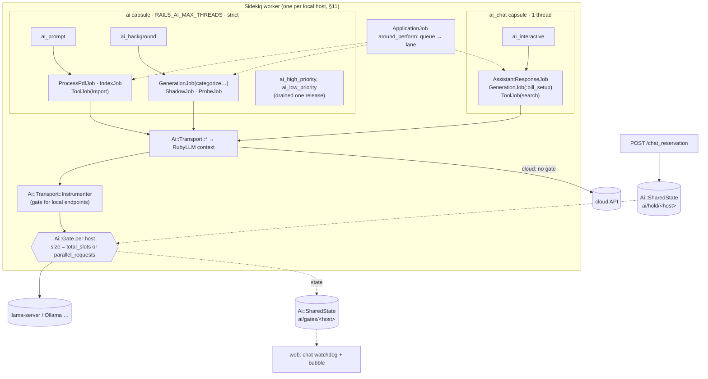

# PR 4: Sequencer (development plan)

**Companion to:** [`ai-plumbing-redesign.md`](ai-plumbing-redesign.md) §19 (PR 4), §11 (the
whole design), §12 (the gate's cancel point), §17 (`ai_gate_test`, `ai_lane_test`,
`ai_nested_call_test`, the escalation cases), the spike's "Job runners and chat priority" and
"Prompt cache and prompt reads on one slot" in [`rubyllm-spike-report.md`](rubyllm-spike-report.md),
and [`pr-3-off-the-web-thread.md`](pr-3-off-the-web-thread.md), which is built at the same time.
**Base:** PR 3's step 1 commit on `feat/ai-3-off-web-thread`, which sits on `feat/ai-2f-review` @
`d55dc808a` (2a–2e plus 2f, ruby_llm 2.2.0). Step 1 gives PR 4 the `ApplicationJob` hook,
`Ai::Capsule`'s queue list and `Ai::SharedState` without a copy of its own.
**Branch:** `feat/ai-4-sequencer`, worktree `~/src/sure-ai-4`, started from that commit, then built in
parallel with the rest of PR 3 (calls by @josh-sanders, 2026-11-13). Rebased onto PR 3 once that merges.
**Merge order:** after PR 3, in the same release.
**Status:** plan; every decision below was made by @josh-sanders on 2026-11-13.

## Context

On `d55dc808a` the AI work runs like this (all checked in the code):

- **One AI capsule.** `config/sidekiq.yml`: `ai` with `RAILS_AI_MAX_THREADS` threads (default 1),
  strict order over `[ai_high_priority, ai_low_priority]` (#4237). The default capsule gets
  `RAILS_MAX_THREADS - RAILS_AI_MAX_THREADS`.
- **Lanes exist only on paper.** `Ai::Routes::MATRIX` gives each feature a lane, and
  `Ai::Routes::QUEUES` maps interactive → `ai_high_priority` and prompt and background →
  `ai_low_priority`. `AssistantResponseJob` names `ai_high_priority` itself.
- **#4444's typing hold** is a Sidekiq fetch class: `ChatReservation::Fetch` drops
  `ai_low_priority` from the queue list while `ChatReservation.held?`, only on a one-thread capsule.
  The hold is set by `POST /chat_reservation` while typing and after every reply (`chat.rb:147`).
  `while_chat_runs` flags a running chat, and the "ready"/"busy" bubble reads it.
- **Health.** `SidekiqHealth::AI_QUEUES` (left out of "queue backed up"; `ai_queues_not_polled`)
  and `BackgroundJobHealth::AI_QUEUES`/`CHAT_QUEUE`/`one_ai_thread?` name the two old queues.
- **The hook point exists.** Every RubyLLM context Sure builds
  (`Ai::Transport::RubyLlmAdapter#ruby_llm_context`) sets `config.instrumenter` to
  `Ai::Transport::Instrumenter`, which every HTTP request passes, with its retries. It already
  checks the attempt's budget there. Sure also owns the Faraday adapter
  (`Ai::Transport::Http::ProxyNetHttp`), whose `build_connection(env)` builds each request's
  `Net::HTTP`, so the gate can reach the live connection.
- **Per-call state lives in fiber storage.** `Ai::CallContext.current` is `Fiber[...]`, which
  threads inherit when they're created from the calling fiber. That's how Jev's fan-out
  (`Ai::Transport::Jev#in_parallel`, a new thread pool per call) sees the call's budget.
- **Chat's busy bubble** reads `BackgroundJobHealth.ai_busy?` (`chat.rb:128`), which looks at the
  old AI queues.
- **Generations aren't streamed.** `complete_json` calls `chat.generate` without a block. RubyLLM
  2.2's `Chat#generate(&)` streams when given one (checked in the gem). Its `Chat#cancel` is
  cooperative: it stops at the next chunk or checkpoint, so it can't stop a request still
  reading its prompt, when no chunk arrives. That's why §11 closes the connection instead.
- **Chat isn't on RubyLLM yet.** `Assistant::Responder#request_response` calls
  `llm.chat_response` once per round, and runs tools **between** rounds
  (`function_tool_caller.fulfill_requests`). So a gate held around each `chat_response` never
  covers a tool's own AI call, and a nested `search_family_files` can't deadlock on its own turn.

What the spike measured (§11): only interrupting the running call (0.09 s extra wait) or keeping a
slot meets the target of about 2 s, never more than 5 s. Chat in its own one-thread capsule got
its first word as fast as a fiber worker did.

## Scope (§19, PR 4)

1. Three lane queues (`ai_interactive`, `ai_prompt`, `ai_background`) replacing `ai_high_priority`
   and `ai_low_priority`; the `ai` capsule drains the old two for one release.
2. The `ai_chat` capsule, one thread, on top of the database pool.
3. One gate per local host in RubyLLM's instrumenter, sized from the server.
4. Rules 1–3: lane order, an interactive call interrupts by closing the running call's connection
   (prompt and background calls on local hosts are streamed for it), background calls never wait.
5. #4444's typing hold moved into the gate; its fetch class deleted.
6. #4237's health signals on the new queues; the gate state the chat watchdog reads.
7. Today's chat holds the gate in the interactive lane around each provider request: a few
   temporary lines PR 6 deletes.
8. The lane and gate tests, and the sequencer cases of the escalation test.

Not in PR 4: the health page's lane view and the two-workers warning (PR 8, §13); a gate shared
across processes (future work, §11); chat on RubyLLM (PR 6).

## Decisions

**Already made (by @josh-sanders during development of PR #4440, §11):**

- Interrupt, don't keep a slot: the gate closes the running call's connection, and the call
  raises `Ai::Error::Preempted`, which never leaves `Ai::Generation#call` and isn't an attempt,
  a down mark or a failover.
- The gate is held per request, not per chat turn.
- #4444's typing hold stays, in the gate: 60 s from the last keystroke, 15-minute cap, its bubble;
  #4444's 60-second hold after each reply goes.
- #4237's health signals carry over, adjusted to the new queues.
- Small batches with re-enqueue for fairness (already in 2c's `Ai::GenerationJob`).
- Chat has its own capsule (spike evidence), not 05 BC7's "one lane, optional chat capsule".
- Develop PR 3 and PR 4 on separate branches, PR 4 starting from PR 3's step 1 (2026-11-13).

**Decided by @josh-sanders, 2026-11-13** (each changes or settles the proposal):

1. **The lane comes from the job's queue, set in `ApplicationJob`'s `around_perform`.** That's
   the callback where PR 3 marks AI jobs as inside the capsule. A Sidekiq middleware would be
   skipped under the test adapter. Each job's queue already comes from its lane, so
   `Ai::Routes.lane_for_queue` maps it back: `ai_interactive` → interactive, and during the drain
   `ai_high_priority` → interactive, `ai_low_priority` → background. No job class changes, which
   keeps PR 4 out of PR 3's new jobs. `Ai::Sequencer.with_lane(lane) { }` covers the rest: evals
   and the console, inside PR 3's `Ai::Capsule.outside`, take lane `:prompt`. So an eval never
   interrupts background work, and never jumps ahead of chat. Like `Ai::CallContext`, the lane
   lives in `Fiber[...]`, so Jev's pool threads inherit it. In thread-local storage they wouldn't,
   and a background Jev request would count as interactive.
2. **Time spent waiting at the gate doesn't count against the attempt's budget.** 2a gives each
   call one time budget, the endpoint's timeout, checked before every request
   (`Ai::Transport::Instrumenter#check_budget!`). A prompt call that waits two minutes behind a
   chat would otherwise reach the server with its budget spent and fail with `Timeout`. The gate
   instrumenter adds the time it waited to `Ai::CallContext.current`'s deadline. The wait itself is
   bounded by the lane rules (chat's watchdog, Rule 3, the hold's cap), not by the budget.
3. **During the typing hold, prompt calls wait; only background calls re-enqueue.** §11 says new
   background **and prompt** calls re-enqueue under the hold. A prompt call runs in the middle of a
   job (`ProcessPdfJob` between pages, PR 3's `Ai::ToolJob` with an MCP client polling for it), and
   re-enqueueing those would redo pages or leave the client waiting on a job that left. Waiting
   matches Rule 1, where prompt calls wait in lane order. Under the hold, a prompt call waits until
   the hold lapses or a chat request takes and frees the slot.
4. **Gate state and the typing hold go in PR 3's `Ai::SharedState` (Sidekiq's Redis), not
   `Rails.cache`.** §11 puts `ai/gates/<host>` in `Rails.cache`. The worker writes it and the web
   reads it (chat's watchdog and bubble), but `Rails.cache` isn't shared between processes in
   development or on a production install without `REDIS_URL` (PR 3's decision 2). The typing
   hold is already in Sidekiq's Redis.
5. **Under the deprecated ENV, the gate finds llama.cpp by asking.** §11 sizes the gate from
   llama.cpp's `total_slots` (`GET /props`) or the endpoint's `parallel_requests`, default 1.
   Presets arrive in PR 7, so until then the worker asks `/props` once per local host when it builds
   the gate, and re-asks after 10 minutes. A 404 or non-JSON answer means "not llama.cpp", so the
   size is `parallel_requests` or 1. The ask isn't a model call and doesn't hold the gate.
6. **The interrupt closes the socket through Sure's own Faraday adapter.** `ProxyNetHttp#build_connection`
   registers each request's `Net::HTTP` object with the gate holder that's sending it.
   `interrupt` marks the holder preempted and calls `finish` on that connection from the
   interrupting thread. The sending thread gets an `IOError` or `EOFError` from the read, which the
   gate maps to `Preempted` because the holder was marked. The spike did this on `Net::HTTP` directly;
   §11 calls it "the part to build and test in PR 4". If closing from another thread proves unsafe
   in the adapter, the fallback is the socket's `shutdown(:RDWR)`, which wakes a blocked read on
   Linux. **Prove it first: step 3 starts with a test against a stub server that holds a request
   open, both while it's "reading the prompt" (no bytes sent) and while it streams.**

## How it fits together



**Rules at the gate (§11), for a local host that's full:**

| Caller's lane | Waits? | Interrupts? | Under the typing hold |
|---|---|---|---|
| Interactive | yes, first in line; bounded by chat's watchdog | the lowest running lane, background before prompt; never another interactive call | unaffected |
| Prompt | yes, after interactive, in arrival order | no | waits (decision 3) |
| Background | no: raises `Ai::Error::Busy`; the job re-enqueues in 5–15 s (random) | no | `Busy` |

With two or more slots, one is kept for the interactive lane. Cloud endpoints have no gate.

## Steps (one commit each, on `feat/ai-4-sequencer`)

### 0. Measure the baseline (before any code)

§19 says to measure chat's time to first token while background AI work runs, after PR 4. Measure
the same on 2f first, so the PR shows before and after (Chatwoot's lesson: instrument first,
02 §1's evidence habit). On venus (sure-dev pod, qwen3.6 on llama.cpp): a categorize run of about
200 transactions queued, then a chat turn; record Sidekiq queue latency, llama.cpp's
`requests_processing`/`requests_deferred` (query-llamacpp-metrics) and the first-token time. Three
runs. The numbers go in the PR description.

### 1. Three lane queues and the chat capsule

- `Ai::Routes` holds every AI queue name in one place:
  - `QUEUES = { interactive: "ai_interactive", prompt: "ai_prompt", background: "ai_background" }`;
  - `LEGACY_QUEUES = { "ai_high_priority" => :interactive, "ai_low_priority" => :background }`;
  - `lane_for_queue(name)`, and `ai_queues`, the names of both.

  PR 3's `Ai::Capsule` reads `ai_queues`, so the capsule check covers the old queues during the
  drain with no list of its own.
- `AssistantResponseJob`: `queue_as { Ai::Routes.queue_for(:chat) }`.
- `config/sidekiq.yml`:

  ```yaml
  <% ai_threads = ENV.fetch("RAILS_AI_MAX_THREADS") { 1 }.to_i %>
  <% if ai_threads.positive? %>
  capsules:
    ai_chat:
      concurrency: 1
      queues: [ai_interactive]
    ai:
      concurrency: <%= ai_threads %>
      # Strict order. The old queues drain for one release.
      queues: [ai_high_priority, ai_prompt, ai_background, ai_low_priority]
  <% end %>
  ```

  `RAILS_AI_MAX_THREADS=0` leaves both AI capsules out (§11's "one worker per local host"). The
  default capsule's sizing is unchanged; the `ai_chat` thread isn't counted in the database pool.
- `SidekiqHealth::AI_QUEUES` and `BackgroundJobHealth::AI_QUEUES` become `Ai::Routes.ai_queues`
  instead of two more copies of the names. `ai_queues_not_polled` checks the three new queues: a
  worker started with the old `sidekiq.yml` leaves chats unanswered, the case §11 calls out.
  `CHAT_QUEUE` becomes `Ai::Routes.queue_for(:chat)`. `one_ai_thread?` and its process label go
  in step 5, which removes their last caller.
- `ai_lane_test.rb`: every AI job's queue is its lane's queue; no job names a queue.

### 2. `Ai::Sequencer`: the lane in each job

- `app/models/ai/sequencer.rb`: `lane` (in `Fiber[...]`, decision 1), `with_lane(lane) { }`,
  `gate_for(endpoint)` (nil for a cloud endpoint), and the per-process gate registry keyed by host
  (§11: host without port, path or scheme; two endpoints on one host share the larger size).
- `ApplicationJob`'s `around_perform`, from PR 3, also runs the job in
  `Ai::Sequencer.with_lane(Ai::Routes.lane_for_queue(queue_name))` when the queue is an AI one
  (decision 1).
- `ai_gate_test` covers a Jev judgement on a local host: its pool threads take the job's lane.
- A transport call with no lane (a test, or a console without `with_lane`) counts as interactive,
  so it never raises `Busy` where nothing would re-enqueue it.
- §11's sketch has `Ai::Sequencer.run(plan) { |route| }` choosing the route. `Ai::Generation#on_routes`
  already chooses it (2c), so the sequencer doesn't take that over. The rule "a busy host never sends
  the call to a later route" goes in `on_routes` instead (step 4).

### 3. The gate and its interrupt

- `Ai::Gate` (`app/models/ai/gate.rb`): `size`, `hold(lane, interrupt:) { }`, a `Monitor` with
  one condition variable; waiters ordered by lane rank, then arrival; holders recorded with lane,
  job id, feature, since. Rules 1–3 as in the table above; with `size >= 2`, one place is kept for
  interactive.
- No new instrumenter class. `Ai::Transport::Instrumenter` already handles `request.ruby_llm`
  (the budget check, the failure payload), and `ruby_llm_context` gives it the endpoint. For a
  local endpoint it holds the host's gate (`Ai::Sequencer.gate_for(endpoint)`) around that block.
  It looks the gate up at request time, because the contexts are cached per transport.
- The order inside the hold is: wait at the gate, add the wait to the call's deadline
  (decision 2), then check the budget. With the budget checked first, a call that waited would
  fail as `Timeout`.
- The interrupt (decision 6): `ProxyNetHttp` registers each request's connection with the
  current holder; the interrupting thread closes it; the sender's `IOError`/`EOFError` becomes
  `Ai::Error::Preempted` when its holder was marked.
- `Ai::Error::Busy` and `Ai::Error::Preempted` join `Ai::Error` (neither maps from HTTP).
- The cancel point §12 asks for: before a request passes the gate, the generation's `cancelled:`
  callable is checked (PR 3 passes it for PDF imports and bill suggestions).
- First commit of the step: the stub-server test that proves the close works while the server is
  silent and while it streams. Build the rest only once it passes.

### 4. Streamed local calls, `Preempted` and `Busy` in the plumbing

- **Stream generations on local endpoints.** `complete_json` passes an empty block to
  `chat.generate` when `endpoint.local?`, and the returned message is the same. Interactive calls
  on a local endpoint stream too, though nothing interrupts them: one path, not two. Usage still
  arrives, because RubyLLM 2.2's chat-completions protocol sends
  `stream_options: { include_usage: true }` whenever it streams (checked in the gem).
  Embeddings, Jev and OCR stay unstreamed: they're short, or can't stream.
- **`Preempted`** never leaves `Ai::Generation#call`: `on_routes` catches it, waits for the gate
  again (now behind the interactive call) and sends the same request on the same route. Not an
  attempt, no down mark, no `failed_over_from` entry. A `Preempted` raised outside a generation
  (none expected) is a bug and surfaces.
- **`Busy`** has to get through three rescues that would otherwise swallow it:
  - `Ai::Generation#on_routes` re-raises it without trying the next route or marking a down;
  - `Ai::Generation#call` turns any `Ai::Error::Base` into an `Ai::Result.failure`, so it
    re-raises `Busy` first;
  - `Ai::GenerationJob#perform` ends with `rescue StandardError` → `give_up`, so it rescues
    `Busy` before that.

  `Ai::GenerationJob` and `Ai::ShadowJob` re-enqueue with
  `self.class.set(wait: rand(5..15).seconds).perform_later(*arguments)`: no retry count, no
  `ai_failed`.
- **Probes:** `AiHealth::Probe#perform` rescues `StandardError` into a failing result, so a busy
  host would show as a failed check. It re-raises `Busy`, and `Ai::ProbeJob` (PR 3) re-enqueues
  the same way. On a busy host a probe's result can be minutes old, and the page shows its age (§13).
- Re-enqueue goes to the back of the queue, which is already 2c's fairness behaviour.

### 5. The typing hold in the gate

- `ChatReservation.hold!` keeps its HTTP side, TTL, cap and bubble, and stores the hold per
  **local host that chat's route uses** (`ai/hold/<host>` in `Ai::SharedState`), not a global
  key. Chat's host is the first route's endpoint from
  `Ai::Router.new(family: Current.family, user: Current.user).resolve(:chat)`.
  `Ai::LegacyEnvConfig` already builds a `chat` route. A cloud chat route holds nothing. Step 6's
  gate lines read the same route, and `ai_agreement_test` gains a case: the route's host is the
  host of the provider today's chat calls, for each of its configurations, so the hold and the
  gate can't land on different hosts.
- The gate reads the hold before admitting a new background call (`Busy`) or prompt call (waits,
  decision 3). Running calls aren't interrupted by the hold; only a chat request interrupts.
- The `one_ai_thread?` guard goes: with the gate, the hold matters whenever chat's host is local,
  however many AI threads there are.
- The bubble: "busy" when the gate on chat's host has a holder, "ready" when it has waiters; the
  same seconds as today.
- **Deletes:**
  - `ChatReservation::Fetch` and `config[:fetch_class]`;
  - the hold after each reply (`chat.rb:147`'s `hold!` call, §11);
  - `while_chat_runs` (its one caller is `AssistantResponseJob`), its Redis flag and
    `chat_active?`, whose only reader is the bubble, which now reads the gate.

### 6. Today's chat takes the gate

- `Assistant::Responder#request_response` wraps `llm.chat_response` in
  `Ai::Sequencer.hold_for_chat(host) { }`: interactive lane, the host of chat's route from the
  router, the same one step 5's typing hold uses (call by @josh-sanders, 2026-11-13), no interrupt
  callable (chat's own requests are never interrupted, §11). Marked as temporary and named in the
  PR: PR 6 deletes it, because chat's requests then pass the instrumenter like everything else.
- Tools run between rounds, outside the hold (checked above), so a tool's `search_documents`
  embedding on the same host waits only for real holders.
- `ai_nested_call_test.rb` (§17): a chat turn that calls `search_family_files` completes when the
  chat and embedding endpoints share one local host's gate of size 1, and the nested call carries
  the chat's correlation id.

### 7. Visible waiting

- The gate writes its holders, waiters and interruption count to `ai/gates/<host>` in
  `Ai::SharedState` (decision 4), with a short expiry refreshed while in use, so a dead worker's
  state lapses.
- `Chat.response_timeout`'s watchdog and the chat's busy bubble read it: "waiting for the model; 1
  task ahead" instead of a silent timeout. The bubble's `BackgroundJobHealth.ai_busy?` check
  (`chat.rb:128`) reads the gate on chat's host instead of the old queues. Strings through `t()`.
- `BackgroundJobHealth` exposes the same read for PR 8's health page. No page in PR 4.

### 8. Tests and docs

- `test/architecture/ai_gate_test.rb` (§17): waiters in lane order; an interactive call interrupts
  the lowest running lane by closing its connection, also while it's still reading its prompt (the
  stub server from step 3), and never interrupts another interactive call; the typing hold keeps
  new background calls off the host (`Busy`), makes new prompt calls wait, and lapses at its cap; a
  background call raises `Busy` instead of waiting; with two or more slots one is kept for
  interactive; the size comes from `parallel_requests` or `/props`'s `total_slots`; cloud
  endpoints have none; gate waiting doesn't spend the budget.
- `ai_escalation_test.rb`, the sequencer cases: a busy local host never sends a call to the next
  route; an interrupted request is sent again on the same route; cloud routes never wait.
- `ai_lane_test.rb` (step 1), `ai_nested_call_test.rb` (step 6).
- 2f's e2e unchanged (cloud models, no gate) and green.
- `docs/llm-guides/ai-pipeline.md`: lanes, the gate, `Busy`/`Preempted`, one worker per local host.
- `docs/hosting/` (wherever `RAILS_AI_MAX_THREADS` is documented): the `ai_chat` thread, the new
  queues, `RAILS_AI_MAX_THREADS=0` on all but one worker for a shared local host.

### 9. Measure after

The step 0 runs again on the PR's head. Target (§11): chat's extra wait about 2 s, never more than
5 s, on top of reading its own context. The numbers go next to step 0's in the PR description.

## Open issues and PRs (checked 2026-11-13)

The same 51 issues and PRs as PR 3's plan, compared by changed files and diff.

**What PR 4 stands on.** The stack #4773 → #4774 → #4775 → #4765 → #4771 → #4892, then PR 3.
Review changes there rebase this branch. It edits the files PR 4 changes most
(`Ai::Transport::Instrumenter`, `ruby_llm_adapter`, `http.rb`, `jev.rb`, `Ai::Generation`,
`Ai::GenerationJob`, `Ai::Routes`).

**The queue rename breaks no other open PR.** No open PR outside the stack adds
`ai_high_priority`, `ai_low_priority` or a `queue_as :ai…` line. #3422 does, but 2e has already
moved its job to `embed`'s lane.

**PRs that interact with this plan:**

| PR | Interaction | Handling |
|---|---|---|
| #4776 Tools/AI onboarding | Edits `Chat.default_model` and `Assistant::Responder`, which steps 6 and 7 change. Its family OpenRouter chat answers whole, without streaming. Families with their own provider are PR 9's scope. | Rebase step 6's temporary gate lines onto whichever lands first. A family's cloud endpoint has no gate, so its chat isn't affected. Its scope is PR 3's call. |
| #4879 PDF vision probe fix | PR 3 step 5 brings this fix to 2f's `AiHealth::Probe`. Step 4 here edits the same file to re-raise `Busy`. | Rebase onto PR 3; separate methods. |
| #4425 receipt splits | Today a web-thread call. Rebuilt on PR 3's pattern, it's an interactive feature: `ai_interactive`, the `ai_chat` thread, interrupting background calls on a local host. | Nothing here. Its routing-table row would set `lane: :interactive`. |
| #4844 Claude subscription | Runs the Claude Code CLI as a subprocess. The gate only sees HTTP requests through RubyLLM, so it never sees these calls. It's a cloud provider, so it needs no gate anyway. | None. |

**Issues:**
- **#4245** (separate chat and background settings) is the configuration side of the same
  problem. Chat and background work on different hosts never share a gate, and on one local
  host the gate puts chat first. PR 4 doesn't close it: the settings are PR 7's.
- **#4864** (chat fails on a 4,096-token context) is about chat's prompt size (PR 6, and PR 8's
  context check). Unaffected.
- **No issue in the set is closed by a small change aligned with this PR.** None asks for
  queues, the capsule, the typing hold or chat priority.

## Coordination with PR 3

PR 3 merges first; PR 4 rebases onto it. What PR 4 relies on and avoids:

- **Relies on:**
  - every job choosing its queue through `Ai::Routes` (PR 3's jobs included);
  - `Ai::Capsule` reading `Ai::Routes.ai_queues`;
  - PR 3's `ApplicationJob` `around_perform` and `Ai::SharedState`;
  - `Ai::ProbeJob` and `Ai::ToolJob` existing, for the `Busy` re-enqueue and the lane table.

  The first three come with PR 3's step 1, which this branch starts from. `Ai::ProbeJob` and
  `Ai::ToolJob` arrive in PR 3's later steps, so the probe re-enqueue and `ToolJob`'s lanes are
  finished after the rebase.
- **Avoids:** any capsule or escape-hatch method on `Ai::Sequencer` (PR 3's decision 1); changing
  job classes to set lanes (decision 1 here).
- **Expected rebase conflicts:** `app/jobs/application_job.rb`, `test/support/ai_test_helper.rb`,
  `ai_lane_test.rb`, `ai-pipeline.md`.

## Still on old code after PR 4

Chat, on `Assistant` and the providers' chat methods, with its few gate lines (PR 6 deletes them).
Configuration from the deprecated ENV, per process, so chat's host and the endpoints' `parallel_requests`
come from ENV until PR 7. The lane view on the health page (PR 8).

## Breaking changes, upgrade notes and release notes

- **Breaking (§18's row):** `ai_high_priority` and `ai_low_priority` are replaced by
  `ai_interactive`, `ai_prompt` and `ai_background`, plus the `ai_chat` capsule. The `ai` capsule
  drains the old queues for one release.
- **Upgrade:** a custom `sidekiq.yml` needs the new queues and the `ai_chat` capsule (copy the
  shipped one); a worker started with the old file leaves chats unanswered, and the health check
  says `ai_queues_not_polled`. With several workers against one local host, set
  `RAILS_AI_MAX_THREADS=0` on all but one. Each worker running the AI capsules now has one extra
  thread for chat.
- **Release notes:** on a local model, chat interrupts background AI work instead of waiting for
  it (before/after numbers from steps 0 and 9); with more than one AI thread, each local model
  host takes as many calls at once as its server has slots, chat first; while chat waits, it says
  so ("waiting for the model; 1 task ahead"); the typing hold works with any number of AI threads.

## Verification

- `bin/rails test` green, including `test/architecture`.
- Steps 0 and 9 on venus: three runs each, numbers in the PR.
- On venus, also: a PDF import (prompt lane) with a chat sent mid-read (§11's "what it can't
  do": the wait is at most one prompt batch), and the typing hold with a categorize run queued.
- A worker on the old `sidekiq.yml` shows `ai_queues_not_polled`.
- `bin/rubocop`, `bin/erb_lint`, Biome and Brakeman.
