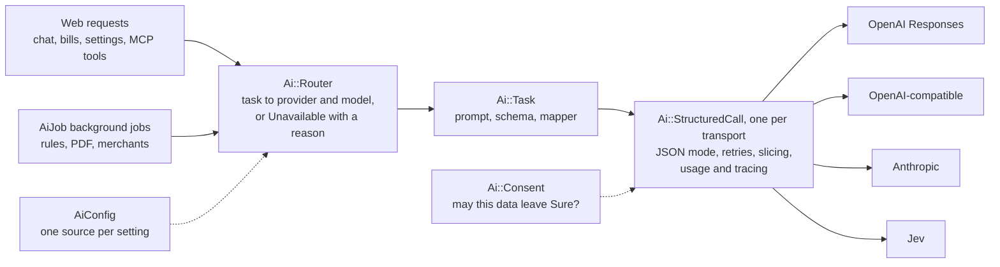

# RFC: AI and ML in Sure v0.8

| | |
|---|---|
| **Status** | Draft for discussion, 2026-10-25 |
| **Author** | @josh-sanders |
| **Discussion** | Discord, and PRs against [#4440](https://github.com/we-promise/sure/issues/4440) |
| **Decision record** | [ADR-0001: one router for every AI call](adr-0001-one-ai-router.md) |
| **Checked against** | `main` @ `445b668d2` (2026-10-25). No AI/ML code changed after the documents' reference commit `2250ba801`. |
| **Built from** | [00](00-ai-ml-block-diagram.md)–[06](06-ai-file-split-review.md), the [Chatwoot lessons](chatwoot-rubyllm-lessons-learned.md), the [consistency check](2026-10-24-consistency-check.md), the [sure.am roadmap](https://sure.am/roadmap) and four [experiments](experiments/README.md) |

IDs such as W, S, P, O-, U, I, BC and F- refer to the source documents and stay stable. This RFC adds G1–G7 (goals), D1–D8 (decisions) and E1–E4 (experiments).

## 1. Summary

Sure's AI layer works, but it grew one feature and one provider at a time. About ten places in the code answer the question "can AI do this here, and with which model?" In 4 of the 9 setups we tried, those answers disagree (E2). On Anthropic-only installs the Enhance merchants button is missing. On some OpenAI setups, chat is offered and every chat turn fails.

This RFC proposes:

1. **One router.** It decides which provider and model serve each AI task, and every feature asks it.
2. **Provider code consolidated behind it,** with one task file per operation instead of one worker class per provider.
3. **Tests and checks that keep it that way:** contract tests first, then invariants as tests and cops.
4. **No change to public boundaries in patch releases** (MCP, API v1, ENV names, stored data). Each breaking change in [05](05-ai-breaking-change-option.md) goes to maintainers as its own ADR and waits for the next minor release.

The first step is small. A 54-line router that delegates to today's code, plus six one-line call-site changes, removed every disagreement in E2 and passed the full unit suite (E4). It fits v0.7.7. The rest follows in the monthly patch releases (§8). §3 defines "finished": eleven measurable rows, each with a check that keeps it true.

## 2. Problem

| # | Problem | Evidence | Source |
|---|---|---|---|
| 1 | **Many places decide which AI applies, and they drift apart.** | 3 provider-resolution paths, `Chat.default_model`, the vector-store default and about 8 availability checks. In E2, 4 of 9 setups get conflicting answers. | 01 B1, 02 A1, D5 I4 |
| 2 | **Provider code is a matrix filled in by hand.** | 3 transports × 7 operations in 12 worker classes. Three helpers are copied 5, 4 and 4 times. One fix comment ("Honors Setting.llm_provider (#2113)") appears 6 times. The declared interface doesn't match the providers (E3). Fixes land one cell at a time, e.g. [#4261](https://github.com/we-promise/sure/issues/4261). | 02 A2, A3, B1, B3; 01 D5.6 |
| 3 | **AI results ignore rule order, and AI mistakes stick.** | AI jobs finish after the rule runner, so rules below them can't see their results. AI locks everything it writes, so later rules and Bayes can't correct it. | 02 A4, A7; 01 D4 #4, #10; 03 §3 |
| 4 | **Operations are hard to predict.** | A provider failure is retried, discarded, recorded or ignored, depending on the job. Four paths call a model on a web thread. Chat and background AI share one worker thread: chat waited 56–104 s behind categorization on one instance. 54 AI env vars, with "ENV > Setting > default" re-implemented in 68 methods and 41 view reads. The web and worker processes resolve them separately. | 02 A5, A6, A8, A9, A12; 01 D3 |
| 5 | **Trust gaps.** | Rule-driven AI ignores a member's AI opt-out. An MCP grant is all or nothing, with no write hints and no audit trail. Any family admin can change instance-wide AI keys and models. | 02 A11, A13; 03 §4 |
| 6 | **Users see mechanisms, not jobs.** | Nine nouns for three jobs. No "why this category?" The debug log is super-admin only. Maybe v0.6.0 upgraders get silent behaviour changes and no guide. | 03 §0, §5, §6, §7.0 |
| 7 | **Contributors copy the nearest example.** | 376 commits from 69 authors in 30 days, mostly agent-written. 342 open PRs. Hot files: `routes.rb` (44 open PRs), `family.rb` (20), `assistant.rb` (14). Invariants live in prose, not checks; `LLMInterfaceTest` declares no tests. | 02 §1, B1–B9; 06 §1; 01 D5.7 |

## 3. Goals

| ID | Goal | Source |
|---|---|---|
| G1 | **One way to reach a model.** Every AI feature asks one router which provider and model serve its task, or why none can. | S1, A1, BC3 |
| G2 | **Less provider code, and every operation on every transport.** | S2, S3, A2, A3, P5, O-B2 |
| G3 | **Enrichment that is honest and correctable.** | A4, A7, S4, S7, S9, BC1, BC2, U4, U10 |
| G4 | **Predictable operations:** declared failure handling, no model calls on web threads, chat that doesn't wait behind background AI, one source per setting. | A5, A6, A8–A10, A12, S5, S6, S8, BC5–BC7, BC9 |
| G5 | **Trust and consent.** | A11, A13, BC8, BC10, U6, U7, U13, U18 |
| G6 | **Users understand AI and can report problems.** | U1–U5, U8, U9, U11, U22–U24 |
| G7 | **Contributors can change AI code safely.** | O-B1, O-B2, O-B5, O-B6, P1, P2, 06 |

### What "finished" means

There are two finish lines.

**The refactor is finished** when every row below holds on `main`. It needs D1 and nothing else: no other decision, no breaking change and no minor release. Each row has a check that keeps it true afterwards.

| # | Measure | Today (`445b668d2`) | Finished | Checked by | Goal |
|---|---|---|---|---|---|
| 1 | LLM provider lookups outside `app/models/ai/` (evals excepted) | 23 call sites in 18 files | 0 | A cop whose allow-list must be empty | G1 |
| 2 | Setups in which entry points disagree about whether AI is available | 4 of 9 (E2) | 0, for every entry point, including ones added later | The E2 agreement test | G1 |
| 3 | Consent and availability as separate checks | `User#ai_enabled?` includes "chat works" | Two checks. Today's consent policy stays until D4. | A test for each | G5 |
| 4 | Provider worker classes and copied helpers | 12 classes. Three helpers copied 5, 4 and 4 times. | One task file per operation, over one structured call per transport. Each helper once. | `LLMInterfaceTest` runs every task on every transport, with bad model output among the fixtures. It has 0 tests today. | G2 |
| 5 | Model calls that record usage, a trace and a correlation id | Each worker opts in by hand. No correlation id. | Every call, recorded by the transport | The same contract test | G4 |
| 6 | AI jobs with a declared lane and failure policy | 2 copy one rescue block, 1 has its own, 2 declare nothing | Every AI job, through `AiJob` | A lane test that finds AI jobs in the code instead of a hand-written list | G4 |
| 7 | Model calls on web threads | 4 paths | Only the health probes, plus MCP `import_bank_statement` unless D6 moves it | A test that fails when a provider is called outside a job | G4 |
| 8 | AI settings read outside one registry | 68 methods and 41 view reads | 0. Every AI setting is an `AiConfig` key that names its source and the process that reads it. | A cop on AI `ENV` reads, and a generated docs table that CI checks | G4 |
| 9 | Chat waiting behind background AI | 56–104 s on one instance (03 §3) | At most the job already running | The [#4444](https://github.com/we-promise/sure/issues/4444) reservation, or an equivalent, and its tests | G4 |
| 10 | Lock and provenance policy | Lock logic in 5 writers, no shared test | One policy that every writer uses | A table-driven test across all writers | G3 |
| 11 | Guidance for contributors | No guide mentions JSON modes, the batch slicer or `Enrichable` | ADR-0001 accepted. `docs/llm-guides/ai-pipeline.md` with recipes. Reference tables generated. | CI fails when a generated table is stale | G7 |

**The proposal is finished** when the refactor is finished and each of D2–D8 has an ADR that was accepted or declined. A declined decision is finished when its ADR says why and the current behaviour is documented where users meet it. An accepted one is finished when it ships in a minor release and meets its own finish line:

| Decision | If accepted, finished when |
|---|---|
| D2 Rule ordering (S4 or BC2) | A rule below an AI step sees its result in the same run (a runner test). |
| D3 AI-set values | AI writes suggestions, one resolver applies them, and "reset AI cache" is gone. |
| D4 Consent | Rule-driven AI follows the chosen policy, with a test for each case. |
| D5 Instance settings | Only super-admins can change instance AI settings (controller tests). |
| D6 MCP contract | MCP offers a read-only scope, write hints and an audit row, and `import_bank_statement` runs in a job (MCP controller tests). |
| D7 Tuning values | Tuning settings live in the database, and the deprecated ENV reads are gone. |
| D8 Chat history | One history path for every provider, and `previous_response_id` is gone. |

The refactor's finish line doesn't depend on when the next minor release comes. The proposal's does.

**Not part of either finish line:**

- G6's user-facing features and per-task models ([#4245](https://github.com/we-promise/sure/issues/4245)). They build on rows 1, 2, 8 and 10, and are tracked as their own issues under the roadmap's "AI controls and transparency" and "Documentation and onboarding".
- A client-library decision (04), new providers, and changes to Bayes or the matcher.

## 4. Non-goals

- A general LLM framework in the LangChain style (02 §5).
- Changing a public boundary without its own ADR, or in a patch release: MCP and API v1 contracts, tool names and schemas, ENV names, job names and queues, stored rows (01 D5).
- Moving Bayes or the matcher to a service, or persisting their models (02 §5, 05 §7).
- Choosing a client library. RubyLLM stays a candidate for the transport layer only, to be decided later on contract-test evidence (04, 05 BC3).
- The product ideas in 03 that aren't AI architecture: plan templates (U15), Firefly III, OFX and CAMT imports (U20, U21), "Coming from…" onboarding (U14). §5 maps them to the roadmap so they aren't lost.

## 5. Fit with the roadmap

The [roadmap](https://sure.am/roadmap) lists 17 priorities in three horizons, with no version numbers: "The order is intentional, but the timing is flexible."

| Roadmap priority | Horizon, status | Goals | Proposal items |
|---|---|---|---|
| Reliability, performance, and technical debt | Short term, in progress | G1, G2, G4, G7 | S1–S3, S5, S6, S8, BC3, BC7, the 06 splits |
| AI controls and transparency | Short term, planned | G5, G6, G3 | U4, U6, U7, U12, U13, U18, U19, BC8, BC10 |
| Documentation and onboarding | Short term, planned | G6, G7 | U1, U2, U22, O-B5, O-B6 |
| Quality-focused release cadence | Short term, planned | G7, G4 | O-B1–O-B4, the PR rules in 05 §5, the staged releases in 05 §6 |
| Web UX/UI polish | Short term, planned | G6 | U3, U8, settings scopes (03 §4) |
| Mobile app planning and delivery | Short term, planned | a constraint | API v1 chats stay stable. One chat history path (BC4) suits [#4421](https://github.com/we-promise/sure/issues/4421). |
| First-class AI | Medium term, exploring | G1, G3, G6 | O-A1 the cascade as a product, per-task models ([#4245](https://github.com/we-promise/sure/issues/4245)), O-A3 provenance, BC1, BC2 |
| Transaction intelligence | Medium term, planned | G3 | W5–W9 as one pipeline, S4 or BC2, U9 |
| Savings, retirement, and investments · Scenario simulation | Medium term | none | 03 §8: plan templates (U15), debt payoff, drawdown |
| Localization and country support | Medium term, planned | none | 03 §7: OFX and CAMT (U20), Firefly III import (U21) |
| External-agent integration and execution | Long term, exploring | G5 | W14, W15, A13, BC8, [#4283](https://github.com/we-promise/sure/issues/4283), [#3025](https://github.com/we-promise/sure/issues/3025) |
| Agent-assisted cleanup and memory | Long term, exploring | G5, G3 | U13, U19, [#3442](https://github.com/we-promise/sure/issues/3442), suggestions as a review queue (BC1) |
| Themes and customization · Polished mobile ecosystem · Improved macOS and desktop experience · Business finance support | — | none | — |

**What this means for the releases.** The roadmap puts "Stabilize and polish the core" before "First-class AI". So the patch releases from v0.7.7 on take the parts that serve the short-term priorities: G1, G2, G4 and G7, plus the policy decisions behind G5. The visible redesign (BC1 suggestions, BC2 pipeline, the cascade as a product) belongs to "First-class AI". It needs maintainer decisions (§10) and a minor release (§8).

## 6. Proposed design

| New interface | Contract | Replaces | Source |
|---|---|---|---|
| `Ai::Router.for(task, family:)`, `.available?(task, family:)` | `Route(provider, model)` or `Unavailable(reason)`. It answers availability, not consent. | 3 resolution paths, `Chat.default_model`, about 8 availability checks, the Enhance button's OpenAI-only check | S1, BC3 |
| `Ai::Task` | `prompt_key`, `schema`, `build_input`, `map_output`, `unit`, `budget`. One file per operation. | 12 provider worker classes | S2, BC3 |
| `Ai::StructuredCall` | One per transport. It owns JSON mode and fallback, think-tag stripping, forced tool use, retries, slicing, usage and tracing. | the copies in each worker, `BatchSlicer`, 3 batching layers | S2, S3 |
| `AiJob` | Declares its lane, a failure policy (`retry`, `discard` or `record`) and a per-family concurrency key. | copied `RuleRun` rescue blocks (01 D5.6 drift 5) | S5, BC7 |
| `AiConfig.key` | `env:`, `setting:`, `default:`, `clamp:`, scope, and which process reads it. It generates the permit list, the docs table and an effective-configuration view. ENV names stay. | 68 methods and 41 view reads | S6 |
| `Ai::Consent.allowed?(task, family:, user:, account:)` | One policy check before data leaves Sure. The policy is a maintainer decision (D4). | the per-feature gates | BC10 |

**Unchanged in patch releases** (the boundaries in 01 D5): `Enrichable` lock semantics (I9), rule action keys and rule order (I10, I11), tool names and schemas (I16), job names and queues (I23), HTTP and MCP endpoints (I25), ENV names (I26), stored AI data (I27).

**Principle** (02 §4): *centralize mechanisms, decentralize declarations.* The router, structured call, batching, failure policy and config are single and well tested. Operations, prompts, schemas, rule actions and tools stay small files that are safe to copy.

## 7. Alternatives considered

| Option | What it means | Verdict |
|---|---|---|
| A. Fix bugs where they appear | For example, make the Enhance button call `preferred_llm_provider`. | Cheapest today, but the next provider or feature repeats the bug. The six copies of the [#2113](https://github.com/we-promise/sure/issues/2113) fix show the pattern. No path to per-task models. |
| **B. Incremental and boundary-first** | This RFC: the router first, then tasks, behind contract tests. Breaking changes one ADR at a time. | **Proposed.** Each PR is small and revertible. E4 shows the first step passes the full suite. |
| C. The breaking-change option all at once | 05 BC1–BC11 over releases N, N+1 and N+2. | The cleanest end state, but it bundles six maintainer decisions, reverses [#4310](https://github.com/we-promise/sure/issues/4310), and breaks operators' env files and MCP clients together. Kept as a menu: each BC can be approved on its own. |
| D. RubyLLM for every model call now | 04's thought experiment. | Removes about 5,000 lines (an estimate) and most transport upkeep. Sure would still own the router and the JSON-mode policy, and would depend on a large library with fast major versions. Chatwoot's migration shows a client swap alone doesn't make an app multi-provider. Revisit per transport, behind the same contract tests. |
| E. A long-lived refactor branch | Rewrite the layer on a branch and merge once. | Rejected. With 342 open PRs the branch would rot, and reviewers would face one huge diff. |

## 8. Migration plan

**Rules for every PR** (05 §5): one PR touches one D5 interface. Moves stay separate from behaviour changes. Contract tests land before the code they protect. New code lands unused first. Deletion is its own PR.

| Phase | Deliverables | Done when | Rollback |
|---|---|---|---|
| **0. Safety nets** | Contract tests in 01 D5.7 order: the I9 lock policy, a shared I1/I2 LLM contract (fill `LLMInterfaceTest`), an I23 lane test derived from the code, I10 executors, I6 vector adapters (plus a Qdrant test), `AssistantResponseJob`. The E2 agreement test, kept as a permanent test. | All on `main` and green. They describe today's behaviour, drift included. | Tests only |
| **1. One router** | ADR-0001 accepted. `Ai::Router` delegating to today's code. Call sites move one PR each: availability checks first (as in E4), then model calls. Consent split from availability. A cop that blocks new LLM provider lookups outside `app/models/ai/`, with today's call sites on an allow-list. The `AiJob` base, one job per PR. The `AiConfig` registry with today's precedence. The pure-move splits from 06 §4 a. | The E2 agreement test passes for all setups. The cop's allow-list is empty. | Revert one PR |
| **2. Consolidation** | Tasks one at a time, smallest first: `bill_setup`, `enhance_merchants`, `detect_merchants`, `categorize` (with Jev and shadow runs), `extract_pdf`, then `chat`. Each PR deletes the worker classes it replaces. Model calls on web threads move to jobs (S8); MCP `import_bank_statement` waits for D6. | Each copied helper exists once. Every task passes the shared contract on every transport. | Revert one PR. The old worker stays until its deletion PR. |
| **3. Decisions** | ADRs for D2–D8. Accepted ones ship as boundary changes in a minor release, with migrations and release notes (05 §6). | Each ADR accepted or declined | Per ADR |
| **4. Cleanup** | Remove the delegating code. Generated reference docs (O-B4). `docs/llm-guides/ai-pipeline.md` with recipes (O-B5). | Every row of the refactor's finish line (§3) holds. | — |

### Timing

Sure ships a patch release at the end of every month, with alphas in between. v0.7.7 is due 2026-11-30. Here "v0.8" means the next minor release, and its date is open: patch releases may continue past v0.7.9 to v0.7.10, v0.7.11 and on. So the plan ties work to the kind of release, not to a version number.

| Release | Theme | Work |
|---|---|---|
| **v0.7.7**, due 2026-11-30 | Stop the drift | Phase 0. D1 decided in the first week of November. The delegating router and the availability call sites (the E4 spike), with consent split from availability. The cop, once the AI PRs already queued for v0.7.7 have merged. |
| **The patch releases after it** | Consolidate | The rest of Phase 1: model calls through the router, `AiJob`, `AiConfig`. Phase 2, one task at a time. D2–D8 decided as ADRs. Non-breaking groundwork for accepted ADRs: new tables, dual writes, flags, deprecation warnings. As many releases as it takes, with no boundary changes. |
| **The next minor release (v0.8)** | Decide and break | The Phase 3 switches for accepted ADRs, with migrations and release notes. Removal of whatever was deprecated. Phase 4 can finish here or later. |

Why this split:

- **The v0.7.7 window is about three weeks.** v0.7.6 occupies maintainers until Oct 31, and code should reach a late alpha, so v0.7.7 merges land Nov 1–23. The router PR should merge by about Nov 15.
- **It matches the project's review speed.** 44 AI-core PRs merged in the two months to 2026-10-24. The median took 2.5 days from opening to merge (2.0 days under 500 changed lines, 5.4 above), but a quarter took longer than 9.6 days and a tenth longer than 16.6. The v0.7.7 slice is five or six small, dependent PRs. Phase 2 is six large ones in sequence, which doesn't fit three weeks.
- **The v0.7.7 slice fixes visible bugs:** the missing Enhance button on Anthropic-only installs, chat offered where it can't answer, and the W24 gate.
- **Patch releases can't break boundaries, and the next minor release has no date.** Nothing before Phase 3 depends on it. Accepted ADRs ship their groundwork in patch releases; only the switch waits.
- **Pure-move splits land only in the first week after a release,** so every open PR gets a whole cycle to rebase. The first window is Nov 1–7.

Maintainers set the milestones.

**Work in flight that this plan absorbs:**

| PR or issue | Where it fits |
|---|---|
| [#4444](https://github.com/we-promise/sure/issues/4444) *(open)* hold back AI jobs while someone writes a chat message | BC7 chat reservation (G4) |
| [#4283](https://github.com/we-promise/sure/issues/4283) *(open, v0.7.6)* MCP-only `mcp` scope | BC8 step 1 (G5) |
| [#3025](https://github.com/we-promise/sure/issues/3025) *(open, v0.7.7)* MCP CRUD tools | needs per-tool surfaces (BC8) |
| [#4245](https://github.com/we-promise/sure/issues/4245) *(issue, open)* separate LLM settings for chat and background jobs | a router setting (G1) |
| [#3694](https://github.com/we-promise/sure/issues/3694) *(open, v0.7.7)* model suggestions, [#3605](https://github.com/we-promise/sure/issues/3605) *(open, v0.7.7)* reasoning effort | Build on the router if it lands first. Otherwise merge as they are, before the cop, and Phase 2 absorbs their per-provider code. Don't hold them back for the refactor. |
| [#3442](https://github.com/we-promise/sure/issues/3442) *(open, v0.7.7)* weekly cleanup chat | Another way into chat, so it needs the same check as chat: `available?(:chat)` once the router exists |

## 9. Evidence from experiments

All four ran on `main` @ `445b668d2` with the project's test setup. The patch and full tables are in [experiments/](experiments/README.md).

**E1. Recount.** The documents' numbers hold: helpers copied 5 / 4 / 4 times, the [#2113](https://github.com/we-promise/sure/issues/2113) comment copied 6 times, `LLMInterfaceTest` empty, `vector_store_chunks` missing from `db/schema.rb`, 5 AI jobs listed by hand in the lane test, and 41 ENV reads in the AI settings views.

**E2. Do the paths agree?** One integration test sets nine configurations and asks every path. For the Enhance button it renders the Merchants page. On `main`:

| Setup | What happens |
|---|---|
| Anthropic key only, with or without `LLM_PROVIDER=anthropic` | The Enhance merchants button is not rendered, though the enhancer job would use Anthropic. This confirms 01 D4 #1. |
| OpenAI-compatible URL, model left blank | Chat is offered, but no provider accepts `gpt-4.1`, so every chat turn fails. Every other AI feature is hidden. |
| OpenAI key with `OPENAI_MODEL=o4-mini` | Chat and "Dig in with AI" are offered, but chat's allow-list rejects `o4-mini`, so every turn fails. Categorization, merchant detection and bill smart-fill don't check the allow-list, so they go ahead with `o4-mini`. |

E2 also shows that the vector-store default follows the `LLM_PROVIDER` setting rather than the configured keys. The same Anthropic key gives no store, or pgvector, depending on that setting.

**E3. Declared vs actual interface.** Reflection confirms 01 D5.6 drift 1–3. `LlmConcept` declares positional `auto_categorize(transactions)`, but every provider takes keywords (`transactions:, user_categories:, model:, family:, json_mode:`). `extract_bank_statement` isn't declared at all. Jev includes only `ClassificationConcept`, yet implements the same `auto_categorize`.

**E4. How big is the first step?** A delegating `Ai::Router` (54 lines) and six one-line changes moved the Enhance button, chat availability, the bill and "Dig in" helpers, and the two AI rule-action offers onto it.

- E2 then found **no disagreements** in any of the nine setups.
- The full unit suite gave **13,163 runs, 0 failures, 0 errors** and 36 skips, the same as `main`.
- One existing test needed a one-line change. It stubbed `Provider::Registry.preferred_llm_provider` to make "Dig in" appear, and "Dig in" now asks whether chat can answer.

What the spike taught:

1. **Delegate first.** The suite stubs today's resolution methods 87 times. A router that calls those methods keeps every one of those tests working. A rewrite would break them all at once.
2. **Split consent from availability.** `User#ai_enabled?` is `ai_enabled && ai_available?`, and `ai_available?` really means "chat works". Once chat availability became honest, bill smart-fill disappeared in the `o4-mini` setup, although the bill suggester works there. Phase 1 has to separate the two.
3. **01 missed a workflow.** `Bills::AiReviewsController` ([#3202](https://github.com/we-promise/sure/issues/3202)) starts a chat from the bills page, but it is gated by the bill-AI check, which looks at the batch provider. It is now [W24](01-ai-ml-workflow-map.md#w24-bills-ai-review) in 01, and it should be gated on the `chat` task.

## 10. Decisions for maintainers

| # | Decision | Options | Source |
|---|---|---|---|
| D1 | Adopt ADR-0001: the router first, no boundary changes in patch releases. Needed in the first week of November for v0.7.7. | accept, amend or decline | this RFC |
| D2 | How AI results reach the rules below them | S4 phases (classifiers stay rules), or BC2 pipeline before rules (reverses [#4310](https://github.com/we-promise/sure/issues/4310)) | 02 S4, 05 BC2 |
| D3 | What an AI-set value is | locked, as today, or a suggestion that one resolver applies | 05 BC1, 03 U10 |
| D4 | Consent for background AI | per user (skip the accounts of members who opted out), or one household decision with a notice to every member | 04 Q4, 05 BC10, 03 U7 |
| D5 | Who edits instance AI settings | any family admin (today), or super-admins only | 03 U6, 04 Q5 |
| D6 | The MCP contract | a read-only scope and write hints now, alongside [#4283](https://github.com/we-promise/sure/issues/4283), or later | 02 A13, 05 BC6, BC8 |
| D7 | ENV for tuning values | keep ENV and show each value's source (S6), or move tuning into the database (BC5) | 02 S6, 05 BC5 |
| D8 | Chat history | keep `previous_response_id` chaining, or always rebuild from the database | 05 BC4 |

Each "yes" to a breaking option gets its own ADR, release note and migration. Agreed items become issues that link back here by ID.

## 11. Risks

| Risk | Mitigation |
|---|---|
| A half-migrated architecture, with old and new resolution side by side for months | The router delegates from day one, so there is one entry point before the internals change. A cop blocks new direct lookups. The finish line in §3 is the exit criterion. |
| Reviewer capacity, with 342 open PRs | Small PRs, one interface each. CODEOWNERS on the seams (O-B8). Mechanical steps filed as `good-agent-task` issues (O-B9). |
| Behaviour changes hidden inside a refactor | Moves stay separate from fixes. E2 lists exactly which screens change: the Enhance button on Anthropic-only installs, and chat hidden when no provider accepts the model. Each goes into the release notes. |
| Tests pinned to the old methods (87 stubs) | Delegate first. Move each stub to the router when its call site moves. |
| A client library brings its own churn later | Contract tests decide (04 Q18). Pin it and give it one owner (Chatwoot lessons 2, 3 and 6). |
| The next minor release is far off, or its date keeps moving | Nothing before Phase 3 needs it. Accepted ADRs ship their groundwork and deprecation warnings in patch releases; only the switch waits. |

## 12. Source documents

| Document | Use it for |
|---|---|
| [00](00-ai-ml-block-diagram.md) block diagram | the map of blocks and models |
| [01](01-ai-ml-workflow-map.md) workflow map | W1–W24, quirks (D4), the interface register and test gaps (D5) |
| [02](02-ai-architecture-review.md) architecture review | A1–A13, S1–S10, O-B1–O-B9, P1–P5 |
| [03](03-ai-user-perspective-review.md) user review | personas, settings scopes, Maybe upgraders, U1–U24 |
| [04](04-rubyllm-thought-experiment.md) RubyLLM thought experiment | the library question, Q1–Q19 |
| [05](05-ai-breaking-change-option.md) breaking-change option | BC1–BC11 and how to split each into PRs |
| [06](06-ai-file-split-review.md) file splits | F-H, F-M, F-R and when to split |
| [Chatwoot lessons](chatwoot-rubyllm-lessons-learned.md) | what a library migration cost another Rails app |
| [Consistency check](2026-10-24-consistency-check.md) | which numbers were re-verified |
| [experiments/](experiments/README.md) | E1–E4: method, patch, full results |
