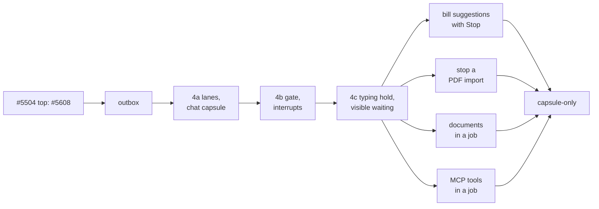

# After #5504: one stack and five feature PRs (delivery plan)

**Companion to:** [`ai-plumbing-redesign.md`](ai-plumbing-redesign.md) §19 (PRs 3 and 4),
[`pr-4-sequencer.md`](pr-4-sequencer.md), [`pr-3-off-the-web-thread.md`](pr-3-off-the-web-thread.md)
(3b–3d), [`ai-generation-outbox.md`](ai-generation-outbox.md) and
[`rubyllm-workbench-comparison.md`](rubyllm-workbench-comparison.md). Those plans hold the design and
the steps. This one holds how they're cut into PRs, the branches, and what changed since they were
written.
**Status:** planned 2026-11-24, nothing built. Code references are to `feat/ai-5077-followups` at
`14ae81544` (the top of stack #5504) and RubyLLM 2.2.3.

**Summary.** Nine PRs, cut by feature (Luis's suggestion; call by @josh-sanders, 2026-11-24). The
plumbing is one stack: the outbox, then the sequencer in three parts. Four feature PRs are each
based on the sequencer's last part and land in any order. Capsule-only comes once all four are in.
It all starts from the top of #5504, so it can land shortly after it. Bug fixes still go on #5504
and are merged up. No decision already made changes here, except the three this plan records as
new calls (O1, O4 and M2 in §3e).

## 1. Nine PRs

| PR | Branch | Worktree | Plan | Replaces |
|---|---|---|---|---|
| Outbox | `feat/ai-generation-outbox` | `~/src/sure-ai-outbox` | [`ai-generation-outbox.md`](ai-generation-outbox.md) | giving a rule run's count back (`release_ai_job!`) |
| 4a Lanes and the chat capsule | `feat/ai-4a-lanes` | `~/src/sure-ai-4a` | [PR 4](pr-4-sequencer.md) steps 0–2 | `ai_high_priority`/`ai_low_priority` |
| 4b The gate and interrupts | `feat/ai-4b-gate` | `~/src/sure-ai-4b` | [PR 4](pr-4-sequencer.md) steps 3–4 | nothing: a local host gets one queue of callers |
| 4c Typing hold and visible waiting | `feat/ai-4c-typing-hold` | `~/src/sure-ai-4c` | [PR 4](pr-4-sequencer.md) steps 5–9 | #4444's fetch class, the hold after each reply |
| Bill suggestions with Stop | `feat/ai-bill-suggestions` | `~/src/sure-ai-bills` | [PR 3](pr-3-off-the-web-thread.md) steps 3–4, and step 5's suggestion half | `AiSetupSuggester` on the web thread |
| Stop a PDF import | `feat/ai-stop-pdf-import` | `~/src/sure-ai-pdf-stop` | [PR 3](pr-3-off-the-web-thread.md) step 5's import half | nothing: a running import couldn't be stopped |
| Documents in a job | `feat/ai-document-indexing` | `~/src/sure-ai-docs-job` | [PR 3](pr-3-off-the-web-thread.md) step 6 | document embedding on the web thread |
| MCP tools in a job | `feat/ai-mcp-tool-job` | `~/src/sure-ai-mcp-job` | [PR 3](pr-3-off-the-web-thread.md) step 7 | the two MCP AI tools' model calls on the web thread |
| Capsule-only | `feat/ai-capsule-only` | `~/src/sure-ai-capsule` | [PR 3](pr-3-off-the-web-thread.md) step 8 | nothing: turns the check on |

**The sequencer in three parts** (call by @josh-sanders, 2026-11-24; as one PR it was estimated at
1,800–2,500 changed lines). Each part replaces something whole:
- **4a** (steps 0–2):
  - the three lane queues, with the old two drained for one release, and the `ai_chat` capsule;
  - queue names only in `Ai::Routes`, health on the new queues, and `Ai::Sequencer.with_lane`;
  - `VectorStore::RequeueIndexPollsJob` moves to `ai_background` in `config/schedule.yml`;
  - the baseline measurement (step 0).

  On its own, 4a already gives chat its own thread.
- **4b** (steps 3–4):
  - `Ai::Gate`, with the connection close proved first by the stub-server test;
  - the local connect timeout;
  - streamed local generations, `Busy` and `Preempted`.
- **4c** (steps 5–9):
  - the typing hold in the gate, which deletes `ChatReservation::Fetch`;
  - chat's temporary gate lines (PR 6 deletes them), the watchdog and the bubble;
  - the docs and the after-measurement.

**Why the features are split.** Each replaces one thing, and each needs different reviewers.
- **Stopping a bill suggestion stays with suggestions.** It's a few lines on the suggestion's own
  record.
- **Stopping a PDF import is a feature of its own:**
  - the import status and everything that lists it;
  - `ProcessPdfJob`'s checks;
  - a controller and the import page.
- **Documents and the MCP tools share nothing.** The MCP PR also depends on how #5708, #3580,
  #4182 and #4283 land, so it mustn't hold up the others.
- **There's no proxy PR.** That's jaysbeekay's #5487 (§3b).

**Why the features come after 4c.** Every feature needs the sequencer (PR 3's decision 9). Before
it, interactive jobs wait behind background work on a local model, which is slower than today's
web thread. The features don't need each other.
- **The cost:** a change in the sequencer is merged into four branches, not one. So the sequencer
  goes through review before the feature PRs leave draft.
- **Expected conflicts between features,** resolved by whichever lands second: `ai_lane_test.rb`,
  `ai-pipeline.md`, `Ai::Requesters::CLASSES`, locale files and `AiTestHelper`.

**Why the outbox comes first.** It's small, it finishes #5077's last "two failures in a row" case,
and it's the stack's answer to #5710's first finding. 4b's `Busy` re-enqueue then puts the job
back in `next_job` rather than relying on a bare `perform_later`. Nothing in the outbox depends on
the sequencer.

### Size

These are estimates before anything is built. They count changed lines (added plus deleted),
including tests and excluding locale files.

| PR | Estimate |
|---|---|
| Outbox, with the merchant lease and O1–O6 | 600–900 |
| 4a | 500–800 |
| 4b | 900–1,200 |
| 4c | 500–800 |
| Bill suggestions with Stop | 1,000–1,300 |
| Stop a PDF import | 300–500 |
| Documents in a job | 300–500 |
| MCP tools in a job | 700–1,000 |
| Capsule-only | 600–900, mostly one line in each of about 60 test files |

A PR whose built diff goes over 2,000 lines is split at a step boundary before review.

## 2. Base, branches and landing

- **Before branching,** merge `main` into `refactor/ai-plumbing` and carry it up #5504 with merges,
  as on 2026-11-23. It's 28 commits behind, with 19 conflicting files from #5709 and the PDF and
  document changes.
  - The features need three things from that merge: #4975 (bill suggestions), #5701 (MCP tools)
    and #5709's consent levels (all of them).
  - If #5710 has landed by then, follow the checklist on #5077
    ([comment 7120007621](https://github.com/we-promise/sure/issues/5077#issuecomment-7120007621)).
- **Branches live on `we-promise/sure`.**
  - **The stack** (outbox → 4a → 4b → 4c) is a `gh stack` based on `feat/ai-5077-followups`. When
    #5504 lands, it is retargeted to `refactor/ai-plumbing`.
  - **The four feature PRs** are plain PRs based on `feat/ai-4c-typing-hold`. Each retargets when
    4c lands.
  - **Capsule-only** is based on `refactor/ai-plumbing` once the four are in.
- **Bug fixes stay on #5504** (#5477, #5663 and any others). Each is merged up, first into the
  stack and then into each feature branch. No force-push; rerere is on.
- **Into `main`:** through `refactor/ai-plumbing`, as #5504 does, so CodeRabbit's 300-file limit
  and the upgrade note stay in one place. Any PR can be the place to stop. No PR needs one from
  later in the order.
- **CodeRabbit** doesn't review on a non-`main` base by itself, so each round needs an
  `@coderabbitai review` comment.
- **The old local branch.** `feat/ai-4-sequencer` is an empty placeholder at 2f's `d55dc808a`,
  with no sequencer commits, and isn't used.

## 3. What changed since the plans

### Outbox

- **As planned in [`ai-generation-outbox.md`](ai-generation-outbox.md), plus O1–O6 (§3e)** and
  the merchant lease (§3a).
- **#5710's findings, checked against the stack:**
  - *Finding 1* (a batch that can't be queued, and recording that fails too): the outbox removes
    the case.
  - *Finding 2* (retries run out before the run is loaded):
    - A database error while loading the run makes `give_up` raise again, so the job fails
      without clearing `next_job`, and delivery brings it back.
    - With O1, a job lost later in its step is delivered again too.
  - *Finding 3* (an `Ai::Error` in neither list): the stack already gives up on it
    (`rescue StandardError → give_up`).
  - *Finding 5* (a replay calls the model again): the outbox's stated limit; the step claim stops
    the second commit.
- **If #5710 lands first:** its `fail_unqueued_job` and `settled_job_ids` go in the main merge
  (the #5077 checklist), and its two-job tests are ported there. This PR then deletes #5608's
  give-back.
- **#5477 (jaysbeekay, on #5608)** changes how a mixed rule counts its ordinary changes. Merge it
  up before building, so the outbox's one transaction counts `transactions_awaiting_ai` the way
  #5477 leaves it.
- **The delivery job runs on `scheduled`,** not on an AI queue. It never calls a model, so the
  capsule check and the lane test don't treat it as AI work.

### 4a, 4b, 4c

- **Base:** the outbox, not 3a-tidy. 3a, its editor's pass and its test trim are all in #5504.
- **`Busy` and the step claims (4b).**
  - `Busy` is raised before the step commits, so the claim isn't taken.
  - The job writes its own arguments back to `next_job`, sets `updated_at`, and re-enqueues with
    `wait: rand(5..15)`. If that queuing fails, delivery brings it back.
  - A `Busy` re-enqueue never counts as a delivery or a step.
- **`Busy` and `Preempted` in the job's rescues (4b).** They are rescued before `RETRIED`,
  `DISCARDED` and `StandardError` (`generation_job.rb:27–67`); otherwise `Busy` would give up.
  Neither is added to `RETRIED`, which would spend the 5 attempts.
- **#5521's windows (4b).** A `Busy` re-enqueue keeps its window, since nothing was examined. A
  test runs a windowed `categorize` through `Busy` and checks the window's counts.
- **`config/schedule.yml` (4a).** `VectorStore::RequeueIndexPollsJob` names `ai_low_priority`, so
  it moves to `ai_background`. `ai_lane_test` also checks the queues `schedule.yml` names.
- **Steps 0 and 9** (the measurements) run on venus, with one local model and one test at a time.

### Bill suggestions

- **#4975 (merged): "Once" frequency.** Its branch in `apply_suggestion` moves into
  `Suggestion#apply_to` (PR 3's step 4 already says so).
- **#5709 (consent).** `bill_setup`'s consent level comes from `Ai::Routes::MATRIX`.
  - The suggestion stores `user_id`, and the job checks
    `Ai.available?(:bill_setup, family:, user:)` again when it runs.
  - If that's denied, the suggestion is `failed` with the router's reason, and the dialog shows it.
- **The gate's cancel point (§12)** gets its first caller here or in Stop a PDF import, whichever
  lands first. Neither needs the other.

### Stop a PDF import

- `ProcessPdfJob` rescues `Ai::Error::Cancelled` before its other rescues and leaves the status
  `cancelled` (PR 3's step 5).
- The API's import status lists and the rswag schema gain `cancelled`. That follows the
  AGENTS.md rule for API changes.

### Documents in a job

- **#3717, #3735, #4516 and #4512 are still open.** PR 3's table handles them: each upload goes
  through `upload_document_later`, and duplicates are adopted when the pending row is created.

### MCP tools in a job

- **#5701 (merged)** removed `Family#search_documents`, and it limits `search_family_files` to
  statements the user can see.
  - `Ai::ToolJob` runs the function as the user, so that limit carries over.
  - Step 7's references to `search_documents` change to the function's own call.
- **#3580, #4182, #4283 and #3025 are still open.** PR 3's table stands.

### Capsule-only

- **As planned.** The completion-hook test also covers the outbox: a run that's delivered again
  still reports `ai_finished` exactly once.

## 3a. What #5077 adds

Each item below closes or narrows a #5077 item. Tick it there when its PR lands.

- **Outbox:** closes "Release a rule run's awaited count when releasing it fails too".
- **Outbox:** takes "Merchant enhancement lease owned by its run".
  - The outbox makes this worse: the Enhancer's 10-minute boolean lock runs out while delivery
    waits an hour, so a second run can start (outbox §4).
  - The boolean lock goes. The lease becomes "an unfinished `enhance_merchants`
    `Ai::GenerationRun` exists for the family", and it ends when the run ends or the 7-day sweep
    deletes it.
- **4b:** debug logging of streamed chunks. This extends "RubyLLM's debug logging" in
  [comment 7094950626](https://github.com/we-promise/sure/issues/5077#issuecomment-7094950626).
  - Streaming brings in RubyLLM's `log_stream_debug`. With `RUBYLLM_STREAM_DEBUG` set, it logs raw
    chunks whatever `log_bodies` says (`protocol/streaming.rb:120,160`), so statement content
    would reach the log.
  - `config/initializers/ruby_llm.rb` sets `config.log_stream_debug = false` next to
    `log_bodies = false`, and contexts take it from there.
  - Test: with `RUBYLLM_STREAM_DEBUG=1`, no chunk text reaches a captured logger.
- **4b:** down marks (the same comment). `Busy`, `Preempted` and time waiting at the gate are
  never down marks, so the "60 s down mark for every family" item doesn't get worse. Its length
  stays open on #5077.
- **4b:** usage rows. A preempted request isn't shown as a failed request on the usage page, and
  it isn't attached to another request's row. This is the same per-request id question as
  "Attach each failed request's error to its own usage row", and it's fixed only if `Preempted`
  runs into it.
- **Bill suggestions:** takes "P2 · Make bill AI consent available with chat disabled" (from
  #4774).
  - The new dialog replaces the message that sends opted-out members to an assistant that is
    hidden in `mcp_only`. It shows the consent control itself.
  - This is checked against #5709's consent levels.
- **Stop a PDF import:** narrows "fencing stale PDF import and poll jobs"
  ([comment 7059291574](https://github.com/we-promise/sure/issues/5077#issuecomment-7059291574)).
  - Result and status writes apply only while the import is `importing` (and its reread token
    matches, where there is one), under the row lock, so a job that resumes after Stop can't
    overwrite `cancelled`.
  - The team's decision on a token for every attempt stays open.

**Left out:**
- **Prompt items** (the Anthropic bill-setup weekday numbering, the categorize, merchant and PDF
  prompts) and the bisection retry. They change prompts or generations, are measured with evals,
  and aren't part of these features.
- **"Check account access again at each generation step"** (from #5700). It waits for #5700; then
  it's a small PR of its own, which fits the outbox's run arguments.
- **The Cloudflare health check, loopback aliases, `native_schema`/`multipleOf` and the pricing
  note.** They're unrelated.

**Translations:** new strings get English and German. The other locales are listed on #5077 for a
translation PR, as 3a's were
([comment 7075000390](https://github.com/we-promise/sure/issues/5077#issuecomment-7075000390)).

## 3b. jaysbeekay's proxy work (#5487, #5488)

It's not a dependency in either direction.
- #5487 keeps `ProxyNetHttp#build_connection`, where 4b records each request's connection, and
  changes only `proxy_for` and `net_http_proxy`.
- #5488 covers non-AI providers.

They meet in five places:
- **4b's `/props` ask is a new outbound call.**
  - Built on a bare `Net::HTTP`, it would be #5192's bug, and #5487's
    `outbound_proxy_contract_test` would fail.
  - It goes through `Ai::Transport::Http`'s Faraday connection, which resolves the proxy today and
    uses `ProxyConfigurable` after #5487 with no edit. That keeps one resolver, which is #5192's
    goal.
- **Interrupting a call through a proxy.**
  - A local host that isn't loopback and isn't in `NO_PROXY` is reached through the proxy
    (Pipelock on venus). Closing our socket then closes the connection to the proxy, and the slot
    is freed only if the proxy also closes its connection to llama.cpp.
  - 4b's stub-server test runs through a stub proxy as well as direct, from the start.
  - On venus with Pipelock, llama.cpp's `requests_processing` should drop after an interrupt.
  - If it doesn't, the docs tell admins to put local model hosts in `NO_PROXY`.
- **The connect timeout through a proxy.**
  - 4b's 10-second `connect_timeout` covers only connecting to the proxy.
  - A dead local host behind a proxy answers 502 or 504 after the proxy's own timeout, and holds
    the gate slot until then.
  - The docs say so, next to the `NO_PROXY` advice.
- **Fail-closed meets the stack's retries.** For the #5487 merge, not this stack's code.
  - #5487 raises `Ai::Error::Unreachable` for an unreadable proxy URL, meaning "never retried".
  - On the stack, `Unreachable` is retried 5 times (`RETRIED`) and marks the whole server down
    (`down_marks.rb:47`).
  - A line goes in the #5077 checklist
    ([comment 7102107617](https://github.com/we-promise/sure/issues/5077#issuecomment-7102107617)):
    map it to an error that isn't retried and isn't a down mark (such as `Unavailable`), or
    accept the retries.
  - 4b reads the proxy setting before waiting at the gate, so a broken setting fails at once, not
    after queueing behind chat.
- **Nothing else here opens a connection.**
  - The outbox only queues jobs.
  - The tool job and the document job call existing transports.
  - The gate's state is in Sidekiq's Redis.

## 3c. dgilperez's open PRs

These were checked by the files each PR changes. None is a dependency; whichever lands second
adapts.

- **#5711 (chat Retry replays tool calls; `responder.rb`, `chat.rb`):**
  - **A small conflict at most.** 4c's gate lines wrap `llm.chat_response` in `request_response`,
    and #5711 edits `history_messages` and `opening_request`.
  - **The watchdog.** 4c's watchdog reads the gate before giving up on a reply, and #5711
    replaces its "delete or mark failed" with `AssistantMessage#abandon!`. If #5711 lands first,
    4c calls `abandon!`, and a reply still waiting at the gate is never abandoned.
  - **The hold after each reply.** 4c deletes it (`chat.rb:147`), next to where #5711 makes
    `ask_assistant_later` return the pending reply.
  - **PR 6** still ports #5711's tests.
- **#5710 and #5700 (rule AI jobs):**
  - The outbox replaces both ways of handling a batch that can't be queued.
  - `RuleAiJob` is deleted in the main merge, so 4a's queue rename never sees it.
  - 4b rescues the new `Busy` and `Preempted` before the retry lists (#5710's finding 3).
  - "Check access at each step" from #5700 is its own PR after #5700.
- **#5697, #5269 and #5413 (import access; `import.rb`, the imports controllers):**
  - **MCP tools.** The new "return the existing import" path runs after #5697's `manageable_by?`
    check, so a retry can't hand a non-manager an import.
  - **Stop a PDF import.** The Stop action uses the same access check as the import's other
    actions after #5697 and #5269.
- **#5708, #5693 and #5696 (`mcp_controller.rb`):**
  - `ai_feature` sits next to #5708's annotations.
  - `Ai::ToolJob` runs only what `tools/call` already authorized after their checks.
  - When the job runs, it checks again that the user is active and that `Ai.available?` holds.
- **#5121 (family time zone):** it touches `sidekiq_health.rb`, as 4a does. A small conflict at
  most.
- **No interaction:** #5734, #5699, #5715, #5713, #5694, #5698, #5634, #5412, #5428 and #5372.

## 3d. Working with others

| Who | PR | How we work together |
|---|---|---|
| dgilperez | #5710, #5700, #5711, #5697, #5708 | §3c. When the outbox opens, add a line to #5710 linking it. |
| jaysbeekay | #5477 (on #5608) | Merged up before the outbox is built. |
| jaysbeekay | #5487, #5488 | §3b. |
| arvind2109 | #5496 (rule-run counts on `main`) | Comes in through the main merge. |
| luis-ibanez | #5663 (to restack on #5504) | A bug fix on #5504; no overlap here. |

Open each PR as a draft, with "Stacked on" or "Based on" and a link to this plan. Ping an author
only on their own PR, and only where a change of theirs moves. Never ping @jjmata.

## 3e. Lessons from rubyllm-workbench

[`yorzi/rubyllm-workbench`](https://github.com/yorzi/rubyllm-workbench) was reviewed at `3c9162d`;
upstream has only a Ruby bump since (`816d6c7`, 2026-11-20). Workbench has no lanes, gate,
interrupt or capsule check. For those parts, the lessons are about RubyLLM 2.2.3 itself, checked
in the gem. O1, O4 and M2 are calls by @josh-sanders, 2026-11-24; the rest follow from the plans.

**Outbox** (written into [`ai-generation-outbox.md`](ai-generation-outbox.md)):
- **O1. `next_job` stays until the step commits.**
  - Today a step clears `next_job` when it starts (`generation_job.rb:39`), so a job lost after
    starting is never delivered again. Workbench catches that case by lease expiry
    (`agent_run_delivery_dispatcher_job.rb:100-124`).
  - The commit that claims a step now writes the next step's `next_job`, or deletes the run.
  - The one-hour idle check tells a live step from a dead one: each step touches the run when it
    loads, and a step takes minutes at most.
  - The cost: a replay of the step before can queue a second copy of a running step. The claim
    stops it at commit, but the model is called twice. Workbench states the same limit
    (`docs/ARCHITECTURE.md:457`).
- **O2.** The idle check compares `updated_at` with the database's `now()` in SQL, so an app
  server's clock doesn't matter.
- **O3.** Deliveries are counted atomically (`UPDATE … WHERE … deliveries < 3 RETURNING`), so two
  overlapping cron runs can't both pass the cap.
- **O4. After 3 deliveries, the run gives up through its requester** (`ai_failed`: "couldn't be
  queued"). Before this, a run was left to the 7-day sweep, which never tells the requester, so a
  rule run stayed pending. Workbench fails such work with a reason the user sees
  (`media_run_recovery_job.rb:39-52`).
- **O5.** Each redelivery and each give-up writes a `DebugLogEntry`. `SidekiqHealth` counts runs
  whose `next_job` has been idle for over an hour, as Workbench's `QueueReadiness` counts due
  deliveries.
- **O6. A test where the queue took the job but the answer was lost.** The job is delivered
  twice, and the run gets one commit and one count (as `agent_run_delivery_dispatcher_job_test.rb:85`).
- **Not copied:**
  - starting every job from a dispatcher, which costs up to 60 s before it starts;
  - retrying deliveries without a limit.

**4b gate:**
- **Confirmed in the gem:**
  - `request.ruby_llm` wraps a whole `connection.post`, with Faraday's retries inside it
    (`transport/connection.rb:151-199`).
  - Sure sets `max_retries = 0` (`ruby_llm_adapter.rb:42`), so the gate is held once per Sure
    attempt, and Faraday never retries an interrupted socket.
  - The event carries no host, so the instrumenter keeps the endpoint it was built with.
- **G1. An interrupted stream never gets its final usage chunk.** Its usage row records
  `tokens_unknown`, and its cost stays unknown, never 0. Workbench found the same zero-cost trap
  (`docs/UPSTREAM_ISSUES.md:31-57`). A test pins it.
- **G2. The interrupt closes the request's own connection.** RubyLLM's Faraday connection is
  cached and shared across threads (`connection.rb:146`). So the interrupt holds each request's
  own `Net::HTTP`, from `ProxyNetHttp#build_connection`. The stub-server test asserts that, as
  Workbench pins its private seams (`ruby_llm_internals_test.rb`).
- **G3. `Busy` has no cap.** Gates live in each worker's memory, so a crashed worker's slot goes
  with it, and the Redis view expires.
- **Not copied:** `stream_idle_timeout` on local streams. llama.cpp sends nothing while it reads a
  long prompt, so an idle timeout would kill real calls.

**Bill suggestions:**
- **S1. A result that arrives before the browser subscribes.** A fast answer can be broadcast
  before the skeleton's stream connects, and the dialog would wait forever. A small Stimulus
  controller reloads the frame once when its `turbo-cable-stream-source` connects. `show`
  renders whatever is stored, so a reload is always right (Workbench `docs/SYSTEM_GUIDE.md:23`).
- **S2. Finishing is conditional.** `apply_ai` and `ai_failed` write only while the suggestion is
  `pending`, under the row lock, so a late answer can't overwrite `cancelled`. Stopping a
  finished suggestion changes nothing and answers 303.
- **S3.** The broadcast frame holds the whole dialog body, so Stop goes away with the result.
  Workbench leaves a stale Cancel button.
- **S4.** `create` reuses the user's pending suggestion for the same entry or bill, so a double
  click starts one job.
- **S5.** If queuing fails, the suggestion is `failed` at once.
- **Not copied:** separate "queued" and "generating" states. The worker-health warning already
  shows a dead worker.

**Stop a PDF import:**
- **P1. The checks and the fence.** The import is checked before read, embed and extract, and
  every write is conditional as in §3a.
  - Workbench's rule is that status alone is enough only if nothing ever makes a record claimable
    again.
  - Sure's reread does, so the reread token stays in the condition.
- **P2.** A model call that finishes after Stop keeps its usage row and applies nothing (as
  `native_evaluation_executor.rb:162-183`). A test pins it.

**Documents in a job:**
- **D1.** The file is purged after the commit that marks the document `ready`, or `error` for
  good. It is never purged inside that commit.
- **D2.** Errors aren't swallowed: `mark_error!` and a `DebugLogEntry`. Workbench's job logs them
  and drops them.
- **Not copied:**
  - keeping files (decision 7 purges them);
  - vectors keyed by checksum, which belong with PR 7's re-indexing.

**MCP tools in a job:**
- **M1.** When no worker polls the tool's AI queue (`ai_queues_not_polled`), the tool answers
  "busy" at once instead of waiting 30 or 120 s.
- **M2.** At most 2 MCP AI calls wait at once in each web process, because each wait holds a Puma
  thread. A third answers "busy, try again". It uses a `Concurrent::Semaphore`.
- **M3. A retried import never starts a second extraction.** Its durable answer is the derived
  import in Postgres, through the `source_import_id` index, so a Redis eviction or a restart
  doesn't matter. The same `pdf_import_id` with a different account returns an error, not the
  other import (as `save_run_note.rb:53-55`).

**Capsule-only:** no change. Workbench's only enforcement is WebMock with `allow_localhost: true`,
which would let local-model calls through. Sure's check in `Ai::Transport::Base` covers every
transport.

**Every PR:** the description records what ran live and on which RubyLLM version. Old live
evidence doesn't certify a new version (Workbench `docs/RELEASING.md:20-22`).

## 4. Keeping it simple

- One commit per plan step, and no wrappers. The only temporary code is 4c's few gate lines in
  `Assistant::Responder`, which PR 6 deletes.
- No new ENV, and no settings before PR 7.
- Each PR gets its editor's pass (`rails-editor-review`) before it leaves draft, inside the PR
  itself. There are no separate editor's-pass or test-trim PRs.
- **Checks before a PR opens:**
  - the full suite and the part's system tests;
  - RuboCop, erb_lint, Biome and Brakeman;
  - the `AI_E2E=1` legs, run before review.
- When a later PR finds a bug in an earlier one, the fix goes in the earlier PR and is merged up.
- A question the plans don't cover gets asked, not answered by widening a PR.

## 5. Choices to confirm

| Choice | Proposed | Why |
|---|---|---|
| Shape | one stack of 4, then 5 PRs | §1, cut by feature |
| Sequencer in three parts | yes (call by @josh-sanders, 2026-11-24) | about 2,000 lines as one PR |
| Stopping a suggestion | stays with bill suggestions | a few lines on its own record |
| Proxy | no PR here | #5487 is its own, §3b |
| Outbox before the sequencer | yes | `Busy` puts the job back in `next_job`; it's the smallest PR |
| Into `main` | through `refactor/ai-plumbing`, after #5504 | keeps the file limit and the upgrade note in one place |
| Base until #5504 lands | `feat/ai-5077-followups` | so the stack can land straight after it |
| O1, O4, M2 | adopted (calls by @josh-sanders, 2026-11-24) | §3e |
