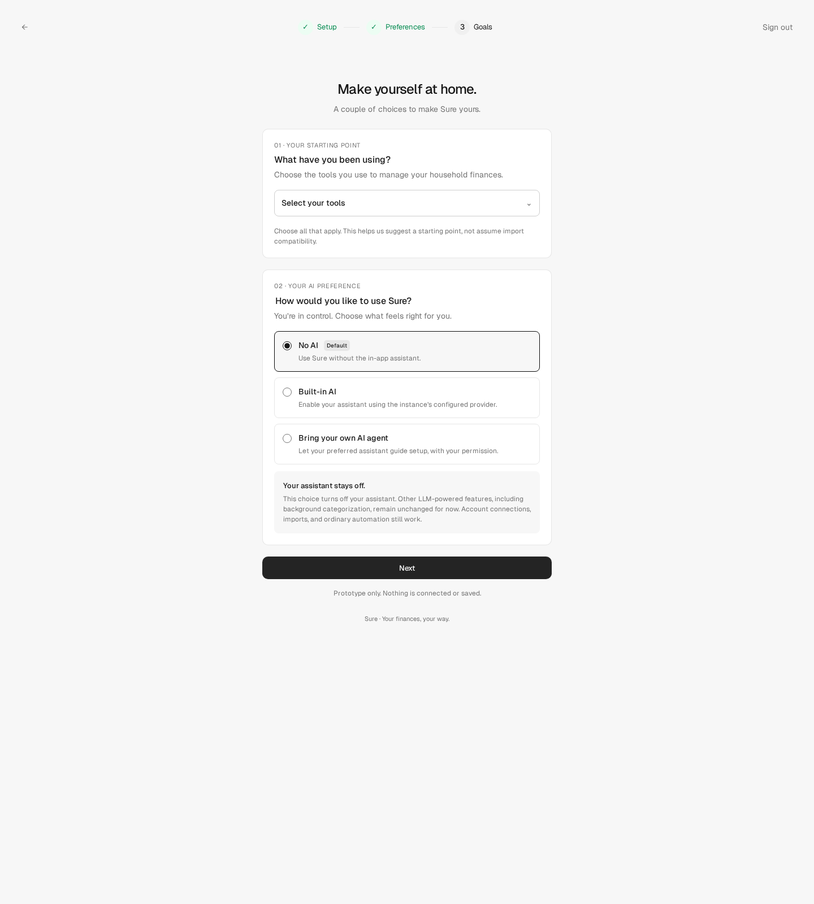

# Onboarding clickable prototype

This is the October 23, 2026 onboarding concept, revised after review to replace
the existing Goals step. It is a standalone HTML prototype with embedded styles
and JavaScript, plus a local `geist.woff2` font asset. It is not wired into the
application; the Rails implementation uses the existing wizard at
`/onboarding/goals`.

## Try it

Download [`index.html`](index.html) and [`geist.woff2`](geist.woff2) into the same
folder and open the HTML in a modern browser. No installation, Rails server,
account, or API key is needed. GitHub's file view
shows the source rather than running the prototype.

For a localhost preview, from the repository root run:

```sh
python3 -m http.server 8000 --bind 127.0.0.1 --directory docs/prototypes/onboarding
```

Then open `http://127.0.0.1:8000/`.

## Review the flow

- The header retains Setup → Preferences → Goals. The title is "Make yourself
  at home." Only "Your starting point" and "Your AI preference" remain.
- Choose previous finance tools, search the list, and try the exclusive
  "Nothing yet" option and optional Other tool name.
- Switch between No AI (the default), Built-in AI, and an external AI agent.
- Read each mode's conditional explanation. No AI turns off the current user's
  in-app assistant, not every LLM-powered feature. Built-in AI enables the user's
  assistant preference; existing instance/household settings still determine
  availability and type. This step does not configure or validate a provider.
- Copy the proposed external-agent instructions. Selecting this mode does not
  connect an agent or grant access, and leaves the in-app assistant off.
- Click Next repeatedly, or try Back and Sign out. These buttons show preview
  status messages only. The Rails form uses the existing completion/navigation
  paths. There is no transaction column, connect/import modal, or optional goals
  question.

Nothing is connected, uploaded, or persisted. Do not enter real credentials or
financial data. The listed products and provider options illustrate the design;
they do not promise importer compatibility or supported integrations.

Related future work: [control-plane onboarding](https://github.com/we-promise/sure/issues/4573)
and [onboarding playbooks](https://github.com/we-promise/sure/issues/4574).
[Remaining No AI enforcement](https://github.com/we-promise/sure/issues/4779)
tracks LLM-powered features beyond the assistant.

## Scope

This directory is review material only. It loads its local font asset but makes
no external network or storage calls.
The accompanying Rails changes persist choices and capture the first family's
AI-mode response as anonymized stated intent under existing telemetry controls;
they do not add transaction onboarding, provider credential entry, or agent
authorization. This prototype itself sends no analytics.

## Static preview

The screenshot below shows the standalone concept, not the rendered Rails page.


