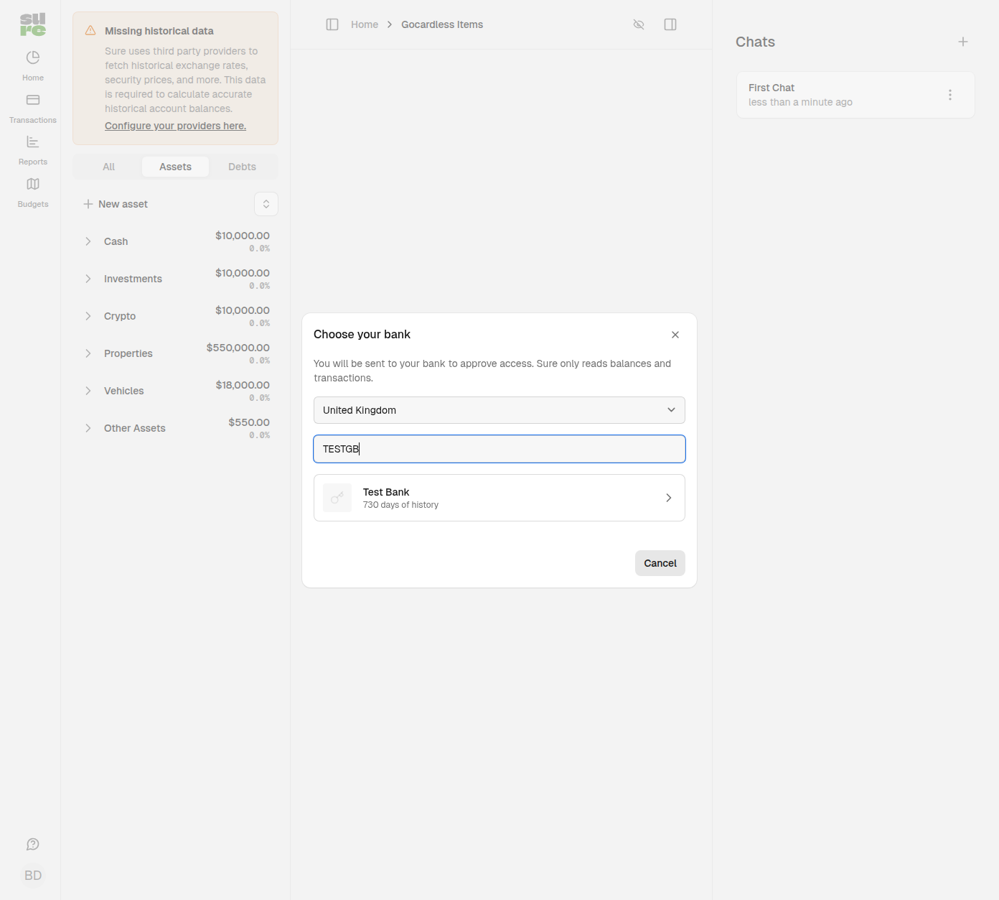

# GoCardless Bank Account Data

GoCardless imports bank balances and transactions using existing Bank Account Data
credentials. Availability depends on the institution and country returned by the API.
The provider has been exercised against NatWest in the UK; other institutions need
verification. This is an alpha integration.

The main use case is migration from Actual Budget: users who already sync banks
through GoCardless can reuse their existing Bank Account Data credentials in Sure.
This preserves a route to bank sync for grandfathered credential holders. It does
not import the Actual Budget ledger, categories or account-linking state.

## Configure and connect

1. In Settings > Providers > GoCardless, enter your Bank Account Data Secret ID and
   Secret Key. A GoCardless merchant account is a separate product.
2. Add a bank account, select GoCardless, choose a country and institution, and
   authorise read-only access on the bank's consent page.
3. Return to Sure, wait for the background import, then select account types in
   the account setup dialog. Existing Sure accounts can also be linked.

Only family administrators can configure credentials, start consent or link accounts.
Credentials follow Sure's optional Active Record encryption configuration. Without
configured encryption, the database stores credentials in plaintext.

This integration needs existing Bank Account Data access. Do not assume a new account
can obtain API credentials; check availability with GoCardless before deployment.

## Sync behavior

- Access tokens are cached by a digest of both credentials. A 401 triggers one token
  refresh and retry; repeated 401s and 403s mark a connection as requiring an update.
- Account endpoint quotas are small. A 429 leaves existing accounts intact and the
  next sync can retry. An account fetch failure never treats that account as removed
  from the requisition.
- Transaction amounts are negated to match Sure's outflow-positive convention.
  ISO 20022 card/loan balances are normalised once to positive debt; overpaid cards
  remain negative liabilities.
- Default history is 90 days. A configured sync start date overrides this. Subsequent
  imports overlap the previous sync by seven days and deduplicate stable bank IDs.
- Booked and pending transactions carry metadata under `extra["gocardless"]`.

## Current limitations

- Consent renewal is not implemented. Once bank access expires, a new consent must
  be created manually. Automatic reuse of existing account links needs further work.
- Pending-to-booked reconciliation needs verification for banks that omit stable
  transaction IDs. Surrogate IDs can leave a pending copy alongside a booked entry.
- Country selection currently lists 15 countries rather than discovering all supported
  countries dynamically.
- Abandoned consents are not automatically removed. Deleting a local connection does
  not revoke its bank consent; use the bank or GoCardless portal to revoke access.

## Database changes

The additive migration creates `gocardless_items` and `gocardless_accounts`, with UUID
keys, family ownership and foreign keys. Existing providers and account data are retained.
Rolling back drops these provider tables. Unlink or export affected accounts before
removing an integration in use.
